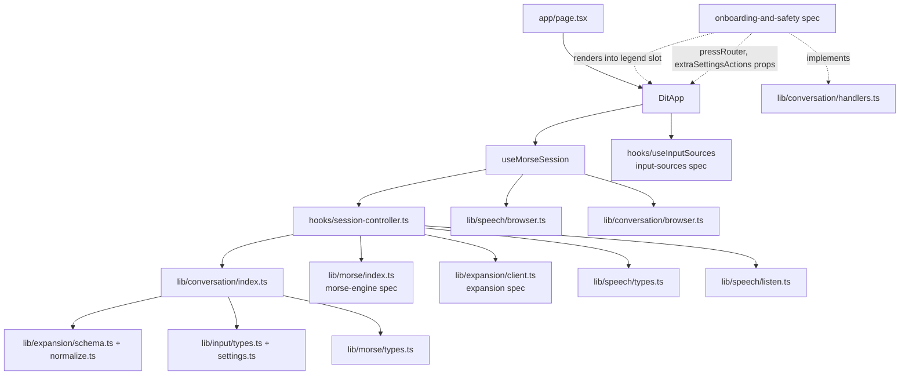
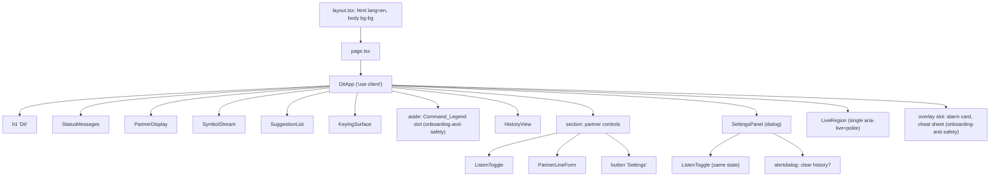
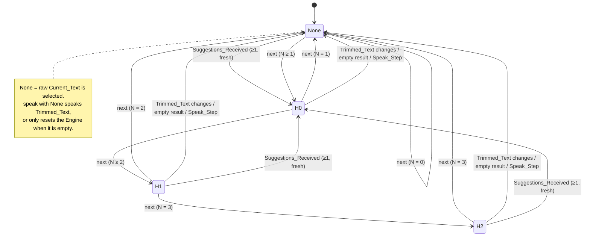
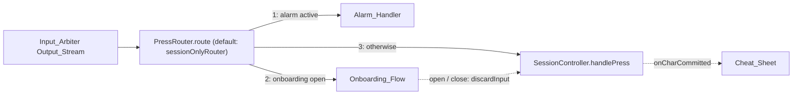

# Design Document: conversation-ui

## Overview

Conversation UI is what the speaker and the partner see and hear. It takes Press_Events from the Input_Arbiter, drives the Morse Engine, turns Engine_Events into typed text through a pure Session_Reducer, asks the expansion Client for up to 3 suggestions, speaks the chosen sentence, keeps a conversation history in localStorage, and gives the partner a large display, a Listen toggle, a typed-line field and a settings dialog.

The design follows the project rule "pure core, thin shell":

- **Pure core** (`src/lib/conversation/`, `src/lib/speech/listen.ts`): the Session_Reducer, the Live_Region announcement throttler, the settings validator and the Zod-validated Storage. No React, no DOM, no clock. Every rule in Requirements 1 to 7, 12 and 16 is decided here and checked by fast-check.
- **Controller** (`src/hooks/session-controller.ts`): a framework-free object that owns the Engine, the Tick_Timer, the effect runner, the alarm routing and the Client calls. Clock, scheduler, Engine factory, Client, speech, storage and alarm are injected, so a model-based fast-check test drives it with a fake clock (Requirement 8, 9, 23.4).
- **Thin shell** (`src/hooks/useMorseSession.ts`, `src/components/`, `src/lib/*/browser.ts`): React wiring, Web Speech and localStorage adapters, and accessible components.

### Sources

- `docs/BRIEF.md` and `.kiro/steering/` (`product.md`, `accessibility.md`, `tech.md`, `structure.md`).
- Sibling designs: `.kiro/specs/morse-engine/design.md` (`Engine`, `EngineEvent`, `EngineConfig`, `createEngine`, `Estimates`), `.kiro/specs/input-sources/design.md` (`PressEvent`, `SourceStatus`, `Clock`, `Scheduler`, `safeTickTime`, `SettingsStore`, `InputSettings`, `useInputSources`), `.kiro/specs/expansion/design.md` (`Turn`, `TurnSchema`, `trimWhitespace`, `ExpansionResult`, `ExpansionClient`, `createExpansionClient`, `CONTEXT_MAX_TURNS`).
- WCAG 2.2: [contrast minimum 1.4.3](https://www.w3.org/WAI/WCAG22/Understanding/contrast-minimum), [non-text contrast 1.4.11](https://www.w3.org/WAI/WCAG22/Understanding/non-text-contrast), [reflow 1.4.10](https://www.w3.org/WAI/WCAG22/Understanding/reflow), [three flashes 2.3.1](https://www.w3.org/WAI/WCAG22/Understanding/three-flashes-or-below-threshold). Relative luminance and contrast ratio use the WCAG formula; the values in the token table were computed with it.
- Web Speech API on MDN: [`SpeechSynthesis`](https://developer.mozilla.org/en-US/docs/Web/API/SpeechSynthesis) (`cancel()`, `getVoices()`, `voiceschanged`), [`SpeechSynthesisErrorEvent.error`](https://developer.mozilla.org/en-US/docs/Web/API/SpeechSynthesisErrorEvent/error) (`interrupted` and `canceled` are reported when an utterance is cut off by `cancel()` or a new `speak()`), [`SpeechRecognition`](https://developer.mozilla.org/en-US/docs/Web/API/SpeechRecognition) and [`SpeechRecognitionErrorEvent.error`](https://developer.mozilla.org/en-US/docs/Web/API/SpeechRecognitionErrorEvent/error) (`not-allowed`, `service-not-allowed`, `audio-capture`, `no-speech`, `aborted`, `network`, …). Recognition stops on its own after silence even with `continuous = true`, which is why Listen restarts on `end`.
- [`<dialog>` and `showModal()`](https://developer.mozilla.org/en-US/docs/Web/HTML/Element/dialog): native modal, `cancel` event on Escape, top layer; it does not wrap Tab inside the dialog in every browser, so the panel adds its own wrap (Req 20.7).
- React 19 [`useSyncExternalStore`](https://react.dev/reference/react/useSyncExternalStore) for subscribing components to the controller snapshot.
- Tailwind CSS v4 [`@theme`](https://tailwindcss.com/docs/theme) tokens in `globals.css`; CSS [container query units](https://developer.mozilla.org/en-US/docs/Web/CSS/CSS_containment/Container_size_and_style_queries) (`cqi`) for the Symbol_Stream size.

### Key design decisions

| Decision | Choice | Why |
| --- | --- | --- |
| Where session rules live | One pure `reduce(state, action)` returning `{ state, effects }` | Req 7 demands purity and determinism; effects as data let the controller run them in order (Req 5.7, 8.8) and let tests assert them without fakes. |
| Where timers live | A framework-free `SessionController` in `src/hooks/session-controller.ts`, wrapped by a thin React hook | The single-timer and pending-press rules (Req 8.3–8.6) need a model-based test with a fake clock. Keeping them out of React avoids `act()` noise and runs in the `node` environment. The file lives under `src/hooks/` because it has side effects, which `src/lib/conversation/` must not. |
| Live_Region throttle | Pure `live-queue.ts` state machine; controller schedules its `nextDueAt` | Req 12.2–12.6 timing is testable with plain numbers. |
| Typed-character detection for announcements | Pure diff of Current_Text before and after each action | Req 12.1 needs "a character was appended"; the Session_Effect union is fixed by the requirements, so the controller derives it instead of adding an effect. |
| Clearing history in storage | Write an empty History_Record | Satisfies Req 16.2 ("write an empty record") and Req 15.5 ("remove the History_Record": no Turns survive) with one code path. |
| Settings_Record validation | Strict schema for the partner fields; per-value `.catch(default)` for Input_Layer values | Req 16.7 replaces the whole record when a partner field is invalid; Req 16.11 replaces only the bad Input_Layer value. |
| Settings dialog | Native `<dialog>` opened with `showModal()`, explicit `aria-modal="true"`, own Tab wrap | Native semantics and Escape (`cancel` event) plus the exact trap Req 20.7 asks for. |
| Clear-history confirmation | A nested `role="alertdialog"` inside the Settings_Panel; either choice closes the panel | Req 21.5 sends focus to the Keying_Surface, which is outside the modal, so the panel must close. |
| Speech echo guard | Discard final transcripts while `SpeechOutput.isSpeaking()` | Req 18.7, simplest rule that does not depend on recognition timing. |
| Sibling plug-ins | `AlarmHandler`, `UnknownPatternHandler` interfaces and a `legend` slot prop on `DitApp` | `onboarding-and-safety` implements them without touching this spec's code. |
| Onboarding integration | Optional `pressRouter` and `extraSettingsActions` props, `SourceControl` in context, `discardInput()` and `onCharCommitted` on the controller | Each one defaults to today's behaviour when unused, so this spec's tests and properties keep passing unchanged (see "Integration points for onboarding-and-safety"). |

## Architecture

### Module layout

```
src/
├── app/
│   ├── layout.tsx                 # <html lang="en" class="dark">, fonts, metadata, globals.css
│   ├── page.tsx                   # server component; renders <DitApp …sibling plug-ins/>
│   └── globals.css                # Tailwind v4 @import + @theme tokens, reduced-motion rules
├── lib/
│   ├── conversation/
│   │   ├── types.ts               # SessionState, SessionAction, SessionEffect, SessionTurn
│   │   ├── session.ts             # INITIAL_SESSION, reduce(), contextWindow(), trimmedText()
│   │   ├── live-queue.ts          # announcement throttler + announcementsFor() diff
│   │   ├── settings.ts            # SettingsRecord type + Zod schema, defaults, validateSettingsPatch()
│   │   ├── storage.ts             # createConversationStorage(backend): History/Settings + SettingsStore
│   │   ├── handlers.ts            # AlarmHandler, UnknownPatternHandler, PressRouter, SourceControl + inert stubs
│   │   ├── browser.ts             # localStorageBackend() (only file here that touches a global)
│   │   ├── test-support.ts        # fast-check arbitraries (not re-exported)
│   │   └── index.ts               # public barrel
│   └── speech/
│       ├── types.ts               # SpeechOutput, SpeechInput, VoiceInfo, outcomes
│       ├── listen.ts              # pure Listen state machine (Req 18)
│       ├── browser.ts             # webSpeechOutput(), webSpeechInput() adapters
│       ├── fakes.ts               # FakeSpeechOutput, FakeSpeechInput for tests
│       └── index.ts
├── hooks/
│   ├── session-controller.ts      # createSessionController(deps): Engine, Tick_Timer, effects, alarm, Client
│   └── useMorseSession.ts         # React hook: builds deps, useSyncExternalStore over the controller
└── components/
    ├── DitApp.tsx                 # 'use client' root; layout grid; legend slot; focus helper
    ├── KeyingSurface.tsx
    ├── SymbolStream.tsx
    ├── SuggestionList.tsx
    ├── PartnerDisplay.tsx
    ├── HistoryView.tsx
    ├── PartnerLineForm.tsx
    ├── ListenToggle.tsx
    ├── SettingsPanel.tsx
    ├── LiveRegion.tsx
    └── StatusMessages.tsx
```

Tests sit beside each file (`session.test.ts`, `session.prop.test.ts`, `KeyingSurface.test.tsx`, …).

### Dependency graph



`src/lib/conversation/**` imports only types and pure helpers from `@/lib/morse`, `@/lib/input` and `@/lib/expansion` (schema and normalize, never `client.ts`), plus `zod`. It imports nothing from `react`, `next`, `src/components` or `src/hooks` (Req 7.6); an ESLint `no-restricted-imports` rule scoped to `src/lib/**` enforces this.

### Component tree



### Runtime flow: press → engine → reducer → effects

The controller is the only caller of the Engine. One Tick_Timer handle exists at any time. Every Engine call, `reset()` or Engine replacement ends with `reschedule()`.

```mermaid
sequenceDiagram
  autonumber
  participant Arb as Input_Arbiter (useInputSources)
  participant C as SessionController
  participant Al as AlarmHandler
  participant E as Engine
  participant R as reduce()
  participant FX as Effect runner
  participant T as Scheduler (Tick_Timer)

  Arb->>C: handlePress({kind:'down', t})
  alt alarm active
    C->>Al: handlePress(event)
  else alarm inactive
    C->>E: press(t)
    E-->>C: events[]
    loop each Engine_Event, in order
      C->>R: reduce(state, {type:'engine', event})
      R-->>C: {state', effects[]}
      C->>C: commit state', persist Turns if changed, Client.update if needed, queue announcements
      loop each effect, in order
        C->>FX: run(effect)
        Note over FX: 'speak' → SpeechOutput.speak<br/>'reset-engine' → E.reset()<br/>'alarm' → Al.start() (try/catch), E.reset(), cancel timer<br/>'unknown' → UnknownPatternHandler.handle(pattern)
      end
    end
    C->>T: reschedule(): cancel timer; d = E.nextDeadline()
    opt d is a number
      C->>T: schedule(max(0, d − clock()), fire(d))
    end
  end

  T-->>C: fire(deadline)
  C->>Arb: pendingSince()
  alt pending ≠ null and pending < deadline
    Note over C: pending-press guard: no tick
    C->>T: schedule(50 ms, fire(deadline))
  else no blocking pending press
    C->>E: tick(safeTickTime(clock(), pending))
    E-->>C: events[] (dispatched as above)
    C->>T: reschedule()
  end
```

`safeTickTime(now, pending)` from `input-sources` returns `min(now, pending)` or `now`, so `tick(t)` never passes a Raw_Down the arbiter still holds back (Req 8.4, 8.6). Because the timer fires at or after the deadline and the guard only lets through pending presses whose Raw_Down is at or after the deadline, the tick time is never below the deadline the Engine asked for.

### Highlight cycle

With N = 1 to 3 Suggestions, `next` walks 0 → 1 → … → N − 1 → none → 0. New non-empty Suggestions set Highlight to 0; a Trimmed_Text change, an empty result or a Speak_Step sets it to none.



### Screen layout

`DitApp` uses a CSS grid with named areas. All sizes are in `rem` or container units so text scales with the browser font size (Req 22.5).

| Viewport | Areas (top to bottom / left to right) |
| --- | --- |
| Width ≥ 1024 px, landscape | Left column (3fr): `status`, `display`, `stream`, `suggestions`, `keying`. Right column (2fr): `legend`, `history`, `partner`. |
| 768–1023 px or portrait tablet | One column: `status`, `display`, `stream`, `suggestions`, `keying`, `legend`, `history`, `partner`. `keying` has `min-height: 30vh` and `legend` sits directly below it so both fit at 768 × 1024. |
| < 768 px | Same single column; `keying` `min-height: 40vh`; history and partner controls scroll below. |

The Keying_Surface spans the full column width with `min-height: max(30vh, 12rem)`, which makes it larger than any other interactive element at every width (Req 10.1). Partner controls are at most `min(100%, 28rem)` wide and 3rem high. The `legend` area reserves `min-height: 7rem` and a full column width; the `onboarding-and-safety` spec must render the Command_Legend inside that box without scrolling at 768 × 1024 and 1024 × 768 (Req 22.7). A layout test at those two sizes checks that the legend box and the Keying_Surface box are both inside the viewport.

## Components and Interfaces

### lib/conversation/types.ts

```ts
import type { EngineEvent } from '@/lib/morse';
import type { ExpansionResult } from '@/lib/expansion/client';
import type { Role } from '@/lib/expansion/schema';

export const TEXT_MAX = 500;
export const HISTORY_CAP = 200;
export const CONTEXT_WINDOW = 10;           // equals CONTEXT_MAX_TURNS from expansion

export interface SessionTurn {
  readonly id: number;                      // unique, strictly increasing in Turns order
  readonly role: Role;                      // 'speaker' | 'partner'
  readonly text: string;                    // 1–500 chars, trimmed
}

export type SuggestionSource = 'ai' | 'on-device';

export interface SessionState {
  readonly currentText: string;             // 0–500 chars
  readonly currentPattern: string;          // '.' and '-' only
  readonly suggestions: readonly string[];  // 0–3
  readonly suggestionSource: SuggestionSource | null;  // null ⇔ suggestions empty
  readonly highlight: number | null;        // null = raw text; else 0..suggestions.length-1
  readonly turns: readonly SessionTurn[];   // oldest first, ≤ HISTORY_CAP
  readonly lastSpoken: string | null;
  readonly nextTurnId: number;              // > every ID ever issued in this state's history
}

/** Loose shape accepted by Hydrate; the reducer filters invalid entries (Req 6.6). */
export interface HydrateEntry {
  readonly role: string;
  readonly text: string;
}

export type SessionAction =
  | { readonly type: 'engine'; readonly event: EngineEvent }
  | { readonly type: 'suggestions'; readonly result: ExpansionResult }
  | { readonly type: 'partner-line'; readonly text: string }
  | { readonly type: 'partner-pick'; readonly index: number }
  | { readonly type: 'clear-history' }
  | { readonly type: 'hydrate'; readonly turns: readonly HydrateEntry[] };

export type SessionEffect =
  | { readonly type: 'speak'; readonly sentence: string }
  | { readonly type: 'reset-engine' }
  | { readonly type: 'alarm' }
  | { readonly type: 'unknown'; readonly pattern: string };

export interface Transition {
  readonly state: SessionState;
  readonly effects: readonly SessionEffect[];
}
```

### lib/conversation/session.ts

```ts
export const INITIAL_SESSION: SessionState; // all empty/null, nextTurnId 1

/** Pure, total, synchronous. Never mutates inputs; returns new objects only where fields change. */
export function reduce(state: SessionState, action: SessionAction): Transition;

/** trimWhitespace(currentText) from expansion/normalize (the 4 Whitespace chars only). */
export function trimmedText(state: SessionState): string;

/** Most recent ≤ 10 Turns, oldest first, as { role, text } without IDs (Req 6.7). */
export function contextWindow(turns: readonly SessionTurn[]): readonly { role: Role; text: string }[];
```

Transition rules, in the order `reduce` applies them. `P` is the input state and `clearSugg` means `suggestions = []`, `suggestionSource = null`, `highlight = null`.

| Action | Result |
| --- | --- |
| `engine/symbol` | `currentPattern += symbol`. Nothing else. No effects (Req 1.5). |
| `engine/char` | `currentPattern = ''`. If `currentText.length < 500`, append `char`. No effects (1.1, 1.2, 1.6). |
| `engine/space` | `currentPattern = ''`. Append `' '` only if text is non-empty, does not end with `' '` and is shorter than 500. No effects (1.3, 1.4). |
| `engine/unknown` | `currentPattern = ''`. Effects `[{unknown, pattern}]` (1.7). |
| `command/backspace` | `currentPattern = ''`; if text non-empty, drop the last UTF-16 code unit. No effects (2.1–2.3). |
| `command/next` | `currentPattern = ''`; if N ≥ 1: `null → 0`, `i < N−1 → i+1`, `N−1 → null`; if N = 0 stays `null`. No effects (3.6–3.8). |
| `command/speak` | `currentPattern = ''`. If `highlight` is an index: Speak_Step with `suggestions[highlight]`. Else if Trimmed_Text non-empty: Speak_Step with Trimmed_Text. Else effects `[{reset-engine}]` only (4.1–4.3). |
| `command/sos` | `currentPattern = ''`. Effects `[{alarm}]`. Nothing else changes (5.1, 5.2). |
| `suggestions` | If `result.text !== trimmedText(P)`: return `P` unchanged (3.3). Else if list empty: `clearSugg`. Else `suggestions = list.slice(0, 3)`, `suggestionSource = result.source`, `highlight = 0` (3.1, 3.2). |
| `partner-line` | `t = trimWhitespace(text)`; if empty return `P`; else append `{ role: 'partner', text: t.slice(0, 500) }` (6.1, 6.2). |
| `partner-pick` | If `Number.isInteger(index) && 0 ≤ index < N`: Speak_Step with `suggestions[index]`; else return `P` (4.4, 4.5). |
| `clear-history` | `turns = []`, `lastSpoken = null`, `nextTurnId` unchanged (6.5). |
| `hydrate` | Keep entries with role `speaker`/`partner` and non-empty trimmed text; take the newest 200; text = trimmed `.slice(0, 500)`; assign IDs `nextTurnId, nextTurnId+1, …`; `lastSpoken` = newest kept speaker text or `null` (6.6). |

After every rule that changes `currentText` (char, space, backspace), `reduce` compares `trimmedText` before and after: different → `clearSugg` (3.4); equal → suggestions kept (3.5).

**Speak_Step(sentence)**: `appendTurn('speaker', sentence)`, `lastSpoken = sentence`, `currentText = ''`, `currentPattern = ''`, `clearSugg`; effects `[{speak, sentence}, {reset-engine}]` (4.6–4.8).

**appendTurn(role, text)**: new turn `{ id: nextTurnId, role, text }`; `nextTurnId + 1`; `turns = [...turns, turn].slice(-200)` (4.9, 6.3, 6.4).

Spoken sentences from Suggestions are 1–200 characters (expansion `ExpandResponseSchema`) and a Trimmed_Text is 1–500 characters, so speaker Turns always satisfy the 1–500 text rule. A defensive `.slice(0, 500)` is still applied in `appendTurn` so a malformed `ExpansionResult` cannot break the turns invariant. Suggestion entries that are empty after trimming are dropped in the `suggestions` rule for the same reason (the expansion schema already forbids them).

### lib/conversation/live-queue.ts

```ts
export const ANNOUNCE_INTERVAL_MS = 1_000;

export type LiveItem =
  | { readonly kind: 'char'; readonly text: string }        // the char, or 'space'
  | { readonly kind: 'suggestions'; readonly text: string }; // "2 suggestions. Highlighted: I am thirsty."

export interface LiveQueueState {
  readonly lastAnnouncedAt: number | null;   // Clock time of the last announcement start
  readonly heldChars: readonly string[];     // in commit order
  readonly heldSuggestions: string | null;   // at most one, newest wins (Req 12.6)
}
export const INITIAL_LIVE_QUEUE: LiveQueueState;

export interface LiveStep {
  readonly state: LiveQueueState;
  readonly announce: string | null;   // text to put in the Live_Region now
  readonly nextDueAt: number | null;  // when to call flush(), or null when nothing is held
}

/** Queue an item at time `now`. Announces at once if nothing was announced in the last 1,000 ms (Req 12.3). */
export function enqueue(s: LiveQueueState, item: LiveItem, now: number): LiveStep;
/** Called by the controller timer at or after nextDueAt. Announces all held items as one string. */
export function flush(s: LiveQueueState, now: number): LiveStep;

/** Joined announcement: held chars first, comma-separated, then the suggestions item. */
export function joinItems(chars: readonly string[], suggestions: string | null): string;

/** Pure diff that decides what an action adds to the queue (Req 12.1, 12.5, 12.7). */
export function announcementsFor(
  prev: SessionState, next: SessionState, action: SessionAction,
): readonly LiveItem[];
export function suggestionsItemText(suggestions: readonly string[], highlight: number | null): string;
```

`announcementsFor` rules:

- Hydrate, `symbol` and `unknown` actions return `[]` (12.7).
- If `next.currentText === prev.currentText + c` for one character `c`, return a `char` item: `c`, or `"space"` when `c === ' '` (12.1).
- If the action is `suggestions` and `next.suggestions` is non-empty and differs from `prev.suggestions` (or the source or highlight differs), add one `suggestions` item. A list that becomes empty adds nothing (12.5, 12.7).

`suggestionsItemText` returns `"1 suggestion"` or `"N suggestions"`, followed by `". Highlighted: <text>"` when `highlight` is an index.

Timing: `enqueue` at `now` announces immediately when `lastAnnouncedAt === null || now − lastAnnouncedAt ≥ 1000` (the controller writes it in the same task, well within 100 ms). Otherwise it holds the item and returns `nextDueAt = lastAnnouncedAt + 1000`. `flush` announces `joinItems(heldChars, heldSuggestions)` and sets `lastAnnouncedAt = now`.

### lib/conversation/settings.ts

```ts
import { z } from 'zod';
import { DEFAULT_INPUT_SETTINGS, type InputSettings } from '@/lib/input';

export const RATE_MIN = 0.5, RATE_MAX = 2.0, RATE_DEFAULT = 1.0;
export const WPM_MIN = 2, WPM_MAX = 20, WPM_DEFAULT = 6;

export interface SettingsRecord {
  readonly v: 1;
  readonly voiceURI: string | null;          // null = browser default voice
  readonly speechRate: number;               // 0.5–2.0
  readonly flip: boolean;
  readonly startingWpm: number;              // 2–20
  readonly adaptive: boolean;                // true = Adaptive_Mode, false = Fixed_Speed_Mode
  readonly switchKey: unknown;               // raw; validated by input-sources validateSwitchKey on read
  readonly input: InputSettings;             // min press durations, blink thresholds
}

export const DEFAULT_SETTINGS: SettingsRecord; // voiceURI null, 1.0, false, 6, true, null, DEFAULT_INPUT_SETTINGS

/** Partner fields strict (whole record falls back on failure, Req 16.7);
 *  Input_Layer fields per-value .catch(default) (Req 16.11). */
export const SettingsRecordSchema = z.object({
  v: z.literal(1),
  voiceURI: z.string().min(1).nullable(),
  speechRate: z.number().finite().min(RATE_MIN).max(RATE_MAX),
  flip: z.boolean(),
  startingWpm: z.number().finite().min(WPM_MIN).max(WPM_MAX),
  adaptive: z.boolean(),
  switchKey: z.unknown().catch(null),
  input: InputSettingsSchema,   // see below
});

/** Each value checked with input-sources validateMinPressDuration / validateThresholds;
 *  an invalid value becomes its default, the others are kept. */
export const InputSettingsSchema: z.ZodType<InputSettings>;

export type SettingsPatch = Partial<Pick<SettingsRecord,
  'voiceURI' | 'speechRate' | 'flip' | 'startingWpm' | 'adaptive'>>;

export type PatchError =
  | { readonly field: 'speechRate'; readonly value: unknown; readonly message: string }
  | { readonly field: 'startingWpm'; readonly value: unknown; readonly message: 'Enter a number from 2 to 20.' }
  | { readonly field: 'voiceURI'; readonly value: unknown; readonly message: string };

/** Pure: returns the merged record, or the errors and no change (Req 17.9, 20.6). */
export function validateSettingsPatch(
  current: SettingsRecord, patch: unknown,
): Result<SettingsRecord, readonly PatchError[]>;

/** Engine config from settings plus optional calibrated estimates. */
export function engineConfigOf(s: SettingsRecord, initial: Estimates | null): EngineConfig;
```

Starting_WPM accepts any finite number in 2–20, matching the Engine's own validation; the number field uses `step="1"` but does not reject decimals, since the Engine accepts them.

### lib/conversation/storage.ts

```ts
export const HISTORY_KEY = 'dit:history:v1';
export const SETTINGS_KEY = 'dit:settings:v1';

export interface KeyValueBackend {           // localStorage shape; may throw
  getItem(key: string): string | null;
  setItem(key: string, value: string): void;
  removeItem(key: string): void;
}

export interface HistoryRecord {
  readonly v: 1;
  readonly turns: readonly { readonly role: Role; readonly text: string }[];  // TurnSchema entries
}
export const HistoryRecordSchema: z.ZodType<HistoryRecord>; // turns: z.array(TurnSchema); trims to newest 200 (Req 16.6)

export interface StorageError { readonly op: 'read' | 'write'; readonly record: 'history' | 'settings'; readonly message: string }

export interface ConversationStorage extends SettingsStore {   // SettingsStore from input-sources (Req 16.11)
  /** Never throws. Missing, bad JSON or schema failure → empty history (Req 16.4, 16.7). */
  loadHistory(): { readonly record: HistoryRecord; readonly error: StorageError | null };
  /** Never throws. Missing, bad JSON or schema failure → DEFAULT_SETTINGS (Req 16.4, 16.7). */
  loadSettings(): { readonly record: SettingsRecord; readonly error: StorageError | null };
  saveHistory(turns: readonly SessionTurn[]): Result<void, StorageError>;   // strips IDs
  saveSettings(record: SettingsRecord): Result<void, StorageError>;
  /** Current in-memory settings (last loaded or saved). */
  settings(): SettingsRecord;
}

export function createConversationStorage(backend: KeyValueBackend): ConversationStorage;
```

- `loadHistory` / `loadSettings`: `getItem` inside try/catch → `JSON.parse` inside try/catch → `safeParse`. Any failure yields the empty or default record for that record alone. A throwing `getItem` yields `error: { op: 'read', … }`; a missing, unparsable or invalid value yields `error: null` (nothing for the partner to act on).
- `saveHistory` / `saveSettings`: `JSON.stringify` then `setItem` inside try/catch; a throw returns `{ ok: false }` and leaves the in-memory record unchanged (Req 16.8). Clear_History calls `saveHistory([])`.
- `SettingsStore` methods (`readSwitchKey`, `writeSwitchKey`, `clearSwitchKey`) read and write `switchKey` inside the same Settings_Record. `readSwitchKey` returns the raw value; `input-sources` validates it with `validateSwitchKey`, which returns `null` (the default) for anything invalid.
- The Input_Layer settings (`InputSettings`) are written through `saveSettings` by the controller when the Input_Layer reports a change; `useInputSources` receives them as its `settings` option.

`src/lib/conversation/browser.ts` exports `localStorageBackend(): KeyValueBackend | null`, which returns `null` when `window.localStorage` access throws (disabled storage). The hook then uses an in-memory backend and reports one save-failure message (Req 16.9).

### lib/conversation/handlers.ts (plug-in interfaces for onboarding-and-safety)

```ts
import type { PressEvent, SourceKind, SourceStatus, SwitchLearner, Unsubscribe } from '@/lib/input';

/** Implemented by onboarding-and-safety. All methods synchronous. */
export interface AlarmHandler {
  /** Start the SOS alarm (card + chime). Called synchronously from the effect runner; may throw. */
  start(): void;
  /** True from start() until the alarm is dismissed. */
  isActive(): boolean;
  /** Receives every Press_Event while isActive() is true (Req 8.10). */
  handlePress(event: PressEvent): void;
  /** Fires when isActive() changes, so the controller can resume Engine scheduling. */
  onActiveChange(listener: (active: boolean) => void): Unsubscribe;
}

/** Implemented by onboarding-and-safety (for example a brief "not a code" hint). */
export interface UnknownPatternHandler {
  handle(pattern: string): void;
}

/** Inert stubs used only until onboarding-and-safety lands; not used in production builds once it does. */
export function inertAlarmHandler(): AlarmHandler;           // isActive() always false; start() no-op
export function inertUnknownPatternHandler(): UnknownPatternHandler;

// ---- Integration points for onboarding-and-safety (additive; see "Integration points" below) ----

/** What DitApp hands to a Press_Router: the session's press entry point and its discard hook. */
export interface SessionPressTarget {
  /** SessionController.handlePress, unchanged. */
  handlePress(event: PressEvent): void;
  /** SessionController.discardInput: empty the Pattern_Buffer, forget an unmatched down, cancel the Tick_Timer. */
  discardInput(): void;
}

/** Implemented by onboarding-and-safety. Sits between the Input_Arbiter Output_Stream and the Session_Controller. */
export interface PressRouter {
  /** Called once by DitApp after the controller exists; the returned function disconnects (unmount). */
  connect(session: SessionPressTarget): Unsubscribe;
  /** Receives every Press_Event from the Output_Stream, in order, synchronously. Delivers it to at most one consumer. */
  route(event: PressEvent): void;
}

/** Default when DitApp gets no pressRouter: every event goes to session.handlePress, as today. */
export function sessionOnlyRouter(): PressRouter;

/** Enabled flags passed to useInputSources. Blink starts only from a user action (input-sources Req 9.1). */
export type EnabledSources = Readonly<Record<SourceKind, boolean>>;
export const DEFAULT_ENABLED_SOURCES: EnabledSources;   // { keyboard: true, switch: true, pointer: true, blink: false }

/** Runtime control over Press_Sources, provided by DitApp through SessionApiContext. */
export interface SourceControl {
  enabled(): EnabledSources;
  statuses(): Readonly<Record<SourceKind, SourceStatus>>;   // useInputSources().statuses
  /** Keyboard, switch or pointer on or off. */
  setEnabled(kind: Exclude<SourceKind, 'blink'>, on: boolean): void;
  /** Call only synchronously from a click, keydown or pointerdown handler. Starts, or retries from a failure status. */
  startBlink(): void;
  stopBlink(): void;
  /** Replace all four flags at once (used to restore a snapshot on "Cancel setup"). */
  restore(flags: EnabledSources): void;
  onChange(listener: () => void): Unsubscribe;   // enabled flags or statuses changed
}

/** Learner used by the no-op SessionApiContext: never arms; arm() and clear() return failed Results with message "not available". */
export function unavailableLearner(): SwitchLearner;
// arm()     → Promise.resolve(err({ reason: 'cancelled', message: 'not available' }))
// cancel()  → no-op; isArmed() → false
// clear()   → err({ reason: 'save-failed', message: 'not available' })
```

The controller treats `start()` as the moment the alarm becomes active for routing: it calls `start()`, then resets the Engine and cancels the Tick_Timer whatever `isActive()` returns, so a throwing or slow handler cannot leave a pending deadline (Req 5.5, 8.11). Routing of later presses uses `isActive()`.

### lib/speech/types.ts

```ts
export interface VoiceInfo {
  readonly uri: string;        // SpeechSynthesisVoice.voiceURI
  readonly name: string;
  readonly lang: string;
  readonly isDefault: boolean;
}

export type UtteranceOutcome = 'done' | 'error' | 'cancelled';

export interface SpeechOutput {
  isSupported(): boolean;
  voices(): readonly VoiceInfo[];
  onVoicesChanged(listener: (voices: readonly VoiceInfo[]) => void): Unsubscribe;
  /** Cancels any utterance in progress, then speaks once. Unknown voiceURI → browser default (Req 17.1, 17.2).
   *  onEnd fires once: 'cancelled' when cut off by cancel() or a newer speak(). */
  speak(sentence: string, opts: { readonly voiceURI: string | null; readonly rate: number },
        onEnd: (outcome: UtteranceOutcome) => void): void;
  isSpeaking(): boolean;
  cancel(): void;
}

export type RecognitionError =
  | 'permission-denied'   // not-allowed, service-not-allowed
  | 'no-microphone'       // audio-capture
  | 'no-speech'
  | 'aborted'
  | 'other';              // network, language-not-supported, bad-grammar, start() throwing, …

export interface SpeechInput {
  isSupported(): boolean;
  /** Starts recognition (continuous, interimResults). Returns a failed Result if start() throws. */
  start(): Result<void, RecognitionError>;
  stop(): void;
  onInterim(listener: (text: string) => void): Unsubscribe;
  onFinal(listener: (text: string) => void): Unsubscribe;
  onError(listener: (error: RecognitionError) => void): Unsubscribe;
  onEnd(listener: () => void): Unsubscribe;
}
```

`browser.ts` adapters:

- `webSpeechOutput(win)`: `isSupported` checks `'speechSynthesis' in win`. `voices()` maps `getVoices()`. `onVoicesChanged` listens to `voiceschanged` and also polls `getVoices()` once 250 ms after subscribe, because some engines fill the list without firing the event (keeps Req 17.7's 1 s bound). `speak` calls `speechSynthesis.cancel()`, builds an utterance with `rate` and the matching voice (or none), and maps `end` → `'done'`, `error` with `interrupted`/`canceled` → `'cancelled'`, other `error` → `'error'`. A per-utterance guard makes `onEnd` fire once.
- `webSpeechInput(win)`: uses `SpeechRecognition ?? webkitSpeechRecognition`, `continuous = true`, `interimResults = true`, `lang = document.documentElement.lang || 'en'`. It maps results to interim or final text and error codes to `RecognitionError`.

### lib/speech/listen.ts (pure Listen state machine)

```ts
export type ListenMessage =
  | 'unsupported'          // "Listening is not supported in this browser. Type your line instead."
  | 'permission-denied'    // "Microphone permission was denied. …"
  | 'no-microphone'        // "No microphone was found. …"
  | 'stopped';             // "Listening stopped. Turn Listen on again or type a line."

export interface ListenState {
  readonly supported: boolean;
  readonly on: boolean;            // Listen_Toggle checked state; false at load (Req 18.10)
  readonly interim: string;        // most recent interim transcript only (Req 18.6)
  readonly message: ListenMessage | null;
}

export type ListenInput =
  | { readonly type: 'toggle'; readonly on: boolean }
  | { readonly type: 'start-failed' }
  | { readonly type: 'interim'; readonly text: string }
  | { readonly type: 'final' }
  | { readonly type: 'error'; readonly error: RecognitionError }
  | { readonly type: 'end' };

export type ListenCommand = 'start' | 'stop' | 'restart-later' | null;

export function initialListen(supported: boolean): ListenState;
export function listenStep(s: ListenState, input: ListenInput): { state: ListenState; command: ListenCommand };
```

| Input | Effect |
| --- | --- |
| `toggle on` (supported) | `on = true`, `message = null`, command `start` (18.3). Ignored when unsupported (18.2). |
| `toggle off` | `on = false`, `interim = ''`, command `stop` (18.12). |
| `interim` while on | `interim = text` (18.6). |
| `final` | `interim = ''` (18.4). Dispatching the Partner_Line is the controller's job. |
| `error permission-denied / no-microphone` | `on = false`, `interim = ''`, message set, command `stop`; no restart (18.8). |
| `error other` or `start-failed` | `on = false`, `interim = ''`, `message = 'stopped'`, command `stop` (18.11). |
| `error no-speech / aborted` | No change; the following `end` restarts (18.9). |
| `end` while on | command `restart-later` (controller restarts after 250 ms, within the 1,000 ms bound, 18.9). `end` while off: no command. |

### hooks/session-controller.ts

```ts
import type { Engine, EngineConfig, Estimates } from '@/lib/morse';
import type { Clock, Scheduler, PressEvent, SourceKind, SourceStatus, InputSettings } from '@/lib/input';
import type { ExpansionClient, ExpansionResult } from '@/lib/expansion/client';

export const PENDING_RETRY_MS = 50;
export const LISTEN_RESTART_MS = 250;

export interface ControllerDeps {
  readonly clock: Clock;
  readonly scheduler: Scheduler;
  readonly createEngine: (config: EngineConfig) => Engine;   // wraps createEngine; falls back to defaults on a failed Result
  readonly pendingSince: () => number | null;                // arbiter.pendingSince, read at fire time
  readonly createClient: (onResult: (r: ExpansionResult) => void) => ExpansionClient;
  readonly speechOutput: SpeechOutput;
  readonly speechInput: SpeechInput;
  readonly alarm: AlarmHandler;
  readonly unknownPattern: UnknownPatternHandler;
  readonly storage: ConversationStorage;
}

export type StatusMessage =
  | { readonly id: 'save-failed'; readonly text: 'History or settings could not be saved on this device.' }
  | { readonly id: 'no-voice'; readonly text: 'No voice is available on this device. The sentence is shown on the display.' }
  | { readonly id: 'speak-error'; readonly text: 'The sentence could not be spoken.' }
  | { readonly id: `source-${SourceKind}`; readonly text: string };   // "Blink input: camera permission denied."

export interface SessionSnapshot {
  readonly session: SessionState;
  readonly settings: SettingsRecord;
  readonly pressed: boolean;                 // last Press_Event kind was 'down' (any source, alarm or not)
  readonly alarmActive: boolean;
  readonly listen: ListenState;
  readonly voices: readonly VoiceInfo[];
  readonly announcement: { readonly seq: number; readonly text: string } | null;
  readonly messages: readonly StatusMessage[];   // one per id, insertion order
}

export interface SessionController {
  handlePress(event: PressEvent): void;
  partnerPick(index: number): void;
  partnerLine(text: string): void;
  clearHistory(): void;
  updateSettings(patch: SettingsPatch): Result<SettingsRecord, readonly PatchError[]>;
  updateInputSettings(input: InputSettings): void;
  setInitialEstimates(estimates: Estimates | null): void;    // from onboarding-and-safety calibration
  setListen(on: boolean): void;
  setSourceStatuses(statuses: Readonly<Record<SourceKind, SourceStatus>>): void;
  dismissMessage(id: StatusMessage['id']): void;
  /** Integration point: called by a Press_Router when presses start or stop going elsewhere (onboarding Req 12.10). */
  discardInput(): void;
  /** Integration point: fires once per `char` Engine_Event the session applies (onboarding Req 10.3). */
  onCharCommitted(listener: (char: string) => void): Unsubscribe;
  getSnapshot(): SessionSnapshot;            // same object until something changes
  subscribe(listener: () => void): Unsubscribe;
  dispose(): void;
}

export function createSessionController(deps: ControllerDeps): SessionController;
```

**Construction** (Req 16.4, 16.5, 17.10, 18.10): load settings and history from `storage`; push a save-failure message if either load reports a read error; build the Engine from `engineConfigOf(settings, null)`; dispatch one `hydrate` with the stored Turns before any press can arrive; create the Client; subscribe to `speechInput`, `speechOutput.onVoicesChanged` and `alarm.onActiveChange`; `listen = initialListen(speechInput.isSupported())`.

**`dispatch(action)`** (internal):

1. `{ state: next, effects } = reduce(prev, action)`; commit `next`.
2. If `next.turns !== prev.turns`: `storage.saveHistory(next.turns)`; on failure add the `save-failed` message (Req 16.1, 16.9).
3. Client rules (Req 9): `pt = trimmedText(prev)`, `nt = trimmedText(next)`. If `nt !== pt` → `client.update(nt, contextWindow(next.turns))` (covers `nt === ''`, Req 9.6). Else if a partner Turn was appended (`last(next.turns)?.id !== last(prev.turns)?.id` and its role is `partner`) and `nt !== ''` → `client.update(nt, contextWindow(next.turns))` (9.3). Otherwise no call (9.2, 9.4).
4. Queue `announcementsFor(prev, next, action)` into the live queue; schedule a flush timer for `nextDueAt` if one is returned and none is pending (separate from the Tick_Timer).
5. Run `effects` in order, each to completion before the next (Req 5.7, 8.8):
   - `speak`: clear `no-voice`/`speak-error` messages; if `!speechOutput.isSupported() || voices().length === 0` add `no-voice` and stop (17.3); else `speak(sentence, { voiceURI, rate }, onEnd)` where `onEnd('error')` adds `speak-error` and `'cancelled'` adds nothing (17.4, 17.5). The voice and rate are read from the current settings at this moment (17.8).
   - `reset-engine`: `engine.reset()`, then `reschedule()` (8.7).
   - `alarm`: `try { alarm.start() } catch {}`; `engine.reset()`; cancel the Tick_Timer; if `engineHeld`, set `withholdUp = true` (5.3–5.5, 8.11, 8.12). No await, no Client or speech call in this branch.
   - `unknown`: `unknownPattern.handle(pattern)` inside try/catch (5.6).
   - After the effects, if `action` is `{ type: 'engine', event: { type: 'char' } }`, call each `onCharCommitted` listener once with the character, each inside try/catch. This adds no effect and changes no state.
6. Notify subscribers once.

**`handlePress(e)`** (Req 8.1, 8.2, 8.10, 8.12, 8.14, 8.15, 10.3):

```
pressed = (e.kind === 'down'); notify
if e.kind === 'down': withholdUp = false     // the withheld up was dropped by a Press_Router; no-op without one
if e.kind === 'up' && withholdUp: withholdUp = false; return
if alarm.isActive(): alarm.handlePress(e); return
events = e.kind === 'down' ? engine.press(e.t) : engine.release(e.t)
engineHeld = (e.kind === 'down')
for ev of events: dispatch({ type: 'engine', event: ev })
if !alarm.isActive(): reschedule()
```

**`reschedule()`** (Req 8.3): cancel the Tick_Timer handle; if the alarm is active, stop (8.10); `d = engine.nextDeadline()`; if `d !== null`, `handle = scheduler.schedule(Math.max(0, d − clock()), () => fire(d))`.

**`fire(d)`** (Req 8.4, 8.5): `handle = null`; `p = pendingSince()`; if `p !== null && p < d` → `handle = scheduler.schedule(50, () => fire(d))`; else `events = engine.tick(safeTickTime(clock(), p))`, dispatch each, then `reschedule()`.

**Engine replacement** (Req 8.9, 8.15, 20.5): on a committed Starting_WPM or adaptation change, or `setInitialEstimates`, the controller cancels the Tick_Timer, sets `engine = createEngine(engineConfigOf(settings, estimates))`, moves `engineHeld` into `withholdUp`, and commits `{ ...state, currentPattern: '' }`. This and `discardInput()` (same `currentPattern: ''` write, see Integration points) are the only state writes outside `reduce`; both are covered by example tests. It then calls `reschedule()`.

**Alarm end**: `onActiveChange(false)` calls `reschedule()` so the Engine resumes (it was reset at alarm start, so `nextDeadline()` is normally `null`).

**Listen** (Req 18): `setListen(on)` feeds `listenStep`; command `start` calls `speechInput.start()` and feeds `start-failed` on a failed Result; `restart-later` schedules `start()` after 250 ms (cancelled by toggle off or dispose). `onFinal(text)`: discard when `!listen.on` (18.12) or `speechOutput.isSpeaking()` (18.7); otherwise `t = trimWhitespace(text)`, discard when empty (18.5), else `dispatch({ type: 'partner-line', text: t })` and `listenStep(final)`.

**Settings** (Req 14.7, 16.3, 17.8, 17.9, 20.5, 20.6, 20.10): `updateSettings(patch)` runs `validateSettingsPatch`. Failure → return errors, change nothing. Success → commit in memory, `storage.saveSettings` (failure adds `save-failed` but keeps the value), and replace the Engine when `startingWpm` changed or `adaptive` toggled.

**Source statuses** (Req 22.12, 22.13): `setSourceStatuses` adds a `source-<kind>` message for each status not in `{'off', 'active'}` and removes it when the status returns to one of those. The hook calls it from a `useEffect` on `useInputSources().statuses`, so the message appears in the next render.

**dispose** (Req 8.13): cancel Tick_Timer, flush timer and Listen restart timer; `client.dispose()`; unsubscribe speech, voices and alarm listeners; `speechInput.stop()`; drop every `onCharCommitted` listener; set a `disposed` flag that makes `handlePress`, `discardInput`, `fire` and Client callbacks no-ops.

### hooks/useMorseSession.ts

```ts
'use client';
export interface UseMorseSessionOptions {
  readonly alarm: AlarmHandler;
  readonly unknownPattern: UnknownPatternHandler;
  readonly pendingSince: () => number | null;     // from useInputSources
  readonly clock: Clock;                          // from useInputSources (performance.now base)
  /** Test seam: replaces browser adapters. */
  readonly overrides?: Partial<Pick<ControllerDeps,
    'scheduler' | 'createEngine' | 'createClient' | 'speechOutput' | 'speechInput' | 'storage'>>;
}
export function useMorseSession(opts: UseMorseSessionOptions): {
  readonly snapshot: SessionSnapshot;
  readonly controller: SessionController;
};
```

- Creates the controller once per mount with `useRef` lazy init; disposes it in the effect cleanup (React strict mode double-mount is handled by creating in the effect and reading through `useSyncExternalStore` with a stable `getSnapshot`).
- Default deps: `browserScheduler`, `createEngine` from `@/lib/morse`, `createExpansionClient` with `fetch`, `window.setTimeout`, `navigator.onLine` and `expandOnDevice`, `webSpeechOutput(window)`, `webSpeechInput(window)`, `createConversationStorage(localStorageBackend() ?? memoryBackend())`.
- `pendingSince` and `alarm` are passed through refs so a changing callback never rebuilds the controller.

### Components

All components are function components with named exports. Only `DitApp` carries `'use client'`; children are imported by it, so they are client components without their own directive.

| Component | Props | Semantics and behavior |
| --- | --- | --- |
| `DitApp` | `{ alarm?: AlarmHandler; unknownPattern?: UnknownPatternHandler; legend?: ReactNode; overlay?: ReactNode; pressRouter?: PressRouter; extraSettingsActions?: (api: { closeSettings(opts?: { focusKeyingSurface?: boolean }): void }) => ReactNode }` | Calls `useInputSources({ surfaceRef, enabled, settings: snapshot.settings.input, store: storage, onPress: router.route })` and `useMorseSession`, where `router = pressRouter ?? sessionOnlyRouter()` and `enabled` is DitApp state starting at `DEFAULT_ENABLED_SOURCES`. Connects the router to `{ handlePress: controller.handlePress, discardInput: controller.discardInput }` in an effect. Renders the grid, the single `h1` "Dit", the `legend` slot inside `<aside aria-label="Commands">`, and the `overlay` slot last. Provides `SessionApiContext` `{ setInitialEstimates, focusKeyingSurface, controller, sources: SourceControl, learner, pendingSince }` (`SessionApiContextValue`) for sibling components, where `learner` and `pendingSince` come from `useInputSources()`. Exposes `focusKeyingSurface()`: `requestAnimationFrame(() => surfaceRef.current?.focus({ preventScroll: true }))`, which runs after React commits (Req 21, < 100 ms). |
| `KeyingSurface` | `{ pressed: boolean; ref }` | `<div role="button" tabIndex={0} aria-label="Keying surface" aria-describedby="keying-hint">` with hidden-visually hint "Press to key Morse: short for dot, long for dash." `autoFocus` behavior via `useEffect` focus on mount (10.2). `data-pressed` toggles classes; no CSS transition on fill or border (10.3, 10.4, 10.8). CSS `touch-action: none; user-select: none; -webkit-user-select: none; -webkit-touch-callout: none;` and `onContextMenu={e => e.preventDefault()}` (10.7; the pointer source also applies `applyNoGestureStyle`). A `div` is used instead of `<button>` so Space and Enter never fire a click (the keyboard source handles them). |
| `SymbolStream` | `{ pattern: string }` | Container `<div>` with `container-type: inline-size` and fixed height `var(--sym-u-max)`. Shapes in an `aria-hidden="true"` row; a sibling visually hidden `<span>` holds "dot dash dot" (empty when pattern empty), not inside the Live_Region and without `aria-live` (11.6, 11.7). Unit `--sym-u: min(1rem, calc(100cqi / 45))`; dot = `u × u` circle, dash = `3.25u × u` pill, gap `0.5u`. Twelve dashes need 12 × 3.25u + 11 × 0.5u = 44.5u, which fits in 45u (11.1, 11.4). No animation (11.5). |
| `SuggestionList` | `{ suggestions; source; highlight; currentText; onPick(i) }` | `<ul aria-label="Suggestions">` of `<li><button type="button">{text}</button></li>`. Highlighted button gets `aria-current="true"`, a 3px `outline-accent` and an adjacent `<span aria-hidden="true">Will be spoken</span>` placed outside the button so the name stays the suggestion text (13.2, 13.3). When highlight is null and text non-empty: a line "Your typed text will be spoken" (13.4). Source label `<p>Source: AI</p>` / `On-device` (13.5). Hint "Tap a suggestion to speak it" in `text-muted` when both empty (13.8, 13.9). `onClick` → `onPick(i)` then `focusKeyingSurface()` (13.7, 21.1). Text wraps with `overflow-wrap: anywhere`. |
| `PartnerDisplay` | `{ currentText; lastSpoken; flip }` | Two `<section>`s with visible `<h2>` labels "Typing" and "Last said". Current text `font-size: clamp(2rem, 1rem + 4vw, 3.5rem)` with a `@media (min-width: 48rem)` floor of 3rem; last said `clamp(1.5rem, 1rem + 2vw, 2.5rem)` with a 2rem floor at ≥ 48rem (14.2, 14.3). `white-space: pre-wrap; overflow-wrap: anywhere` (14.11). Flip: `transform: rotate(180deg)` on the inner wrapper; no transition under reduced motion, 150 ms opacity cross-fade otherwise (14.5, 14.6, 14.12). Placeholders "Nothing typed yet" and "Nothing said yet" in `text-muted` (14.8, 14.9). |
| `HistoryView` | `{ turns; reducedMotion; hydrated }` | `<ul aria-label="Conversation history">`, one `<li>` per Turn with a visible "Speaker" or "Partner" label (15.1, 15.3). Empty: list with zero items plus `<p>No conversation yet.</p>` outside the list (15.8). On new last ID: `lastLi.scrollIntoView({ block: 'end', behavior: reducedMotion || hydrated-first-render ? 'auto' : 'smooth' })` in a layout effect (15.2, 15.7, 15.9). Keyed by Turn ID so dropped Turns unmount (15.10). |
| `PartnerLineForm` | `{ onSubmit(text): boolean }` | `<form>` with `<label for>` "Your line", `<input type="text" maxLength={500}>` and `<button type="submit">Add line</button>` (19.1, 19.7). `maxLength` truncates paste in all supported browsers; an `onInput` guard slices to 500 as a fallback (19.8). Submit trims; non-empty → `onSubmit`, clear the field, `focusKeyingSurface()`; empty → no dispatch, keep value and focus (19.4–19.6, 21.2, 21.3). Space/Enter inside the field type normally because `classifyFocus` returns `editable` (19.2, 19.3; input-sources). |
| `ListenToggle` | `{ listen; onToggle(on) }` | `<button type="button" role="switch" aria-checked={on}>Listen</button>`; disabled with the unsupported text when `!supported` (18.1, 18.2). Shows `interim` in a `<p>` and the `message` text. Activation outside the dialog calls `focusKeyingSurface()` (21.1). |
| `SettingsPanel` | `{ open; settings; voices; listen; onClose; onPatch; onClearHistory; extraActions?: ReactNode }` | Native `<dialog aria-modal="true" aria-labelledby="settings-title">` with `<h2 id="settings-title">Settings</h2>`. Controls, each with a `<label>`: "Voice" `<select>` (first option "Browser default"; selected = stored URI if present in `voices`, else default, 17.7), "Speech rate" `<input type="range" min=0.5 max=2 step=0.1>` plus readout, `ListenToggle`, "Flip partner display" switch, "Clear history" button, "Starting speed (WPM)" `<input type="number" min=2 max=20>` committed on `change`/Enter, "Adapt to my speed" switch (20.3). Close button `aria-label="Close settings"` (20.2). `showModal()` when opened, focus first control (20.4). Keydown Tab/Shift+Tab wraps between first and last focusable (20.7). `cancel` (Escape), close button and backdrop click all call `onClose`, which closes and then `focusKeyingSurface()` (20.8, 21.4). Range errors shown in a `<p id>` referenced by `aria-describedby` (20.6). Clear history swaps content to a `role="alertdialog"` "Clear the whole conversation?" with "Clear history" and "Cancel"; either closes the dialog and focuses the Keying_Surface (15.4–15.6, 21.5). `extraActions`, when given, renders after "Clear history" inside the dialog, so it is part of the Tab wrap; nothing renders when it is absent. |
| `LiveRegion` | `{ announcement }` | The only `aria-live` element: `<div aria-live="polite" aria-atomic="true" class="sr-only">`. Renders `announcement.text`; when two consecutive announcements have identical text, it renders an invisible zero-width suffix toggled by `seq` parity so screen readers re-announce (12.8). |
| `StatusMessages` | `{ messages; onDismiss(id) }` | `<ul aria-label="Status">` of messages, each with a "Dismiss" button (17.6). It is placed directly after the `h1` so screen reader users reach it first. It is not a live region and does not use `role="status"`, so the page keeps exactly one `aria-live` region (12.8). |

**Letter trail (visual-only addition from the demo design direction).** `LetterTrail` (`{ text }`) sits in the stream band next to the Symbol_Stream row, not inside it. It draws the last few characters of Current_Text (at most 24) as Morse tape: each character as its glyph group from `CHARACTER_TABLE` with the letter beneath, 3u apart (the letter gap), with a 7u word gap for a space (3u, a 1u gap item, 3u) and the same gap before the live pattern, so the screen mirrors Morse timing and the live pattern visibly continues the trail. It is derived only from `snapshot.session.currentText`: no session state, reducer change or live-region change. It is `aria-hidden`. A character without a code is drawn as the bare letter. Its row runs right to left from the newest group, so when space runs out the oldest groups are clipped at the left edge and the Symbol_Stream row never shrinks. A new group settles in over 150 ms, and not at all under reduced motion. Glyphs are muted (#A9B1BC on the surface, 8.07:1) so the live symbols stay brightest.

### app files

- `layout.tsx`: `<html lang="en" className="dark">`, `<body className="bg-bg text-text font-sans">`, metadata title "Dit", `viewport` with `width=device-width, initial-scale=1` and no `maximum-scale` (zoom stays enabled, Req 22.4).
- `page.tsx`: server component that renders `<DitApp alarm={…} unknownPattern={…} legend={…} overlay={…} />`. Until `onboarding-and-safety` exists, the props are omitted and `DitApp` uses the inert stubs and an empty legend box.
- `globals.css`: `@import "tailwindcss";`, the `@theme` block below, `.sr-only`, and a `@media (prefers-reduced-motion: reduce)` block that sets `transition-property: opacity` and `animation: none` on every element and caps durations at 200 ms (Req 22.10). No keyframe animation in this spec flashes; nothing repeats faster than 3 Hz (22.11).

### Integration points for onboarding-and-safety

`.kiro/specs/onboarding-and-safety/requirements.md` needs five hooks into this spec. Each is additive: when `onboarding-and-safety` supplies nothing, DitApp and the controller behave exactly as described above. Requirement numbers in this subsection prefixed "O" refer to that spec (for example O12.1); unprefixed numbers refer to this spec.



**1. Press_Router seam before the Session_Controller.** The types are `PressRouter`, `SessionPressTarget` and `sessionOnlyRouter()` in `handlers.ts`.

- DitApp passes `router.route` to `useInputSources` as `onPress`. `onboarding-and-safety` owns the router. Its order is alarm, then onboarding, then session (O12.1). When the consumer for an `up` differs from the consumer that got its `down`, the router drops that `up` (O12.8).
- The controller's `handlePress(e: PressEvent)` keeps its current signature and behaviour. `sessionOnlyRouter()` calls `session.handlePress(e)` for every event, so the default path is the same as today.
- When a router is present, it satisfies the controller's alarm routing (8.10–8.12). While `alarm.isActive()` is true, the router sends every Press_Event to the Alarm_Handler (O2.9), so the controller's own `alarm.isActive()` branch in `handlePress` stays as a defensive check that a correct router never reaches. Engine reset and Tick_Timer cancel at alarm start (8.11) still run in the controller's `alarm` effect. For an `up` withheld under 8.12, the router drops it as a consumer change (O12.8), so the controller never sees it. The new first line of `handlePress` clears `withholdUp` on the next `down`, so a dropped `up` cannot swallow a later one. Without a router the arbiter alternates `down` and `up`, so that line never changes anything.
- `discardInput()` keeps buffered symbols from being decoded and leaves no unmatched `down` (O12.10). The router calls it synchronously when the Onboarding_Flow opens and again when it closes, before it routes the next event. It cancels the Tick_Timer, calls `engine.reset()` (the morse-engine `reset()` empties the Pattern_Buffer and emits no Engine_Event), moves `engineHeld` into `withholdUp`, sets `engineHeld = false`, commits `{ ...state, currentPattern: '' }`, notifies subscribers, and calls `reschedule()`, which schedules nothing because the Engine is idle. No `char` is decoded, so Current_Text keeps its value (O12.2). The Engine is kept, not replaced, so `dotEstimate` and `dashEstimate` are unchanged (O12.2). It is not a Session_Action, it queues no announcement and it makes no Client call.
- Cheat_Sheet keying (O10.8) needs nothing extra, because the router keeps sending presses to the session while only the Cheat_Sheet is open. The Guard_Engine (O12.5) can build its configuration with the exported `engineConfigOf(snapshot.settings, storedEstimates)`.
- Maps to: O2.9, O2.11, O10.8, O11.3, O12.1, O12.2, O12.8, O12.10.

**2. Control over enabled Press_Sources.** The types are `EnabledSources`, `DEFAULT_ENABLED_SOURCES` and `SourceControl` in `handlers.ts`, and DitApp provides the object as `SessionApiContext.sources`.

- DitApp holds the `enabled` flags that it passes to `useInputSources` in React state, starting at `DEFAULT_ENABLED_SOURCES`, with blink off. So no camera request happens on load, whatever the stored Input_Choice (O11.12). `useMorseSession` and the controller do not own these flags. The controller still receives statuses through `setSourceStatuses`, unchanged.
- `setEnabled(kind, on)` turns keyboard, switch or pointer on or off. `stopBlink()` sets blink off, and `useInputSources` calls the Blink_Source `stop()`. `restore(flags)` sets all four flags at once, for "Cancel setup" (O11.9).
- `startBlink()` must be called synchronously from a click, keydown or pointerdown handler (O11.13, O13.8). It sets blink on. If blink is already on and the blink status is a failure status, it retries (O11.14, O13.10 "Try again"): it commits blink off with `flushSync`, then sets blink on. React runs the passive effects of the first commit before the next render, so `useInputSources` calls `stop()` and then `start()`. The status `'off'` passes between them and adds no `source-blink` message. In development, DitApp warns when `navigator.userActivation?.isActive === false` at the call. It does not block the call, because enforcing the user-action rule is the caller's job (input-sources Req 9.1).
- `statuses()` mirrors `useInputSources().statuses`. `onChange` fires after any flag or status change, so the Onboarding_Flow and the "Turn on camera for blink input" button can follow the Blink_Source status (O11.13, O13.8–O13.10). The existing `source-<kind>` status messages (22.12, 22.13) are unchanged.
- The Onboarding_Record stores the Input_Choice. This spec stores no enabled flags.
- Maps to: O11.9, O11.12, O11.13, O11.14, O13.3, O13.4, O13.7, O13.8, O13.10, O13.12.

**3. "Run setup again" slot in the Settings_Panel.** DitApp takes the optional `extraSettingsActions` render prop. It calls the prop with `{ closeSettings }` and passes the result to `SettingsPanel` as `extraActions`. The panel renders it after "Clear history", inside the Tab wrap (20.7). `onboarding-and-safety` renders its "Run setup again" button there (O11.6). On activation, the button calls `closeSettings({ focusKeyingSurface: false })` and then opens the Onboarding_Flow, which moves focus to the selected choice (O11.7). `closeSettings()` with no options behaves like `onClose`: it closes the panel and then calls `focusKeyingSurface()` (20.8, 21.4). Without the prop, the panel renders exactly as before.

- Maps to: O11.6, O11.7.

**4. `onCharCommitted` notification and the estimates path.**

- `controller.onCharCommitted(listener)` fires once for each `char` Engine_Event that `dispatch` applies. It fires after that action's effects run and before subscribers are notified, so a listener that reads `getSnapshot()` sees the committed text. It also fires when the 500-character cap stopped the character from being appended, because the Engine_Event was still committed. It does not fire for `symbol`, `space`, `unknown` or `command` events (O10.4). It does not fire for presses that the router sent to the Alarm_Handler or the Onboarding_Flow, because those never reach the Session_Engine (O10.11, O12.7). A throwing listener is caught and ignored. The Cheat_Sheet subscribes through `SessionApiContext.controller` to close an `unknown` sheet (O10.3).
- `setInitialEstimates(estimates | null)` is unchanged and remains the only way to apply estimates (O15.9). It is exposed on the controller and on `SessionApiContext`. A call with `Estimates` builds the Engine from `engineConfigOf(settings, estimates)`. A call with `null` builds it from the Starting_WPM defaults. Both calls go through Engine replacement (8.9): the Tick_Timer is cancelled, Current_Pattern is cleared and a held `up` is withheld. Each call replaces the Engine once, so calling it exactly once per load (O11.4) or per "Use this speed" or Continue (O15.6, O15.7) gives one replacement. Not calling it (O11.5, O15.5, cancel under O11.9) leaves the Engine and its estimates unchanged.
- `discardInput()` from point 1 discards buffered symbols and any unmatched `down` when the router starts or stops sending presses elsewhere (O12.10).
- Maps to: O10.3, O10.4, O10.11, O11.4, O11.5, O12.10, O15.5, O15.6, O15.7, O15.9.

**5. Switch learning and the arbiter's pending press through `SessionApiContext`.** DitApp already receives `learner` and `pendingSince` from `useInputSources()` (input-sources `UseInputSourcesResult`). It passes both through `SessionApiContext` unchanged, next to the existing fields. The interface lives in `components/DitApp.tsx`:

```ts
import type { Estimates } from '@/lib/morse';
import type { SwitchLearner } from '@/lib/input';
import type { SourceControl } from '@/lib/conversation/handlers';
import type { SessionController } from '@/hooks/session-controller';

export interface SessionApiContextValue {
  setInitialEstimates(estimates: Estimates | null): void;   // SessionController.setInitialEstimates
  focusKeyingSurface(): void;
  readonly controller: SessionController;
  readonly sources: SourceControl;
  /** useInputSources().learner: the input-sources Switch_Learner (arm, cancel, isArmed, clear) and its Results. */
  readonly learner: SwitchLearner;
  /** useInputSources().pendingSince: the arbiter's earliest pending Raw_Down timestamp, or null. */
  pendingSince(): number | null;
}
```

- `learner` lets the Onboarding_Flow run switch learning (O13.4–O13.6): `arm()` resolves `ok(code)` or a `LearnError`, `cancel()` resolves a pending `arm()` with `cancelled`, and `clear()` removes the Learned_Switch_Key. DitApp adds no learning logic of its own. The input-sources `KeyRouter` already gives the learner first look at each key, so a learning press reaches neither the Press_Router nor the Session_Controller.
- `pendingSince` lets the Guard_Engine tick safely (O12.3–O12.4) under the same rule the controller uses (8.5): never call `tick` past `safeTickTime(clock(), pendingSince())`, and retry later while a pending Raw_Down is older than the deadline. Read it at timer time, not render time. DitApp provides a stable function that reads the latest `useInputSources().pendingSince` through a ref, so the context value does not change when the callback identity changes.
- The no-op context (the `createContext` default, used when no DitApp is mounted, for example in isolated component tests) supplies `learner: unavailableLearner()` from `handlers.ts` and `pendingSince: () => null`. `unavailableLearner().arm()` resolves `err({ reason: 'cancelled', message: 'not available' })`, `clear()` returns `err({ reason: 'save-failed', message: 'not available' })`, `cancel()` does nothing and `isArmed()` is false. Both use existing `LearnError` reasons, so input-sources types are unchanged.
- Maps to: O12.3, O12.4, O13.4, O13.5, O13.6.

## Data Models

### Design tokens (`globals.css` `@theme`)

```css
@theme {
  --color-bg: #0B0D10;           /* page background, L = 0.0040 */
  --color-surface: #161A20;      /* panels, history, dialog, L = 0.0101 */
  --color-raised: #222831;       /* keying idle fill, buttons, speaker bubble, L = 0.0208 */
  --color-partner: #1A2433;      /* partner bubble, L = 0.0172 */
  --color-text: #F5F7FA;         /* body and partner display text, L = 0.9284 */
  --color-muted: #A9B1BC;        /* labels, placeholders, hint, L = 0.4351 */
  --color-border: #7A8491;       /* control and surface boundaries, L = 0.2268 */
  --color-accent: #7CC4FF;       /* highlight outline, keying pressed fill, symbols alt, L = 0.5098 */
  --color-on-accent: #0B0D10;    /* text on accent fill */
  --color-focus: #FFD166;        /* focus ring, L = 0.6782 */
  --color-error: #FF9A8F;        /* error message text, L = 0.4635 */

  --font-sans: ui-sans-serif, system-ui, sans-serif;
  --text-base: 1.125rem;         /* 18 px body (Req 22.5) */
  --text-display: clamp(2rem, 1rem + 4vw, 3.5rem);
  --text-last: clamp(1.5rem, 1rem + 2vw, 2.5rem);

  --size-target: 2.75rem;        /* 44 px minimum target (Req 22.6) */
  --border-pressed: 4px;         /* ≥ 3 px (Req 10.5) */
  --ring-width: 3px;             /* focus ring ≥ 2 px (Req 10.6, 22.6) */
  --ring-offset: 4px;
  --outline-highlight: 3px;      /* suggestion highlight (Req 13.2) */
  --duration-fade: 150ms;        /* the only transition; opacity only */
}
```

Components use these through Tailwind utilities (`bg-raised`, `text-muted`, `outline-focus`); no raw hex values in components.

### Contrast pairs (WCAG ratio, computed)

| Use | Foreground | Background | Ratio | Needed | Req |
| --- | --- | --- | --- | --- | --- |
| Partner_Display text | text #F5F7FA | bg #0B0D10 | 18.13 | 7:1, L ≥ 0.85 | 14.4, 22.1 |
| Body text on panels | text | surface #161A20 | 16.27 | 4.5:1 | 22.2 |
| Button and speaker-bubble text | text | raised #222831 | 13.82 | 4.5:1 | 22.2 |
| Partner-bubble text | text | partner #1A2433 | 14.56 | 4.5:1 | 15.1 |
| Muted text (labels, placeholders, hint, source label) | muted #A9B1BC | bg | 8.99 | 4.5:1 | 13.8, 14.8, 22.2 |
| Muted text on panels | muted | surface | 8.07 | 4.5:1 | 22.2 |
| Muted text on buttons / bubbles | muted | raised / partner | 6.85 / 7.22 | 4.5:1 | 22.2 |
| Error text | error #FF9A8F | surface / bg | 8.54 / 9.52 | 4.5:1 | 17.3, 17.4 |
| Control and Keying_Surface boundary | border #7A8491 | bg / surface / raised | 5.13 / 4.60 / 3.91 | 3:1 | 22.3 |
| Keying pressed fill vs idle fill | accent #7CC4FF | raised | 7.91 | 3:1 | 10.5 |
| Keying pressed border (4 px) | text | bg (adjacent page) | 18.13 | 3:1 | 10.5 |
| Keying label on pressed fill | on-accent #0B0D10 | accent | 10.37 | 4.5:1 | 22.2 |
| Focus ring (offset 4 px, sits on page or panel) | focus #FFD166 | bg / surface / raised | 13.49 / 12.11 / 10.29 | 3:1 | 10.6, 22.3 |
| Suggestion highlight outline | accent | surface / raised | 9.31 / 7.91 | 3:1 | 13.2 |
| Symbol shapes | text | surface | 16.27 | 3:1 | 11.8 |
| Accent text ("Will be spoken") and the newest symbol | accent | bg / surface | 10.37 / 9.31 | 4.5:1 | 11.8, 13.2 |
| Switch knob on the accent track | on-accent | accent | 10.37 | 3:1 | 22.3 |
| Destructive button text ("Clear history" confirm) | error | raised | 7.25 | 4.5:1 | 22.2 |

The focus ring and the pressed border differ in colour (amber vs white), position (ring is offset 4 px outside the border) and style (ring is a dashed `outline`, pressed is a solid `border`), so a focused idle surface never looks pressed (Req 10.6). Page background luminance 0.0040 ≤ 0.05 (Req 22.1).

### Storage records

```jsonc
// localStorage["dit:history:v1"]
{ "v": 1, "turns": [ { "role": "partner", "text": "Are you thirsty?" },
                     { "role": "speaker", "text": "Yes, water please." } ] }

// localStorage["dit:settings:v1"]
{ "v": 1, "voiceURI": null, "speechRate": 1, "flip": false, "startingWpm": 6,
  "adaptive": true, "switchKey": null,
  "input": { "minPressDuration": { "keyboard": 30, "switch": 30, "pointer": 30, "blink": 200 },
             "closeThreshold": 0.5, "openThreshold": 0.35 } }
```

Turn IDs are not stored; Hydrate reassigns them from the in-memory counter. No other keys are written. Nothing is sent anywhere except the Client's `/api/expand` requests (Req 16.10).

### Session state invariants

These hold after every `reduce` call from any reachable state (checked by Properties 1, 5 and 9):

- `currentText.length ≤ 500`, does not start with `' '`, has no `'  '`.
- `currentPattern` matches `/^[.-]*$/`.
- `suggestions.length ≤ 3`; `suggestionSource === null ⇔ suggestions.length === 0`; `highlight === null || 0 ≤ highlight < suggestions.length`.
- `turns.length ≤ 200`; IDs strictly increase; every ID `< nextTurnId`; each text 1–500 chars; role `speaker` or `partner`.

### Controller state (not React state)

| Field | Meaning |
| --- | --- |
| `engine` | Current Engine; replaced, never mutated from outside |
| `tickHandle` | Cancel function of the single Tick_Timer, or `null` |
| `engineHeld` | A `down` reached the current Engine without its `up` |
| `withholdUp` | Drop the next `up` (alarm start, Engine replacement or `discardInput()` during a press); cleared by the next `down` |
| `charListeners` | `onCharCommitted` listeners, called once per applied `char` Engine_Event |
| `live`, `flushHandle` | Live queue state and its timer |
| `listen`, `restartHandle` | Listen state and restart timer |
| `estimates` | Calibrated initial estimates from onboarding-and-safety, or `null` |
| `disposed` | Set by `dispose()` |

## Correctness Properties

*A property is a characteristic or behavior that should hold true across all valid executions of a system-essentially, a formal statement about what the system should do. Properties serve as the bridge between human-readable specifications and machine-verifiable correctness guarantees.*

Every property is one fast-check test with `numRuns: 200` or more, in the file named in its "Test" line, and its test name starts with its ID (for example `P1 spacing and length invariant`). Generators live in `src/lib/conversation/test-support.ts` (see Testing Strategy).

### Property 1: Spacing and length invariant

*For any* reachable Session_State and *for any* sequence of 0 to 1,000 Session_Actions of every kind, the Current_Text after every action has at most 500 characters, does not start with a space, and contains no two consecutive spaces.

**Validates: Requirements 1.2, 1.4, 1.8**

Test: `src/lib/conversation/session.prop.test.ts`

### Property 2: Engine events follow the transition table

*For any* reachable Session_State and *for any* single Engine_Event (`symbol`, `char`, `space`, `unknown`, or `command` with `backspace` or `sos`), `reduce` returns the state and effects given by a simple reference model of the transition table: symbol appends to Current_Pattern; char and space append under their length and spacing rules; backspace drops exactly the last character (or nothing when empty); `unknown` returns exactly `[{unknown, pattern}]`; `sos` returns exactly `[{alarm}]` and leaves every field except Current_Pattern unchanged; and every event other than `symbol` empties Current_Pattern.

**Validates: Requirements 1.1, 1.2, 1.3, 1.4, 1.5, 1.6, 1.7, 2.1, 2.2, 2.3, 5.1, 5.2**

Test: `src/lib/conversation/session.prop.test.ts`

### Property 3: Backspace inverse

*For any* Session_State whose Current_Text has 0 to 499 characters and *for any* `char` Engine_Event, applying the char then `backspace` returns the original Current_Text and an empty Current_Pattern; and applying `space` then `backspace` returns the original Current_Text whenever the space was appended.

**Validates: Requirements 2.4, 2.5**

Test: `src/lib/conversation/session.prop.test.ts`

### Property 4: Suggestions are accepted only when fresh and dropped when the text changes

*For any* Session_State and *for any* Expansion_Result, `reduce` with Suggestions_Received returns the input state unchanged when `result.text` differs from Trimmed_Text (including differences only in case or inner Whitespace); otherwise it sets Suggestions to the first min(3, n) entries, Suggestion_Source to the result source and Highlight to 0 (or clears all three when n = 0), with no effects. *For any* text-changing action, Suggestions, Suggestion_Source and Highlight are cleared exactly when Trimmed_Text changes and kept exactly when it does not.

**Validates: Requirements 3.1, 3.2, 3.3, 3.4, 3.5**

Test: `src/lib/conversation/session.prop.test.ts`

### Property 5: Highlight range invariant

*For any* sequence of Session_Actions, after every action Highlight is null or an integer in [0, Suggestions length − 1], Highlight is null whenever Suggestions is empty, and Suggestion_Source is null if and only if Suggestions is empty.

**Validates: Requirements 3.8, 3.9**

Test: `src/lib/conversation/session.prop.test.ts`

### Property 6: Highlight cycle

*For any* Session_State with N = 1 to 3 Suggestions and any starting Highlight, one `next` moves Highlight to the next value in the sequence 0, 1, …, N − 1, null, 0 and changes no other field except Current_Pattern, with no effects; and N + 1 consecutive `next` commands return Highlight to its starting value.

**Validates: Requirements 3.6, 3.7, 3.10**

Test: `src/lib/conversation/session.prop.test.ts`

### Property 7: Speak and Partner_Pick choose the right sentence

*For any* Session_State, `speak` speaks `suggestions[highlight]` when Highlight is an index, speaks Trimmed_Text when Highlight is null and Trimmed_Text is non-empty, and otherwise returns the input state (with Current_Pattern emptied) and exactly `[{reset-engine}]`. *For any* number `index`, Partner_Pick speaks `suggestions[index]` when `index` is an integer in range, and returns the input state with no effects otherwise (negative, fractional, NaN, ±Infinity, ≥ N, or any index when Suggestions is empty).

**Validates: Requirements 4.1, 4.2, 4.3, 4.4, 4.5**

Test: `src/lib/conversation/session.prop.test.ts`

### Property 8: Speak clears state

*For any* Session_State and *for any* action that triggers the Speak_Step, the next state has empty Current_Text and Current_Pattern, empty Suggestions, null Suggestion_Source and Highlight, Turns one longer (or exactly 200 when the input held 200, with the oldest removed and the rest in order), a last Turn with role `'speaker'`, text equal to the spoken sentence and Last_Spoken, and a fresh ID; and the effects are exactly `[{speak, sentence}, {reset-engine}]`.

**Validates: Requirements 4.6, 4.7, 4.8, 4.9, 4.10**

Test: `src/lib/conversation/session.prop.test.ts`

### Property 9: Turns invariant

*For any* sequence of Session_Actions, after every action Turns has at most 200 entries, IDs strictly increase from oldest to newest, every newly appended Turn's ID is greater than every ID issued earlier in the sequence (including Turns removed by the cap, Clear_History or Hydrate), every role is `'speaker'` or `'partner'`, and every text is 1 to 500 characters.

**Validates: Requirements 4.9, 6.3, 6.4, 6.8**

Test: `src/lib/conversation/session.prop.test.ts`

### Property 10: Partner_Line, Clear_History and Hydrate follow their model

*For any* Session_State and *for any* string, Partner_Line appends one partner Turn whose text is the first 500 characters of the trimmed string, or returns the input state when the trimmed string is empty. Clear_History empties Turns and Last_Spoken and keeps the counter and every typing field. *For any* list of entries with arbitrary roles and texts, Hydrate keeps exactly the newest 200 valid entries in stored order with trimmed, 500-capped text, assigns strictly increasing fresh IDs, sets Last_Spoken to the newest kept speaker text (or null), and keeps every typing field. None of these actions return effects.

**Validates: Requirements 6.1, 6.2, 6.5, 6.6**

Test: `src/lib/conversation/session.prop.test.ts`

### Property 11: Determinism

*For any* valid Session_State and *for any* sequence of 0 to 1,000 Session_Actions, applying the sequence to two deeply equal copies produces deeply equal states (including Turn IDs and the counter) and deeply equal effect lists after every action.

**Validates: Requirements 7.4**

Test: `src/lib/conversation/session.prop.test.ts`

### Property 12: The reducer is total, synchronous and non-mutating

*For any* valid Session_State and *for any* Session_Action, with both deep-frozen, `reduce` returns without throwing, returns a plain `{ state, effects }` object (not a thenable), and leaves both inputs deeply equal to a `structuredClone` taken before the call.

**Validates: Requirements 7.2, 7.3, 7.5**

Test: `src/lib/conversation/session.prop.test.ts`

### Property 13: Storage round-trip

*For any* valid History_Record of 0 to 200 Turns and *for any* valid Settings_Record, `saveHistory` then `loadHistory` and `saveSettings` then `loadSettings` on a fresh `createConversationStorage` over the same in-memory backend return records equal to the originals.

**Validates: Requirements 16.12**

Test: `src/lib/conversation/storage.prop.test.ts`

### Property 14: Storage survives bad data and failing backends

*For any* stored string (invalid JSON, valid JSON of the wrong shape, out-of-range Speech_Rate or Starting_WPM, or a valid record) in either key, and *for any* backend that may throw on `getItem` or `setItem`: loading never throws; an invalid History_Record yields an empty history and an invalid Settings_Record yields `DEFAULT_SETTINGS`, each without affecting the other record; a valid History_Record with more than 200 Turns yields its newest 200 in order; an invalid Input_Layer value yields that value's default while the other settings are kept; and a throwing `setItem` returns a failed Result and leaves `settings()` unchanged.

**Validates: Requirements 16.4, 16.6, 16.7, 16.8, 16.11, 17.10**

Test: `src/lib/conversation/storage.prop.test.ts`

### Property 15: Settings validation rejects out-of-range values

*For any* current Settings_Record and *for any* patch value for `speechRate` or `startingWpm` (finite, non-finite, string, null), `validateSettingsPatch` returns the merged record exactly when the value is a finite number in 0.5–2.0 or 2–20 respectively, and otherwise returns an error naming the field with the current record unchanged.

**Validates: Requirements 17.9, 20.6**

Test: `src/lib/conversation/settings.prop.test.ts`

### Property 16: Live_Region throttle

*For any* sequence of queued items at non-decreasing times, driving `enqueue` and `flush` (each flush run at its `nextDueAt`) produces announcements whose start times are at least 1,000 ms apart, and an item queued when no announcement started in the preceding 1,000 ms is announced at its own queue time.

**Validates: Requirements 12.2, 12.3**

Test: `src/lib/conversation/live-queue.prop.test.ts`

### Property 17: Live_Region coalescing order

*For any* sequence of queued items, every queued character appears in exactly one announcement, in commit order; each announcement lists its characters before its suggestions item; and an announcement contains at most one suggestions item, which is the newest one queued since the previous announcement.

**Validates: Requirements 12.4, 12.6**

Test: `src/lib/conversation/live-queue.prop.test.ts`

### Property 18: Announcement derivation

*For any* Session_State and *for any* Session_Action, `announcementsFor(prev, next, action)` returns one `char` item (the character, or `"space"` for U+0020) exactly when Current_Text grew by one character, one `suggestions` item exactly when a Suggestions_Received set a non-empty list whose text states its count and, when Highlight is an index, the highlighted sentence, and nothing for `symbol`, `unknown`, Hydrate, or a list that became empty.

**Validates: Requirements 12.1, 12.5, 12.7**

Test: `src/lib/conversation/live-queue.prop.test.ts`

### Property 19: One Tick_Timer, never ticking past a pending press

*For any* interleaving of Press_Events, pending-press reports (Raw_Down at or before the current time, later confirmed or discarded), clock advances and scheduler runs, driven against a `SessionController` with a manual clock, manual scheduler and a scripted fake Engine: at most one Tick_Timer is scheduled at every step; after every Engine call, `reset()` or replacement, a timer is scheduled exactly when `nextDeadline()` is a number, at that deadline (or 0 ms when it has passed); a firing that finds a pending Raw_Down earlier than its deadline calls no `tick` and reschedules 50 ms later for the same deadline; and every `tick(t)` has `t = min(now, pending)` and `t ≤` every pending Raw_Down at the time of the call.

**Validates: Requirements 8.3, 8.4, 8.5, 8.6, 8.7**

Test: `src/hooks/session-controller.prop.test.ts` (model-based, `fc.commands`)

### Property 20: Press routing and the alarm

*For any* interleaving of Press_Events, `sos` commands decoded by the fake Engine, pending Client requests and alarm end events: while the alarm is inactive each `down` calls `press(t)` once and each `up` calls `release(t)` once with the event's `t`; each `alarm` effect calls `AlarmHandler.start()` exactly once before the next Press_Event is handled even when a Client request is unresolved, followed by one `reset()` and no scheduled Tick_Timer; while the alarm is active every Press_Event reaches `handlePress` and none reaches the Engine; and an `up` whose `down` reached the Engine before the alarm started reaches neither.

**Validates: Requirements 5.3, 8.1, 8.10, 8.11, 8.12, 8.14**

Test: `src/hooks/session-controller.prop.test.ts` (model-based, `fc.commands`)

### Property 21: Client calls follow Trimmed_Text and partner Turns

*For any* sequence of Session_Actions dispatched through the controller with a recording fake Client, `client.update` is called exactly once per action that changes Trimmed_Text (with the new value, including the empty string), exactly once per appended partner Turn while Trimmed_Text is non-empty and unchanged, and never otherwise; and every call's context equals the last min(10, Turns length) Turns, oldest first, as `{ role, text }` pairs.

**Validates: Requirements 6.7, 9.1, 9.2, 9.3, 9.4, 9.6**

Test: `src/hooks/session-controller.prop.test.ts`

### Reflection on redundancy

- The single-event rules for char, space, symbol, unknown, backspace and sos are folded into Property 2 rather than six properties; Property 1 stays separate because it checks sequences, which catches rules that are each locally correct but compose badly.
- Highlight changes from `next` (3.6, 3.7) are part of Property 6; the range invariant (Property 5) stays separate because it also covers Suggestions_Received and text changes.
- Speak selection (Property 7) and speak clearing (Property 8) are split: Property 7 checks which sentence, Property 8 checks the resulting state for every trigger.
- History cap on Speak_Step (4.9) is checked in both Property 8 and Property 9; Property 8 checks the order of the kept Turns, Property 9 the ID rule across caps, clears and hydrates.
- Storage load validation (16.4) and stored Speech_Rate fallback (17.10) are covered by Property 14, not separate tests.

### Criteria covered by examples, smoke checks or manual checks

- Controller examples (`session-controller.test.ts`): 5.4–5.7, 8.2, 8.8, 8.9, 8.13, 8.15, 9.5, 14.7, 16.1–16.3, 16.5, 16.9, 17.3–17.6, 17.8, 18.4, 18.5, 18.7, 18.9, 18.12, 20.5, 20.9, 20.10, 22.12, 22.13.
- Pure Listen table (`listen.test.ts`): 18.3, 18.6, 18.8, 18.10, 18.11.
- Speech adapters with fake Web Speech (`speech/browser.test.ts`): 17.1, 17.2, 17.5, 17.7.
- Components (Testing Library): 10.2–10.4, 10.7 (context menu prevented), 11.1, 11.2, 11.6, 11.7, 12.8, 13.1–13.10, 14.1, 14.5, 14.6, 14.8–14.10, 15.1–15.10, 18.1, 18.2, 19.1–19.8, 20.1–20.4, 20.7, 20.8, 21.1–21.6, 22.8, 22.9.
- Static and smoke: 7.1 and 7.6 (ESLint `no-restricted-imports` and `no-restricted-globals` on `src/lib/conversation/**`, plus a test that runs `reduce` with `Date.now`, `Math.random` and `performance.now` replaced by throwing stubs), 16.10 (a `fetch` spy across controller tests sees only `/api/expand`), 10.5, 10.6, 11.8, 14.4, 22.1–22.3 (a `tokens.test.ts` that parses `globals.css` `@theme` and asserts every pair in the contrast table).
- Manual checklist: 10.1, 10.8, 11.3–11.5, 14.2, 14.3, 14.11, 14.12, 22.4–22.7, 22.10, 22.11, 22.14.
- Requirement 23 is met by the Testing Strategy below.

## Error Handling

| Failure | Detection | Response | Req |
| --- | --- | --- | --- |
| Stale Expansion_Result | `result.text !== trimmedText` | Reducer returns state unchanged | 3.3 |
| Out-of-range Partner_Pick | `!Number.isInteger(i) \|\| i < 0 \|\| i ≥ N` | Reducer returns state unchanged | 4.5 |
| Malformed Hydrate entries | Role or text check in reducer | Entry dropped; others kept | 6.6 |
| localStorage missing, bad JSON, schema failure | `try/JSON.parse/safeParse` in `load*` | Empty history or `DEFAULT_SETTINGS` for that record only; no message | 16.7 |
| localStorage read or write throws (quota, disabled) | try/catch around backend calls | Failed Result; in-memory state kept; one `save-failed` message until dismissed | 16.8, 16.9, 20.10 |
| `window.localStorage` access throws | `localStorageBackend()` returns `null` | In-memory backend; `save-failed` shown once | 16.9 |
| Engine factory returns a failed Result | `createEngine(config).ok === false` | Use `createEngine()` defaults; settings already validated so this is a defensive path | 8.9 |
| AlarmHandler `start()` throws | try/catch in effect runner | Engine still reset, timer cancelled, processing continues | 5.5 |
| UnknownPatternHandler throws | try/catch | Ignored | 5.6 |
| Speech synthesis unsupported or no voices | `isSupported()`, `voices().length` | `no-voice` message; Turn and Last_Spoken already recorded | 17.3 |
| Utterance error | `onEnd('error')` | `speak-error` message, no retry | 17.4 |
| Utterance cut off by newer speak | `onEnd('cancelled')` | Nothing shown | 17.5 |
| Selected voice missing | Lookup by `voiceURI` fails | Browser default voice; stored choice kept | 17.2 |
| Recognition unsupported | `isSupported()` false | Listen_Toggle disabled with text | 18.2 |
| Recognition permission / mic errors | `onError` | Listen off, named message, no restart | 18.8 |
| Recognition other error or `start()` throws | `onError('other')` / failed Result | Listen off, "Listening stopped…" message | 18.11 |
| Recognition ends after silence | `onEnd` while on | Restart after 250 ms | 18.9 |
| Own voice picked up | `speechOutput.isSpeaking()` at final transcript | Transcript discarded | 18.7 |
| Invalid Speech_Rate or Starting_WPM entry | `validateSettingsPatch` | Previous value kept and shown; range text for WPM; nothing written | 17.9, 20.6 |
| Input source failure status | `statuses` from `useInputSources` | One `source-<kind>` message per failing source, removed on recovery | 22.12, 22.13 |
| Pending press at tick time | `pendingSince() < deadline` | No tick; retry in 50 ms | 8.5 |
| Late callbacks after unmount | `disposed` flag | Ignored | 8.13 |
| `onCharCommitted` listener throws | try/catch per listener | Ignored; other listeners and later effects still run | O10.3 (integration) |
| `PressRouter.route` throws | try/catch in DitApp's `onPress` wrapper | That event is dropped. It is not sent to the session, so practice presses never type text. | O12.1 (integration) |

Expected failures never throw across the React boundary; lib functions return Result unions and the controller turns them into `StatusMessage`s. No user text is logged anywhere.

## Testing Strategy

### Tooling

- Vitest + fast-check, run with `bun run test` (never `bun test`). One non-watch run, no network, no real Web Speech (Req 23.7).
- Environment per file: `src/lib/**` and `src/hooks/session-controller*.test.ts` run in `node`; `src/components/**` and `src/hooks/useMorseSession.test.tsx` run in `jsdom` via `// @vitest-environment jsdom`.
- Component and hook tests use `@testing-library/react` and `@testing-library/user-event`, and locate elements only by role and accessible name (`getByRole('button', { name: 'Keying surface' })`), never by class or test ID (Req 23.5).
- Every property test uses `numRuns: 200` or more and carries the tag comment, for example:

```ts
// Feature: conversation-ui, Property 9: Turns invariant
it('P9 turns invariant', () => {
  fc.assert(fc.property(arbState(), arbActions({ max: 1000 }), (s, actions) => { /* … */ }), { numRuns: 200 });
});
```

### Generators (`src/lib/conversation/test-support.ts`)

- `arbText()`: 0–500 characters from `a–z`, digits, the Character_Table punctuation, U+0020 and the other three Whitespace characters, biased toward lengths 0, 1, 499 and 500 and toward texts ending in a space.
- `arbState()`: builds a reachable state by applying `arbActions` to `INITIAL_SESSION`, plus a direct constructor that satisfies the invariants (Turns counts 0 to 200, IDs increasing, `nextTurnId` above them) so large Turns counts are cheap.
- `arbAction()`: every Session_Action kind (Req 23.2): all Engine_Event variants including the four commands; Suggestions_Received whose `text` is the current Trimmed_Text 70% of the time (with 0 to 5 suggestions, so slicing to 3 is exercised) and a near-miss otherwise; Partner_Line with Whitespace-only, short and over-500 strings; Partner_Pick with `fc.oneof(fc.integer({ min: -2, max: 4 }), fc.double())`; Clear_History; Hydrate with 0 to 250 entries of mixed valid and invalid roles and texts. Stateful generation uses `fc.commands` or a fold so Suggestions_Received can match the current text.
- `arbSettingsRecord()`, `arbHistoryRecord()`, `arbStoredJunk()` for storage.
- `FakeEngine` (scripted `press/release/tick` responses and a settable `nextDeadline`), `ManualClock` and `ManualScheduler` from `@/lib/input` test support, `FakeClient` (records `update` calls; resolves on demand), `FakeSpeechOutput`, `FakeSpeechInput`, `FakeAlarmHandler`, `memoryBackend()` and `throwingBackend()`.

### Property tests

| File | Properties |
| --- | --- |
| `src/lib/conversation/session.prop.test.ts` | P1–P12 |
| `src/lib/conversation/storage.prop.test.ts` | P13, P14 (P14 includes the invalid-JSON and schema-invalid cases of Req 23.3) |
| `src/lib/conversation/settings.prop.test.ts` | P15 |
| `src/lib/conversation/live-queue.prop.test.ts` | P16–P18 |
| `src/hooks/session-controller.prop.test.ts` | P19, P20, P21 |

P19 and P20 are model-based (`fc.commands`) against a model holding the expected timer deadline, pending Raw_Downs, alarm flag, `engineHeld` and `withholdUp`. Commands: `Down(t)`, `Up(t)`, `PendingStart(rawDownT)`, `PendingEnd`, `Advance(ms)`, `RunDue`, `EngineReturns(events)`, `SetDeadline(d | null)`, `AlarmEnd`, `ReplaceEngine`. After each command the check asserts `scheduler.pending() ≤ 1` and that every recorded `tick(t)` satisfied `t ≤ min(pending Raw_Downs)` (the two Req 23.4 bullets), plus the routing assertions.

### Example and unit tests

- `session.test.ts`: one example per row of the transition table, including the 500-character boundaries and the worked speak flows (highlighted suggestion, raw text, Whitespace-only text); reducer run with throwing `Date.now`, `Math.random` and `performance.now` stubs (Req 7.1).
- `storage.test.ts`: Clear_History writes `{ v: 1, turns: [] }`; `SettingsStore` methods read and write `switchKey`; disabled storage path.
- `live-queue.test.ts`: `"1 suggestion"` vs `"3 suggestions. Highlighted: …"`; three chars inside one second become one announcement `"h, i, space"`.
- `listen.test.ts`: the Listen table, row by row.
- `speech/browser.test.ts`: a fake `speechSynthesis` records `cancel()` before `speak()` (Req 23.6), voice fallback, `interrupted` → `'cancelled'`; a fake `SpeechRecognition` maps error codes.
- `session-controller.test.ts`: the examples listed under Correctness Properties, including `sos` reaching the alarm while a `FakeClient` request is unresolved (Req 23.4), the no-voices message (Req 23.6), and discarding a final transcript while `FakeSpeechOutput.isSpeaking()` is true (Req 23.6).
- Components (`*.test.tsx`, jsdom): Keying_Surface name and initial focus; one button per suggestion and exactly one `aria-current` element matching Highlight; "Source: AI" and "Source: On-device"; Listen exposed as a switch and the unsupported message; dialog "Settings" opens, Escape closes it, focus lands on the Keying_Surface; exactly one `aria-live="polite"` region; exactly one heading level 1 with the dialog open; Partner_Line_Form trimming, 500-char limit and focus rules; history list name, labels, empty message and `scrollIntoView` behavior under a stubbed `matchMedia('(prefers-reduced-motion: reduce)')`. jsdom lacks `HTMLDialogElement.showModal` in some versions; a setup file polyfills `showModal`/`close` to toggle `open`.
- `DitApp.test.tsx`: after clicking a suggestion, pressing Space produces a `down`/`up` Press_Event (through the real keyboard source and a `FakeEngine`) and does not activate the button again (Req 21.6).
- Integration points (examples only; P19–P21 are unchanged because without a router the arbiter alternates `down` and `up`, so the new `withholdUp` line never fires):
  - `session-controller.test.ts`: `discardInput()` with a buffered pattern and a pending Tick_Timer resets the Engine, cancels the timer, empties Current_Pattern, keeps Current_Text and decodes nothing. `discardInput()` during a held press withholds the matching `up`. After a dropped `up`, the next `down`/`up` pair reaches the Engine. `onCharCommitted` fires once per `char` (including at the 500 cap), never for `symbol`, `space`, `unknown` or `command`, after effects and before subscribers are notified, and a throwing listener is ignored. `setInitialEstimates(null)` and `setInitialEstimates(estimates)` each replace the Engine once.
  - `DitApp.test.tsx`: with no `pressRouter`, presses reach the controller as before. With a fake router, every Press_Event goes to `route`, `connect` is called once, and the router can deliver to `session.handlePress`. `SourceControl` defaults to blink off, `startBlink()` from a click sets blink on, and `restore()` sets all flags. `extraSettingsActions` renders inside the Settings dialog within the Tab wrap, `closeSettings({ focusKeyingSurface: false })` leaves focus alone, and with no prop nothing extra renders.
- `tokens.test.ts`: parses the `@theme` block from `globals.css` and asserts each row of the contrast table with the WCAG formula.

### Manual checklist (tablet and desktop)

Run with `bun run dev` started by a human, on an iPad-class tablet (Safari) and desktop Chrome and Firefox:

1. Viewports 320 × 640, 768 × 1024, 1024 × 768, 1440 × 900, 2560 × 1440, portrait and landscape: no horizontal scrollbar, no clipped or overlapping text; Keying_Surface is the largest target; Command_Legend box and Keying_Surface both fully visible at 768 × 1024 and 1024 × 768 (Req 10.1, 22.4, 22.7).
2. Browser zoom 200% and browser default font size 200%: same checks; body text scales (Req 22.5).
3. Measure computed font sizes of the Partner_Display at 767 px and 768 px widths (Req 14.2, 14.3).
4. Long-press, drag and pinch on the Keying_Surface: no selection, callout, scroll or zoom (Req 10.7).
5. Twelve dashes in a row in the Symbol_Stream at 320 px: none clipped or wrapped; empty stream keeps its height (Req 11.3, 11.4).
6. 500-character Current_Text and Last_Spoken at 320 px: all characters visible (Req 14.11).
7. Turn on "Reduce motion" at the OS level: no slide, scale or pulse; flip and history scroll are instant (Req 10.8, 11.5, 14.12, 15.7, 22.10).
8. Verify focus ring visibility on every control and that a focused idle Keying_Surface does not look pressed (Req 10.6, 22.6).
9. Spot-check contrast pairs with a contrast tool against the token table (Req 22.1–22.3).
10. Rotate the tablet mid-typing: text, pattern, suggestions, highlight, history and focus unchanged (Req 22.14).
11. Watch every state change for flashing: nothing flashes more than 3 times per second (Req 22.11).
12. VoiceOver and NVDA: characters and suggestions announced at most once per second via one polite region; dots and dashes not announced (Req 11.7, 12).

## Implementation notes

Deviations and clarifications recorded while building this spec. The code and tests follow these notes.

- **Tooling.** Tailwind CSS 4.3.5 is installed with `@tailwindcss/postcss` and `postcss`, because the current Tailwind guide for Next.js lists all three. ESLint 10.14.0 runs with `eslint-config-next` 16.4.6 (the `core-web-vitals` and `typescript` presets). Bun reports peer warnings for bundled plugins that do not list ESLint 10 yet, and every rule still runs. `eslint.config.mjs` also holds the rules that earlier specs deferred until ESLint existed: morse-engine Req 15.2 and 15.6, the input-sources pure-module override (task 15.1) and the expansion data-file rule (task 5.2). Turning lint on found two violations in existing code. Both were fixed without disabling a rule: `src/lib/expansion/deadline.ts` now initialises its timer handle explicitly (`prefer-const`), and the local `use` helper in `src/lib/input/switch.ts` is now `applyKey`, because `react-hooks/rules-of-hooks` treats any function named `use` as a hook.
- **Test setup.** `src/components/test-setup.ts` polyfills `HTMLDialogElement.showModal()` and `close()` only when they are missing (jsdom 31 lacks both). Like a browser, it turns Escape into a cancelable `cancel` event on the open modal dialog. Its `matchMedia` stub answers `(prefers-reduced-motion: reduce)` from `setReducedMotion()` and resets after each test. It does not register Testing Library's cleanup, because that needs Vitest globals; test files call `cleanup()` in `afterEach`, as `useInputSources.test.tsx` does.
- **Settings.** `PatchError` has one more variant, `{ field: 'flip' | 'adaptive' }`, for a value that is not a boolean. `validateSettingsPatch` treats an `undefined` field as absent and rejects an empty `voiceURI`; the voice select maps "Browser default" to `null`. When only the stored close threshold is invalid, it falls back alone if the stored open threshold stays below the default close threshold; otherwise both thresholds fall back. Zod 4.6 rejects a missing `z.unknown()` key, so `switchKey` is `z.unknown().optional()` and a missing key reads as `null`.
- **Storage.** `settings()` loads the record on first use if `loadSettings()` has not run yet, so the Switch_Source can read the learned key whatever the start order. The learned switch key belongs to the Input_Layer. When the controller saves partner or Input_Layer settings, it takes `switchKey` from `storage.settings()`, so a key written through the Settings_Store is never overwritten.
- **Listen.** Turning Listen on while it is already on does nothing, because a second `start()` makes recognition throw. Errors, `start-failed` and `end` that arrive while Listen is off change nothing. While Listen is on, every final transcript clears the interim text, including a final that is discarded because the app is speaking or because it is blank. The message texts are in `LISTEN_MESSAGE_TEXT`.
- **Speech adapters.** `webSpeechOutput` uses the DOM's own `SpeechSynthesis` and `SpeechSynthesisUtterance` types, and tests pass a fake through a cast. It ends a cut-off utterance as `'cancelled'` itself, because some engines report it as `end`. `onVoicesChanged` delivers a list only when it differs from the last one.
- **Controller.** `ControllerDeps.uiScheduler` is optional and defaults to `scheduler`. It runs the Live_Region flush and Listen restart timers. Tests pass a second scheduler, so `scheduler.pending()` counts Tick_Timers only, as Req 23.4 and Property 19 require; production passes one scheduler. `ControllerDeps.persistent` is also optional (default `true`). The hook sets it to `false` when `localStorageBackend()` returns `null` and it falls back to `memoryBackend()`, and the controller then shows the save-failure message once from the start (Req 16.9). Subscribers are notified once per public call, so a press that decodes several events notifies once. `engineOrDefault(createEngine)` builds the `createEngine` dependency with the fallback to the default configuration. The status message texts are exported constants, and `sourceStatusText(kind, status)` builds each `source-<kind>` text, for example "Blink input: camera permission denied."
- **Controller test fakes.** `FakeEngine.reset()` clears its deadline, and a tick at or after the deadline consumes it, as the real Engine does. Without that, a deadline in the past would reschedule at 0 ms forever. `createInspectableScheduler` reports live timers with their due times, and `src/hooks/session-controller.test-support.ts` wires every fake into one rig.
- **useMorseSession.** The hook returns a stable facade as `controller`, which forwards to the controller that the mount effect creates (none on the server or before the effect runs). Child effects run before the hook's effect, so the facade keeps its own `onCharCommitted` listeners and re-applies the last `setInitialEstimates` value to a controller that attaches later. Before the controller exists, `updateSettings` returns a failed Result with no errors and the snapshot is `INITIAL_SNAPSHOT`, whose Listen state is optimistic (supported, off), so supported browsers never flash the "not supported" text. The hook also returns `storage`, which DitApp hands to `useInputSources` as its store, and `ready`, which is false until the controller's first snapshot (the one with the hydrated history) renders. `overrides` (and DitApp's `sessionOverrides` test prop) are read once, at mount.
- **SessionApiContext.** `SessionApiContextValue` lives in `src/components/session-api-context.ts`, next to the context, rather than in `DitApp.tsx`. The inert default is exported as `INERT_SESSION_API`, so component tests can spread it and replace one method.
- **Stream band.** DitApp renders the band as a `morse-scale` container that defines one unit for the Symbol_Stream and the Letter_Trail: `--sym-u: min(1.5rem, calc(100cqi / 52))`. The design gave SymbolStream its own `inline-size` container, but a content-sized row beside the trail cannot be its own container. Symbols are 1u apart (the Morse intra-character gap, from the demo direction) instead of 0.5u, so twelve dashes take 50u, which fits in 52u (Req 11.4). The newest symbol is drawn in the accent colour, and a new symbol settles in over 150 ms (opacity and scale), never under reduced motion. Shapes carry `role="img"` and the names "dot" and "dash" inside the `aria-hidden` row, so tests can count them with `{ hidden: true }`.
- **HistoryView.** It scrolls the list itself (`list.scrollTo({ top: scrollHeight, behavior })`) instead of calling `scrollIntoView` on the last item, because `scrollIntoView` also scrolls the page and would move the Keying_Surface out of view on every new Turn. The list is its own scroll container. It reads `(prefers-reduced-motion: reduce)` from `matchMedia` at scroll time instead of taking a `reducedMotion` prop. `hydrated` is DitApp's `ready`: the first render that shows the stored history scrolls without animation. The list is named by its visible heading "Conversation history".
- **KeyingSurface.** The description text is also shown as a caption inside the surface, not visually hidden. The surface takes an `id`, and `focusKeyingSurface()` finds it by id, so `closeSettings` (which a render prop receives during render) holds no ref (`react-hooks/refs`).
- **Settings panel.** `SettingsPanel` keeps the dialog mechanics (showModal, the close paths, the Tab wrap, focus on the first control) and renders `SettingsForm`, which holds the controls and mounts on each opening, so a rejected Starting_WPM message and the clear-history prompt never carry over. The panel also takes `onListen`. The control order is Voice, Speech rate, Listen, Flip partner display, Starting speed (WPM), Adapt to my speed, Clear history, the extra actions, then Close; focus starts on Voice. Escape is a `cancel` event, which the panel cancels and handles through the same path as "Close settings". A press counts as a backdrop press only when it starts and ends on the dialog element. The close button shows "Close" and is named "Close settings". Starting_WPM commits on the native `change` event and on Enter. In the confirmation, "Cancel" comes first and gets focus. `SwitchControl` is a shared switch for Listen, flip and adaptation.
- **StatusMessages.** It renders nothing when there are no messages. Each "Dismiss" button is described by its message text, and dismissing returns focus to the Keying_Surface.
- **Layout.** The grid names three areas (`header`, `primary`, `secondary`). The regions in each column stack in the order of the Screen layout table, and in one column the secondary column follows the primary one, so the order matches the table. In two columns the secondary column is size-contained and scrolls inside, so a long history never stretches the page, and the Keying_Surface fills the rest of the viewport height with a 12rem minimum instead of `max(30vh, 12rem)`, so it stays on screen while three suggestions show at 1440 × 900. It is still the largest target.
- **Tablet fit (Requirement 22.7, fixed with onboarding-and-safety).** With the real Command_Legend and three one-line suggestions, the page used to scroll at both tablet sizes. Three changes fix it. (1) A `short:` variant (`max-height: 50rem`, so 1024 × 768 and phones in landscape) tightens the vertical rhythm: grid and column gaps 1rem instead of 1.5rem, smaller gaps in the Partner_Display and the suggestion list, and suggestion buttons with 6 px vertical padding (still at least 44 px high). (2) In one column from 768 px the Keying_Surface minimum is `max(24vh, 12rem)` instead of `max(30vh, 12rem)`, and in two columns on short screens 10rem instead of 12rem; in two columns it still fills the rest of the height. (3) The legend puts "All codes" beside its two code columns when they fit. Measured in headless Chrome with "c y" keyed (three suggestions): at 768 × 1024 the Keying_Surface spans y 629 to 875 and the Commands box y 899 to 1011; at 1024 × 768 the Keying_Surface spans y 548 to 752 and the Commands box y 70 to 338; neither page scrolls. The Keying_Surface stays the largest target (173,008 px² against 38,291 px² for the largest other control at 768 × 1024; 107,555 px² against 24,494 px² at 1024 × 768), Current_Text stays at 48 px and Last_Spoken at 32 px at 768 px, and 320 px and 640 × 400 (200 % zoom at 1280 × 800) have no horizontal scroll.
- **Type and tokens.** The variable font is Atkinson Hyperlegible Next (OFL), loaded with `next/font/google` as `--font-atkinson`. `--font-sans` maps it through `@theme inline` and keeps `ui-sans-serif, system-ui, sans-serif` as fallbacks. The fallback family is named, because Next has no metric overrides for this font and would otherwise warn on every build. The partner display goes beyond the design's clamp values: Current_Text uses `clamp(2rem, 1rem + 4vw, 5rem)` (3rem floor from 48rem) and Last_Spoken uses `clamp(1.5rem, 1rem + 2vw, 3rem)` (2rem floor from 48rem). The default Tailwind palette and text scale are cleared, so no utility can produce a colour or a size outside the tokens (nothing below 18 px). Section labels are sentence case, because Chrome applies `text-transform` to accessible names. `.sr-only` is Tailwind's built-in utility. The reduced-motion block sets `transition-property: opacity` with a 0 s duration and `animation: none`. `src/app/icon.svg` gives the tab an icon, so browsers do not request a missing `/favicon.ico`.
