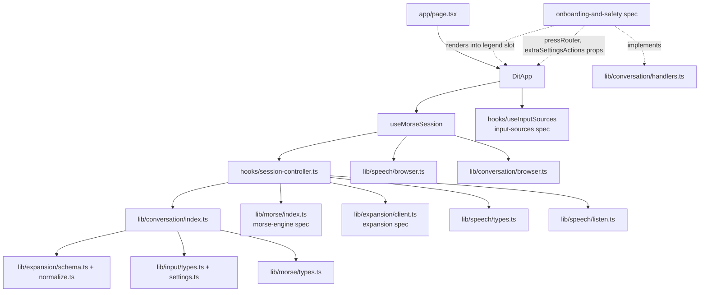
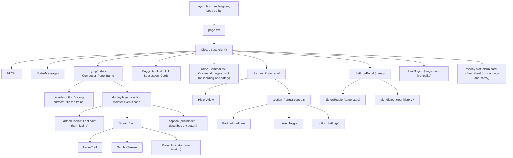
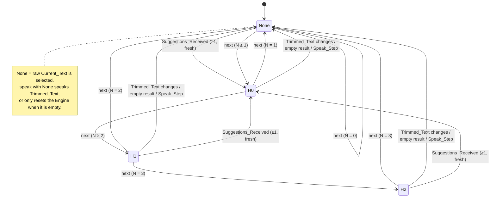
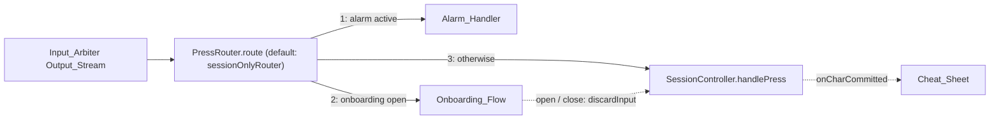

# Design Document: conversation-ui

## Overview

Conversation UI is what the speaker and the partner see and hear. It takes Press_Events from the Input_Arbiter, drives the Morse Engine, turns Engine_Events into typed text through a pure Session_Reducer, asks the expansion Client for up to 3 suggestions, speaks the chosen sentence, keeps a conversation history in localStorage, and gives the partner a large display, a Listen toggle, a typed-line field and a settings dialog.

The design follows the project rule "pure core, thin shell":

- **Pure core** (`src/lib/conversation/`, `src/lib/speech/listen.ts`): the Session_Reducer, the Live_Region announcement throttler, the settings validator and the Zod-validated Storage. No React, no DOM, no clock. Every rule in Requirements 1 to 7, 12 and 16 is decided here and checked by fast-check.
- **Controller** (`src/hooks/session-controller.ts`): a framework-free object that owns the Engine, the Tick_Timer, the effect runner, the alarm routing and the Client calls. Clock, scheduler, Engine factory, Client, speech, storage and alarm are injected, so a model-based fast-check test drives it with a fake clock (Requirement 8, 9, 23.4).
- **Thin shell** (`src/hooks/useMorseSession.ts`, `src/components/`, `src/lib/*/browser.ts`): React wiring, Web Speech and localStorage adapters, and accessible components.

The main screen was recomposed on 2026-11-11 in a design polish pass (Requirements 24 to 28). One Composer_Panel that is the Keying_Surface carries the sentence and the live Morse tape, numbered Suggestion_Cards sit under it, and the Command_Legend and a quiet Partner_Zone sit in a rail or below. The pass changes presentation only. See "Screen layout", "Components", "Design tokens", "Contrast pairs" and the Implementation notes "Design polish pass (2026-11-11)" and "Visual iteration (task 17.7)".

### Sources

- `docs/BRIEF.md` and `.kiro/steering/` (`product.md`, `accessibility.md`, `tech.md`, `structure.md`).
- Sibling designs: `.kiro/specs/morse-engine/design.md` (`Engine`, `EngineEvent`, `EngineConfig`, `createEngine`, `Estimates`), `.kiro/specs/input-sources/design.md` (`PressEvent`, `SourceStatus`, `Clock`, `Scheduler`, `safeTickTime`, `SettingsStore`, `InputSettings`, `useInputSources`), `.kiro/specs/expansion/design.md` (`Turn`, `TurnSchema`, `trimWhitespace`, `ExpansionResult`, `ExpansionClient`, `createExpansionClient`, `CONTEXT_MAX_TURNS`).
- WCAG 2.2: [contrast minimum 1.4.3](https://www.w3.org/WAI/WCAG22/Understanding/contrast-minimum), [non-text contrast 1.4.11](https://www.w3.org/WAI/WCAG22/Understanding/non-text-contrast), [reflow 1.4.10](https://www.w3.org/WAI/WCAG22/Understanding/reflow), [three flashes 2.3.1](https://www.w3.org/WAI/WCAG22/Understanding/three-flashes-or-below-threshold). Relative luminance and contrast ratio use the WCAG formula; the values in the token table were computed with it.
- Web Speech API on MDN: [`SpeechSynthesis`](https://developer.mozilla.org/en-US/docs/Web/API/SpeechSynthesis) (`cancel()`, `getVoices()`, `voiceschanged`), [`SpeechSynthesisErrorEvent.error`](https://developer.mozilla.org/en-US/docs/Web/API/SpeechSynthesisErrorEvent/error) (`interrupted` and `canceled` are reported when an utterance is cut off by `cancel()` or a new `speak()`), [`SpeechRecognition`](https://developer.mozilla.org/en-US/docs/Web/API/SpeechRecognition) and [`SpeechRecognitionErrorEvent.error`](https://developer.mozilla.org/en-US/docs/Web/API/SpeechRecognitionErrorEvent/error) (`not-allowed`, `service-not-allowed`, `audio-capture`, `no-speech`, `aborted`, `network`, …). Recognition stops on its own after silence even with `continuous = true`, which is why Listen restarts on `end`.
- [`<dialog>` and `showModal()`](https://developer.mozilla.org/en-US/docs/Web/HTML/Element/dialog): native modal, `cancel` event on Escape, top layer; it does not wrap Tab inside the dialog in every browser, so the panel adds its own wrap (Req 20.7).
- React 19 [`useSyncExternalStore`](https://react.dev/reference/react/useSyncExternalStore) for subscribing components to the controller snapshot.
- Tailwind CSS v4 [`@theme`](https://tailwindcss.com/docs/theme) tokens in `globals.css`; CSS [container query units](https://developer.mozilla.org/en-US/docs/Web/CSS/CSS_containment/Container_size_and_style_queries) (`cqi`) for the Symbol_Stream size.

### Key design decisions

| Decision | Choice | Why |
| --- | --- | --- |
| Where session rules live | One pure `reduce(state, action)` returning `{ state, effects }` | Req 7 demands purity and determinism; effects as data let the controller run them in order (Req 5.7, 8.8) and let tests assert them without fakes. |
| Where timers live | A framework-free `SessionController` in `src/hooks/session-controller.ts`, wrapped by a thin React hook | The single-timer and pending-press rules (Req 8.3–8.6) need a model-based test with a fake clock. Keeping them out of React avoids `act()` noise and runs in the `node` environment. The file lives under `src/hooks/` because it has side effects, which `src/lib/conversation/` must not. |
| Live_Region throttle | Pure `live-queue.ts` state machine; controller schedules its `nextDueAt` | Req 12.2–12.6 timing is testable with plain numbers. |
| Typed-character detection for announcements | Pure diff of Current_Text before and after each action | Req 12.1 needs "a character was appended"; the Session_Effect union is fixed by the requirements, so the controller derives it instead of adding an effect. |
| Clearing history in storage | Write an empty History_Record | Satisfies Req 16.2 ("write an empty record") and Req 15.5 ("remove the History_Record": no Turns survive) with one code path. |
| Settings_Record validation | Strict schema for the partner fields; per-value `.catch(default)` for Input_Layer values | Req 16.7 replaces the whole record when a partner field is invalid; Req 16.11 replaces only the bad Input_Layer value. |
| Settings dialog | Native `<dialog>` opened with `showModal()`, explicit `aria-modal="true"`, own Tab wrap | Native semantics and Escape (`cancel` event) plus the exact trap Req 20.7 asks for. |
| Clear-history confirmation | A nested `role="alertdialog"` inside the Settings_Panel; either choice closes the panel | Req 21.5 sends focus to the Keying_Surface, which is outside the modal, so the panel must close. |
| Speech echo guard | Discard final transcripts while `SpeechOutput.isSpeaking()` | Req 18.7, simplest rule that does not depend on recognition timing. |
| Sibling plug-ins | `AlarmHandler`, `UnknownPatternHandler` interfaces and a `legend` slot prop on `DitApp` | `onboarding-and-safety` implements them without touching this spec's code. |
| Onboarding integration | Optional `pressRouter` and `extraSettingsActions` props, `SourceControl` in context, `discardInput()` and `onCharCommitted` on the controller | Each one defaults to today's behaviour when unused, so this spec's tests and properties keep passing unchanged (see "Integration points for onboarding-and-safety"). |
| Main screen composition (design polish pass, 2026-11-11) | The stage is the Keying_Surface: one Composer_Panel whose `role="button"` element fills it, with the Partner_Display and the Stream_Band on a sibling layer that lets presses through. Numbered Suggestion_Cards sit under it. The "Commands" panel and a quiet Partner_Zone sit in a rail (Wide_Layout) or below (One_Column_Layout). Presses show on a small Press_Indicator; focus shows as the Armed_Edge | The review screenshots read as a dashboard with equal weight everywhere. One stage gives the speaker, the partner and a camera one place to watch, makes the whole stage the press target (BRIEF item 1: "anywhere on the keying surface"), and lets the press feedback shrink from a full-surface fill to one dot-sized mark (Req 24 to 28). |

## Architecture

### Module layout

```
src/
├── app/
│   ├── layout.tsx                 # <html lang="en" class="dark">, fonts, metadata, globals.css
│   ├── page.tsx                   # server component; renders <DitApp …sibling plug-ins/>
│   └── globals.css                # Tailwind v4 @import + @theme tokens, reduced-motion rules
├── lib/
│   ├── conversation/
│   │   ├── types.ts               # SessionState, SessionAction, SessionEffect, SessionTurn
│   │   ├── session.ts             # INITIAL_SESSION, reduce(), contextWindow(), trimmedText()
│   │   ├── live-queue.ts          # announcement throttler + announcementsFor() diff
│   │   ├── settings.ts            # SettingsRecord type + Zod schema, defaults, validateSettingsPatch()
│   │   ├── storage.ts             # createConversationStorage(backend): History/Settings + SettingsStore
│   │   ├── handlers.ts            # AlarmHandler, UnknownPatternHandler, PressRouter, SourceControl + inert stubs
│   │   ├── browser.ts             # localStorageBackend() (only file here that touches a global)
│   │   ├── test-support.ts        # fast-check arbitraries (not re-exported)
│   │   └── index.ts               # public barrel
│   └── speech/
│       ├── types.ts               # SpeechOutput, SpeechInput, VoiceInfo, outcomes
│       ├── listen.ts              # pure Listen state machine (Req 18)
│       ├── browser.ts             # webSpeechOutput(), webSpeechInput() adapters
│       ├── fakes.ts               # FakeSpeechOutput, FakeSpeechInput for tests
│       └── index.ts
├── hooks/
│   ├── session-controller.ts      # createSessionController(deps): Engine, Tick_Timer, effects, alarm, Client
│   └── useMorseSession.ts         # React hook: builds deps, useSyncExternalStore over the controller
└── components/
    ├── DitApp.tsx                 # 'use client' root; layout grid; legend slot; focus helper
    ├── KeyingSurface.tsx          # the Composer_Panel frame (design polish pass)
    ├── StreamBand.tsx             # Letter_Trail, Symbol_Stream and Press_Indicator on one unit (design polish pass)
    ├── LetterTrail.tsx
    ├── SymbolStream.tsx
    ├── SuggestionList.tsx
    ├── PartnerDisplay.tsx
    ├── HistoryView.tsx
    ├── PartnerLineForm.tsx
    ├── ListenToggle.tsx
    ├── SettingsPanel.tsx
    ├── LiveRegion.tsx
    └── StatusMessages.tsx
```

Tests sit beside each file (`session.test.ts`, `session.prop.test.ts`, `KeyingSurface.test.tsx`, …).

### Dependency graph



`src/lib/conversation/**` imports only types and pure helpers from `@/lib/morse`, `@/lib/input` and `@/lib/expansion` (schema and normalize, never `client.ts`), plus `zod`. It imports nothing from `react`, `next`, `src/components` or `src/hooks` (Req 7.6); an ESLint `no-restricted-imports` rule scoped to `src/lib/**` enforces this.

### Component tree



### Runtime flow: press → engine → reducer → effects

The controller is the only caller of the Engine. One Tick_Timer handle exists at any time. Every Engine call, `reset()` or Engine replacement ends with `reschedule()`.

```mermaid
sequenceDiagram
  autonumber
  participant Arb as Input_Arbiter (useInputSources)
  participant C as SessionController
  participant Al as AlarmHandler
  participant E as Engine
  participant R as reduce()
  participant FX as Effect runner
  participant T as Scheduler (Tick_Timer)

  Arb->>C: handlePress({kind:'down', t})
  alt alarm active
    C->>Al: handlePress(event)
  else alarm inactive
    C->>E: press(t)
    E-->>C: events[]
    loop each Engine_Event, in order
      C->>R: reduce(state, {type:'engine', event})
      R-->>C: {state', effects[]}
      C->>C: commit state', persist Turns if changed, Client.update if needed, queue announcements
      loop each effect, in order
        C->>FX: run(effect)
        Note over FX: 'speak' → SpeechOutput.speak<br/>'reset-engine' → E.reset()<br/>'alarm' → Al.start() (try/catch), E.reset(), cancel timer<br/>'unknown' → UnknownPatternHandler.handle(pattern)
      end
    end
    C->>T: reschedule(): cancel timer; d = E.nextDeadline()
    opt d is a number
      C->>T: schedule(max(0, d − clock()), fire(d))
    end
  end

  T-->>C: fire(deadline)
  C->>Arb: pendingSince()
  alt pending ≠ null and pending < deadline
    Note over C: pending-press guard: no tick
    C->>T: schedule(50 ms, fire(deadline))
  else no blocking pending press
    C->>E: tick(safeTickTime(clock(), pending))
    E-->>C: events[] (dispatched as above)
    C->>T: reschedule()
  end
```

`safeTickTime(now, pending)` from `input-sources` returns `min(now, pending)` or `now`, so `tick(t)` never passes a Raw_Down the arbiter still holds back (Req 8.4, 8.6). Because the timer fires at or after the deadline and the guard only lets through pending presses whose Raw_Down is at or after the deadline, the tick time is never below the deadline the Engine asked for.

### Highlight cycle

With N = 1 to 3 Suggestions, `next` walks 0 → 1 → … → N − 1 → none → 0. New non-empty Suggestions set Highlight to 0; a Trimmed_Text change, an empty result or a Speak_Step sets it to none.



### Screen layout

Rewritten on 2026-11-11 in the design polish pass (Requirements 24 to 28). The first layout, a 3:2 grid with the Keying_Surface as a separate box under the suggestions, is in git history, and the "Layout" and "Tablet fit" Implementation notes record how it was built.

`DitApp` lays out one composed screen with a clear order of attention: the sentence (Last_Spoken above Current_Text), the Stream_Band directly under it, the Suggestion_Cards, then the quieter "Commands" panel and Partner_Zone. Sizes are in `rem`, viewport or container units, so text follows the browser font size (Req 22.5). The DOM order is the reading order in every layout, and nothing is reordered with CSS (Req 24.1, 28.4).

| Layout | When | Arrangement |
| --- | --- | --- |
| Wide_Layout | The `wide` variant: at least 64rem wide and landscape (1280 × 800, 1024 × 768, 1440 × 900) | A grid of `minmax(0, 1fr)` and `clamp(20rem, 30vw, 27rem)` on a `min-h-dvh` page. Speaker column, top to bottom: the `h1` row, StatusMessages, the Composer_Panel (`flex-1`, so it takes the height that the Suggestion_List leaves), then the Suggestion_List. Rail, size-contained and the full page height: the "Commands" panel (the Command_Legend in one column, "All codes" and SafetyNotices), then the Partner_Zone filling the rest (the history list `flex-1` and scrolling inside, the Partner controls at the bottom). No page scroll at 1280 × 800 and 1024 × 768 with three one-line suggestions and up to two lines of Current_Text (Req 24.2, 24.3, 28.5). |
| One_Column_Layout | Every other viewport: portrait, narrower than 64rem, or 200 % zoom (820 × 1180, 768 × 1024, 393 × 852, 320 × 720, 640 × 400) | One column: the `h1` row, StatusMessages, the Composer_Panel (its content height, with a minimum), the Suggestion_List, the "Commands" panel (two code columns when they fit, one on phones), then the Partner_Zone (the history list capped at about `min(24rem, 50dvh)` and scrolling inside, then the Partner controls) (Req 24.4, 28.6). |

Spacing follows one vertical rhythm, tighter under the `short` variant (800 px tall or less, which includes 1280 × 800 and 1024 × 768):

| Measure | Wide_Layout | Wide_Layout, `short` | One column from 48rem | One column below 48rem |
| --- | --- | --- | --- | --- |
| Page padding | 2.5rem | 1.5rem | 2rem | 1rem |
| Gap between regions (between columns) | 1.5rem (2.5rem) | 1rem (2rem) | 1.5rem | 1rem |
| Composer_Panel padding | 2rem | 1.5rem | 2rem | 1.25rem |
| Gap inside the Composer_Panel | 1rem | 0.75rem | 1rem | 0.75rem |
| Composer_Panel minimum height | 16rem | 14rem | 20rem | 16rem |
| Suggestion_Card minimum height | 4rem | 3.5rem | 4rem | 4rem from 40rem; 5rem below 40rem, where the "Will be spoken" marker sits under the text |

Surfaces and radii: the page is `bg`. The Composer_Panel, the "Commands" panel and the Partner_Zone are `surface` panels set apart by fill. Only the Composer_Panel keeps a boundary, a 1 px `border` line, because it is a control (Req 22.3, 25.6); the two rail panels have none (Req 28.1, 28.2). Radii are about 2rem for the Composer_Panel, 1.5rem for the rail panels, 1rem for the Suggestion_Cards and 0.75rem for controls.

Composer_Panel content, top to bottom: "Last said" with Last_Spoken at the top edge, the free space, then "Typing" with Current_Text, the Stream_Band and the caption at the bottom edge. The Partner_Display group takes the free space between its two sections, so a second line of Current_Text grows upward into it while the Stream_Band, the caption and everything below keep their places, and the sentence being formed sits on the tape right above the Suggestion_Cards. Where the stage has no free space (One_Column_Layout, which sizes it to its content), the same content stacks with the gaps alone (Implementation note "Visual iteration (task 17.7)").

Reserved heights, so that the first character, the first symbol, the first spoken sentence and arriving or clearing suggestions move nothing (Req 11.3, 14.8, 14.9, 24.8, 24.9):

- The Last_Spoken area keeps one `text-last` line and the Current_Text area one `text-display` line. Each placeholder sits at the top of its area, directly under its label, on a `leading-snug` line that is shorter than either.
- The Stream_Band keeps 1.75 base units plus its `text-lg` letter row, whatever it shows (Req 26.2).
- The Suggestion_List keeps its header row plus three one-line Suggestion_Cards and two gaps, with or without suggestions. Each place that no card fills shows an Empty_Slot of the same height (Req 27.12).

Height budget at 1280 × 800, as measured in task 17.7: the speaker column has 800 px. Page padding takes 48, the `h1` row 38, two gaps 32 and the Suggestion_List 221 (a 29 px header row, one `text-lg` line, and three 56 px cards with 8 px gaps), which leaves 461 px for the Composer_Panel. Its content needs 355 px with one line of Current_Text and 428 px with two (1.5rem padding, two labels, one 50 px Last_Spoken line, 74 px Current_Text lines, the 62 px Stream_Band, the caption and the 0.75rem gaps), so a second line takes 74 of the 106 px of free height and nothing below it moves. At 1024 × 768 the Composer_Panel is 429 px, and its content needs 331 px with one line and 394 px with two (63 px lines). This is why Wide_Layout uses the `short` rhythm at 800 px and less: with 2.5rem page padding the two-line case would scroll at 1280 × 800 (Req 24.3).

Tablet check (Req 22.7, 24.11, `onboarding-and-safety` 8.6), as measured in task 17.7 with three one-line suggestions: at 768 × 1024 the Composer_Panel spans y 94 to 442, the Suggestion_List y 466 to 723 and the "Commands" panel y 747 to 881, with "All codes" at y 817 to 861. At 1024 × 768 the "Commands" panel is at the top of the rail, y 24 to 330, with "All codes" at y 266 to 310, and the Keying_Surface spans y 78 to 507. So the whole Command_Legend with "All codes" and the whole Keying_Surface are on screen at both sizes while three suggestions show.

Keying_Surface size (Req 10.1): the Keying_Surface fills the Composer_Panel, so it stays the largest target at every size. The next largest controls are the Suggestion_Cards: at 1280 × 800 a card is 816 × 56 px against a stage of 816 × 461 px, which has 8.2 times its area (the column is 1280 − 48 − 384 − 32 = 816 px wide). The ratio is smallest on phones, 3.6 at 320 × 720 (Implementation note "Measured composed screen (task 17.7)").

Panel placement (`onboarding-and-safety` Req 10.9, 14.2): `usePanelPlacement` finds the `role="button"` element, which now covers the whole Composer_Panel, and places the Cheat_Sheet (at least 280 × 240) or the Practice_Step (at least 300 × 260) in the largest free band beside it: the rail in Wide_Layout and the area below the stage in one column. Task 17.7 measured such a band at every size it checked except 640 × 400 (200 % zoom at 1280 × 800), where the stage takes 296 of the 400 px and no band of 280 × 240 exists (Implementation note "Measured composed screen (task 17.7)").

## Components and Interfaces

### lib/conversation/types.ts

```ts
import type { EngineEvent } from '@/lib/morse';
import type { ExpansionResult } from '@/lib/expansion/client';
import type { Role } from '@/lib/expansion/schema';

export const TEXT_MAX = 500;
export const HISTORY_CAP = 200;
export const CONTEXT_WINDOW = 10;           // equals CONTEXT_MAX_TURNS from expansion

export interface SessionTurn {
  readonly id: number;                      // unique, strictly increasing in Turns order
  readonly role: Role;                      // 'speaker' | 'partner'
  readonly text: string;                    // 1–500 chars, trimmed
}

export type SuggestionSource = 'ai' | 'on-device';

export interface SessionState {
  readonly currentText: string;             // 0–500 chars
  readonly currentPattern: string;          // '.' and '-' only
  readonly suggestions: readonly string[];  // 0–3
  readonly suggestionSource: SuggestionSource | null;  // null ⇔ suggestions empty
  readonly highlight: number | null;        // null = raw text; else 0..suggestions.length-1
  readonly turns: readonly SessionTurn[];   // oldest first, ≤ HISTORY_CAP
  readonly lastSpoken: string | null;
  readonly nextTurnId: number;              // > every ID ever issued in this state's history
}

/** Loose shape accepted by Hydrate; the reducer filters invalid entries (Req 6.6). */
export interface HydrateEntry {
  readonly role: string;
  readonly text: string;
}

export type SessionAction =
  | { readonly type: 'engine'; readonly event: EngineEvent }
  | { readonly type: 'suggestions'; readonly result: ExpansionResult }
  | { readonly type: 'partner-line'; readonly text: string }
  | { readonly type: 'partner-pick'; readonly index: number }
  | { readonly type: 'clear-history' }
  | { readonly type: 'hydrate'; readonly turns: readonly HydrateEntry[] };

export type SessionEffect =
  | { readonly type: 'speak'; readonly sentence: string }
  | { readonly type: 'reset-engine' }
  | { readonly type: 'alarm' }
  | { readonly type: 'unknown'; readonly pattern: string };

export interface Transition {
  readonly state: SessionState;
  readonly effects: readonly SessionEffect[];
}
```

### lib/conversation/session.ts

```ts
export const INITIAL_SESSION: SessionState; // all empty/null, nextTurnId 1

/** Pure, total, synchronous. Never mutates inputs; returns new objects only where fields change. */
export function reduce(state: SessionState, action: SessionAction): Transition;

/** trimWhitespace(currentText) from expansion/normalize (the 4 Whitespace chars only). */
export function trimmedText(state: SessionState): string;

/** Most recent ≤ 10 Turns, oldest first, as { role, text } without IDs (Req 6.7). */
export function contextWindow(turns: readonly SessionTurn[]): readonly { role: Role; text: string }[];
```

Transition rules, in the order `reduce` applies them. `P` is the input state and `clearSugg` means `suggestions = []`, `suggestionSource = null`, `highlight = null`.

| Action | Result |
| --- | --- |
| `engine/symbol` | `currentPattern += symbol`. Nothing else. No effects (Req 1.5). |
| `engine/char` | `currentPattern = ''`. If `currentText.length < 500`, append `char`. No effects (1.1, 1.2, 1.6). |
| `engine/space` | `currentPattern = ''`. Append `' '` only if text is non-empty, does not end with `' '` and is shorter than 500. No effects (1.3, 1.4). |
| `engine/unknown` | `currentPattern = ''`. Effects `[{unknown, pattern}]` (1.7). |
| `command/backspace` | `currentPattern = ''`; if text non-empty, drop the last UTF-16 code unit. No effects (2.1–2.3). |
| `command/next` | `currentPattern = ''`; if N ≥ 1: `null → 0`, `i < N−1 → i+1`, `N−1 → null`; if N = 0 stays `null`. No effects (3.6–3.8). |
| `command/speak` | `currentPattern = ''`. If `highlight` is an index: Speak_Step with `suggestions[highlight]`. Else if Trimmed_Text non-empty: Speak_Step with Trimmed_Text. Else effects `[{reset-engine}]` only (4.1–4.3). |
| `command/sos` | `currentPattern = ''`. Effects `[{alarm}]`. Nothing else changes (5.1, 5.2). |
| `suggestions` | If `result.text !== trimmedText(P)`: return `P` unchanged (3.3). Else if list empty: `clearSugg`. Else `suggestions = list.slice(0, 3)`, `suggestionSource = result.source`, `highlight = 0` (3.1, 3.2). |
| `partner-line` | `t = trimWhitespace(text)`; if empty return `P`; else append `{ role: 'partner', text: t.slice(0, 500) }` (6.1, 6.2). |
| `partner-pick` | If `Number.isInteger(index) && 0 ≤ index < N`: Speak_Step with `suggestions[index]`; else return `P` (4.4, 4.5). |
| `clear-history` | `turns = []`, `lastSpoken = null`, `nextTurnId` unchanged (6.5). |
| `hydrate` | Keep entries with role `speaker`/`partner` and non-empty trimmed text; take the newest 200; text = trimmed `.slice(0, 500)`; assign IDs `nextTurnId, nextTurnId+1, …`; `lastSpoken` = newest kept speaker text or `null` (6.6). |

After every rule that changes `currentText` (char, space, backspace), `reduce` compares `trimmedText` before and after: different → `clearSugg` (3.4); equal → suggestions kept (3.5).

**Speak_Step(sentence)**: `appendTurn('speaker', sentence)`, `lastSpoken = sentence`, `currentText = ''`, `currentPattern = ''`, `clearSugg`; effects `[{speak, sentence}, {reset-engine}]` (4.6–4.8).

**appendTurn(role, text)**: new turn `{ id: nextTurnId, role, text }`; `nextTurnId + 1`; `turns = [...turns, turn].slice(-200)` (4.9, 6.3, 6.4).

Spoken sentences from Suggestions are 1–200 characters (expansion `ExpandResponseSchema`) and a Trimmed_Text is 1–500 characters, so speaker Turns always satisfy the 1–500 text rule. A defensive `.slice(0, 500)` is still applied in `appendTurn` so a malformed `ExpansionResult` cannot break the turns invariant. Suggestion entries that are empty after trimming are dropped in the `suggestions` rule for the same reason (the expansion schema already forbids them).

### lib/conversation/live-queue.ts

```ts
export const ANNOUNCE_INTERVAL_MS = 1_000;

export type LiveItem =
  | { readonly kind: 'char'; readonly text: string }        // the char, or 'space'
  | { readonly kind: 'suggestions'; readonly text: string }; // "2 suggestions. Highlighted: I am thirsty."

export interface LiveQueueState {
  readonly lastAnnouncedAt: number | null;   // Clock time of the last announcement start
  readonly heldChars: readonly string[];     // in commit order
  readonly heldSuggestions: string | null;   // at most one, newest wins (Req 12.6)
}
export const INITIAL_LIVE_QUEUE: LiveQueueState;

export interface LiveStep {
  readonly state: LiveQueueState;
  readonly announce: string | null;   // text to put in the Live_Region now
  readonly nextDueAt: number | null;  // when to call flush(), or null when nothing is held
}

/** Queue an item at time `now`. Announces at once if nothing was announced in the last 1,000 ms (Req 12.3). */
export function enqueue(s: LiveQueueState, item: LiveItem, now: number): LiveStep;
/** Called by the controller timer at or after nextDueAt. Announces all held items as one string. */
export function flush(s: LiveQueueState, now: number): LiveStep;

/** Joined announcement: held chars first, comma-separated, then the suggestions item. */
export function joinItems(chars: readonly string[], suggestions: string | null): string;

/** Pure diff that decides what an action adds to the queue (Req 12.1, 12.5, 12.7). */
export function announcementsFor(
  prev: SessionState, next: SessionState, action: SessionAction,
): readonly LiveItem[];
export function suggestionsItemText(suggestions: readonly string[], highlight: number | null): string;
```

`announcementsFor` rules:

- Hydrate, `symbol` and `unknown` actions return `[]` (12.7).
- If `next.currentText === prev.currentText + c` for one character `c`, return a `char` item: `c`, or `"space"` when `c === ' '` (12.1).
- If the action is `suggestions` and `next.suggestions` is non-empty and differs from `prev.suggestions` (or the source or highlight differs), add one `suggestions` item. A list that becomes empty adds nothing (12.5, 12.7).

`suggestionsItemText` returns `"1 suggestion"` or `"N suggestions"`, followed by `". Highlighted: <text>"` when `highlight` is an index.

Timing: `enqueue` at `now` announces immediately when `lastAnnouncedAt === null || now − lastAnnouncedAt ≥ 1000` (the controller writes it in the same task, well within 100 ms). Otherwise it holds the item and returns `nextDueAt = lastAnnouncedAt + 1000`. `flush` announces `joinItems(heldChars, heldSuggestions)` and sets `lastAnnouncedAt = now`.

### lib/conversation/settings.ts

```ts
import { z } from 'zod';
import { DEFAULT_INPUT_SETTINGS, type InputSettings } from '@/lib/input';

export const RATE_MIN = 0.5, RATE_MAX = 2.0, RATE_DEFAULT = 1.0;
export const WPM_MIN = 2, WPM_MAX = 20, WPM_DEFAULT = 6;

export interface SettingsRecord {
  readonly v: 1;
  readonly voiceURI: string | null;          // null = browser default voice
  readonly speechRate: number;               // 0.5–2.0
  readonly flip: boolean;
  readonly startingWpm: number;              // 2–20
  readonly adaptive: boolean;                // true = Adaptive_Mode, false = Fixed_Speed_Mode
  readonly switchKey: unknown;               // raw; validated by input-sources validateSwitchKey on read
  readonly input: InputSettings;             // min press durations, blink thresholds
}

export const DEFAULT_SETTINGS: SettingsRecord; // voiceURI null, 1.0, false, 6, true, null, DEFAULT_INPUT_SETTINGS

/** Partner fields strict (whole record falls back on failure, Req 16.7);
 *  Input_Layer fields per-value .catch(default) (Req 16.11). */
export const SettingsRecordSchema = z.object({
  v: z.literal(1),
  voiceURI: z.string().min(1).nullable(),
  speechRate: z.number().finite().min(RATE_MIN).max(RATE_MAX),
  flip: z.boolean(),
  startingWpm: z.number().finite().min(WPM_MIN).max(WPM_MAX),
  adaptive: z.boolean(),
  switchKey: z.unknown().catch(null),
  input: InputSettingsSchema,   // see below
});

/** Each value checked with input-sources validateMinPressDuration / validateThresholds;
 *  an invalid value becomes its default, the others are kept. */
export const InputSettingsSchema: z.ZodType<InputSettings>;

export type SettingsPatch = Partial<Pick<SettingsRecord,
  'voiceURI' | 'speechRate' | 'flip' | 'startingWpm' | 'adaptive'>>;

export type PatchError =
  | { readonly field: 'speechRate'; readonly value: unknown; readonly message: string }
  | { readonly field: 'startingWpm'; readonly value: unknown; readonly message: 'Enter a number from 2 to 20.' }
  | { readonly field: 'voiceURI'; readonly value: unknown; readonly message: string };

/** Pure: returns the merged record, or the errors and no change (Req 17.9, 20.6). */
export function validateSettingsPatch(
  current: SettingsRecord, patch: unknown,
): Result<SettingsRecord, readonly PatchError[]>;

/** Engine config from settings plus optional calibrated estimates. */
export function engineConfigOf(s: SettingsRecord, initial: Estimates | null): EngineConfig;
```

Starting_WPM accepts any finite number in 2–20, matching the Engine's own validation; the number field uses `step="1"` but does not reject decimals, since the Engine accepts them.

### lib/conversation/storage.ts

```ts
export const HISTORY_KEY = 'dit:history:v1';
export const SETTINGS_KEY = 'dit:settings:v1';

export interface KeyValueBackend {           // localStorage shape; may throw
  getItem(key: string): string | null;
  setItem(key: string, value: string): void;
  removeItem(key: string): void;
}

export interface HistoryRecord {
  readonly v: 1;
  readonly turns: readonly { readonly role: Role; readonly text: string }[];  // TurnSchema entries
}
export const HistoryRecordSchema: z.ZodType<HistoryRecord>; // turns: z.array(TurnSchema); trims to newest 200 (Req 16.6)

export interface StorageError { readonly op: 'read' | 'write'; readonly record: 'history' | 'settings'; readonly message: string }

export interface ConversationStorage extends SettingsStore {   // SettingsStore from input-sources (Req 16.11)
  /** Never throws. Missing, bad JSON or schema failure → empty history (Req 16.4, 16.7). */
  loadHistory(): { readonly record: HistoryRecord; readonly error: StorageError | null };
  /** Never throws. Missing, bad JSON or schema failure → DEFAULT_SETTINGS (Req 16.4, 16.7). */
  loadSettings(): { readonly record: SettingsRecord; readonly error: StorageError | null };
  saveHistory(turns: readonly SessionTurn[]): Result<void, StorageError>;   // strips IDs
  saveSettings(record: SettingsRecord): Result<void, StorageError>;
  /** Current in-memory settings (last loaded or saved). */
  settings(): SettingsRecord;
}

export function createConversationStorage(backend: KeyValueBackend): ConversationStorage;
```

- `loadHistory` / `loadSettings`: `getItem` inside try/catch → `JSON.parse` inside try/catch → `safeParse`. Any failure yields the empty or default record for that record alone. A throwing `getItem` yields `error: { op: 'read', … }`; a missing, unparsable or invalid value yields `error: null` (nothing for the partner to act on).
- `saveHistory` / `saveSettings`: `JSON.stringify` then `setItem` inside try/catch; a throw returns `{ ok: false }` and leaves the in-memory record unchanged (Req 16.8). Clear_History calls `saveHistory([])`.
- `SettingsStore` methods (`readSwitchKey`, `writeSwitchKey`, `clearSwitchKey`) read and write `switchKey` inside the same Settings_Record. `readSwitchKey` returns the raw value; `input-sources` validates it with `validateSwitchKey`, which returns `null` (the default) for anything invalid.
- The Input_Layer settings (`InputSettings`) are written through `saveSettings` by the controller when the Input_Layer reports a change; `useInputSources` receives them as its `settings` option.

`src/lib/conversation/browser.ts` exports `localStorageBackend(): KeyValueBackend | null`, which returns `null` when `window.localStorage` access throws (disabled storage). The hook then uses an in-memory backend and reports one save-failure message (Req 16.9).

### lib/conversation/handlers.ts (plug-in interfaces for onboarding-and-safety)

```ts
import type { PressEvent, SourceKind, SourceStatus, SwitchLearner, Unsubscribe } from '@/lib/input';

/** Implemented by onboarding-and-safety. All methods synchronous. */
export interface AlarmHandler {
  /** Start the SOS alarm (card + chime). Called synchronously from the effect runner; may throw. */
  start(): void;
  /** True from start() until the alarm is dismissed. */
  isActive(): boolean;
  /** Receives every Press_Event while isActive() is true (Req 8.10). */
  handlePress(event: PressEvent): void;
  /** Fires when isActive() changes, so the controller can resume Engine scheduling. */
  onActiveChange(listener: (active: boolean) => void): Unsubscribe;
}

/** Implemented by onboarding-and-safety (for example a brief "not a code" hint). */
export interface UnknownPatternHandler {
  handle(pattern: string): void;
}

/** Inert stubs used only until onboarding-and-safety lands; not used in production builds once it does. */
export function inertAlarmHandler(): AlarmHandler;           // isActive() always false; start() no-op
export function inertUnknownPatternHandler(): UnknownPatternHandler;

// ---- Integration points for onboarding-and-safety (additive; see "Integration points" below) ----

/** What DitApp hands to a Press_Router: the session's press entry point and its discard hook. */
export interface SessionPressTarget {
  /** SessionController.handlePress, unchanged. */
  handlePress(event: PressEvent): void;
  /** SessionController.discardInput: empty the Pattern_Buffer, forget an unmatched down, cancel the Tick_Timer. */
  discardInput(): void;
}

/** Implemented by onboarding-and-safety. Sits between the Input_Arbiter Output_Stream and the Session_Controller. */
export interface PressRouter {
  /** Called once by DitApp after the controller exists; the returned function disconnects (unmount). */
  connect(session: SessionPressTarget): Unsubscribe;
  /** Receives every Press_Event from the Output_Stream, in order, synchronously. Delivers it to at most one consumer. */
  route(event: PressEvent): void;
}

/** Default when DitApp gets no pressRouter: every event goes to session.handlePress, as today. */
export function sessionOnlyRouter(): PressRouter;

/** Enabled flags passed to useInputSources. Blink starts only from a user action (input-sources Req 9.1). */
export type EnabledSources = Readonly<Record<SourceKind, boolean>>;
export const DEFAULT_ENABLED_SOURCES: EnabledSources;   // { keyboard: true, switch: true, pointer: true, blink: false }

/** Runtime control over Press_Sources, provided by DitApp through SessionApiContext. */
export interface SourceControl {
  enabled(): EnabledSources;
  statuses(): Readonly<Record<SourceKind, SourceStatus>>;   // useInputSources().statuses
  /** Keyboard, switch or pointer on or off. */
  setEnabled(kind: Exclude<SourceKind, 'blink'>, on: boolean): void;
  /** Call only synchronously from a click, keydown or pointerdown handler. Starts, or retries from a failure status. */
  startBlink(): void;
  stopBlink(): void;
  /** Replace all four flags at once (used to restore a snapshot on "Cancel setup"). */
  restore(flags: EnabledSources): void;
  onChange(listener: () => void): Unsubscribe;   // enabled flags or statuses changed
}

/** Learner used by the no-op SessionApiContext: never arms; arm() and clear() return failed Results with message "not available". */
export function unavailableLearner(): SwitchLearner;
// arm()     → Promise.resolve(err({ reason: 'cancelled', message: 'not available' }))
// cancel()  → no-op; isArmed() → false
// clear()   → err({ reason: 'save-failed', message: 'not available' })
```

The controller treats `start()` as the moment the alarm becomes active for routing: it calls `start()`, then resets the Engine and cancels the Tick_Timer whatever `isActive()` returns, so a throwing or slow handler cannot leave a pending deadline (Req 5.5, 8.11). Routing of later presses uses `isActive()`.

### lib/speech/types.ts

```ts
export interface VoiceInfo {
  readonly uri: string;        // SpeechSynthesisVoice.voiceURI
  readonly name: string;
  readonly lang: string;
  readonly isDefault: boolean;
}

export type UtteranceOutcome = 'done' | 'error' | 'cancelled';

export interface SpeechOutput {
  isSupported(): boolean;
  voices(): readonly VoiceInfo[];
  onVoicesChanged(listener: (voices: readonly VoiceInfo[]) => void): Unsubscribe;
  /** Cancels any utterance in progress, then speaks once. Unknown voiceURI → browser default (Req 17.1, 17.2).
   *  onEnd fires once: 'cancelled' when cut off by cancel() or a newer speak(). */
  speak(sentence: string, opts: { readonly voiceURI: string | null; readonly rate: number },
        onEnd: (outcome: UtteranceOutcome) => void): void;
  isSpeaking(): boolean;
  cancel(): void;
}

export type RecognitionError =
  | 'permission-denied'   // not-allowed, service-not-allowed
  | 'no-microphone'       // audio-capture
  | 'no-speech'
  | 'aborted'
  | 'other';              // network, language-not-supported, bad-grammar, start() throwing, …

export interface SpeechInput {
  isSupported(): boolean;
  /** Starts recognition (continuous, interimResults). Returns a failed Result if start() throws. */
  start(): Result<void, RecognitionError>;
  stop(): void;
  onInterim(listener: (text: string) => void): Unsubscribe;
  onFinal(listener: (text: string) => void): Unsubscribe;
  onError(listener: (error: RecognitionError) => void): Unsubscribe;
  onEnd(listener: () => void): Unsubscribe;
}
```

`browser.ts` adapters:

- `webSpeechOutput(win)`: `isSupported` checks `'speechSynthesis' in win`. `voices()` maps `getVoices()`. `onVoicesChanged` listens to `voiceschanged` and also polls `getVoices()` once 250 ms after subscribe, because some engines fill the list without firing the event (keeps Req 17.7's 1 s bound). `speak` calls `speechSynthesis.cancel()`, builds an utterance with `rate` and the matching voice (or none), and maps `end` → `'done'`, `error` with `interrupted`/`canceled` → `'cancelled'`, other `error` → `'error'`. A per-utterance guard makes `onEnd` fire once.
- `webSpeechInput(win)`: uses `SpeechRecognition ?? webkitSpeechRecognition`, `continuous = true`, `interimResults = true`, `lang = document.documentElement.lang || 'en'`. It maps results to interim or final text and error codes to `RecognitionError`.

### lib/speech/listen.ts (pure Listen state machine)

```ts
export type ListenMessage =
  | 'unsupported'          // "Listening is not supported in this browser. Type your line instead."
  | 'permission-denied'    // "Microphone permission was denied. …"
  | 'no-microphone'        // "No microphone was found. …"
  | 'stopped';             // "Listening stopped. Turn Listen on again or type a line."

export interface ListenState {
  readonly supported: boolean;
  readonly on: boolean;            // Listen_Toggle checked state; false at load (Req 18.10)
  readonly interim: string;        // most recent interim transcript only (Req 18.6)
  readonly message: ListenMessage | null;
}

export type ListenInput =
  | { readonly type: 'toggle'; readonly on: boolean }
  | { readonly type: 'start-failed' }
  | { readonly type: 'interim'; readonly text: string }
  | { readonly type: 'final' }
  | { readonly type: 'error'; readonly error: RecognitionError }
  | { readonly type: 'end' };

export type ListenCommand = 'start' | 'stop' | 'restart-later' | null;

export function initialListen(supported: boolean): ListenState;
export function listenStep(s: ListenState, input: ListenInput): { state: ListenState; command: ListenCommand };
```

| Input | Effect |
| --- | --- |
| `toggle on` (supported) | `on = true`, `message = null`, command `start` (18.3). Ignored when unsupported (18.2). |
| `toggle off` | `on = false`, `interim = ''`, command `stop` (18.12). |
| `interim` while on | `interim = text` (18.6). |
| `final` | `interim = ''` (18.4). Dispatching the Partner_Line is the controller's job. |
| `error permission-denied / no-microphone` | `on = false`, `interim = ''`, message set, command `stop`; no restart (18.8). |
| `error other` or `start-failed` | `on = false`, `interim = ''`, `message = 'stopped'`, command `stop` (18.11). |
| `error no-speech / aborted` | No change; the following `end` restarts (18.9). |
| `end` while on | command `restart-later` (controller restarts after 250 ms, within the 1,000 ms bound, 18.9). `end` while off: no command. |

### hooks/session-controller.ts

```ts
import type { Engine, EngineConfig, Estimates } from '@/lib/morse';
import type { Clock, Scheduler, PressEvent, SourceKind, SourceStatus, InputSettings } from '@/lib/input';
import type { ExpansionClient, ExpansionResult } from '@/lib/expansion/client';

export const PENDING_RETRY_MS = 50;
export const LISTEN_RESTART_MS = 250;

export interface ControllerDeps {
  readonly clock: Clock;
  readonly scheduler: Scheduler;
  readonly createEngine: (config: EngineConfig) => Engine;   // wraps createEngine; falls back to defaults on a failed Result
  readonly pendingSince: () => number | null;                // arbiter.pendingSince, read at fire time
  readonly createClient: (onResult: (r: ExpansionResult) => void) => ExpansionClient;
  readonly speechOutput: SpeechOutput;
  readonly speechInput: SpeechInput;
  readonly alarm: AlarmHandler;
  readonly unknownPattern: UnknownPatternHandler;
  readonly storage: ConversationStorage;
}

export type StatusMessage =
  | { readonly id: 'save-failed'; readonly text: 'History or settings could not be saved on this device.' }
  | { readonly id: 'no-voice'; readonly text: 'No voice is available on this device. The sentence is shown on the display.' }
  | { readonly id: 'speak-error'; readonly text: 'The sentence could not be spoken.' }
  | { readonly id: `source-${SourceKind}`; readonly text: string };   // "Blink input: camera permission denied."

export interface SessionSnapshot {
  readonly session: SessionState;
  readonly settings: SettingsRecord;
  readonly pressed: boolean;                 // last Press_Event kind was 'down' (any source, alarm or not)
  readonly alarmActive: boolean;
  readonly listen: ListenState;
  readonly voices: readonly VoiceInfo[];
  readonly announcement: { readonly seq: number; readonly text: string } | null;
  readonly messages: readonly StatusMessage[];   // one per id, insertion order
}

export interface SessionController {
  handlePress(event: PressEvent): void;
  partnerPick(index: number): void;
  partnerLine(text: string): void;
  clearHistory(): void;
  updateSettings(patch: SettingsPatch): Result<SettingsRecord, readonly PatchError[]>;
  updateInputSettings(input: InputSettings): void;
  setInitialEstimates(estimates: Estimates | null): void;    // from onboarding-and-safety calibration
  setListen(on: boolean): void;
  setSourceStatuses(statuses: Readonly<Record<SourceKind, SourceStatus>>): void;
  dismissMessage(id: StatusMessage['id']): void;
  /** Integration point: called by a Press_Router when presses start or stop going elsewhere (onboarding Req 12.10). */
  discardInput(): void;
  /** Integration point: fires once per `char` Engine_Event the session applies (onboarding Req 10.3). */
  onCharCommitted(listener: (char: string) => void): Unsubscribe;
  getSnapshot(): SessionSnapshot;            // same object until something changes
  subscribe(listener: () => void): Unsubscribe;
  dispose(): void;
}

export function createSessionController(deps: ControllerDeps): SessionController;
```

**Construction** (Req 16.4, 16.5, 17.10, 18.10): load settings and history from `storage`; push a save-failure message if either load reports a read error; build the Engine from `engineConfigOf(settings, null)`; dispatch one `hydrate` with the stored Turns before any press can arrive; create the Client; subscribe to `speechInput`, `speechOutput.onVoicesChanged` and `alarm.onActiveChange`; `listen = initialListen(speechInput.isSupported())`.

**`dispatch(action)`** (internal):

1. `{ state: next, effects } = reduce(prev, action)`; commit `next`.
2. If `next.turns !== prev.turns`: `storage.saveHistory(next.turns)`; on failure add the `save-failed` message (Req 16.1, 16.9).
3. Client rules (Req 9): `pt = trimmedText(prev)`, `nt = trimmedText(next)`. If `nt !== pt` → `client.update(nt, contextWindow(next.turns))` (covers `nt === ''`, Req 9.6). Else if a partner Turn was appended (`last(next.turns)?.id !== last(prev.turns)?.id` and its role is `partner`) and `nt !== ''` → `client.update(nt, contextWindow(next.turns))` (9.3). Otherwise no call (9.2, 9.4).
4. Queue `announcementsFor(prev, next, action)` into the live queue; schedule a flush timer for `nextDueAt` if one is returned and none is pending (separate from the Tick_Timer).
5. Run `effects` in order, each to completion before the next (Req 5.7, 8.8):
   - `speak`: clear `no-voice`/`speak-error` messages; if `!speechOutput.isSupported() || voices().length === 0` add `no-voice` and stop (17.3); else `speak(sentence, { voiceURI, rate }, onEnd)` where `onEnd('error')` adds `speak-error` and `'cancelled'` adds nothing (17.4, 17.5). The voice and rate are read from the current settings at this moment (17.8).
   - `reset-engine`: `engine.reset()`, then `reschedule()` (8.7).
   - `alarm`: `try { alarm.start() } catch {}`; `engine.reset()`; cancel the Tick_Timer; if `engineHeld`, set `withholdUp = true` (5.3–5.5, 8.11, 8.12). No await, no Client or speech call in this branch.
   - `unknown`: `unknownPattern.handle(pattern)` inside try/catch (5.6).
   - After the effects, if `action` is `{ type: 'engine', event: { type: 'char' } }`, call each `onCharCommitted` listener once with the character, each inside try/catch. This adds no effect and changes no state.
6. Notify subscribers once.

**`handlePress(e)`** (Req 8.1, 8.2, 8.10, 8.12, 8.14, 8.15, 10.3):

```
pressed = (e.kind === 'down'); notify
if e.kind === 'down': withholdUp = false     // the withheld up was dropped by a Press_Router; no-op without one
if e.kind === 'up' && withholdUp: withholdUp = false; return
if alarm.isActive(): alarm.handlePress(e); return
events = e.kind === 'down' ? engine.press(e.t) : engine.release(e.t)
engineHeld = (e.kind === 'down')
for ev of events: dispatch({ type: 'engine', event: ev })
if !alarm.isActive(): reschedule()
```

**`reschedule()`** (Req 8.3): cancel the Tick_Timer handle; if the alarm is active, stop (8.10); `d = engine.nextDeadline()`; if `d !== null`, `handle = scheduler.schedule(Math.max(0, d − clock()), () => fire(d))`.

**`fire(d)`** (Req 8.4, 8.5): `handle = null`; `p = pendingSince()`; if `p !== null && p < d` → `handle = scheduler.schedule(50, () => fire(d))`; else `events = engine.tick(safeTickTime(clock(), p))`, dispatch each, then `reschedule()`.

**Engine replacement** (Req 8.9, 8.15, 20.5): on a committed Starting_WPM or adaptation change, or `setInitialEstimates`, the controller cancels the Tick_Timer, sets `engine = createEngine(engineConfigOf(settings, estimates))`, moves `engineHeld` into `withholdUp`, and commits `{ ...state, currentPattern: '' }`. This and `discardInput()` (same `currentPattern: ''` write, see Integration points) are the only state writes outside `reduce`; both are covered by example tests. It then calls `reschedule()`.

**Alarm end**: `onActiveChange(false)` calls `reschedule()` so the Engine resumes (it was reset at alarm start, so `nextDeadline()` is normally `null`).

**Listen** (Req 18): `setListen(on)` feeds `listenStep`; command `start` calls `speechInput.start()` and feeds `start-failed` on a failed Result; `restart-later` schedules `start()` after 250 ms (cancelled by toggle off or dispose). `onFinal(text)`: discard when `!listen.on` (18.12) or `speechOutput.isSpeaking()` (18.7); otherwise `t = trimWhitespace(text)`, discard when empty (18.5), else `dispatch({ type: 'partner-line', text: t })` and `listenStep(final)`.

**Settings** (Req 14.7, 16.3, 17.8, 17.9, 20.5, 20.6, 20.10): `updateSettings(patch)` runs `validateSettingsPatch`. Failure → return errors, change nothing. Success → commit in memory, `storage.saveSettings` (failure adds `save-failed` but keeps the value), and replace the Engine when `startingWpm` changed or `adaptive` toggled.

**Source statuses** (Req 22.12, 22.13): `setSourceStatuses` adds a `source-<kind>` message for each status not in `{'off', 'active'}` and removes it when the status returns to one of those. The hook calls it from a `useEffect` on `useInputSources().statuses`, so the message appears in the next render.

**dispose** (Req 8.13): cancel Tick_Timer, flush timer and Listen restart timer; `client.dispose()`; unsubscribe speech, voices and alarm listeners; `speechInput.stop()`; drop every `onCharCommitted` listener; set a `disposed` flag that makes `handlePress`, `discardInput`, `fire` and Client callbacks no-ops.

### hooks/useMorseSession.ts

```ts
'use client';
export interface UseMorseSessionOptions {
  readonly alarm: AlarmHandler;
  readonly unknownPattern: UnknownPatternHandler;
  readonly pendingSince: () => number | null;     // from useInputSources
  readonly clock: Clock;                          // from useInputSources (performance.now base)
  /** Test seam: replaces browser adapters. */
  readonly overrides?: Partial<Pick<ControllerDeps,
    'scheduler' | 'createEngine' | 'createClient' | 'speechOutput' | 'speechInput' | 'storage'>>;
}
export function useMorseSession(opts: UseMorseSessionOptions): {
  readonly snapshot: SessionSnapshot;
  readonly controller: SessionController;
};
```

- Creates the controller once per mount with `useRef` lazy init; disposes it in the effect cleanup (React strict mode double-mount is handled by creating in the effect and reading through `useSyncExternalStore` with a stable `getSnapshot`).
- Default deps: `browserScheduler`, `createEngine` from `@/lib/morse`, `createExpansionClient` with `fetch`, `window.setTimeout`, `navigator.onLine` and `expandOnDevice`, `webSpeechOutput(window)`, `webSpeechInput(window)`, `createConversationStorage(localStorageBackend() ?? memoryBackend())`.
- `pendingSince` and `alarm` are passed through refs so a changing callback never rebuilds the controller.

### Components

All components are function components with named exports. Only `DitApp` carries `'use client'`; children are imported by it, so they are client components without their own directive.

| Component | Props | Semantics and behavior |
| --- | --- | --- |
| `DitApp` | `{ alarm?: AlarmHandler; unknownPattern?: UnknownPatternHandler; legend?: ReactNode; overlay?: ReactNode; pressRouter?: PressRouter; extraSettingsActions?: (api: { closeSettings(opts?: { focusKeyingSurface?: boolean }): void }) => ReactNode }` | Calls `useInputSources({ surfaceRef, enabled, settings: snapshot.settings.input, store: storage, onPress: router.route })` and `useMorseSession`, where `router = pressRouter ?? sessionOnlyRouter()` and `enabled` is DitApp state starting at `DEFAULT_ENABLED_SOURCES`. Connects the router to `{ handlePress: controller.handlePress, discardInput: controller.discardInput }` in an effect. Renders the Screen layout (Wide_Layout or One_Column_Layout): the single `h1` "Dit", `KeyingSurface` with `PartnerDisplay` and `StreamBand` as its children, `SuggestionList`, the `legend` slot inside `<aside aria-label="Commands">` (a rail panel), the Partner_Zone, and the `overlay` slot last. Provides `SessionApiContext` `{ setInitialEstimates, focusKeyingSurface, controller, sources: SourceControl, learner, pendingSince }` (`SessionApiContextValue`) for sibling components, where `learner` and `pendingSince` come from `useInputSources()`. Exposes `focusKeyingSurface()`: `requestAnimationFrame(() => surfaceRef.current?.focus({ preventScroll: true }))`, which runs after React commits (Req 21, < 100 ms). |
| `KeyingSurface` | `{ id?; pressed: boolean; ref; children?: ReactNode }` | Rewritten in the design polish pass: it renders the Composer_Panel frame, a `relative` wrapper without `overflow-hidden` (which would clip the edge), holding two siblings. (1) The Keying_Surface element, `absolute inset-0`: `<div ref id role="button" tabIndex={0} aria-label="Keying surface" aria-describedby={captionId} data-pressed>` with `touch-none select-none cursor-pointer [-webkit-touch-callout:none] [-webkit-user-select:none]` and `onContextMenu={e => e.preventDefault()}` (10.7; the pointer source also applies `applyNoGestureStyle`). It draws the stage: `bg-surface`, about 2rem radius and a 1 px `border-border` boundary (25.6). On focus it shows the Armed_Edge instead of the global dashed ring: a 2 px `text` outline on its inside edge (negative offset), so no box moves (10.6, 25.7). It has no pressed fill, border or transition; `data-pressed` stays for the tests, and the pressed state shows only on the Press_Indicator (10.3 to 10.5, 25.5). (2) A display layer after it in the DOM, `relative z-10 pointer-events-none select-none`, with no fill, which renders `children` (PartnerDisplay, then StreamBand) and, at the bottom, the caption "Press to key Morse: short for dot, long for dash." in `text-base text-muted`, balanced over two lines where it wraps. The layer pads by `--stage-pad`, set to the Composer_Panel padding of the Screen layout table, which the Letter_Trail's clip fade also reads (26.5). The caption is `aria-hidden` and carries the id that `aria-describedby` names, so assistive technology hears it once, as the description: the description algorithm reads a referenced node even when it is hidden (10.2). No heading or region sits inside `role="button"`, because a button's children are presentational (24.5). Focus on mount via `useEffect` (10.2). A `div` is used instead of `<button>` so Space and Enter never fire a click (the keyboard source handles them). In Wide_Layout the frame is `flex-1` of the speaker column; in one column it takes its content height with a minimum (Screen layout). |
| `StreamBand` | `{ text: string; pattern: string; pressed: boolean }` | New in the design polish pass: the Stream_Band (Req 26). A `morse-scale` container with no fill or border (26.6). Its inner row has the fixed height `calc(var(--sym-u-base) * 1.75 + 1.25rem)`: a glyph row, a 0.75u gap and a `text-lg` letter row. The height sits on the inner row because container units resolve against an ancestor container (26.2, 11.3). The row holds, left to right: `LetterTrail` (`text`; `min-w-0`, clips its oldest groups at the left under a fade in the Composer_Panel padding, `trail-bleed`, and ends with its own 3u letter gap), `SymbolStream` (`pattern`; `flex-none`), a 1u gap when the pattern is not empty, then the Press_Indicator (26.1, 26.5). It sets `--stream-span` inline, as a plain number, from the exported `streamSpan(pattern)` = units + 2, where units = dots + 3.25 × dashes + (symbols − 1), or 0 for an empty pattern (26.3). `morse-scale` computes the drawn unit as min(base unit, (band width − `--sym-press-min`) / span), where `--sym-press-min` is 1rem. The 2 covers the 1u gap and one unit of the indicator, and the subtracted 1rem covers the rest of the indicator, which is `max(1rem, u)` wide and so never wider than u + 1rem. The pattern, the gap and the indicator therefore always fit, however small the unit gets on a phone. The Press_Indicator is `<span role="img" aria-label="Press indicator" data-state="idle" or "pressed">` inside an `aria-hidden="true"` wrapper one glyph row high, a `flex-none` circle `max(var(--sym-press-min), var(--sym-u))` across that the wrapper centres on the glyph row (Implementation note "Building the design polish pass"). Idle, it is a 2 px `border-border` ring with a transparent centre; pressed, the same ring in `border-accent` around a `bg-accent` centre disc half as wide as the ring's inside, with the panel fill between them, so a held press never reads as a keyed dot (Implementation note "Visual iteration (task 17.7)"). It has no transition or animation (25.1 to 25.4). It sits outside SymbolStream's markup, so SymbolStream's text and shape counts do not change. With empty Current_Text and Current_Pattern, the band shows only the idle ring. |
| `SymbolStream` | `{ pattern: string }` (unchanged) | A row of the Stream_Band. Shapes in an `aria-hidden="true"` row; a sibling visually hidden `<span>` holds "dot dash dot" (empty when the pattern is empty), not inside the Live_Region and without `aria-live` (11.6, 11.7). It takes the unit u from the StreamBand's `morse-scale` container (design polish pass): u = min(base unit, (band width − 1rem) / span), so 12 dashes (50u, plus the 1u gap and the indicator) fit (11.1, 11.4, 26.3). Dot = `u × u` circle, dash = `3.25u × u` pill, 1u apart; the newest symbol is accent, the rest near-white (26.4). A new symbol settles in over 150 ms outside reduced motion and appears at once under it (11.5). The first design's own `inline-size` container and its 45u budget were replaced first by the "Stream band" note and then by the StreamBand. |
| `SuggestionList` | `{ suggestions; source; highlight; currentText; onPick(i) }` (unchanged) | Rewritten in the design polish pass as Suggestion_Cards (Req 27). A header row, one `text-lg` line high whatever it shows, with the source label "Source: AI" or "Source: On-device" in `section-label` (13.5, 27.11). `<ol aria-label="Suggestions">`, which keeps the list role (27.1), of cards: `<li>` with `relative grid items-center gap-x-4 rounded-2xl border border-border bg-raised px-5`, columns `auto minmax(0, 1fr)` plus an `auto` column for the marker from 40rem, and a minimum height and padding from the Screen layout table (`min-h-16 py-2.5`; `wide:short:` 3.5rem and `py-1.5`; below 40rem `min-h-20 py-2`), so a one-line card is exactly that high and at least 44 px (27.4). Each card holds an `aria-hidden` Ordinal badge (a circle of about 2.25rem with `border-2 border-border` and a near-white semibold number) before the `<button type="button">`, whose only content is the suggestion text (`text-left text-suggestion font-medium text-text wrap-anywhere`), so its name and `textContent` stay the text (13.1, 27.2). The number is a real element, not CSS `::before` content on the button, because Chrome adds generated content to the accessible name. The button stretches its hit area over the card with `after:absolute after:inset-0 after:rounded-2xl`, whose content is empty, so the name is unchanged and a press on the Ordinal or the marker activates it (27.3). Its focus ring moves to the card: `focus:outline-none` on the button and the dashed amber outline on the `<li>` through `has-[:focus]` (27.7). The highlighted card gets `bg-selected` and `ring-3 ring-accent` with the border transparent, its Ordinal turns `bg-accent text-on-accent`, and `<span aria-hidden="true">Will be spoken</span>` (accent, semibold) sits at the end of the card, outside the button; below 40rem it sits under the text and the Ordinal spans both rows; the button gets `aria-current="true"` (13.2, 13.3, 27.5). No other card shows any of these. Highlight none and text non-empty: "Your typed text will be spoken" in `text-lg` near-white with a small accent mark, at the end of the header row, so it stays clear what will be spoken (13.4). No suggestions and no text: the hint "Tap a suggestion to speak it" in `text-lg text-muted`, in the header row (13.8, 13.9). The list keeps the height of three one-line cards (13.5rem, 11.5rem in `wide:short:`, 16.5rem below 40rem), so with the fixed header row the area keeps its height (24.9). That reserve sits on a wrapper after the header row, which holds the `<ol>` and, after it, one `aria-hidden` Empty_Slot for each place the cards leave, numbered with the next Ordinals (27.12): `bg-surface` with a transparent 1 px border (so its box matches a card's), the card's minimum height and radius, and a `size-9` Ordinal circle with a `border-raised` ring and a muted number. The slots sit outside the list, hold no control, and use the card gap as their top margin when cards precede them. A new list fades in with `motion-safe:animate-fade-in` (opacity, 150 ms), keyed by the list so that a Highlight move never fades; Highlight moves are instant (27.8 to 27.10). `onClick` → `onPick(i)` then `focusKeyingSurface()` (13.7, 21.1). |
| `PartnerDisplay` | `{ currentText; lastSpoken; flip }` (unchanged) | Two `<section>`s with visible `<h2>` labels in `section-label`: "Last said" first, then "Typing" (design polish pass), so the Stream_Band sits directly under Current_Text (24.6). Current_Text in `text-display font-medium tracking-tight text-text`, in an area at least one display line high; Last_Spoken in `text-last text-text`, in an area one `text-last` line high (14.8, 14.9, 24.8). `--text-display` is `clamp(2rem, 1rem + 4vw, 5rem)` with a 3rem floor from 48rem, and `--text-last` is `clamp(1.5rem, 1rem + 2vw, 3rem)` with a 2rem floor (14.2, 14.3; the values of the "Type and tokens" note). `white-space: pre-wrap; overflow-wrap: anywhere` (14.11). The placeholders "Nothing said yet" and "Nothing typed yet" are `text-lg leading-snug text-muted`, so no larger than 1.25rem, as blocks at the top of their areas, directly under their labels (14.8, 14.9). Their 27.5 px line is shorter than one line of the text they stand in for (a `text-last` line is at least 28.8 px, a `text-display` line at least 35.2 px), so each area is exactly one line of its text with or without its placeholder (Implementation note "Measured composed screen (task 17.7)"). On the Composer_Panel the group is `flex-1 justify-between`, so "Last said" holds the top of the stage and "Typing" sits on the Stream_Band at the bottom (Screen layout). Each region's `textContent` is its heading followed by the text or the placeholder, which the `DitRoot.test.tsx` `typing()` helper relies on. Flip: `transform: rotate(180deg)` on the group, DOM order unchanged; no transition under reduced motion, a 150 ms opacity fade otherwise (14.5, 14.6, 14.12). It renders in the Composer_Panel's display layer, outside `role="button"`. |
| `HistoryView` | `{ turns; reducedMotion; hydrated }` | `<ul aria-label="Conversation history">`, one `<li>` per Turn with a visible "Speaker" or "Partner" label (15.1, 15.3). Empty: list with zero items plus `<p>No conversation yet.</p>` outside the list (15.8). On new last ID: `lastLi.scrollIntoView({ block: 'end', behavior: reducedMotion || hydrated-first-render ? 'auto' : 'smooth' })` in a layout effect (15.2, 15.7, 15.9). Keyed by Turn ID so dropped Turns unmount (15.10). |
| `PartnerLineForm` | `{ onSubmit(text): boolean }` | `<form>` with `<label for>` "Your line", `<input type="text" maxLength={500}>` and `<button type="submit">Add line</button>` (19.1, 19.7). `maxLength` truncates paste in all supported browsers; an `onInput` guard slices to 500 as a fallback (19.8). Submit trims; non-empty → `onSubmit`, clear the field, `focusKeyingSurface()`; empty → no dispatch, keep value and focus (19.4–19.6, 21.2, 21.3). Space/Enter inside the field type normally because `classifyFocus` returns `editable` (19.2, 19.3; input-sources). |
| `ListenToggle` | `{ listen; onToggle(on) }` | `<button type="button" role="switch" aria-checked={on}>Listen</button>`; disabled with the unsupported text when `!supported` (18.1, 18.2). Shows `interim` in a `<p>` and the `message` text. Activation outside the dialog calls `focusKeyingSurface()` (21.1). |
| `SettingsPanel` | `{ open; settings; voices; listen; onClose; onPatch; onClearHistory; extraActions?: ReactNode }` | Native `<dialog aria-modal="true" aria-labelledby="settings-title">` with `<h2 id="settings-title">Settings</h2>`. Controls, each with a `<label>`: "Voice" `<select>` (first option "Browser default"; selected = stored URI if present in `voices`, else default, 17.7), "Speech rate" `<input type="range" min=0.5 max=2 step=0.1>` plus readout, `ListenToggle`, "Flip partner display" switch, "Clear history" button, "Starting speed (WPM)" `<input type="number" min=2 max=20>` committed on `change`/Enter, "Adapt to my speed" switch (20.3). Close button `aria-label="Close settings"` (20.2). `showModal()` when opened, focus first control (20.4). Keydown Tab/Shift+Tab wraps between first and last focusable (20.7). `cancel` (Escape), close button and backdrop click all call `onClose`, which closes and then `focusKeyingSurface()` (20.8, 21.4). Range errors shown in a `<p id>` referenced by `aria-describedby` (20.6). Clear history swaps content to a `role="alertdialog"` "Clear the whole conversation?" with "Clear history" and "Cancel"; either closes the dialog and focuses the Keying_Surface (15.4–15.6, 21.5). `extraActions`, when given, renders after "Clear history" inside the dialog, so it is part of the Tab wrap; nothing renders when it is absent. |
| `LiveRegion` | `{ announcement }` | The only `aria-live` element: `<div aria-live="polite" aria-atomic="true" class="sr-only">`. Renders `announcement.text`; when two consecutive announcements have identical text, it renders an invisible zero-width suffix toggled by `seq` parity so screen readers re-announce (12.8). |
| `StatusMessages` | `{ messages; onDismiss(id) }` | `<ul aria-label="Status">` of messages, each with a "Dismiss" button (17.6). It is placed directly after the `h1` so screen reader users reach it first. It is not a live region and does not use `role="status"`, so the page keeps exactly one `aria-live` region (12.8). |

**Letter trail (visual-only addition from the demo design direction).** `LetterTrail` (`{ text }`) sits in the Stream_Band (`StreamBand.tsx` since the design polish pass) before the Symbol_Stream row, not inside it. It uses the Stream_Band's unit, so a pattern long enough to shrink the unit (Req 26.3) shrinks the trail together with the live symbols. Its trailing 3u letter gap belongs to the part that clips, which is why the span rule does not count it (Req 26.1, 26.3, 26.5). It draws the last few characters of Current_Text (at most 24) as Morse tape: each character as its glyph group from `CHARACTER_TABLE` with the letter beneath, 3u apart (the letter gap), with a 7u word gap for a space (3u, a 1u gap item, 3u) and the same gap before the live pattern, so the screen mirrors Morse timing and the live pattern visibly continues the trail. It is derived only from `snapshot.session.currentText`: no session state, reducer change or live-region change. It is `aria-hidden`. A character without a code is drawn as the bare letter. Its row runs right to left from the newest group, so when space runs out the oldest groups are clipped at the left edge and the Symbol_Stream row never shrinks. On the Composer_Panel the clip edge lies in the panel padding (26.5): the `trail-bleed` utility in `globals.css` gives the trail box a negative left margin and a left padding of `--stage-pad`, and a mask that runs from transparent at the panel's inner edge to opaque at the content edge. A clipped group runs off the stage softly, and a trail that fits starts at the content edge, outside the fade. Without `--stage-pad` the utility changes nothing. A new group settles in over 150 ms, and not at all under reduced motion. Glyphs are muted (#A9B1BC on the surface, 8.07:1) so the live symbols stay brightest.

**Partner_Zone and the "Commands" panel (design polish pass, Req 28).** Both are quiet panels: `bg-surface`, about 1.5rem radius, no border, about 1.25rem padding (1rem on phones), and text only at `text-base` and `text-lg`, never larger than the Suggestion_Card text (28.1 to 28.3).

- The "Commands" panel is the `<aside aria-label="Commands">` legend slot itself. It holds the Command_Legend in compact rows, each label above its Glyphs (Implementation note "Legend rows"), one column in the rail and on phones, and two columns in one column when they fit. "All codes" stays inside the legend as a quiet secondary button (`onboarding-and-safety` Requirements 8.6 and 8.8), followed by SafetyNotices. The legend content and its rules belong to `onboarding-and-safety`; this spec only styles the slot.
- The Partner_Zone is a `div` panel holding `HistoryView` (the heading "Conversation history" in `section-label`, and bubbles as before: `bg-raised` for the speaker and `bg-partner` for the partner, with visible "Speaker" and "Partner" labels) and then `<section aria-label="Partner controls">`. That section holds `PartnerLineForm`, then one row with `ListenToggle` and the "Settings" button, which wraps when narrow. Every control stays at least 44 px (28.7).
- In Wide_Layout the Partner_Zone fills the rail below the "Commands" panel: the history list is `flex-1` and scrolls inside, and the Partner controls sit at the bottom (28.5). In one column the list is capped at about `min(24rem, 50dvh)` and scrolls inside (28.6). The history comes before the controls in both layouts, in the DOM and on screen (28.4), so the line form sits right under the newest Turn, as in a chat.
- The history list's scroll edges keep padding (1.5rem at the top, 1rem at the bottom) under two `aria-hidden` overlays that fade from the panel fill to transparent, the top one solid for its first third. A bubble scrolled past an edge fades out instead of being cut mid-label, and the newest bubble sits clear of the bottom edge. The overlays are drawn over the list rather than as a mask on it, because a mask would also hide the list's own focus ring (Chrome makes a scrolling list a tab stop). With no Turns there are no overlays and no padding.
- Names and roles stay: the list "Conversation history" (named by its heading), the section "Partner controls", the switch "Listen", the text field "Your line", and the buttons "Add line" and "Settings" (28.7).

### app files

- `layout.tsx`: `<html lang="en" className="dark">`, `<body className="bg-bg text-text font-sans">`, metadata title "Dit", `viewport` with `width=device-width, initial-scale=1` and no `maximum-scale` (zoom stays enabled, Req 22.4).
- `page.tsx`: server component that renders `<DitApp alarm={…} unknownPattern={…} legend={…} overlay={…} />`. Until `onboarding-and-safety` exists, the props are omitted and `DitApp` uses the inert stubs and an empty legend box.
- `globals.css`: `@import "tailwindcss";`, the `@theme` block below, `.sr-only`, and a `@media (prefers-reduced-motion: reduce)` block that sets `transition-property: opacity` and `animation: none` on every element and caps durations at 200 ms (Req 22.10). No keyframe animation in this spec flashes; nothing repeats faster than 3 Hz (22.11).

### Integration points for onboarding-and-safety

`.kiro/specs/onboarding-and-safety/requirements.md` needs five hooks into this spec. Each is additive: when `onboarding-and-safety` supplies nothing, DitApp and the controller behave exactly as described above. Requirement numbers in this subsection prefixed "O" refer to that spec (for example O12.1); unprefixed numbers refer to this spec.



**1. Press_Router seam before the Session_Controller.** The types are `PressRouter`, `SessionPressTarget` and `sessionOnlyRouter()` in `handlers.ts`.

- DitApp passes `router.route` to `useInputSources` as `onPress`. `onboarding-and-safety` owns the router. Its order is alarm, then onboarding, then session (O12.1). When the consumer for an `up` differs from the consumer that got its `down`, the router drops that `up` (O12.8).
- The controller's `handlePress(e: PressEvent)` keeps its current signature and behaviour. `sessionOnlyRouter()` calls `session.handlePress(e)` for every event, so the default path is the same as today.
- When a router is present, it satisfies the controller's alarm routing (8.10–8.12). While `alarm.isActive()` is true, the router sends every Press_Event to the Alarm_Handler (O2.9), so the controller's own `alarm.isActive()` branch in `handlePress` stays as a defensive check that a correct router never reaches. Engine reset and Tick_Timer cancel at alarm start (8.11) still run in the controller's `alarm` effect. For an `up` withheld under 8.12, the router drops it as a consumer change (O12.8), so the controller never sees it. The new first line of `handlePress` clears `withholdUp` on the next `down`, so a dropped `up` cannot swallow a later one. Without a router the arbiter alternates `down` and `up`, so that line never changes anything.
- `discardInput()` keeps buffered symbols from being decoded and leaves no unmatched `down` (O12.10). The router calls it synchronously when the Onboarding_Flow opens and again when it closes, before it routes the next event. It cancels the Tick_Timer, calls `engine.reset()` (the morse-engine `reset()` empties the Pattern_Buffer and emits no Engine_Event), moves `engineHeld` into `withholdUp`, sets `engineHeld = false`, commits `{ ...state, currentPattern: '' }`, notifies subscribers, and calls `reschedule()`, which schedules nothing because the Engine is idle. No `char` is decoded, so Current_Text keeps its value (O12.2). The Engine is kept, not replaced, so `dotEstimate` and `dashEstimate` are unchanged (O12.2). It is not a Session_Action, it queues no announcement and it makes no Client call.
- Cheat_Sheet keying (O10.8) needs nothing extra, because the router keeps sending presses to the session while only the Cheat_Sheet is open. The Guard_Engine (O12.5) can build its configuration with the exported `engineConfigOf(snapshot.settings, storedEstimates)`.
- Maps to: O2.9, O2.11, O10.8, O11.3, O12.1, O12.2, O12.8, O12.10.

**2. Control over enabled Press_Sources.** The types are `EnabledSources`, `DEFAULT_ENABLED_SOURCES` and `SourceControl` in `handlers.ts`, and DitApp provides the object as `SessionApiContext.sources`.

- DitApp holds the `enabled` flags that it passes to `useInputSources` in React state, starting at `DEFAULT_ENABLED_SOURCES`, with blink off. So no camera request happens on load, whatever the stored Input_Choice (O11.12). `useMorseSession` and the controller do not own these flags. The controller still receives statuses through `setSourceStatuses`, unchanged.
- `setEnabled(kind, on)` turns keyboard, switch or pointer on or off. `stopBlink()` sets blink off, and `useInputSources` calls the Blink_Source `stop()`. `restore(flags)` sets all four flags at once, for "Cancel setup" (O11.9).
- `startBlink()` must be called synchronously from a click, keydown or pointerdown handler (O11.13, O13.8). It sets blink on. If blink is already on and the blink status is a failure status, it retries (O11.14, O13.10 "Try again"): it commits blink off with `flushSync`, then sets blink on. React runs the passive effects of the first commit before the next render, so `useInputSources` calls `stop()` and then `start()`. The status `'off'` passes between them and adds no `source-blink` message. In development, DitApp warns when `navigator.userActivation?.isActive === false` at the call. It does not block the call, because enforcing the user-action rule is the caller's job (input-sources Req 9.1).
- `statuses()` mirrors `useInputSources().statuses`. `onChange` fires after any flag or status change, so the Onboarding_Flow and the "Turn on camera for blink input" button can follow the Blink_Source status (O11.13, O13.8–O13.10). The existing `source-<kind>` status messages (22.12, 22.13) are unchanged.
- The Onboarding_Record stores the Input_Choice. This spec stores no enabled flags.
- Maps to: O11.9, O11.12, O11.13, O11.14, O13.3, O13.4, O13.7, O13.8, O13.10, O13.12.

**3. "Run setup again" slot in the Settings_Panel.** DitApp takes the optional `extraSettingsActions` render prop. It calls the prop with `{ closeSettings }` and passes the result to `SettingsPanel` as `extraActions`. The panel renders it after "Clear history", inside the Tab wrap (20.7). `onboarding-and-safety` renders its "Run setup again" button there (O11.6). On activation, the button calls `closeSettings({ focusKeyingSurface: false })` and then opens the Onboarding_Flow, which moves focus to the selected choice (O11.7). `closeSettings()` with no options behaves like `onClose`: it closes the panel and then calls `focusKeyingSurface()` (20.8, 21.4). Without the prop, the panel renders exactly as before.

- Maps to: O11.6, O11.7.

**4. `onCharCommitted` notification and the estimates path.**

- `controller.onCharCommitted(listener)` fires once for each `char` Engine_Event that `dispatch` applies. It fires after that action's effects run and before subscribers are notified, so a listener that reads `getSnapshot()` sees the committed text. It also fires when the 500-character cap stopped the character from being appended, because the Engine_Event was still committed. It does not fire for `symbol`, `space`, `unknown` or `command` events (O10.4). It does not fire for presses that the router sent to the Alarm_Handler or the Onboarding_Flow, because those never reach the Session_Engine (O10.11, O12.7). A throwing listener is caught and ignored. The Cheat_Sheet subscribes through `SessionApiContext.controller` to close an `unknown` sheet (O10.3).
- `setInitialEstimates(estimates | null)` is unchanged and remains the only way to apply estimates (O15.9). It is exposed on the controller and on `SessionApiContext`. A call with `Estimates` builds the Engine from `engineConfigOf(settings, estimates)`. A call with `null` builds it from the Starting_WPM defaults. Both calls go through Engine replacement (8.9): the Tick_Timer is cancelled, Current_Pattern is cleared and a held `up` is withheld. Each call replaces the Engine once, so calling it exactly once per load (O11.4) or per "Use this speed" or Continue (O15.6, O15.7) gives one replacement. Not calling it (O11.5, O15.5, cancel under O11.9) leaves the Engine and its estimates unchanged.
- `discardInput()` from point 1 discards buffered symbols and any unmatched `down` when the router starts or stops sending presses elsewhere (O12.10).
- Maps to: O10.3, O10.4, O10.11, O11.4, O11.5, O12.10, O15.5, O15.6, O15.7, O15.9.

**5. Switch learning and the arbiter's pending press through `SessionApiContext`.** DitApp already receives `learner` and `pendingSince` from `useInputSources()` (input-sources `UseInputSourcesResult`). It passes both through `SessionApiContext` unchanged, next to the existing fields. The interface lives in `components/DitApp.tsx`:

```ts
import type { Estimates } from '@/lib/morse';
import type { SwitchLearner } from '@/lib/input';
import type { SourceControl } from '@/lib/conversation/handlers';
import type { SessionController } from '@/hooks/session-controller';

export interface SessionApiContextValue {
  setInitialEstimates(estimates: Estimates | null): void;   // SessionController.setInitialEstimates
  focusKeyingSurface(): void;
  readonly controller: SessionController;
  readonly sources: SourceControl;
  /** useInputSources().learner: the input-sources Switch_Learner (arm, cancel, isArmed, clear) and its Results. */
  readonly learner: SwitchLearner;
  /** useInputSources().pendingSince: the arbiter's earliest pending Raw_Down timestamp, or null. */
  pendingSince(): number | null;
}
```

- `learner` lets the Onboarding_Flow run switch learning (O13.4–O13.6): `arm()` resolves `ok(code)` or a `LearnError`, `cancel()` resolves a pending `arm()` with `cancelled`, and `clear()` removes the Learned_Switch_Key. DitApp adds no learning logic of its own. The input-sources `KeyRouter` already gives the learner first look at each key, so a learning press reaches neither the Press_Router nor the Session_Controller.
- `pendingSince` lets the Guard_Engine tick safely (O12.3–O12.4) under the same rule the controller uses (8.5): never call `tick` past `safeTickTime(clock(), pendingSince())`, and retry later while a pending Raw_Down is older than the deadline. Read it at timer time, not render time. DitApp provides a stable function that reads the latest `useInputSources().pendingSince` through a ref, so the context value does not change when the callback identity changes.
- The no-op context (the `createContext` default, used when no DitApp is mounted, for example in isolated component tests) supplies `learner: unavailableLearner()` from `handlers.ts` and `pendingSince: () => null`. `unavailableLearner().arm()` resolves `err({ reason: 'cancelled', message: 'not available' })`, `clear()` returns `err({ reason: 'save-failed', message: 'not available' })`, `cancel()` does nothing and `isArmed()` is false. Both use existing `LearnError` reasons, so input-sources types are unchanged.
- Maps to: O12.3, O12.4, O13.4, O13.5, O13.6.

## Data Models

### Design tokens (`globals.css` `@theme`)

```css
@theme {
  --color-bg: #0B0D10;           /* page background, L = 0.0040 */
  --color-surface: #161A20;      /* Composer_Panel, rail panels, dialog, L = 0.0101 */
  --color-raised: #222831;       /* Suggestion_Cards, buttons, speaker bubble, L = 0.0208 */
  --color-partner: #1A2433;      /* partner bubble, L = 0.0172 */
  --color-selected: #1A3656;     /* Selected_Fill of the highlighted Suggestion_Card, L = 0.0353 */
  --color-text: #F5F7FA;         /* body and partner display text, Armed_Edge, L = 0.9284 */
  --color-muted: #A9B1BC;        /* labels, placeholders, hint, Letter_Trail, L = 0.4351 */
  --color-border: #7A8491;       /* control and Keying_Surface boundaries, Press_Indicator ring, L = 0.2268 */
  --color-accent: #7CC4FF;       /* highlight ring, Press_Indicator disc, newest symbol, L = 0.5098 */
  --color-on-accent: #0B0D10;    /* text on accent fill (Ordinal, switch knob) */
  --color-focus: #FFD166;        /* focus ring of every control but the Keying_Surface, L = 0.6782 */
  --color-error: #FF9A8F;        /* error message text, L = 0.4635 */

  --font-sans: ui-sans-serif, system-ui, sans-serif;
  --text-base: 1.125rem;         /* 18 px body (Req 22.5) */
  --text-display: clamp(2rem, 1rem + 4vw, 3.5rem);
  --text-last: clamp(1.5rem, 1rem + 2vw, 2.5rem);
  --text-suggestion: clamp(1.25rem, 0.75rem + 1.5vw, 2rem); /* Suggestion_Card text (Req 27.6) */
  --text-suggestion--line-height: 1.25;

  --size-target: 2.75rem;        /* 44 px minimum target (Req 22.6) */
  --ring-width: 3px;             /* focus ring ≥ 2 px (Req 22.6); the Armed_Edge is 2 px (Req 10.6) */
  --ring-offset: 4px;
  --outline-highlight: 3px;      /* highlighted Suggestion_Card ring (Req 13.2, 27.5) */
  --duration-fade: 150ms;        /* the only transition; opacity only */
  --sym-u-max: 1.5rem;           /* largest Stream_Unit: a dot's diameter (Req 26.2) */
  --sym-press-min: 1rem;         /* smallest Press_Indicator; the drawn unit reserves it (Req 25.3, 26.3) */
}
```

Components use these through Tailwind utilities (`bg-raised`, `text-muted`, `outline-focus`); no raw hex values in components.

Design polish pass (2026-11-11):

- `--color-selected`, `--text-suggestion` and `--sym-press-min` are new. The existing `@media (min-width: 48rem) :root` block also raises the suggestion floor: `--text-suggestion: clamp(1.5rem, 0.75rem + 1.5vw, 2rem)` (Req 27.6). Every existing colour keeps its value, and the font stays Atkinson Hyperlegible Next.
- `--border-pressed` (4px, the pressed border of the old Req 10.5) is removed, with its lines in `tokens.test.ts`, because nothing draws a pressed border any more.
- The `morse-scale` utility defines two units. The base unit `--sym-u-base: min(var(--sym-u-max), calc(100cqi / 28))` sets the Stream_Band height. The drawn Stream_Unit `--sym-u: min(var(--sym-u-base), calc((100cqi - var(--sym-press-min)) / var(--stream-span, 2)))` sizes every shape (Req 26.2, 26.3). The StreamBand sets `--stream-span` from `streamSpan(pattern)`, and its Press_Indicator uses the same `--sym-press-min`, so the reserve and the indicator cannot drift apart. `tokens.test.ts` checks the 28 and the reserve in the CSS.
- The font and the display sizes in the block above are the first design's. The "Type and tokens" note records what shipped: Atkinson Hyperlegible Next, and display maxima of 5rem and 3rem.
- Visual iteration (task 17.7): no token changes. `globals.css` gains the `trail-bleed` utility for the Letter_Trail's clip fade, which reads `--stage-pad`, a variable that KeyingSurface sets on the Composer_Panel's display layer (the "Letter trail" paragraph above).

### Contrast pairs (WCAG ratio, computed)

| Use | Foreground | Background | Ratio | Needed | Req |
| --- | --- | --- | --- | --- | --- |
| Partner_Display text | text #F5F7FA | bg #0B0D10 | 18.13 | 7:1, L ≥ 0.85 | 14.4, 22.1 |
| Body text on panels | text | surface #161A20 | 16.27 | 4.5:1 | 22.2 |
| Button and speaker-bubble text | text | raised #222831 | 13.82 | 4.5:1 | 22.2 |
| Partner-bubble text | text | partner #1A2433 | 14.56 | 4.5:1 | 15.1 |
| Muted text (labels, placeholders, hint, source label) | muted #A9B1BC | bg | 8.99 | 4.5:1 | 13.8, 14.8, 22.2 |
| Muted text on panels | muted | surface | 8.07 | 4.5:1 | 14.8, 14.9, 22.2, 26.4 |
| Muted text on buttons / bubbles | muted | raised / partner | 6.85 / 7.22 | 4.5:1 | 22.2 |
| Error text | error #FF9A8F | surface / bg | 8.54 / 9.52 | 4.5:1 | 17.3, 17.4 |
| Control and Keying_Surface boundary | border #7A8491 | bg / surface / raised | 5.13 / 4.60 / 3.91 | 3:1 | 22.3, 25.6 |
| Press_Indicator idle ring (2 px) | border | surface | 4.60 | 3:1 | 10.5, 25.1 |
| Press_Indicator pressed ring and centre disc | accent #7CC4FF | surface | 9.31 | 3:1 | 10.5, 25.2 |
| Keying_Surface Armed_Edge (2 px, on focus) | text | bg / surface | 18.13 / 16.27 | 3:1 | 10.6, 22.3 |
| Armed_Edge against the unfocused boundary | text | border | 3.53 | 3:1 | 25.7 |
| Focus ring (offset 4 px, sits on page or panel) | focus #FFD166 | bg / surface / raised | 13.49 / 12.11 / 10.29 | 3:1 | 22.3, 22.6, 27.7 |
| Suggestion_Card text | text | raised / selected #1A3656 | 13.82 / 11.47 | 7:1 | 27.6 |
| Highlight ring, accent Ordinal disc and "Will be spoken" | accent | selected / bg | 6.56 / 10.37 | 4.5:1 | 13.2, 27.5 |
| Ordinal number on the accent disc | on-accent #0B0D10 | accent | 10.37 | 4.5:1 | 27.2, 27.5 |
| Ordinal number on the other cards | text | raised | 13.82 | 4.5:1 | 27.2 |
| Symbol shapes | text | surface | 16.27 | 3:1 | 11.8, 26.4 |
| Newest symbol and accent marks (typed-text mark, logo dot) | accent | surface / bg | 9.31 / 10.37 | 3:1 | 11.8, 26.4 |
| Switch knob on the accent track | on-accent | accent | 10.37 | 3:1 | 22.3 |
| Destructive button text ("Clear history" confirm) | error | raised | 7.25 | 4.5:1 | 22.2 |

The Keying_Surface shows focus with the Armed_Edge and presses with the Press_Indicator. The two differ in place (the panel's edge against the head of the tape), size (the whole panel against one dot), colour (near-white against the border colour or the accent) and form (a frame against a ring, or a ring around a disc), so focus never looks like a press (Req 10.6). The Armed_Edge differs from the unfocused 1 px boundary by 3.53:1 (Req 25.7). Every other focusable element keeps the dashed amber ring, offset 4 px. The Selected_Fill #1A3656 (L = 0.0353) is 1.20:1 against the card fill and 1.58:1 against the page, so the highlighted card also reads lighter than the others; its meaning is carried by the ring, the filled Ordinal, the marker and `aria-current` (Req 13.2, 27.5), so the fill difference needs no 3:1. Page background luminance 0.0040 ≤ 0.05 (Req 22.1).

Design polish pass (2026-11-11): the rows "Keying pressed fill vs idle fill", "Keying pressed border (4 px)" and "Keying label on pressed fill" were removed with the pressed fill. The rows for the Press_Indicator, the Armed_Edge, the Suggestion_Card text and the Ordinal are new. "Suggestion highlight outline" (accent on surface and raised) became the highlight row on the Selected_Fill and the page, and "Accent text ("Will be spoken") and the newest symbol" became the accent-marks row, because "Will be spoken" now sits on the Selected_Fill. Every ratio was computed to 2 decimals with the formula in `src/app/tokens.test.ts`.

Visual iteration (task 17.7): the row "Press_Indicator pressed disc" became "Press_Indicator pressed ring and centre disc"; both parts are accent on surface (9.31), and the ring's change from the border colour to the accent is 2.02:1, so the held state is told apart by the centre disc as well as by colour (Req 10.5, 25.2). An Empty_Slot draws its Ordinal in muted on surface (8.07, the "Muted text on panels" row), as Req 27.12 asks. Its fill (surface on bg, 1.11:1) and its ring (raised on surface, 1.18:1) are decorative, hidden from assistive technology and not a control, so they need no 3:1; the hint text and the Ordinals say what the places are. The Letter_Trail's fade strip lowers the contrast only of groups that are already being clipped (Req 26.5); every group outside the strip keeps the "Muted text on panels" ratio (Req 26.4).

### Storage records

```jsonc
// localStorage["dit:history:v1"]
{ "v": 1, "turns": [ { "role": "partner", "text": "Are you thirsty?" },
                     { "role": "speaker", "text": "Yes, water please." } ] }

// localStorage["dit:settings:v1"]
{ "v": 1, "voiceURI": null, "speechRate": 1, "flip": false, "startingWpm": 6,
  "adaptive": true, "switchKey": null,
  "input": { "minPressDuration": { "keyboard": 30, "switch": 30, "pointer": 30, "blink": 200 },
             "closeThreshold": 0.5, "openThreshold": 0.35 } }
```

Turn IDs are not stored; Hydrate reassigns them from the in-memory counter. No other keys are written. Nothing is sent anywhere except the Client's `/api/expand` requests (Req 16.10).

### Session state invariants

These hold after every `reduce` call from any reachable state (checked by Properties 1, 5 and 9):

- `currentText.length ≤ 500`, does not start with `' '`, has no `'  '`.
- `currentPattern` matches `/^[.-]*$/`.
- `suggestions.length ≤ 3`; `suggestionSource === null ⇔ suggestions.length === 0`; `highlight === null || 0 ≤ highlight < suggestions.length`.
- `turns.length ≤ 200`; IDs strictly increase; every ID `< nextTurnId`; each text 1–500 chars; role `speaker` or `partner`.

### Controller state (not React state)

| Field | Meaning |
| --- | --- |
| `engine` | Current Engine; replaced, never mutated from outside |
| `tickHandle` | Cancel function of the single Tick_Timer, or `null` |
| `engineHeld` | A `down` reached the current Engine without its `up` |
| `withholdUp` | Drop the next `up` (alarm start, Engine replacement or `discardInput()` during a press); cleared by the next `down` |
| `charListeners` | `onCharCommitted` listeners, called once per applied `char` Engine_Event |
| `live`, `flushHandle` | Live queue state and its timer |
| `listen`, `restartHandle` | Listen state and restart timer |
| `estimates` | Calibrated initial estimates from onboarding-and-safety, or `null` |
| `disposed` | Set by `dispose()` |

## Correctness Properties

*A property is a characteristic or behavior that should hold true across all valid executions of a system-essentially, a formal statement about what the system should do. Properties serve as the bridge between human-readable specifications and machine-verifiable correctness guarantees.*

Every property is one fast-check test with `numRuns: 200` or more, in the file named in its "Test" line, and its test name starts with its ID (for example `P1 spacing and length invariant`). Generators live in `src/lib/conversation/test-support.ts` (see Testing Strategy).

### Property 1: Spacing and length invariant

*For any* reachable Session_State and *for any* sequence of 0 to 1,000 Session_Actions of every kind, the Current_Text after every action has at most 500 characters, does not start with a space, and contains no two consecutive spaces.

**Validates: Requirements 1.2, 1.4, 1.8**

Test: `src/lib/conversation/session.prop.test.ts`

### Property 2: Engine events follow the transition table

*For any* reachable Session_State and *for any* single Engine_Event (`symbol`, `char`, `space`, `unknown`, or `command` with `backspace` or `sos`), `reduce` returns the state and effects given by a simple reference model of the transition table: symbol appends to Current_Pattern; char and space append under their length and spacing rules; backspace drops exactly the last character (or nothing when empty); `unknown` returns exactly `[{unknown, pattern}]`; `sos` returns exactly `[{alarm}]` and leaves every field except Current_Pattern unchanged; and every event other than `symbol` empties Current_Pattern.

**Validates: Requirements 1.1, 1.2, 1.3, 1.4, 1.5, 1.6, 1.7, 2.1, 2.2, 2.3, 5.1, 5.2**

Test: `src/lib/conversation/session.prop.test.ts`

### Property 3: Backspace inverse

*For any* Session_State whose Current_Text has 0 to 499 characters and *for any* `char` Engine_Event, applying the char then `backspace` returns the original Current_Text and an empty Current_Pattern; and applying `space` then `backspace` returns the original Current_Text whenever the space was appended.

**Validates: Requirements 2.4, 2.5**

Test: `src/lib/conversation/session.prop.test.ts`

### Property 4: Suggestions are accepted only when fresh and dropped when the text changes

*For any* Session_State and *for any* Expansion_Result, `reduce` with Suggestions_Received returns the input state unchanged when `result.text` differs from Trimmed_Text (including differences only in case or inner Whitespace); otherwise it sets Suggestions to the first min(3, n) entries, Suggestion_Source to the result source and Highlight to 0 (or clears all three when n = 0), with no effects. *For any* text-changing action, Suggestions, Suggestion_Source and Highlight are cleared exactly when Trimmed_Text changes and kept exactly when it does not.

**Validates: Requirements 3.1, 3.2, 3.3, 3.4, 3.5**

Test: `src/lib/conversation/session.prop.test.ts`

### Property 5: Highlight range invariant

*For any* sequence of Session_Actions, after every action Highlight is null or an integer in [0, Suggestions length − 1], Highlight is null whenever Suggestions is empty, and Suggestion_Source is null if and only if Suggestions is empty.

**Validates: Requirements 3.8, 3.9**

Test: `src/lib/conversation/session.prop.test.ts`

### Property 6: Highlight cycle

*For any* Session_State with N = 1 to 3 Suggestions and any starting Highlight, one `next` moves Highlight to the next value in the sequence 0, 1, …, N − 1, null, 0 and changes no other field except Current_Pattern, with no effects; and N + 1 consecutive `next` commands return Highlight to its starting value.

**Validates: Requirements 3.6, 3.7, 3.10**

Test: `src/lib/conversation/session.prop.test.ts`

### Property 7: Speak and Partner_Pick choose the right sentence

*For any* Session_State, `speak` speaks `suggestions[highlight]` when Highlight is an index, speaks Trimmed_Text when Highlight is null and Trimmed_Text is non-empty, and otherwise returns the input state (with Current_Pattern emptied) and exactly `[{reset-engine}]`. *For any* number `index`, Partner_Pick speaks `suggestions[index]` when `index` is an integer in range, and returns the input state with no effects otherwise (negative, fractional, NaN, ±Infinity, ≥ N, or any index when Suggestions is empty).

**Validates: Requirements 4.1, 4.2, 4.3, 4.4, 4.5**

Test: `src/lib/conversation/session.prop.test.ts`

### Property 8: Speak clears state

*For any* Session_State and *for any* action that triggers the Speak_Step, the next state has empty Current_Text and Current_Pattern, empty Suggestions, null Suggestion_Source and Highlight, Turns one longer (or exactly 200 when the input held 200, with the oldest removed and the rest in order), a last Turn with role `'speaker'`, text equal to the spoken sentence and Last_Spoken, and a fresh ID; and the effects are exactly `[{speak, sentence}, {reset-engine}]`.

**Validates: Requirements 4.6, 4.7, 4.8, 4.9, 4.10**

Test: `src/lib/conversation/session.prop.test.ts`

### Property 9: Turns invariant

*For any* sequence of Session_Actions, after every action Turns has at most 200 entries, IDs strictly increase from oldest to newest, every newly appended Turn's ID is greater than every ID issued earlier in the sequence (including Turns removed by the cap, Clear_History or Hydrate), every role is `'speaker'` or `'partner'`, and every text is 1 to 500 characters.

**Validates: Requirements 4.9, 6.3, 6.4, 6.8**

Test: `src/lib/conversation/session.prop.test.ts`

### Property 10: Partner_Line, Clear_History and Hydrate follow their model

*For any* Session_State and *for any* string, Partner_Line appends one partner Turn whose text is the first 500 characters of the trimmed string, or returns the input state when the trimmed string is empty. Clear_History empties Turns and Last_Spoken and keeps the counter and every typing field. *For any* list of entries with arbitrary roles and texts, Hydrate keeps exactly the newest 200 valid entries in stored order with trimmed, 500-capped text, assigns strictly increasing fresh IDs, sets Last_Spoken to the newest kept speaker text (or null), and keeps every typing field. None of these actions return effects.

**Validates: Requirements 6.1, 6.2, 6.5, 6.6**

Test: `src/lib/conversation/session.prop.test.ts`

### Property 11: Determinism

*For any* valid Session_State and *for any* sequence of 0 to 1,000 Session_Actions, applying the sequence to two deeply equal copies produces deeply equal states (including Turn IDs and the counter) and deeply equal effect lists after every action.

**Validates: Requirements 7.4**

Test: `src/lib/conversation/session.prop.test.ts`

### Property 12: The reducer is total, synchronous and non-mutating

*For any* valid Session_State and *for any* Session_Action, with both deep-frozen, `reduce` returns without throwing, returns a plain `{ state, effects }` object (not a thenable), and leaves both inputs deeply equal to a `structuredClone` taken before the call.

**Validates: Requirements 7.2, 7.3, 7.5**

Test: `src/lib/conversation/session.prop.test.ts`

### Property 13: Storage round-trip

*For any* valid History_Record of 0 to 200 Turns and *for any* valid Settings_Record, `saveHistory` then `loadHistory` and `saveSettings` then `loadSettings` on a fresh `createConversationStorage` over the same in-memory backend return records equal to the originals.

**Validates: Requirements 16.12**

Test: `src/lib/conversation/storage.prop.test.ts`

### Property 14: Storage survives bad data and failing backends

*For any* stored string (invalid JSON, valid JSON of the wrong shape, out-of-range Speech_Rate or Starting_WPM, or a valid record) in either key, and *for any* backend that may throw on `getItem` or `setItem`: loading never throws; an invalid History_Record yields an empty history and an invalid Settings_Record yields `DEFAULT_SETTINGS`, each without affecting the other record; a valid History_Record with more than 200 Turns yields its newest 200 in order; an invalid Input_Layer value yields that value's default while the other settings are kept; and a throwing `setItem` returns a failed Result and leaves `settings()` unchanged.

**Validates: Requirements 16.4, 16.6, 16.7, 16.8, 16.11, 17.10**

Test: `src/lib/conversation/storage.prop.test.ts`

### Property 15: Settings validation rejects out-of-range values

*For any* current Settings_Record and *for any* patch value for `speechRate` or `startingWpm` (finite, non-finite, string, null), `validateSettingsPatch` returns the merged record exactly when the value is a finite number in 0.5–2.0 or 2–20 respectively, and otherwise returns an error naming the field with the current record unchanged.

**Validates: Requirements 17.9, 20.6**

Test: `src/lib/conversation/settings.prop.test.ts`

### Property 16: Live_Region throttle

*For any* sequence of queued items at non-decreasing times, driving `enqueue` and `flush` (each flush run at its `nextDueAt`) produces announcements whose start times are at least 1,000 ms apart, and an item queued when no announcement started in the preceding 1,000 ms is announced at its own queue time.

**Validates: Requirements 12.2, 12.3**

Test: `src/lib/conversation/live-queue.prop.test.ts`

### Property 17: Live_Region coalescing order

*For any* sequence of queued items, every queued character appears in exactly one announcement, in commit order; each announcement lists its characters before its suggestions item; and an announcement contains at most one suggestions item, which is the newest one queued since the previous announcement.

**Validates: Requirements 12.4, 12.6**

Test: `src/lib/conversation/live-queue.prop.test.ts`

### Property 18: Announcement derivation

*For any* Session_State and *for any* Session_Action, `announcementsFor(prev, next, action)` returns one `char` item (the character, or `"space"` for U+0020) exactly when Current_Text grew by one character, one `suggestions` item exactly when a Suggestions_Received set a non-empty list whose text states its count and, when Highlight is an index, the highlighted sentence, and nothing for `symbol`, `unknown`, Hydrate, or a list that became empty.

**Validates: Requirements 12.1, 12.5, 12.7**

Test: `src/lib/conversation/live-queue.prop.test.ts`

### Property 19: One Tick_Timer, never ticking past a pending press

*For any* interleaving of Press_Events, pending-press reports (Raw_Down at or before the current time, later confirmed or discarded), clock advances and scheduler runs, driven against a `SessionController` with a manual clock, manual scheduler and a scripted fake Engine: at most one Tick_Timer is scheduled at every step; after every Engine call, `reset()` or replacement, a timer is scheduled exactly when `nextDeadline()` is a number, at that deadline (or 0 ms when it has passed); a firing that finds a pending Raw_Down earlier than its deadline calls no `tick` and reschedules 50 ms later for the same deadline; and every `tick(t)` has `t = min(now, pending)` and `t ≤` every pending Raw_Down at the time of the call.

**Validates: Requirements 8.3, 8.4, 8.5, 8.6, 8.7**

Test: `src/hooks/session-controller.prop.test.ts` (model-based, `fc.commands`)

### Property 20: Press routing and the alarm

*For any* interleaving of Press_Events, `sos` commands decoded by the fake Engine, pending Client requests and alarm end events: while the alarm is inactive each `down` calls `press(t)` once and each `up` calls `release(t)` once with the event's `t`; each `alarm` effect calls `AlarmHandler.start()` exactly once before the next Press_Event is handled even when a Client request is unresolved, followed by one `reset()` and no scheduled Tick_Timer; while the alarm is active every Press_Event reaches `handlePress` and none reaches the Engine; and an `up` whose `down` reached the Engine before the alarm started reaches neither.

**Validates: Requirements 5.3, 8.1, 8.10, 8.11, 8.12, 8.14**

Test: `src/hooks/session-controller.prop.test.ts` (model-based, `fc.commands`)

### Property 21: Client calls follow Trimmed_Text and partner Turns

*For any* sequence of Session_Actions dispatched through the controller with a recording fake Client, `client.update` is called exactly once per action that changes Trimmed_Text (with the new value, including the empty string), exactly once per appended partner Turn while Trimmed_Text is non-empty and unchanged, and never otherwise; and every call's context equals the last min(10, Turns length) Turns, oldest first, as `{ role, text }` pairs.

**Validates: Requirements 6.7, 9.1, 9.2, 9.3, 9.4, 9.6**

Test: `src/hooks/session-controller.prop.test.ts`

### Reflection on redundancy

- The single-event rules for char, space, symbol, unknown, backspace and sos are folded into Property 2 rather than six properties; Property 1 stays separate because it checks sequences, which catches rules that are each locally correct but compose badly.
- Highlight changes from `next` (3.6, 3.7) are part of Property 6; the range invariant (Property 5) stays separate because it also covers Suggestions_Received and text changes.
- Speak selection (Property 7) and speak clearing (Property 8) are split: Property 7 checks which sentence, Property 8 checks the resulting state for every trigger.
- History cap on Speak_Step (4.9) is checked in both Property 8 and Property 9; Property 8 checks the order of the kept Turns, Property 9 the ID rule across caps, clears and hydrates.
- Storage load validation (16.4) and stored Speech_Rate fallback (17.10) are covered by Property 14, not separate tests.

### Criteria covered by examples, smoke checks or manual checks

- Controller examples (`session-controller.test.ts`): 5.4–5.7, 8.2, 8.8, 8.9, 8.13, 8.15, 9.5, 14.7, 16.1–16.3, 16.5, 16.9, 17.3–17.6, 17.8, 18.4, 18.5, 18.7, 18.9, 18.12, 20.5, 20.9, 20.10, 22.12, 22.13.
- Pure Listen table (`listen.test.ts`): 18.3, 18.6, 18.8, 18.10, 18.11.
- Speech adapters with fake Web Speech (`speech/browser.test.ts`): 17.1, 17.2, 17.5, 17.7.
- Components (Testing Library): 10.2–10.4, 10.7 (context menu prevented), 11.1, 11.2, 11.6, 11.7, 12.8, 13.1–13.10, 14.1, 14.5, 14.6, 14.8–14.10, 15.1–15.10, 18.1, 18.2, 19.1–19.8, 20.1–20.4, 20.7, 20.8, 21.1–21.6, 22.8, 22.9.
- Static and smoke: 7.1 and 7.6 (ESLint `no-restricted-imports` and `no-restricted-globals` on `src/lib/conversation/**`, plus a test that runs `reduce` with `Date.now`, `Math.random` and `performance.now` replaced by throwing stubs), 16.10 (a `fetch` spy across controller tests sees only `/api/expand`), 10.5, 10.6, 11.8, 14.4, 22.1–22.3 (a `tokens.test.ts` that parses `globals.css` `@theme` and asserts every pair in the contrast table).
- Manual checklist: 10.1, 10.8, 11.3–11.5, 14.2, 14.3, 14.11, 14.12, 22.4–22.7, 22.10, 22.11, 22.14.
- Design polish pass (2026-11-11): Requirements 24 to 28 and the criteria changed in place (10.5, 10.6, 14.8, 14.9, 23.5).
  - Component tests (Testing Library): 10.5 and 25.3 (`StreamBand.test.tsx`: the Press_Indicator's `data-state` follows `pressed`, it is hidden from assistive technology, and a held press adds the centre disc inside the ring, 25.2); 14.8 and 14.9 (`PartnerDisplay.test.tsx`: the exact placeholder texts; the size cap is in the headless check); 24.1 and 28.4 (`DitApp.test.tsx`: the region order and the history before the Partner controls, with `compareDocumentPosition`); 24.5 (`KeyingSurface.test.tsx` and `DitApp.test.tsx`: the `role="button"` element contains neither the Partner display group nor the Stream_Band, found by its Press_Indicator, and both are present); 24.6 (`PartnerDisplay.test.tsx`: the headings "Last said", then "Typing"); 26.1 and 26.3 (`StreamBand.test.tsx`: the Press_Indicator follows the last symbol, the `streamSpan` values, and `--stream-span` set inline); 27.1, 27.2, 27.5, 27.11 and 27.12 (`SuggestionList.test.tsx`: the ordered list, the hidden Ordinals, one marker on the highlighted card, the source row, and the hidden Empty_Slots outside the list); 28.7 (the role and name queries in `DitApp.test.tsx`, `HistoryView.test.tsx`, `ListenToggle.test.tsx` and `PartnerLineForm.test.tsx`).
  - `tokens.test.ts`: 10.5, 10.6, 25.1, 25.2, 25.6, 25.7, 26.4, 27.5 and 27.6 (the contrast rows); 27.6 (the `--text-suggestion` floors); 26.2 and 26.3 (the `morse-scale` base budget of 28 and its `--sym-press-min` reserve); 26.5 (the `trail-bleed` fade and its fallback to nothing without `--stage-pad`).
  - The headless check of task 17.7 (`next start` on port 3124 and `agent-browser`): 10.6, 25.6 and 25.7 (the computed boundary without focus, the computed outline on focus, and equal boxes after a blur); 14.8 and 14.9 (the placeholder font size and the area heights before and after the first character and the first spoken sentence); 24.2, 24.3, 24.4, 24.6, 24.7, 24.8, 24.9, 24.10 and 24.11 (positions, scroll and font sizes at the target viewports); 24.5 for pointers (`document.elementFromPoint` over the Partner_Display text returns the Keying_Surface); 25.1 to 25.5 (the indicator's computed ring and disc, its size, no running animation or transition on it, and the stage's computed fill, border, outline and box equal in idle and pressed); 26.2, 26.4, 26.5, 26.6 and 26.7 (the band height, the computed colours, clipping and its fade in the panel padding, no fill and the trail under reduced motion); 27.3 (`elementFromPoint` over an Ordinal returns that card's button); 27.4, 27.6 (computed sizes at 767 and 768 px) and 27.7; 27.8, 27.9 and 27.10 (`document.getAnimations()` after a new list and after a Highlight move, with and without reduced motion); 27.12 (the Empty_Slot heights against a one-line card); 28.1, 28.2, 28.3, 28.4 (the visual order), 28.5 and 28.6.
  - Judgement: the order of attention, and whether the highlighted card can be told apart from across a bed (the user stories of Requirements 24 and 27), are judged on the task 17.7 screenshots and with manual checklist items 13 to 16.
  - The items added to 23.5 are met by the tests of tasks 17.2 to 17.6.
- Requirement 23 is met by the Testing Strategy below.

## Error Handling

| Failure | Detection | Response | Req |
| --- | --- | --- | --- |
| Stale Expansion_Result | `result.text !== trimmedText` | Reducer returns state unchanged | 3.3 |
| Out-of-range Partner_Pick | `!Number.isInteger(i) \|\| i < 0 \|\| i ≥ N` | Reducer returns state unchanged | 4.5 |
| Malformed Hydrate entries | Role or text check in reducer | Entry dropped; others kept | 6.6 |
| localStorage missing, bad JSON, schema failure | `try/JSON.parse/safeParse` in `load*` | Empty history or `DEFAULT_SETTINGS` for that record only; no message | 16.7 |
| localStorage read or write throws (quota, disabled) | try/catch around backend calls | Failed Result; in-memory state kept; one `save-failed` message until dismissed | 16.8, 16.9, 20.10 |
| `window.localStorage` access throws | `localStorageBackend()` returns `null` | In-memory backend; `save-failed` shown once | 16.9 |
| Engine factory returns a failed Result | `createEngine(config).ok === false` | Use `createEngine()` defaults; settings already validated so this is a defensive path | 8.9 |
| AlarmHandler `start()` throws | try/catch in effect runner | Engine still reset, timer cancelled, processing continues | 5.5 |
| UnknownPatternHandler throws | try/catch | Ignored | 5.6 |
| Speech synthesis unsupported or no voices | `isSupported()`, `voices().length` | `no-voice` message; Turn and Last_Spoken already recorded | 17.3 |
| Utterance error | `onEnd('error')` | `speak-error` message, no retry | 17.4 |
| Utterance cut off by newer speak | `onEnd('cancelled')` | Nothing shown | 17.5 |
| Selected voice missing | Lookup by `voiceURI` fails | Browser default voice; stored choice kept | 17.2 |
| Recognition unsupported | `isSupported()` false | Listen_Toggle disabled with text | 18.2 |
| Recognition permission / mic errors | `onError` | Listen off, named message, no restart | 18.8 |
| Recognition other error or `start()` throws | `onError('other')` / failed Result | Listen off, "Listening stopped…" message | 18.11 |
| Recognition ends after silence | `onEnd` while on | Restart after 250 ms | 18.9 |
| Own voice picked up | `speechOutput.isSpeaking()` at final transcript | Transcript discarded | 18.7 |
| Invalid Speech_Rate or Starting_WPM entry | `validateSettingsPatch` | Previous value kept and shown; range text for WPM; nothing written | 17.9, 20.6 |
| Input source failure status | `statuses` from `useInputSources` | One `source-<kind>` message per failing source, removed on recovery | 22.12, 22.13 |
| Pending press at tick time | `pendingSince() < deadline` | No tick; retry in 50 ms | 8.5 |
| Late callbacks after unmount | `disposed` flag | Ignored | 8.13 |
| `onCharCommitted` listener throws | try/catch per listener | Ignored; other listeners and later effects still run | O10.3 (integration) |
| `PressRouter.route` throws | try/catch in DitApp's `onPress` wrapper | That event is dropped. It is not sent to the session, so practice presses never type text. | O12.1 (integration) |

Expected failures never throw across the React boundary; lib functions return Result unions and the controller turns them into `StatusMessage`s. No user text is logged anywhere.

## Testing Strategy

### Tooling

- Vitest + fast-check, run with `bun run test` (never `bun test`). One non-watch run, no network, no real Web Speech (Req 23.7).
- Environment per file: `src/lib/**` and `src/hooks/session-controller*.test.ts` run in `node`; `src/components/**` and `src/hooks/useMorseSession.test.tsx` run in `jsdom` via `// @vitest-environment jsdom`.
- Component and hook tests use `@testing-library/react` and `@testing-library/user-event`, and locate elements only by role and accessible name (`getByRole('button', { name: 'Keying surface' })`), never by class or test ID (Req 23.5).
- Every property test uses `numRuns: 200` or more and carries the tag comment, for example:

```ts
// Feature: conversation-ui, Property 9: Turns invariant
it('P9 turns invariant', () => {
  fc.assert(fc.property(arbState(), arbActions({ max: 1000 }), (s, actions) => { /* … */ }), { numRuns: 200 });
});
```

### Generators (`src/lib/conversation/test-support.ts`)

- `arbText()`: 0–500 characters from `a–z`, digits, the Character_Table punctuation, U+0020 and the other three Whitespace characters, biased toward lengths 0, 1, 499 and 500 and toward texts ending in a space.
- `arbState()`: builds a reachable state by applying `arbActions` to `INITIAL_SESSION`, plus a direct constructor that satisfies the invariants (Turns counts 0 to 200, IDs increasing, `nextTurnId` above them) so large Turns counts are cheap.
- `arbAction()`: every Session_Action kind (Req 23.2): all Engine_Event variants including the four commands; Suggestions_Received whose `text` is the current Trimmed_Text 70% of the time (with 0 to 5 suggestions, so slicing to 3 is exercised) and a near-miss otherwise; Partner_Line with Whitespace-only, short and over-500 strings; Partner_Pick with `fc.oneof(fc.integer({ min: -2, max: 4 }), fc.double())`; Clear_History; Hydrate with 0 to 250 entries of mixed valid and invalid roles and texts. Stateful generation uses `fc.commands` or a fold so Suggestions_Received can match the current text.
- `arbSettingsRecord()`, `arbHistoryRecord()`, `arbStoredJunk()` for storage.
- `FakeEngine` (scripted `press/release/tick` responses and a settable `nextDeadline`), `ManualClock` and `ManualScheduler` from `@/lib/input` test support, `FakeClient` (records `update` calls; resolves on demand), `FakeSpeechOutput`, `FakeSpeechInput`, `FakeAlarmHandler`, `memoryBackend()` and `throwingBackend()`.

### Property tests

| File | Properties |
| --- | --- |
| `src/lib/conversation/session.prop.test.ts` | P1–P12 |
| `src/lib/conversation/storage.prop.test.ts` | P13, P14 (P14 includes the invalid-JSON and schema-invalid cases of Req 23.3) |
| `src/lib/conversation/settings.prop.test.ts` | P15 |
| `src/lib/conversation/live-queue.prop.test.ts` | P16–P18 |
| `src/hooks/session-controller.prop.test.ts` | P19, P20, P21 |

P19 and P20 are model-based (`fc.commands`) against a model holding the expected timer deadline, pending Raw_Downs, alarm flag, `engineHeld` and `withholdUp`. Commands: `Down(t)`, `Up(t)`, `PendingStart(rawDownT)`, `PendingEnd`, `Advance(ms)`, `RunDue`, `EngineReturns(events)`, `SetDeadline(d | null)`, `AlarmEnd`, `ReplaceEngine`. After each command the check asserts `scheduler.pending() ≤ 1` and that every recorded `tick(t)` satisfied `t ≤ min(pending Raw_Downs)` (the two Req 23.4 bullets), plus the routing assertions.

### Example and unit tests

- `session.test.ts`: one example per row of the transition table, including the 500-character boundaries and the worked speak flows (highlighted suggestion, raw text, Whitespace-only text); reducer run with throwing `Date.now`, `Math.random` and `performance.now` stubs (Req 7.1).
- `storage.test.ts`: Clear_History writes `{ v: 1, turns: [] }`; `SettingsStore` methods read and write `switchKey`; disabled storage path.
- `live-queue.test.ts`: `"1 suggestion"` vs `"3 suggestions. Highlighted: …"`; three chars inside one second become one announcement `"h, i, space"`.
- `listen.test.ts`: the Listen table, row by row.
- `speech/browser.test.ts`: a fake `speechSynthesis` records `cancel()` before `speak()` (Req 23.6), voice fallback, `interrupted` → `'cancelled'`; a fake `SpeechRecognition` maps error codes.
- `session-controller.test.ts`: the examples listed under Correctness Properties, including `sos` reaching the alarm while a `FakeClient` request is unresolved (Req 23.4), the no-voices message (Req 23.6), and discarding a final transcript while `FakeSpeechOutput.isSpeaking()` is true (Req 23.6).
- Components (`*.test.tsx`, jsdom): Keying_Surface name and initial focus; one button per suggestion and exactly one `aria-current` element matching Highlight; "Source: AI" and "Source: On-device"; Listen exposed as a switch and the unsupported message; dialog "Settings" opens, Escape closes it, focus lands on the Keying_Surface; exactly one `aria-live="polite"` region; exactly one heading level 1 with the dialog open; Partner_Line_Form trimming, 500-char limit and focus rules; history list name, labels, empty message and `scrollIntoView` behavior under a stubbed `matchMedia('(prefers-reduced-motion: reduce)')`. jsdom lacks `HTMLDialogElement.showModal` in some versions; a setup file polyfills `showModal`/`close` to toggle `open`.
- `DitApp.test.tsx`: after clicking a suggestion, pressing Space produces a `down`/`up` Press_Event (through the real keyboard source and a `FakeEngine`) and does not activate the button again (Req 21.6).
- Integration points (examples only; P19–P21 are unchanged because without a router the arbiter alternates `down` and `up`, so the new `withholdUp` line never fires):
  - `session-controller.test.ts`: `discardInput()` with a buffered pattern and a pending Tick_Timer resets the Engine, cancels the timer, empties Current_Pattern, keeps Current_Text and decodes nothing. `discardInput()` during a held press withholds the matching `up`. After a dropped `up`, the next `down`/`up` pair reaches the Engine. `onCharCommitted` fires once per `char` (including at the 500 cap), never for `symbol`, `space`, `unknown` or `command`, after effects and before subscribers are notified, and a throwing listener is ignored. `setInitialEstimates(null)` and `setInitialEstimates(estimates)` each replace the Engine once.
  - `DitApp.test.tsx`: with no `pressRouter`, presses reach the controller as before. With a fake router, every Press_Event goes to `route`, `connect` is called once, and the router can deliver to `session.handlePress`. `SourceControl` defaults to blink off, `startBlink()` from a click sets blink on, and `restore()` sets all flags. `extraSettingsActions` renders inside the Settings dialog within the Tab wrap, `closeSettings({ focusKeyingSurface: false })` leaves focus alone, and with no prop nothing extra renders.
- `tokens.test.ts`: parses the `@theme` block from `globals.css` and asserts each row of the contrast table with the WCAG formula.
- Design polish pass (2026-11-11), task 17. The component tests run in jsdom and find elements by role and name only; the shapes and the Press_Indicator sit in `aria-hidden` subtrees, so those queries pass `hidden: true`.
  - `StreamBand.test.tsx`: `streamSpan('')` is 2, `streamSpan('...---...')` is 25.75 and 12 dashes give 52. The band's inline `--stream-span` follows Current_Pattern. The Press_Indicator (`img` "Press indicator") comes after the last live symbol, sits in an `aria-hidden` subtree, and its `data-state` is `idle` or `pressed` with the `pressed` prop. A held press adds one centre element inside the ring, and the idle ring holds none. With no text and no pattern, only the idle indicator shows (Req 10.5, 25.2, 25.3, 26.1, 26.3).
  - `KeyingSurface.test.tsx` and `DitApp.test.tsx`: the `button` "Keying surface" contains neither the `group` "Partner display" nor the Stream_Band, found by its Press_Indicator, and both are on the screen. The caption is the button's accessible description and is hidden from assistive technology, so it is read once (Req 10.2, 24.5).
  - `DitApp.test.tsx`: the `group` "Partner display", the `list` "Suggestions", the `complementary` "Commands" and the `region` "Partner controls" follow each other in the DOM (`compareDocumentPosition`), and the `list` "Conversation history" comes before the `region` "Partner controls" (Req 24.1, 28.4).
  - `PartnerDisplay.test.tsx`: the headings read "Last said", then "Typing", flipped or not, and the placeholders "Nothing said yet" and "Nothing typed yet" keep their texts (Req 14.8, 14.9, 24.6).
  - `SuggestionList.test.tsx`: the `list` "Suggestions" is an `ol`. Each card shows its Ordinal, "1" to "3", hidden from assistive technology, while each button's name and text content stay exactly the suggestion. Exactly one "Will be spoken" marker shows, on the highlighted card, and the source label comes before the list. With no suggestions, three hidden Empty_Slots numbered 1 to 3 sit outside the list; with one card, two numbered 2 and 3 that hold no button; with three cards, none (Req 13.1, 24.9, 27.1, 27.2, 27.5, 27.11, 27.12).
  - `tokens.test.ts`: the new contrast rows, `--color-selected`, the `--text-suggestion` floors (1.25rem, and 1.5rem from 48rem), `--sym-press-min`, the `morse-scale` base budget of 28 and its 1rem reserve, the `trail-bleed` fade, and no `--border-pressed` (Req 10.5, 10.6, 25.1, 25.2, 25.6, 25.7, 26.2, 26.3, 26.4, 26.5, 27.5, 27.6).

### Manual checklist (tablet and desktop)

Run with `bun run dev` started by a human, on an iPad-class tablet (Safari) and desktop Chrome and Firefox:

1. Viewports 320 × 640, 768 × 1024, 1024 × 768, 1440 × 900, 2560 × 1440, portrait and landscape: no horizontal scrollbar, no clipped or overlapping text; Keying_Surface is the largest target; Command_Legend box and Keying_Surface both fully visible at 768 × 1024 and 1024 × 768 (Req 10.1, 22.4, 22.7).
2. Browser zoom 200% and browser default font size 200%: same checks; body text scales (Req 22.5).
3. Measure computed font sizes of the Partner_Display at 767 px and 768 px widths (Req 14.2, 14.3).
4. Long-press, drag and pinch on the Keying_Surface: no selection, callout, scroll or zoom (Req 10.7).
5. Twelve dashes in a row in the Symbol_Stream at 320 px: none clipped or wrapped; empty stream keeps its height (Req 11.3, 11.4).
6. 500-character Current_Text and Last_Spoken at 320 px: all characters visible (Req 14.11).
7. Turn on "Reduce motion" at the OS level: no slide, scale or pulse; flip and history scroll are instant (Req 10.8, 11.5, 14.12, 15.7, 22.10).
8. Verify focus ring visibility on every control and that a focused idle Keying_Surface does not look pressed (Req 10.6, 22.6).
9. Spot-check contrast pairs with a contrast tool against the token table (Req 22.1–22.3).
10. Rotate the tablet mid-typing: text, pattern, suggestions, highlight, history and focus unchanged (Req 22.14).
11. Watch every state change for flashing: nothing flashes more than 3 times per second (Req 22.11).
12. VoiceOver and NVDA: characters and suggestions announced at most once per second via one polite region; dots and dashes not announced (Req 11.7, 12).

Added on 2026-11-11 in the design polish pass. Task 17.7 runs item 13 and the headless parts of items 14 to 16; a person working through task 16 repeats 14 to 16 on the tablet.

13. Headless screenshot pass (agent-run, task 17.7): after `bunx next build && bunx next start -p 3124`, capture idle, mid-keying (a press held) and with-suggestions screens at 1280 × 800, 820 × 1180 and 393 × 852 into `docs/review/after-<landscape|portrait|phone>-<idle|keying|suggestions>.png`, and look at each one: the sentence leads, the tape sits right under it, the Suggestion_Cards follow, and the "Commands" panel and the Partner_Zone stay quiet (Req 24, 26, 27, 28).
14. Press indicator: hold a press, then release it. Only the Press_Indicator changes, from a ring to an accent ring around an accent centre and back; the Composer_Panel's fill, edge and size stay the same, and the Armed_Edge never looks like a press (Req 10.5, 10.6, 25).
15. No flash: key dots as fast as possible for a few seconds, more than 3 presses per second. No area larger than the Press_Indicator changes brightness, so nothing counts as a general flash (Req 22.11, 25.5).
16. Long-press, drag and pinch on the Partner_Display text and on the Stream_Band on a touch tablet: each press keys Morse, with no selection, callout, scroll or zoom (Req 10.7, 24.5).

## Implementation notes

Deviations and clarifications recorded while building this spec. The code and tests follow these notes.

- **Tooling.** Tailwind CSS 4.3.5 is installed with `@tailwindcss/postcss` and `postcss`, because the current Tailwind guide for Next.js lists all three. ESLint 10.14.0 runs with `eslint-config-next` 16.4.6 (the `core-web-vitals` and `typescript` presets). Bun reports peer warnings for bundled plugins that do not list ESLint 10 yet, and every rule still runs. `eslint.config.mjs` also holds the rules that earlier specs deferred until ESLint existed: morse-engine Req 15.2 and 15.6, the input-sources pure-module override (task 15.1) and the expansion data-file rule (task 5.2). Turning lint on found two violations in existing code. Both were fixed without disabling a rule: `src/lib/expansion/deadline.ts` now initialises its timer handle explicitly (`prefer-const`), and the local `use` helper in `src/lib/input/switch.ts` is now `applyKey`, because `react-hooks/rules-of-hooks` treats any function named `use` as a hook.
- **Test setup.** `src/components/test-setup.ts` polyfills `HTMLDialogElement.showModal()` and `close()` only when they are missing (jsdom 31 lacks both). Like a browser, it turns Escape into a cancelable `cancel` event on the open modal dialog. Its `matchMedia` stub answers `(prefers-reduced-motion: reduce)` from `setReducedMotion()` and resets after each test. It does not register Testing Library's cleanup, because that needs Vitest globals; test files call `cleanup()` in `afterEach`, as `useInputSources.test.tsx` does.
- **Settings.** `PatchError` has one more variant, `{ field: 'flip' | 'adaptive' }`, for a value that is not a boolean. `validateSettingsPatch` treats an `undefined` field as absent and rejects an empty `voiceURI`; the voice select maps "Browser default" to `null`. When only the stored close threshold is invalid, it falls back alone if the stored open threshold stays below the default close threshold; otherwise both thresholds fall back. Zod 4.6 rejects a missing `z.unknown()` key, so `switchKey` is `z.unknown().optional()` and a missing key reads as `null`.
- **Storage.** `settings()` loads the record on first use if `loadSettings()` has not run yet, so the Switch_Source can read the learned key whatever the start order. The learned switch key belongs to the Input_Layer. When the controller saves partner or Input_Layer settings, it takes `switchKey` from `storage.settings()`, so a key written through the Settings_Store is never overwritten.
- **Listen.** Turning Listen on while it is already on does nothing, because a second `start()` makes recognition throw. Errors, `start-failed` and `end` that arrive while Listen is off change nothing. While Listen is on, every final transcript clears the interim text, including a final that is discarded because the app is speaking or because it is blank. The message texts are in `LISTEN_MESSAGE_TEXT`.
- **Speech adapters.** `webSpeechOutput` uses the DOM's own `SpeechSynthesis` and `SpeechSynthesisUtterance` types, and tests pass a fake through a cast. It ends a cut-off utterance as `'cancelled'` itself, because some engines report it as `end`. `onVoicesChanged` delivers a list only when it differs from the last one.
- **Controller.** `ControllerDeps.uiScheduler` is optional and defaults to `scheduler`. It runs the Live_Region flush and Listen restart timers. Tests pass a second scheduler, so `scheduler.pending()` counts Tick_Timers only, as Req 23.4 and Property 19 require; production passes one scheduler. `ControllerDeps.persistent` is also optional (default `true`). The hook sets it to `false` when `localStorageBackend()` returns `null` and it falls back to `memoryBackend()`, and the controller then shows the save-failure message once from the start (Req 16.9). Subscribers are notified once per public call, so a press that decodes several events notifies once. `engineOrDefault(createEngine)` builds the `createEngine` dependency with the fallback to the default configuration. The status message texts are exported constants, and `sourceStatusText(kind, status)` builds each `source-<kind>` text, for example "Blink input: camera permission denied."
- **Controller test fakes.** `FakeEngine.reset()` clears its deadline, and a tick at or after the deadline consumes it, as the real Engine does. Without that, a deadline in the past would reschedule at 0 ms forever. `createInspectableScheduler` reports live timers with their due times, and `src/hooks/session-controller.test-support.ts` wires every fake into one rig.
- **useMorseSession.** The hook returns a stable facade as `controller`, which forwards to the controller that the mount effect creates (none on the server or before the effect runs). Child effects run before the hook's effect, so the facade keeps its own `onCharCommitted` listeners and re-applies the last `setInitialEstimates` value to a controller that attaches later. Before the controller exists, `updateSettings` returns a failed Result with no errors and the snapshot is `INITIAL_SNAPSHOT`, whose Listen state is optimistic (supported, off), so supported browsers never flash the "not supported" text. The hook also returns `storage`, which DitApp hands to `useInputSources` as its store, and `ready`, which is false until the controller's first snapshot (the one with the hydrated history) renders. `overrides` (and DitApp's `sessionOverrides` test prop) are read once, at mount.
- **SessionApiContext.** `SessionApiContextValue` lives in `src/components/session-api-context.ts`, next to the context, rather than in `DitApp.tsx`. The inert default is exported as `INERT_SESSION_API`, so component tests can spread it and replace one method.
- **Stream band.** DitApp renders the band as a `morse-scale` container that defines one unit for the Symbol_Stream and the Letter_Trail: `--sym-u: min(1.5rem, calc(100cqi / 52))`. The design gave SymbolStream its own `inline-size` container, but a content-sized row beside the trail cannot be its own container. Symbols are 1u apart (the Morse intra-character gap, from the demo direction) instead of 0.5u, so twelve dashes take 50u, which fits in 52u (Req 11.4). The newest symbol is drawn in the accent colour, and a new symbol settles in over 150 ms (opacity and scale), never under reduced motion. Shapes carry `role="img"` and the names "dot" and "dash" inside the `aria-hidden` row, so tests can count them with `{ hidden: true }`. Superseded in part by the design polish pass (2026-11-11, below): the band now lives in `StreamBand.tsx` on the Composer_Panel with no panel of its own, and its unit budget is 28 units with the span rule instead of 52.
- **HistoryView.** It scrolls the list itself (`list.scrollTo({ top: scrollHeight, behavior })`) instead of calling `scrollIntoView` on the last item, because `scrollIntoView` also scrolls the page and would move the Keying_Surface out of view on every new Turn. The list is its own scroll container. It reads `(prefers-reduced-motion: reduce)` from `matchMedia` at scroll time instead of taking a `reducedMotion` prop. `hydrated` is DitApp's `ready`: the first render that shows the stored history scrolls without animation. The list is named by its visible heading "Conversation history".
- **KeyingSurface.** The description text is also shown as a caption inside the surface, not visually hidden. The surface takes an `id`, and `focusKeyingSurface()` finds it by id, so `closeSettings` (which a render prop receives during render) holds no ref (`react-hooks/refs`). Superseded in part by the design polish pass (below): the caption now sits in the Composer_Panel's display layer, `aria-hidden`, and still describes the button.
- **Settings panel.** `SettingsPanel` keeps the dialog mechanics (showModal, the close paths, the Tab wrap, focus on the first control) and renders `SettingsForm`, which holds the controls and mounts on each opening, so a rejected Starting_WPM message and the clear-history prompt never carry over. The panel also takes `onListen`. The control order is Voice, Speech rate, Listen, Flip partner display, Starting speed (WPM), Adapt to my speed, Clear history, the extra actions, then Close; focus starts on Voice. Escape is a `cancel` event, which the panel cancels and handles through the same path as "Close settings". A press counts as a backdrop press only when it starts and ends on the dialog element. The close button shows "Close" and is named "Close settings". Starting_WPM commits on the native `change` event and on Enter. In the confirmation, "Cancel" comes first and gets focus. `SwitchControl` is a shared switch for Listen, flip and adaptation.
- **StatusMessages.** It renders nothing when there are no messages. Each "Dismiss" button is described by its message text, and dismissing returns focus to the Keying_Surface.
- **Layout.** The grid names three areas (`header`, `primary`, `secondary`). The regions in each column stack in the order of the Screen layout table, and in one column the secondary column follows the primary one, so the order matches the table. In two columns the secondary column is size-contained and scrolls inside, so a long history never stretches the page, and the Keying_Surface fills the rest of the viewport height with a 12rem minimum instead of `max(30vh, 12rem)`, so it stays on screen while three suggestions show at 1440 × 900. It is still the largest target. Superseded by the design polish pass (below), which replaces the 3:2 grid and the keying minimum heights with the Screen layout of Requirements 24 and 28.
- **Tablet fit (Requirement 22.7, fixed with onboarding-and-safety).** With the real Command_Legend and three one-line suggestions, the page used to scroll at both tablet sizes. Three changes fix it. (1) A `short:` variant (`max-height: 50rem`, so 1024 × 768 and phones in landscape) tightens the vertical rhythm: grid and column gaps 1rem instead of 1.5rem, smaller gaps in the Partner_Display and the suggestion list, and suggestion buttons with 6 px vertical padding (still at least 44 px high). (2) In one column from 768 px the Keying_Surface minimum is `max(24vh, 12rem)` instead of `max(30vh, 12rem)`, and in two columns on short screens 10rem instead of 12rem; in two columns it still fills the rest of the height. (3) The legend puts "All codes" beside its two code columns when they fit. Measured in headless Chrome with "c y" keyed (three suggestions): at 768 × 1024 the Keying_Surface spans y 629 to 875 and the Commands box y 899 to 1011; at 1024 × 768 the Keying_Surface spans y 548 to 752 and the Commands box y 70 to 338; neither page scrolls. The Keying_Surface stays the largest target (173,008 px² against 38,291 px² for the largest other control at 768 × 1024; 107,555 px² against 24,494 px² at 1024 × 768), Current_Text stays at 48 px and Last_Spoken at 32 px at 768 px, and 320 px and 640 × 400 (200 % zoom at 1280 × 800) have no horizontal scroll. Superseded in part by the design polish pass (below): the keying minimums and these measurements belong to the first layout, and task 17.7 measures the composed screen again. The `short` variant stays.
- **Type and tokens.** The variable font is Atkinson Hyperlegible Next (OFL), loaded with `next/font/google` as `--font-atkinson`. `--font-sans` maps it through `@theme inline` and keeps `ui-sans-serif, system-ui, sans-serif` as fallbacks. The fallback family is named, because Next has no metric overrides for this font and would otherwise warn on every build. The partner display goes beyond the design's clamp values: Current_Text uses `clamp(2rem, 1rem + 4vw, 5rem)` (3rem floor from 48rem) and Last_Spoken uses `clamp(1.5rem, 1rem + 2vw, 3rem)` (2rem floor from 48rem). The default Tailwind palette and text scale are cleared, so no utility can produce a colour or a size outside the tokens (nothing below 18 px). Section labels are sentence case, because Chrome applies `text-transform` to accessible names. `.sr-only` is Tailwind's built-in utility. The reduced-motion block sets `transition-property: opacity` with a 0 s duration and `animation: none`. `src/app/icon.svg` gives the tab an icon, so browsers do not request a missing `/favicon.ico`.
- **Design polish pass (2026-11-11).** The review screenshots (`docs/review/landscape-idle.png`, `landscape-pressing.png` and `portrait-typing.png`, at 1280 × 800 and 820 × 1180, kept out of git) showed five problems. The screen read as a dashboard with flat hierarchy. The placeholder "Nothing typed yet" was the largest element on an idle screen. Every press flooded the whole Keying_Surface with the accent colour. The live stream, the app's visual signature (`product.md`), sat in a small band. The highlighted suggestion was easy to miss. Requirements 24 to 28 and task 17 compose the screen again. Behaviour does not change: roles, names, the single Live_Region, focus return, press routing and expansion stay as they are, and the tests that pin them keep passing. The decisions and their reasons:
  - **The stage is the Keying_Surface.** The Composer_Panel holds Last_Spoken, Current_Text, the Stream_Band and the caption, and its `role="button"` element fills the whole panel, so a press anywhere on the stage keys Morse (BRIEF item 1: "a pointer press anywhere on the keying surface"). The speaker, the partner and a camera watch one place, the press target is as large as the layout allows (Req 10.1), and an empty box no longer takes half the screen.
  - **Siblings, not children.** The display layer is a sibling of the `role="button"` element, drawn on top of it, because the children of a button are presentational: headings and regions inside it would be lost to assistive technology. The layer has `pointer-events: none`, so presses fall through to the button, and `user-select: none`, so a long press on the text selects nothing (Req 10.7, 24.5). `usePanelPlacement` still finds the button by its role and name. The button now covers the whole stage, so the Cheat_Sheet and the Practice_Step go in the rail or below the stage.
  - **The Armed_Edge replaces the dashed amber ring, on the Keying_Surface only.** The Keying_Surface holds focus for the whole session, so its indicator should read as "ready", not as a passing tab stop. A solid near-white 2 px edge is calm, meets 3:1 against the page and the stage (18.13 and 16.27), changes the boundary colour by 3.53:1, and keeps the accent free for live and selected things (Req 10.6, 25.6, 25.7). Every other control keeps the dashed amber ring (Req 22.6).
  - **The Press_Indicator replaces the full-surface accent fill.** The old pressed state changed the whole surface, about 680 × 365 CSS px at 1280 × 800, from L 0.02 to L 0.51 and back on every press. WCAG 2.3.1 counts each such pair as a general flash once the flashing area passes a quarter of a 341 × 256 px field (about 21,800 CSS px²). Keying dots of about 110 ms with 170 ms gaps, the pace of the headless test runs, is about 3.6 presses a second, so fast keying could cross the three-flashes threshold (Req 22.11). The Press_Indicator is one dot across, at most 1.5rem (24 px at the default font size, about 450 CSS px² as a disc), far below that area, and it sits where the next symbol will appear, so the eye stays on the tape (Req 10.5, 25). The ring while idle and the disc while pressed differ in shape and fill, not only in colour.
  - **A 28-unit tape with a span rule.** The old band divided its width by 52 units so that 12 dashes always fit, which kept every symbol small: about 14 px at 820 px wide. The new base unit divides by 28, which fits every real code at full size. The longest command, SOS, is 23.75 units, and the longest character, "0", is 20.25. Only a pattern longer than any real code, such as 6 or more dashes in a row, can shrink the whole tape: the drawn unit is min(base unit, (W − 1rem) / (P + 2)) for a band W wide, so 12 dashes (50 units) still fit with the gap and the Press_Indicator (Req 11.4, 26.3). The band height comes from the base unit, so it never changes (Req 11.3, 26.2). Estimated from the Screen layout values, the unit reaches 1.5rem (24 px dots and 78 px dashes) at 1280 × 800 and 820 × 1180, and is about 20.5 px at 1024 × 768 and about 11.5 px on a 393 px phone. The Letter_Trail's 3u letter gap is part of the trail, which is the part that clips, so the span does not count it.
  - **Why the span reserves 1rem.** The planning brief used a span of `max(28, P + 3)` and reserved 2 units for the Press_Indicator. The indicator is never smaller than 1rem (Req 25.3), and 2 units are less than 1rem wherever the unit falls below 0.5rem, which is exactly when a long pattern shrinks the tape on a phone. Checked with the Screen layout widths, the brief's rule overflows the band by about 3.7 px with 9 dashes and 6.6 px with 12 dashes at a 320 px viewport, and by 3.9 px with 12 dashes at 393 px. The rule above subtracts the indicator's 1rem floor from the width instead, so the pattern, the gap and the indicator fit at every width, and every real code still draws at the base unit wherever the band is at least 12.5rem wide (the band is about 15.5rem wide at a 320 px viewport). `streamSpan(pattern)` returns P + 2 and needs no minimum, because the base unit already caps the drawn unit.
  - **"Last said" above "Typing".** The tape sits directly under the sentence being formed, so the eye moves from Current_Text to the symbols that will extend it, and Last_Spoken, the quieter line, sits above. The DOM order changes with the visual order, so reading order and focus order still match, and flip still rotates the group without reordering it (Req 14.5, 24.6). `PartnerDisplay.test.tsx` now expects the headings in the order "Last said", "Typing".
  - **Quiet placeholders that keep their height.** "Nothing typed yet" and "Nothing said yet" are `text-lg` muted, no larger than 1.25rem, at the bottom of areas that keep one line of their text. An idle screen is calm, and the first character or the first spoken sentence moves nothing (Req 14.8, 14.9, 24.8). Their texts are unchanged, because tests pin them.
  - **Suggestion_Cards.** Each card is numbered by an Ordinal outside the button and hidden from assistive technology, so the button's name stays exactly the suggestion text (Req 13.1, 27.2). CSS `::before` content on the button would not do, because Chrome adds generated content to the accessible name. A stretched `::after` with empty content makes the whole card the target (Req 27.3). Before, only the ring, the marker and `aria-current` marked the highlighted suggestion; now it also has the Selected_Fill and a filled accent Ordinal, which read from across a bed (Req 27.5). A new list fades in over 150 ms, opacity only, and a Highlight move is instant, so `..--` answers at once (Req 27.8 to 27.10).
  - **Selected_Fill #1A3656, not the first candidate #132840.** #132840 has L 0.0203, almost the card fill's L 0.0208 (1.01:1), so the highlighted card would have differed from the others by hue alone. #1A3656 has the same hue (about 212°), is 1.20:1 lighter than the card fill and 1.58:1 against the page, and keeps the suggestion text at 11.47:1 and the accent ring and marker at 6.56:1 (Req 27.5, 27.6).
  - **Reserved suggestion height.** The Suggestion_List keeps the height of its header row and three one-line cards. Suggestions arrive about 1.4 s after a letter and clear on every change of Trimmed_Text. Without the reserve, the "Commands" panel and the Partner_Zone in one column, and the Composer_Panel in Wide_Layout, would jump with each keyed letter (Req 24.9).
  - **"All codes" stays in the Command_Legend.** The direction for this pass grouped "All codes" with the partner tools. `onboarding-and-safety` Requirement 8 puts the button in the legend (8.8) and keeps it on screen at 768 × 1024 and 1024 × 768 (8.6), so moving it into the Partner_Zone would break that spec. It becomes a quiet secondary button inside the "Commands" panel. That panel sits in the same rail as the Partner_Zone, or right before it in one column, so the partner tools stay together. The `onboarding-and-safety` design notes record the new legend layout without changing its requirements.
  - **History in the Partner_Zone, in one order everywhere.** In Wide_Layout the rail holds the "Commands" panel and the Partner_Zone, whose history list scrolls inside while the Partner controls stay at the bottom. In one column the Partner_Zone follows the "Commands" panel, with a capped list. The history comes before the controls in every layout (Req 28.4). An earlier sketch of this pass put the controls first in one column only. That would need CSS `order`, so the visual order would differ from the DOM and focus order in one layout (WCAG 1.3.2 and 2.4.3; Chrome also makes a scrolling list a tab stop). One order avoids that, and the line form sits right under the newest Turn, as in a chat.
  - **Tokens.** `--color-selected`, `--text-suggestion` and `--sym-press-min` are new, and `--border-pressed` is removed with its `tokens.test.ts` lines. Every existing colour keeps its value, and the font stays Atkinson Hyperlegible Next. The three contrast rows of the pressed fill are replaced by the Press_Indicator, Armed_Edge, Suggestion_Card and Ordinal rows ("Contrast pairs").
  - **Spec edits.** Criteria changed in place, each marked in its text: 10.5 (the pressed state is the Press_Indicator), 10.6 (the Armed_Edge), 14.8 and 14.9 (the placeholder size cap and the kept height) and 23.5 (five new component-test items). New glossary terms: Composer_Panel, Armed_Edge, Letter_Trail, Stream_Band, Stream_Unit, Press_Indicator, Suggestion_Card, Ordinal, Selected_Fill, Partner_Zone, Wide_Layout and One_Column_Layout. The Keying_Surface entry now says that it fills the Composer_Panel, and the introduction's component list adds the Stream_Band.
  - **Superseded notes.** This pass supersedes parts of the "Stream band" note (the 52-unit budget and the band as its own panel), the "KeyingSurface" note (where the caption sits), the "Layout" note (the 3:2 grid and the keying minimum heights) and the "Tablet fit" note (the keying minimums and its measurements, which task 17.7 takes again). Those notes stay above as history.
- **Building the design polish pass (tasks 17.1 to 17.6).** What the code does where the text above left room or had to change:
  - **Press_Indicator markup.** `aria-hidden="true"` sits on a wrapper one glyph row high (`h-(--sym-u)`, `items-center`), not on the indicator itself, in the same way as the Symbol_Stream shapes sit in an `aria-hidden` row. The wrapper centres the indicator on the symbols, also on phones, where the indicator (at least 1rem) is taller than the glyph row, and it carries the 1u gap as a left margin when Current_Pattern is not empty. The indicator keeps `role="img"`, the name "Press indicator" and `data-state`. An element that is `aria-hidden` itself gets an empty name from the accessible-name algorithm that Testing Library uses, so a role query by name with `{ hidden: true }` could not find it. It is still hidden from assistive technology (Req 25.3).
  - **Suggestion_Card heights.** A one-line card is exactly its minimum height, so the reserve of three one-line cards is exact: the vertical padding is `py-2.5` (`py-1.5` under `wide:short:`) instead of `py-3`, because with `py-3` a one-line card at 1280 × 800 is 65 px (two 1 px borders, 2 × 12 px of padding and one 39 px line of 31 px text), more than the 3.5rem minimum the height budget assumes. Below 40rem the "Will be spoken" marker sits under the text, in the text column (a grid, not a wrapping flex row, so it lines up with the text), and the highlighted card's Ordinal spans both rows. A one-line card there is 5rem high with or without the marker (at most 78 px with it), so a Highlight move never changes a card's height. That replaces the 3.5rem of the "One column below 48rem" column in the Screen layout table, and the list reserves 16.5rem below 40rem, 13.5rem from 40rem and 11.5rem under `wide:short:`. The `short` card values apply in Wide_Layout only, as the spacing table defines them; one-column short viewports (640 × 400, phones in landscape) keep the one-column values.
  - **One header row for the source, the typed-text marker and the hint.** "Source: AI" or "Source: On-device" (start), "Your typed text will be spoken" (end) and "Tap a suggestion to speak it" share the header row above the cards, which keeps one `text-lg` line of height (`min-h-[1lh]`). Below the cards they would add a line under the reserve each time Highlight became none. On a phone, the header row wraps to two lines while both the source label and the typed-text marker show (suggestions with Highlight none), which moves the regions after the list by one line in that state only.
  - **Main screen grid.** In one column the `main` grid packs its rows at the top (`content-start`), so spare height on a tall screen goes below the Partner_Zone instead of opening gaps between regions; in Wide_Layout it stretches its one row to the viewport (`wide:content-stretch`). The `h1` is the first item of the speaker column, so the rail starts at the top of the page. The "Partner controls" section keeps the earlier 28rem cap, so in one column the line form and the row with Listen and "Settings" share one width; in the rail the section is full width. The Listen switch sits in a `flex-1` wrapper, so the row puts "Settings" on a second line when the rail is narrower than the switch and the button together (the 20rem rail at 1024 × 768).
  - **Legend rows.** Every Command_Legend row stacks its label above its Glyphs. Side by side, "Help alarm" with the SOS Glyphs needs about 28rem, more than any legend column is wide at the target sizes, so a mixed layout would only make some rows differ from the others (`onboarding-and-safety` design note "Command_Legend layout").
- **Visual iteration (task 17.7).** The screenshots of task 17.7 were taken in rounds with a scratch capture script (`.tmp/design/capture.sh`, kept out of git). Each round runs `bunx next build` and `bunx next start -p 3124`, skips onboarding and seeds a 3-Turn history through localStorage, and keys "iwtg" and two dashes of "o" with real-time Space `keydown` and `keyup` events. The keying shot is taken while the third dash is held, and the suggestions shot once the final suggestions for "iwtgo" show "Source: AI". Each round writes `docs/review/after-<landscape|portrait|phone>-<idle|keying|suggestions>.png` at 1280 × 800, 820 × 1180 and 393 × 852. Round r0 was the build of tasks 17.1 to 17.6, r1 and r2 made the changes below, and r3 captured the result; r4 and r5 captured the final code after the fix that the measurements found (note "Measured composed screen (task 17.7)"). The server ran with `NODE_OPTIONS=--network-family-autoselection-attempt-timeout=1000`, because Node's default 250 ms connection attempt made some `/api/expand` calls fail with 502 and one r0 shot show "Source: On-device". That option is a local network setting and changes nothing in the app.
  - **Empty_Slots (r1).** r0 idle: with no suggestions, the reserve of Req 24.9 showed the hint and then an empty dark area, about 200 px high at 1280 × 800, 250 px at 820 × 1180 and 300 px on the phone, which read as missing content. Each place that no card fills now shows a quiet Empty_Slot with the Ordinal of that place (Req 27.12): the panel fill, a faint `raised` ring and a muted number, with no border and no text. The area reads as three numbered places waiting for sentences, arriving Suggestion_Cards take the same places, and the hint texts are unchanged. The slots sit outside the `<ol>` and are `aria-hidden`, so the list still holds only the cards. Slots fill every empty place, not only an empty list, so the area is always three places high plus the extra lines of any card that wraps, which is the same rule as with three cards.
  - **Letter_Trail clip edge (r1).** r0 keying and suggestions: the trail was clipped at the band's own left edge, which is the stage's content edge, so a half dot or a dash with a flat cut stood there at 1280 × 800, and a half "g" on the phone. The clip edge now lies in the Composer_Panel padding under a fade (`trail-bleed`, Req 26.5): the oldest groups run off the stage, and a trail that fits still starts at the content edge, outside the fade. A mask fits here because the trail is not focusable. The rejected alternative, a fade that turns on only when the trail overflows, needed a measurement in JavaScript and would have dimmed the left end of the visible trail.
  - **Held Press_Indicator (r1).** r0 keying: the held indicator was an accent disc one dot across, 1u after the accent newest symbol, so the tape read as if one more dot had been keyed (at 1280 × 800: a white dash, an accent dash and an accent disc). Held, it is now an accent ring around an accent centre half as wide as its inside, with the panel fill between them (Req 10.5, 25.2): a target that no Morse symbol resembles. The footprint, the idle ring, the single-step switch and the photosensitivity budget (no area larger than the indicator changes) are unchanged. This replaces the plain pressed disc of the notes above.
  - **Placeholders under their labels (r1).** r0 idle: "Nothing typed yet" sat at the bottom of its reserved display line, about 50 px below its "Typing" label at 1280 × 800, so it floated away from its label. Both placeholders are now blocks at the top of their reserved lines, directly under their labels, where the sentences they stand in for start; the areas keep their heights (Req 14.8, 14.9, 24.8). This replaces "at the bottom of their areas" in the note "Quiet placeholders that keep their height".
  - **Composer at the bottom of the stage (r1).** r0 at 1280 × 800: the content ended at the tape's letter row (y ≈ 370) and the caption sat at the bottom (y ≈ 500), so about 100 px of empty fill lay under the tape, the empty-box look that the pass set out to remove. That free space has a job: a second line of Current_Text goes there without page scroll (Req 24.3). The Partner_Display group now takes the free space between its two sections, so "Last said" holds the top of the stage, and "Typing", Current_Text, the tape and the caption sit together at the bottom, right above the Suggestion_Cards. The sentence being formed, its tape and the suggestions now read as one block, a wrapping Current_Text grows upward without moving the tape, and nothing empty sits under the tape. One_Column_Layout looks the same as before, because its stage has no free space.
  - **History scroll edges (r1, refined in r2).** r0 at 1280 × 800: the history list, scrolled to its newest Turn, cut a sliver of a "Speaker" label at its top edge, and the last bubble sat on the bottom edge with its lower corners cut by a few pixels. The list now keeps padding at both ends under overlays that fade from the panel fill to transparent (Partner_Zone paragraph above). In r1 the top fade was 1rem, and a faint remnant of the cut label still showed right under "Conversation history". r2 made the top strip 1.5rem, solid for its first third, and removed the gap between the heading and the list, so the remnant is hidden and an unscrolled list starts 1.5rem under its heading. The Partner_Zone gap went from 1.25rem to 0.75rem, because the list's bottom padding now gives the newest bubble its space. The fades are overlays, not a mask, because a mask would hide the list's own focus ring.
  - **Caption on phones (r2).** r1 phone: the caption wrapped as "Press to key Morse: short for dot, long" with "for dash." alone on a second line. It is now `text-balance`, which gives two lines of even length. Splitting it at the colon would need a second element inside the caption, and the KeyingSurface tests find the caption by its whole text, so the text stays one node.
  - **Judged fine as they are.** The "Source: On-device" label in one r0 shot came from connection failures, not from the UI; every later shot shows "Source: AI". On the 393 px phone the drawn unit is about 11.5 px (28 units over a 321 px band) with a 16 px Press_Indicator. The dots, dashes, letters and the held target read clearly, and a smaller budget would draw SOS below the base unit and change Req 26.2 and 26.3, so the budget stays. After a completed word the decoder appends a space, so the idle ring sits a 7-unit word gap after the last group; that is correct Morse spacing. The 2 px near-white Armed_Edge is the brightest line on screen; it stays, because it marks the one element that is always armed (Req 10.6). The legend Glyphs stay near-white, as `onboarding-and-safety` Req 8.5 and its design have them; they are small and sit in the quiet rail, so the stage still leads.
  - **Spec edits.** Changed in place and marked: 10.5 and 25.2 (the held Press_Indicator), 26.5 (the clip edge and its fade) and 23.5 (two items extended). New: 27.12 (Empty_Slots) and the glossary term Empty_Slot; the Press_Indicator glossary entry follows 25.2. The Screen layout, the Components rows for KeyingSurface, StreamBand, SuggestionList and PartnerDisplay, the "Letter trail" and Partner_Zone paragraphs, the Design tokens notes, the Contrast pairs (one row renamed, plus a note on the Empty_Slot and the fade), the coverage lists, the Testing Strategy, manual checklist item 14 and tasks 17.3 to 17.6 describe the shipped markup.
- **Measured composed screen (task 17.7).** The headless check of task 17.7 ran on the `next start` build of the final code, in headless Chrome driven by `agent-browser`, at 1280 × 800, 1024 × 768, 820 × 1180, 768 × 1024, 767 × 1024, 393 × 852, 320 × 720 and 640 × 400 (which stands for 200 % zoom at 1280 × 800). A scratch script (`.tmp/design/measure.sh` with `meas-lib.js`, kept out of git) skips onboarding, seeds 3 Turns (12 for the history checks, none for the first-sentence checks), keys "iwtgo" with real-time Space events until three "Source: AI" suggestions show, and reads boxes, computed styles, `document.elementFromPoint` and `document.getAnimations()`. Values are CSS px. Of 281 checks, 279 passed; the two that did not are both at 640 × 400 ("Panels beside the stage" below).
  - **Scroll and fit (Req 22.4, 24.3, 24.10, 24.11).** No size scrolls sideways: the page is exactly as wide as the viewport at all eight. Wide_Layout does not scroll at 1280 × 800 and 1024 × 768 (page height 800 and 768) with three one-line suggestions, with 12 Turns of history, or with a second line of Current_Text set as a probe, which grew upward into the free height of the stage while the Stream_Band and everything below kept their boxes. With the page at the top, the whole Composer_Panel is in view at 1280 × 800 (y 78 to 539), 820 × 1180 (y 94 to 446) and 393 × 852 (y 70 to 363). The tablet positions are in "Screen layout"; at both tablet sizes every legend label, every Glyph row and "All codes" are in view and unclipped.
  - **Regions (Req 24.1, 24.2, 24.4, 24.6, 28.4).** At every size the DOM order and the order of the boxes are the `h1`, the Composer_Panel, the Suggestion_List, "Commands" and the Partner_Zone, with "Last said" before "Typing", the Stream_Band as the next element after the Partner_Display group (12 or 16 px under Current_Text, the panel gap) and the history list before "Partner controls". In Wide_Layout the rail is 384 px wide at 1280 × 800 and 320 px at 1024 × 768, with "Commands" at its top.
  - **Keying_Surface size (Req 10.1).** The stage and the largest other control, which is always a Suggestion_Card: 816 × 461 and 816 × 56 at 1280 × 800 (8.2 times the area), 624 × 429 and 624 × 56 at 1024 × 768 (7.7), 756 × 351 and 756 × 64 at 820 × 1180 (5.5), 704 × 348 and 704 × 64 at 768 × 1024 (5.4), 735 × 312 and 735 × 64 at 767 × 1024 (4.9), 608 × 296 and 608 × 64 at 640 × 400 (4.6), 361 × 293 and 361 × 80 at 393 × 852 (3.7), and 288 × 288 and 288 × 80 at 320 × 720 (3.6). As in the "Tablet fit" note, this compares controls. The history list is a scroll region with no action of its own; with 12 Turns its capped box in one column is larger than the stage at 820 × 1180 (716 × 384), 768 × 1024 (664 × 384), 393 × 852 (329 × 384) and 320 × 720 (256 × 360).
  - **Type (Req 14.2, 14.3, 24.7, 27.6).** Current_Text, Last_Spoken and suggestion text: 67.2, 41.6 and 31.2 px at 1280 × 800; 57.0, 36.5 and 27.4 at 1024 × 768; 48.8, 32.4 and 24.3 at 820 × 1180; 48, 32 and 24 at 768 × 1024; 46.7, 31.3 and 23.5 at 767 × 1024; 41.6, 28.8 and 21.6 at 640 × 400; 32, 24 and 20 at 393 × 852 and 320 × 720. The floors hold on both sides of 768 px, and the order holds at every size. The placeholders are 20 px in the muted colour, and the labels and the caption 18 px.
  - **Stage, Armed_Edge and press (Req 10.5, 10.6, 25.1 to 25.7).** Focused, the Keying_Surface draws a solid 2 px `rgb(245, 247, 250)` outline at −2 px. After a blur it draws no outline and keeps its 1 px `rgb(122, 132, 145)` border, and the stage, the Partner_Display, the Stream_Band, the caption and the Suggestion_List keep their boxes. While a press is held, the stage keeps its fill, border, outline, radius and box, and a diff of the computed styles and boxes of every element on the page finds two changes only: the Press_Indicator's ring turns from the border colour to the accent `rgb(124, 196, 255)`, and its accent centre disc appears (10 px inside the 24 px ring at 1280 × 800, with 5 px of panel fill around it; 6 px inside the 16 px ring on phones). The held state shows 33 to 47 ms after the keydown, which is the 30 ms minimum press of the keyboard source (`input-sources` Min_Press_Duration) plus one frame, with no transition (`all 0s`) or animation on the indicator. The indicator is one unit across where the unit is at least 1rem (24 px at 1280 × 800, 820 × 1180 and 767 × 1024, 22.9 at 768 × 1024, 20.6 at 1024 × 768 and 20.3 at 640 × 400) and 16 px on phones, where the unit is 11.5 (393 × 852) or 8.9 (320 × 720).
  - **Tape (Req 26.2, 26.4 to 26.6).** The band is 1.75 base units plus the 20 px letter row at every size: 62 px where the base unit is 24, 60 at 768 × 1024, 56 at 1024 × 768, 55.5 at 640 × 400, 40.1 at 393 × 852 and 35.5 at 320 × 720, the same while idle, keying and with suggestions. Live symbols are near-white with the newest in the accent, trail glyphs and letters are muted, and the band has no fill or border. After "iwtgo" the trail is wider than its room at every size; its clip edge is the stage's own edge (x 24 at 1280 × 800) and its fade ends where the band starts (x 48), so only groups inside the fade are cut.
  - **Suggestion_List (Req 24.5, 24.9, 27.3 to 27.5, 27.7, 27.12).** The list is as high with no suggestions as with three one-line suggestions: 221 px in Wide_Layout, 257 px in one column from 40rem and 305 px below. Cards and Empty_Slots have the same heights, 56 px in Wide_Layout on short screens, 64 px in one column from 40rem and 80 px below, and every card is as wide as the list. Exactly one card has the Selected_Fill `rgb(26, 54, 86)`, the 3 px accent ring, the accent Ordinal and "Will be spoken". `elementFromPoint` over each Ordinal, the marker and a card's corner returns that card's button, and over Last_Spoken, Current_Text, both labels, the caption, a trail group and the Press_Indicator it returns the Keying_Surface. A focused suggestion button draws no outline itself; its card draws the 3 px dashed amber ring at 4 px.
  - **First symbol, character and spoken sentence (Req 14.8, 14.9, 24.8).** On an empty history, the first dot, the first character ("i") and the first spoken sentence (a picked suggestion that fits on one line, for example "I need some help, please." at 393 × 852) move no box above the history list at any size, within Blink's 1/64 px layout unit. The spoken sentence adds a Turn, so in one column the history list grows (the Partner_Zone from 248 to 340 px at 820 × 1180) and moves "Partner controls" down; Req 24.8 now names that exception. Headless Chrome has no voices, so each spoken sentence also showed "The sentence could not be spoken." above the stage, and the comparison was made after dismissing it.
  - **Motion (Req 11.5, 26.7, 27.8 to 27.10).** Without reduced motion, each new symbol and trail group runs the 150 ms `settle` animation (opacity and transform), each new list the 150 ms `fade-in` on the `<ol>` (opacity only), and a Highlight move runs no animation and keeps the same `<ol>` element. With `prefers-reduced-motion: reduce` emulated at 1280 × 800 and 393 × 852, `document.getAnimations()` returned nothing at any of the 46 changes recorded (symbols, trail groups, lists and Highlight moves).
  - **Commands and Partner_Zone (Req 28.1 to 28.3, 28.5, 28.6).** Both panels are `rgb(22, 26, 32)` on the `rgb(11, 13, 16)` page with no border, and their text is 18 to 20 px, never larger than the suggestion text (both 20 px on phones). With 12 Turns at 1280 × 800 the history list is 344 × 210 and scrolls inside the rail while "Partner controls" stays in view (y 612 to 756) and the page does not scroll; at 1024 × 768 the list is 280 × 123. In one column the list stops at min(24rem, 50dvh), which is 384 px at 820 × 1180, 768 × 1024 and 393 × 852, 360 px at 320 × 720 and 200 px at 640 × 400, and scrolls inside.
  - **Panels beside the stage (`onboarding-and-safety` Req 10.9, 14.2).** The largest free band is the rail in Wide_Layout (432 × 800 at 1280 × 800, 368 × 768 at 1024 × 768) and the area below the stage in one column (820 × 726, 768 × 574, 767 × 634, 393 × 481 and 320 × 354). "All codes", an unknown pattern (six dots) and the Practice_Step place their panel there without covering the stage, and focus stays on the Keying_Surface or returns to it; "Settings" opens a modal dialog whose close button returns focus there. At 640 × 400 no band of 280 × 240 exists at any scroll position: the stage takes 296 of the 400 px, which leaves 62 px above it and 25 px below. `usePanelPlacement` then uses its fallback, the band above, so an unknown pattern opens the Cheat_Sheet as a 640 × 62 strip whose list scrolls inside, and the Practice_Step panel shows only its top 46 px; "All codes", which the partner reaches by scrolling down, gets the whole viewport below the stage. At that size `onboarding-and-safety` Req 14.2 (the whole Keying_Surface in view and not covered) and Req 18.5 (nothing clipped at 200 % zoom) cannot both hold, because the stage and a 260 px panel need more than 400 px; the first layout's 12rem keying box would also have left at most 200 px. The conflict is left open for the 200 % zoom check of the `onboarding-and-safety` manual checklist (item 6) and needs a decision in that spec.
  - **Fix made while measuring.** Below about 409 px wide, the first spoken sentence moved everything under "Last said" up by 0.2 px: the `text-lg` placeholder line was 29 px (1.45 × 20) and one `text-last` line at its 24 px floor is 28.8 px. Both placeholders now use `leading-snug` (27.5 px), so each area is one line of its own text with or without its placeholder; at 393 × 852 the Last_Spoken area measures 28.8 px before and after the first sentence. The after screenshots were taken again from this code (rounds r4 and r5, each from a fresh build of the same code) and looked at: the placeholders moved up by less than 1 px, and nothing else changed. The portrait set is from r4, because two of the r5 model sentences ended in "...", which reads like cut-off text.
  - **Spec edits.** Req 24.8 now names the history list as its one exception. The "Screen layout" height budget, tablet check, Keying_Surface size and panel placement paragraphs, the PartnerDisplay row and task 17.4 give the measured values and `leading-snug`.


## Review corrections: timing, SOS, context and echo (review, 2026-11-11)

These corrections supersede earlier conflicting criteria in this document.

The session controller compares context changes as well as typed text; client generation owns asynchronous freshness. Persist timing reset through the existing onboarding record boundary. Detect a standalone final sos before space/speak handling. Track the speech completion clock and normalized last sentence. Clamp blink events at the session-engine boundary; leave other input timestamps unchanged.

Review integration detail: setup cancellation snapshots the session engine’s current adapted estimates through getEstimates(), rather than rereading storage. Practice and Legend are non-modal panels beside the keying surface; focus returns to that surface for Speak-code acceptance/Start. Learning a switch re-enables its source after a previous key/tap or blink choice disabled it.

Round 2: match a standalone final `s *o *s` suffix before space/Speak, stripping only the matched letters and internal spaces. Keep the universal 1500 ms speech cooldown; constrain normalized-sentence echo matching to elapsed < 5000 ms after speech completion. Property tests cover spaced SOS and acceptance at the echo-window boundary.


### Listen fallback (Requirement 29, 2026-11-11)

`webSpeechInput(window)` now composes `browserRecognitionInput` and `recorderSpeechInput` through `adaptiveSpeechInput`. A WeakSet keyed by the browser window remembers native backend failures for the page session. `network` and `service-not-allowed` switch backend once; permission denial does not bypass consent. Optional `mode`/`onMode` and `setPaused` capabilities preserve existing SpeechInput fakes and consumers. The controller relays mode into the pure Listen reducer and suspends input around speech output; an output generation prevents cancellation of an earlier utterance from resuming capture during its replacement.

`vad.ts` is pure: RMS threshold 0.015, silence boundary 800 ms, utterance boundary 15 s, minimum speech span 120 ms. The adapter samples energy every 20 ms, requests mono-style echo cancellation/noise suppression, and uses a fresh MediaRecorder per utterance (WebM/Opus, Ogg/Opus, MP4 or WAV according to browser support). Audio is recorded only after energy crosses the threshold. Each recorded clip is decoded with Web Audio, downmixed/resampled by pure `encodeSpeechWav` and uploaded as mono PCM16 WAV at 16 kHz. Data chunks are bounded at 1 MiB; no silence-only clips or unfinished clips are uploaded. Clips delayed beyond 16 s by timer throttling are discarded. Uploads are serialized with at most two pending clips, a 20 s client timeout, and generation checks that invalidate pending permission, recorder and network callbacks on stop/pause. Tracks, graph nodes, AudioContext, timers and AbortControllers are released. Only final text reaches the existing echo-filtered Partner_Line path.

POST `/api/transcribe` is a Node route with injected WHATWG handler dependencies matching `/api/expand`. It imports `checkOrigin`, `clientKey`, `readBodyCapped`, `jsonResponse`, the sliding-window rate limiter and complete-response deadline rather than duplicating security logic. It accepts raw PCM16 WAV, validates RIFF/format/data chunk bounds, sample rate, byte rate and alignment, enforces a real 30 s duration from the sample count and 1 MiB even on chunked requests, and counts 30 requests per IP per 60 s in this instance's memory. Browser capture provides the 15 s segmentation bound; the server independently enforces bytes and actual PCM duration without depending on client-supplied duration metadata. The provider request is multipart (`file`, `model`, `response_format=json`); upstream reply bodies are also bounded. Logs contain only `{ status, latencyMs }` and no payload, transcript, key or upstream details.

The requested legacy Fireworks defaults are `https://audio-prod.api.fireworks.ai/v1/audio/transcriptions` and `whisper-v3-turbo`, with DIT_LLM_API_KEY. Fireworks' [current changelog](https://docs.fireworks.ai/updates/changelog#audio-inference-and-image-generation-deprecation) deprecates audio inference (2026-06-10); the current reference no longer documents an active Whisper endpoint. A live generated clip on 2026-11-11 returned 401 from that host and 503 (`no healthy upstream`) from the former turbo host. This prevents claiming working Fireworks transcription. `DIT_TRANSCRIBE_API_KEY`, `DIT_TRANSCRIBE_BASE_URL`, and `DIT_TRANSCRIBE_MODEL` allow an active provider. The recommended override is [Groq](https://console.groq.com/docs/speech-to-text): `https://api.groq.com/openai/v1`, `whisper-large-v3-turbo`, and a separate Groq key; enable its [Zero Data Retention setting](https://console.groq.com/docs/your-data). No replacement key has been provided or tested. Fireworks' [zero data retention policy](https://docs.fireworks.ai/guides/security_compliance/data_handling) is documented without asserting other providers share it.
