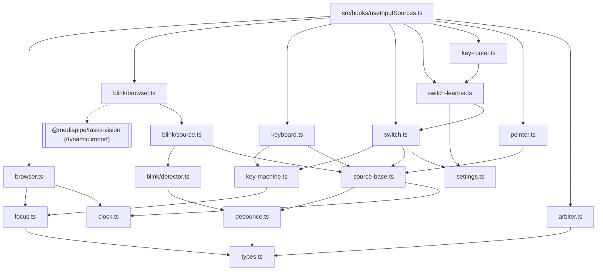
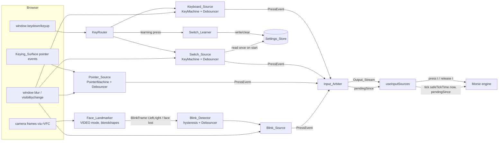
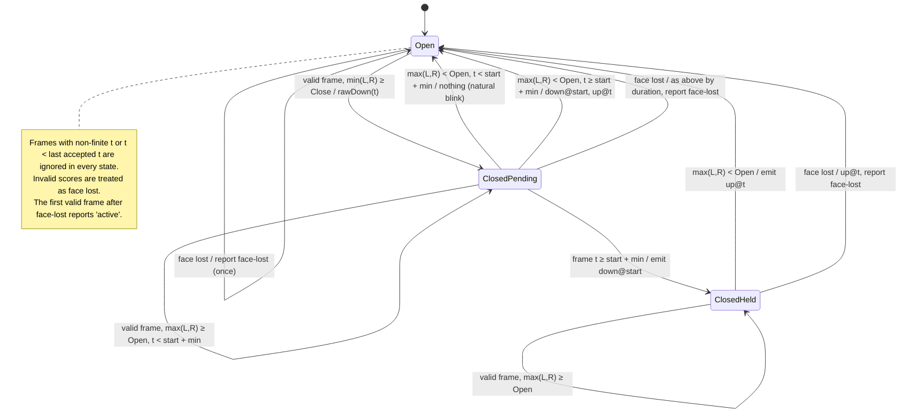
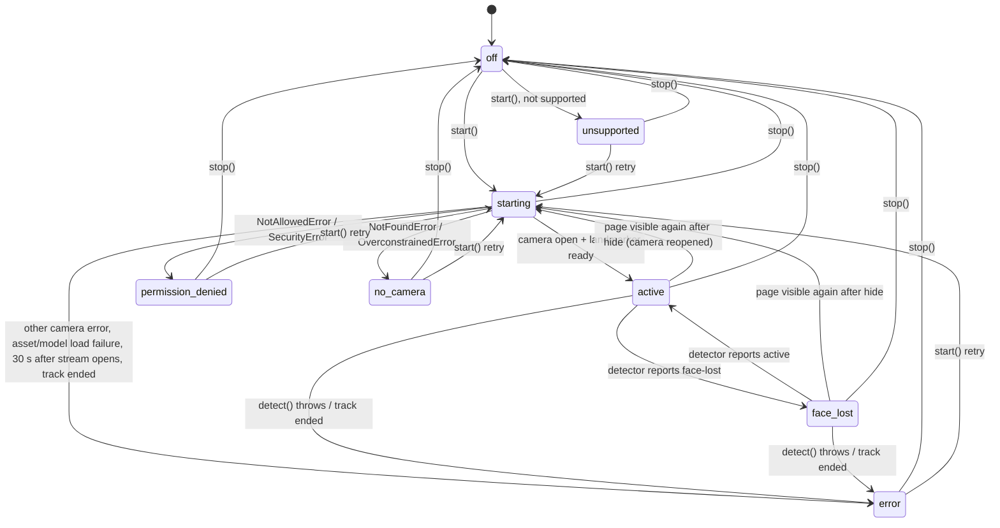

# Design Document: input-sources

## Overview

Input sources is the layer in `src/lib/input/` that turns one reliable movement into one stream of `{ kind, t, source }` Press_Events for the Morse engine. The engine calls `press(t)` for each `down` and `release(t)` for each `up`.

The layer has three kinds of parts:

- **Pure core** (no DOM, no React, no real clock): the Debouncer (`debounce.ts`), the Input_Arbiter reducer (`arbiter.ts`), the Blink_Detector (`blink/detector.ts`), focus classification (`focus.ts`), and the key and pointer decision logic inside `keyboard.ts`, `switch.ts` and `pointer.ts`. These take time as arguments and return events as values.
- **Sources**: the Keyboard_Source, Switch_Source, Pointer_Source and Blink_Source. Each one implements the Press_Source contract and owns exactly one Debouncer. Sources receive their browser dependencies (key event target, Keying_Surface, page lifecycle, scheduler, camera, Face_Landmarker) through small structural interfaces, so tests drive them with plain fake objects.
- **Browser adapters**: `src/lib/input/browser.ts` (window, document, `performance.now()`, timers) and `src/lib/input/blink/browser.ts` (`getUserMedia`, `requestVideoFrameCallback`, lazy MediaPipe). These are the only files in `src/lib/input/` that read globals, as `structure.md` requires.

A small React hook, `src/hooks/useInputSources.ts`, builds the sources once, connects them to the arbiter, starts and stops them from the enabled flags, forwards arbiter output to the caller, and exposes the pending-press signal.

Out of scope, per the requirements: Morse decoding, dot/dash classification, gap detection, calibration, UI layout, where settings are persisted, and how statuses are displayed.

### Sources

- Behaviour and numbers: `requirements.md` in this folder. Where steering and requirements differ in wording, requirements win.
- Conventions: `.kiro/steering/tech.md`, `structure.md`, `accessibility.md`, `morse-engine.md` (debounce belongs to the input layer; engine rejects stale timestamps).
- Engine API used by the consumer: `.kiro/specs/morse-engine/design.md` (`press`, `release`, `tick`, `nextDeadline`; `Result<T, E>` exported as a public type from `src/lib/morse/index.ts`).
- MediaPipe Face Landmarker for web, video running mode, `outputFaceBlendshapes`, `FilesetResolver.forVisionTasks(basePath)`: [Face landmark detection guide for Web](https://ai.google.dev/edge/mediapipe/solutions/vision/face_landmarker/web_js). The loader in `@mediapipe/tasks-vision@1.2.2` (`vision_bundle.mjs`) resolves `forVisionTasks(base)` to `${base}/vision_wasm_internal.js` and `${base}/vision_wasm_internal.wasm`; checked by reading the published package.
- Frame timestamps: [`HTMLVideoElement.requestVideoFrameCallback()`](https://developer.mozilla.org/en-US/docs/Web/API/HTMLVideoElement/requestVideoFrameCallback) passes a `now` value and frame metadata in the `performance.now()` time base.
- Pointer capture and `lostpointercapture`: [Pointer events (MDN)](https://developer.mozilla.org/en-US/docs/Web/API/Pointer_events). Long-press suppression: [`touch-action`](https://developer.mozilla.org/en-US/docs/Web/CSS/touch-action), [`user-select`](https://developer.mozilla.org/en-US/docs/Web/CSS/user-select), `-webkit-touch-callout`.
- `getUserMedia` error names (`NotAllowedError`, `SecurityError`, `NotFoundError`, `OverconstrainedError`): [MediaDevices.getUserMedia() (MDN)](https://developer.mozilla.org/en-US/docs/Web/API/MediaDevices/getUserMedia).
- fast-check API (`fc.commands`-free scripts built from `fc.array`, `fc.oneof`, `fc.double`, `fc.constantFrom`, `fc.record`, `fc.assert` with `numRuns`): [fast-check documentation](https://fast-check.dev/docs/introduction/).

### Key design decisions

| Decision | Rationale |
| --- | --- |
| **Blink debounce lives in exactly one place: the shared Debouncer in `debounce.ts`.** The Blink_Detector owns the Blink_Source's Debouncer instance and drives it with frame timestamps: a closing frame calls `rawDown(t)`, every accepted frame during a Closure calls `advance(t)`, and the frame that ends the Closure (open or face-lost) calls `advance(t)` then `rawUp(t)`. The detector itself implements only hysteresis and face status. The arbiter never debounces. | Req 3.3 (blink "reaches" Min_Press_Duration on the first frame with `t ≥ start + min`) and Req 8.4 to 8.6 (detector emits `down` at the Closure start once the Closure lasts Min_Press_Duration; short Closures emit nothing) describe the same rule. Implementing it once removes the chance of two thresholds drifting, and the debounce property (Req 3.12) and the minimum-closure property (Req 8.15) test the same code. |
| All duration comparisons use the deadline form `t >= downT + min`. | Matches the engine's convention and Req 3.3's wording. Req 8.4's `t − start ≥ min` can disagree by one ULP at the boundary; the deadline form makes `advance(deadline())` always confirm. Property generators use integer milliseconds so both forms agree in tests. |
| Each Press_Source owns its Debouncer and emits debounced Press_Events. | Req 1.4 (`stop()` discards the Pending_Press) and Req 1.9 (source output alternates) put debounce inside the source boundary. The arbiter sees only confirmed presses. |
| The arbiter is a pure reducer `arbiterStep(state, input)` plus a thin `createArbiter` wrapper that subscribes to sources and reads the injected Clock only when a source detaches. | Req 11.1 and 11.2. Detach is the only arbiter input that has no event timestamp (Req 2.9). |
| A source that becomes the Holder has its mark cleared, and an `up` from the Holder always ends the Held state before any mark is checked. | For conforming sources this never changes behaviour (a marked source's next event is its `up`, Req 1.9). For arbitrary inputs (Req 2.11 quantifies over all sequences) it rules out a stuck Held state where the Holder's `up` would be eaten by a stale mark. |
| Key handling is a pure decision machine (`KeyMachine`) shared by the Keyboard_Source and Switch_Source, parameterised by key codes and a focus rule. A `KeyRouter` gives the Switch_Learner first look at every key event. | Req 4 and Req 5.9 differ only in which codes count and which focus classes block. Req 5.5 needs one place that suppresses the learning press for every source. |
| Sources take structural interfaces (`KeyEventTarget`, `SurfaceElement`, `PageLifecycle`, `Scheduler`, `BlinkDevices`) instead of DOM types. `browser.ts` files bind them to real globals. | `structure.md` allows globals only in `browser.ts` files. Source tests then need no jsdom; jsdom is used only for the hook and the `describeElement` adapter. |
| Blink start is sequential: camera first, then assets and Face_Landmarker. | A denied or absent camera then downloads nothing (about 18 MB). The 30 s readiness limit (Req 9.11) starts when the stream opens, so the permission prompt is excluded by construction. |
| `@mediapipe/tasks-vision` is reached only through `await import(...)` inside `blink/browser.ts`, called from `start()`. Other files use `import type` only. | Req 9.1: no model or WebAssembly request before opt-in. Type imports are erased at build time, so the main bundle carries no MediaPipe code. |
| The Face_Landmarker instance is closed on every `stop()`, hide and failure, and rebuilt on the next start. | One lifecycle rule for camera and model. The browser HTTP cache keeps the rebuild to WebAssembly compile time. |
| Assets are served from a versioned path `public/mediapipe/1.2.2/`. | The version in the URL lets `next.config.ts` mark the files `immutable`, and an upgrade cannot mix old WebAssembly with a new loader. |
| The Blink_Detector starts with face status `'active'` as its most recently reported value. | The Blink_Source already reports `'active'` once ready (Req 9.2), so the first valid frame must not produce a second `'active'` report (Req 8.16). |

## Architecture

### Module layout

```
src/lib/input/
├── types.ts            # PressEvent, SourceKind, SourceStatus, PressSource, Unsubscribe, errors, ok()/err()
├── clock.ts            # Clock, Scheduler interfaces; createManualClock() / createManualScheduler() (pure fakes)
├── debounce.ts         # Debouncer (pure), debounceStep(), validateMinPressDuration(), MIN_PRESS_RANGES, defaults
├── arbiter.ts          # arbiterStep() (pure), createArbiter(), safeTickTime()
├── focus.ts            # FocusDescription, classifyFocus() (pure)
├── key-machine.ts      # KeyMachine (pure): keydown/keyup decisions for a set of codes + focus rule
├── key-router.ts       # KeyRouter: one keydown/keyup listener pair, learner first, then switch and keyboard
├── keyboard.ts         # createKeyboardSource()
├── switch.ts           # createSwitchSource(), isReservedKey(), validateSwitchKey()
├── switch-learner.ts   # createSwitchLearner()
├── pointer.ts          # PointerMachine (pure) + createPointerSource()
├── source-base.ts      # shared subscriber sets, status dedupe, lifecycle wiring used by every source
├── settings.ts         # SettingsStore interface, InputSettings, validateInputSettings()
├── browser.ts          # performanceClock, browserScheduler, browserPage, windowKeyTarget, describeElement()
├── blink/
│   ├── detector.ts     # BlinkDetector (pure), normalizeFrame(), validateThresholds(), DEFAULT_DETECTOR_CONFIG
│   ├── source.ts       # createBlinkSource(): status machine over injected BlinkDevices
│   └── browser.ts      # browserBlinkDevices(): getUserMedia, video element, rVFC loop, lazy MediaPipe
├── index.ts            # public barrel
├── test-support.ts     # fast-check arbitraries, fake targets, script runners (tests only)
└── *.test.ts, *.prop.test.ts
src/hooks/useInputSources.ts
scripts/mediapipe-assets.ts   # postinstall: copy + verify pinned MediaPipe assets
public/mediapipe/1.2.2/       # self-hosted wasm + model
```

`key-machine.ts`, `key-router.ts`, `switch-learner.ts`, `source-base.ts`, `settings.ts` and `blink/source.ts` are small additions to the file list in `structure.md`. Each one keeps a pure decision or a shared lifecycle rule out of the adapter code, so it can be tested without a DOM.

### Purity boundary

| Module | May reference globals | May import |
| --- | --- | --- |
| `debounce.ts`, `arbiter.ts`, `focus.ts`, `blink/detector.ts`, `key-machine.ts` | No (Req 11.1) | `types.ts`, `type Result` from `src/lib/morse` |
| `keyboard.ts`, `switch.ts`, `switch-learner.ts`, `pointer.ts`, `key-router.ts`, `source-base.ts`, `settings.ts`, `blink/source.ts`, `clock.ts` | No | pure modules, `types.ts`, `clock.ts` |
| `browser.ts`, `blink/browser.ts` | Yes | anything above; `blink/browser.ts` dynamically imports `@mediapipe/tasks-vision` |
| `src/hooks/useInputSources.ts` | Via `browser.ts` only | `src/lib/input` barrel, `react` |

An ESLint `no-restricted-globals` / `no-restricted-imports` override on the pure modules enforces the first row; a unit test also greps those files for the banned identifiers in Req 11.1.

### Dependency graph



### Data flow



### Consumer contract with the engine

The engine rejects `press(t)` with `t` below its last accepted timestamp. A Debouncer emits `down` with the Raw_Down timestamp, which can be up to Min_Press_Duration (2000 ms for blink) in the past. If the consumer called `tick(now)` while that press was pending, the later `press(rawDownT)` would be stale and dropped, and the engine would wrongly settle a letter or word gap that the speaker interrupted.

Rule: the consumer never advances the engine past `arbiter.pendingSince()`. `arbiter.ts` exports

```ts
export function safeTickTime(now: number, pendingSince: number | null): number;
// pendingSince === null ? now : Math.min(now, pendingSince)
```

and `useInputSources` exposes `pendingSince` plus an `onPendingChange` subscription. When the pending press is discarded, `pendingSince` becomes `null` and the consumer reschedules its engine timer from `engine.nextDeadline()`. This satisfies Req 2.13. The hook that drives the engine (owned by conversation-ui) applies the rule; this spec supplies the signal and the helper.

### Dependency on conversation-ui

After a partner activates a button, link or other control, the focused element is an Interactive_Target, so Space and Enter keep their native behaviour (Req 4.6). The conversation-ui spec must return focus to the Keying_Surface after a partner control finishes, so the next Space or Enter press keys Morse again. This spec relies on that behaviour but does not implement it. A learned switch key is unaffected, because it keys Morse on any non-editable focus (Req 4.9).

## Components and Interfaces

### types.ts

```ts
import type { Result } from '@/lib/morse';
export type { Result };
export const ok = <T>(value: T): Result<T, never> => ({ ok: true, value });
export const err = <E>(error: E): Result<never, E> => ({ ok: false, error });

export type SourceKind = 'keyboard' | 'switch' | 'pointer' | 'blink';
export const SOURCE_KINDS: readonly SourceKind[] = ['keyboard', 'switch', 'pointer', 'blink'];

export type PressKind = 'down' | 'up';

/** Exactly three fields (Req 1.1). Created only through pressEvent(). */
export interface PressEvent {
  readonly kind: PressKind;
  readonly t: number;          // finite ms in the Clock's time base
  readonly source: SourceKind;
}
export const pressEvent = (kind: PressKind, t: number, source: SourceKind): PressEvent =>
  Object.freeze({ kind, t, source });

export type SourceStatus =
  | 'off' | 'starting' | 'active' | 'face-lost'
  | 'permission-denied' | 'no-camera' | 'unsupported' | 'error';

export type FailureStatus = 'unsupported' | 'permission-denied' | 'no-camera' | 'error';

export type Unsubscribe = () => void;

/** The shared source contract (Req 1.2). */
export interface PressSource {
  readonly kind: SourceKind;
  start(): void;                                   // no-op unless status is 'off' (Req 1.3, 1.6); never throws
  stop(): void;                                    // no-op when status is 'off' (Req 1.4 to 1.6); never throws
  status(): SourceStatus;
  /** Raw_Down timestamp of the Debouncer's Pending_Press, or null (Req 2.13). */
  pendingSince(): number | null;
  onPress(listener: (event: PressEvent) => void): Unsubscribe;
  onStatus(listener: (status: SourceStatus) => void): Unsubscribe;
  onPending(listener: (since: number | null) => void): Unsubscribe;
}

export interface SettingError {
  readonly source: SourceKind;
  readonly setting: 'minPressDuration' | 'closeThreshold' | 'openThreshold';
  readonly value: unknown;
  readonly message: string;
}
```

`Blink_Source` failure statuses are `SourceStatus` values; the Blink_Source is the only producer of `'starting'`, `'face-lost'` and the four `FailureStatus` values.

### clock.ts

```ts
/** Returns the current time in ms, finite, same base for every source (performance.now()). */
export type Clock = () => number;

export interface Scheduler {
  /** Calls fn once at or after `delayMs`. Returns a cancel function. */
  schedule(delayMs: number, fn: () => void): () => void;
}

/** Pure fakes for tests and scripted replays. */
export interface ManualClock { readonly now: Clock; set(t: number): void; advance(ms: number): void; }
export function createManualClock(start?: number): ManualClock;
export interface ManualScheduler extends Scheduler { runDue(now: number): void; pending(): number; }
export function createManualScheduler(): ManualScheduler;
```

`browser.ts` exports `performanceClock: Clock = () => performance.now()` and `browserScheduler` (wrapping `setTimeout`/`clearTimeout`).

### debounce.ts

```ts
export const MIN_PRESS_RANGES: Readonly<Record<SourceKind, { min: number; max: number }>> = {
  keyboard: { min: 0, max: 500 }, switch: { min: 0, max: 500 },
  pointer: { min: 0, max: 500 },  blink: { min: 50, max: 2000 },
};
export const DEFAULT_MIN_PRESS: Readonly<Record<SourceKind, number>> = {
  keyboard: 30, switch: 30, pointer: 30, blink: 200,
};

export function validateMinPressDuration(kind: SourceKind, value: unknown): Result<number, SettingError>;

export type DebounceState =
  | { readonly phase: 'idle' }
  | { readonly phase: 'pending'; readonly downT: number; readonly min: number }
  | { readonly phase: 'confirmed'; readonly downT: number };

export type DebounceInput =
  | { readonly type: 'rawDown'; readonly t: number }
  | { readonly type: 'rawUp'; readonly t: number }
  | { readonly type: 'advance'; readonly now: number }
  | { readonly type: 'cancel' }                        // blur / hidden / stop: drop Pending_Press (Req 1.4, 7.3)
  | { readonly type: 'forceUp'; readonly now: number }; // end a Confirmed_Press at max(now, downT) (Req 1.5, 7.1, 7.2)

export function debounceStep(
  state: DebounceState, input: DebounceInput, kind: SourceKind, min: number,
): { readonly state: DebounceState; readonly events: readonly PressEvent[] };

export interface Debouncer {
  readonly kind: SourceKind;
  rawDown(t: number): readonly PressEvent[];
  rawUp(t: number): readonly PressEvent[];
  advance(now: number): readonly PressEvent[];
  cancel(): void;
  forceUp(now: number): readonly PressEvent[];
  isHeld(): boolean;                     // phase === 'confirmed'
  pendingSince(): number | null;         // downT when phase === 'pending'
  deadline(): number | null;             // downT + min when phase === 'pending'
  minPressDuration(): number;
  setMinPressDuration(value: unknown): Result<number, SettingError>;
}
export function createDebouncer(kind: SourceKind, min?: number): Debouncer;
```

Transition rules (`min` is captured into the `pending` state at Raw_Down, so a new setting applies from the next Raw_Down, Req 3.8 and 8.15):

| State | Input | Next state | Emits |
| --- | --- | --- | --- |
| idle | rawDown(t), min = 0 | confirmed(t) | `down@t` synchronously (Req 3.7) |
| idle | rawDown(t), min > 0 | pending(t, min) | nothing (Req 3.2) |
| pending | advance(now), `now >= downT + min` | confirmed | `down@downT` (Req 3.3) |
| pending | advance(now), otherwise | unchanged | nothing |
| pending | rawUp(t′), t = max(t′, downT), `t >= downT + min` | idle | `down@downT`, `up@t` (Req 3.6, 3.11) |
| pending | rawUp(t′), otherwise | idle | nothing (Req 3.4, 3.11) |
| confirmed | rawUp(t′) | idle | `up@max(t′, downT)` (Req 3.5, 3.11) |
| pending or confirmed | rawDown | unchanged | nothing (Req 3.9) |
| idle | rawUp, advance, cancel, forceUp | idle | nothing (Req 3.10, 7.8) |
| pending | cancel or forceUp | idle | nothing (Req 1.4, 7.3) |
| confirmed | forceUp(now) | idle | `up@max(now, downT)` |
| confirmed | cancel | unchanged | nothing (cancel only drops Pending_Presses) |
| any | input with non-finite `t`/`now` | unchanged | nothing |

`setMinPressDuration` validates with `validateMinPressDuration`. A failed Result names the Source_Kind and the setting and keeps the previous value (Req 3.8).

Timer-driven confirmation for keyboard, switch and pointer: after a `rawDown` that leaves the Debouncer pending, `source-base.ts` schedules `scheduler.schedule(deadline − clock(), check)`. `check` calls `advance(clock())`; if the Clock is still below the deadline (timer fired early), it reschedules. Any transition out of `pending` cancels the timer. The Blink_Source never schedules: its `advance` calls come from frames (Req 3.3).

### arbiter.ts

```ts
export interface ArbiterState {
  readonly holder: SourceKind | null;      // non-null ⇔ Held
  readonly lastT: number | null;           // t of the last Press_Event in the Output_Stream
  readonly marks: readonly SourceKind[];   // sources whose next 'up' is discarded; sorted, unique
}
export const INITIAL_ARBITER_STATE: ArbiterState;

export type ArbiterInput =
  | { readonly type: 'event'; readonly event: PressEvent }
  | { readonly type: 'detach'; readonly source: SourceKind; readonly now: number };

export function arbiterStep(
  state: ArbiterState, input: ArbiterInput,
): { readonly state: ArbiterState; readonly out: PressEvent | null };

export interface Arbiter {
  /** Subscribes to the source. Fails if a source of the same kind is already connected. */
  connect(source: PressSource): Result<Unsubscribe, { readonly kind: SourceKind; readonly message: string }>;
  onOutput(listener: (event: PressEvent) => void): Unsubscribe;
  isHeld(): boolean;
  holder(): SourceKind | null;
  /** Earliest pendingSince() across connected sources, or null (Req 2.13). */
  pendingSince(): number | null;
  onPendingChange(listener: (since: number | null) => void): Unsubscribe;
}
export function createArbiter(clock: Clock): Arbiter;
export function safeTickTime(now: number, pendingSince: number | null): number;
```

`arbiterStep` rules, checked in this order:

1. Event with non-finite `t`: no change, `out = null` (Req 2.8).
2. `down` with `lastT !== null && t < lastT`: no change (Req 2.8).
3. `down`, not Held: emit the event object unchanged, `holder = source`, `lastT = t`, remove `source` from `marks` (Req 2.1).
4. `down` from the Holder: no change (Req 2.3).
5. `down` from another source while Held: add `source` to `marks` if absent (Req 2.2).
6. `up` from the Holder: emit `up` with `t' = max(t, lastT)` (the original object when `t' === t`), `holder = null`, `lastT = t'` (Req 2.5, 2.7).
7. `up` from a marked source: remove the mark, no output (Req 2.4).
8. Any other `up`: no change (Req 2.6).
9. `detach(source, now)`: if `source` is the Holder, emit `up` with `source` and `t = max(now, lastT)` (falling back to `lastT` if `now` is non-finite) and leave Held (Req 2.9). In all cases remove `source` from `marks` (Req 2.10).

`createArbiter(clock)` holds one `ArbiterState`. `connect` subscribes to `onPress` (feeds `event` inputs), `onStatus` (on `'off'` or any `FailureStatus`, feeds `detach` with `clock()`), and `onPending` (recomputes the earliest pending timestamp and notifies only on change). The returned `Unsubscribe` feeds `detach` with `clock()` and removes the subscriptions (Req 2.9 "removed"). When a Held source stops, it emits its own `up` before reporting `'off'` (Req 1.5), so step 6 ends the Held state and step 9 finds no Holder: exactly one `up` (Req 2.9).

### focus.ts

```ts
export interface FocusDescription {
  readonly isBodyOrNull: boolean;
  readonly isKeyingSurface: boolean;
  readonly tagName: string;                 // lowercase, '' when isBodyOrNull
  readonly inputType: string | null;        // lowercase `type` attribute; null when absent
  readonly hasHref: boolean;
  readonly contentEditable: boolean;        // own or inherited true state (isContentEditable)
  readonly role: string | null;             // lowercase, trimmed; first token only
  readonly inOpenDialog: boolean;
}
export type FocusClass = 'keying' | 'editable' | 'interactive';
export function classifyFocus(d: FocusDescription): FocusClass;
```

`classifyFocus` order (Req 4.1, 4.8, Editable_Target in the glossary):

1. `isKeyingSurface` → `'keying'` (before every other rule).
2. Editable: `contentEditable`; `textarea`; `select`; `input` with `inputType` null, `''` or one of `text search email url tel password number`; or `inOpenDialog` and tag is `input`, `select` or `textarea` → `'editable'`.
3. `isBodyOrNull` → `'keying'`.
4. Interactive: `button`; `a`/`area` with `hasHref`; `input` with type other than `hidden`; `summary`; role in the 17 listed roles → `'interactive'`.
5. Otherwise → `'keying'`.

`input type="hidden"` is not editable and not interactive, so it classifies as `'keying'`; it cannot normally take focus anyway. `browser.ts` exports `describeElement(el: Element | null, surface: Element | null): FocusDescription`, the only DOM-reading part of focus handling.

### key-machine.ts

```ts
export type FocusRule = 'keyboard' | 'switch';
// keyboard: handle only when classifyFocus === 'keying' (Req 4.1, 4.6)
// switch:   handle unless classifyFocus === 'editable'   (Req 4.9, 5.9, 5.11)

export interface KeyMachineState {
  readonly active: string | null;                         // code holding the current raw press
  readonly ignored: ReadonlyMap<string, { readonly preventDefaultOnUp: boolean }>;
}
export interface KeyDecision {
  readonly state: KeyMachineState;
  readonly raw: 'down' | 'up' | null;
  readonly preventDefault: boolean;
}
export function keyDown(
  s: KeyMachineState, ev: { code: string; repeat: boolean },
  codes: ReadonlySet<string>, rule: FocusRule, focus: FocusClass,
): KeyDecision;
export function keyUp(s: KeyMachineState, ev: { code: string }): KeyDecision;
/** Blur, hide, stop, or switch-key change: forget the active press; its later keyup is swallowed (Req 7.4, 5.13). */
export function abandonActive(s: KeyMachineState): KeyMachineState;
```

`keyDown` decision table, for `ev.code ∈ codes` (other codes return `raw: null, preventDefault: false`):

| Condition | raw | preventDefault | State change |
| --- | --- | --- | --- |
| `repeat` and `code === active` | null | true | none (Req 4.3) |
| `repeat`, other code, focus allowed by rule | null | true | none (Req 4.5) |
| `repeat`, focus blocked | null | false | none (Req 4.3, 4.6) |
| focus blocked by rule | null | false | `ignored.set(code, { preventDefaultOnUp: false })` (Req 4.6, 5.11) |
| `active !== null` (another code holds the press) | null | true | `ignored.set(code, { preventDefaultOnUp: true })` (Req 4.4, 4.5) |
| otherwise | `'down'` | true | `active = code` (Req 4.1, 4.5, 5.9) |

`keyUp`: `code === active` → `raw: 'up'`, `preventDefault: true`, `active = null`, whatever the focus (Req 4.2). `code` in `ignored` → delete the entry, `raw: null`, `preventDefault` from the entry (Req 4.7). Otherwise no effect.

### key-router.ts

```ts
export interface KeyEventLike { readonly code: string; readonly repeat: boolean; preventDefault(): void; }
export interface KeyEventTarget {          // browser.ts binds this to window, capture phase
  addKeyListeners(onDown: (e: KeyEventLike) => void, onUp: (e: KeyEventLike) => void): Unsubscribe;
}
export interface KeyHandler { keyDown(e: KeyEventLike): void; keyUp(e: KeyEventLike): void; }

export interface KeyRouter {
  /** Registers a handler; the DOM listeners exist only while at least one handler or an armed learner is registered. */
  add(handler: KeyHandler): Unsubscribe;
  setLearner(learner: LearnerHook | null): void;
}
export interface LearnerHook {
  isArmed(): boolean;
  /** Returns true when the learner consumed the keydown. */
  offer(e: KeyEventLike): boolean;
}
export function createKeyRouter(target: KeyEventTarget): KeyRouter;
```

Dispatch:

- `keydown`: if the learner is armed and `offer(e)` returns true, add `e.code` to `learnSuppressed` and stop (Req 5.1, 5.2, 5.5). Otherwise pass to every handler.
- `keyup`: if `e.code ∈ learnSuppressed`, remove it and stop. This covers a `keyup` that arrives after the learner disarmed (Req 5.5). Otherwise pass to every handler.

The Keyboard_Source codes `{Space, Enter, NumpadEnter}` and the Learned_Switch_Key are disjoint because a Learned_Switch_Key is never a Reserved_Key, so at most one handler acts on any event.

Listening on `window` in the capture phase lets the sources call `preventDefault()` before a focused control sees the event.

### keyboard.ts and switch.ts

```ts
export interface KeySourceDeps {
  readonly router: KeyRouter;
  readonly clock: Clock;
  readonly scheduler: Scheduler;
  readonly page: PageLifecycle;
  readonly focus: () => FocusClass;          // hook passes () => classifyFocus(describeElement(document.activeElement, surface))
  readonly minPressDuration?: number;
}
export function createKeyboardSource(deps: KeySourceDeps): PressSource & {
  setMinPressDuration(v: unknown): Result<number, SettingError>;
};

export const RESERVED_KEYS: ReadonlySet<string>;  // Space, Enter, NumpadEnter, Tab, Escape
export function isReservedKey(code: string): boolean;
export function validateSwitchKey(value: unknown): string | null;  // non-empty, non-reserved string, else null (Req 5.8)

export interface SwitchSource extends PressSource {
  setMinPressDuration(v: unknown): Result<number, SettingError>;
  learnedKey(): string | null;
  /** Called by the learner and by clear; ends a Held press first (Req 5.13). */
  setLearnedKey(code: string | null): void;
}
export function createSwitchSource(deps: KeySourceDeps & { readonly store: SettingsStore }): SwitchSource;
```

On `start()`, the Switch_Source reads the store once and keeps `validateSwitchKey(read.value)`, or `null` when the read fails, without writing (Req 5.7, 5.8). With no key, `codes` is empty, so no event produces a raw input (Req 5.10).

`setLearnedKey`: if the KeyMachine has an active press, pass `rawUp(clock())` to the Debouncer and apply `abandonActive`, so the old key's later `keyup` is swallowed (Req 5.13). Then replace `codes`.

### switch-learner.ts

```ts
export type LearnError =
  | { readonly reason: 'reserved-input'; readonly code: string; readonly message: string }  // Space/Enter (Req 5.2)
  | { readonly reason: 'cancelled'; readonly message: string }                              // Req 5.4
  | { readonly reason: 'save-failed'; readonly message: string };                           // Req 5.12

export interface SwitchLearner {
  /** Arms the learner. Resolves on the next qualifying keydown or on cancel(). Never rejects. No timeout (Req 5.5). */
  arm(): Promise<Result<string, LearnError>>;
  cancel(): void;
  isArmed(): boolean;
  /** Clears the key (Req 5.6). */
  clear(): Result<void, { readonly reason: 'save-failed'; readonly message: string }>;
}
export function createSwitchLearner(deps: {
  readonly router: KeyRouter; readonly store: SettingsStore; readonly switchSource: SwitchSource;
}): SwitchLearner;
```

`offer(e)` while armed:

| Event | Action | Consumed |
| --- | --- | --- |
| `repeat` true | stay armed | no |
| `Tab` or `Escape` | stay armed, no `preventDefault` (Req 5.3) | no |
| `Space`, `Enter`, `NumpadEnter` | `preventDefault`, disarm, resolve `reserved-input` (Req 5.2) | yes |
| other non-empty code | `preventDefault`; `store.writeSwitchKey(code)`; on success `switchSource.setLearnedKey(code)` and resolve `ok(code)` (Req 5.1); on failure keep the previous key in use and stored, resolve `save-failed` (Req 5.12). Disarm in both cases. | yes |
| empty `code` | stay armed | no |

Calling `arm()` while armed resolves the earlier promise with `cancelled` first. `clear()` calls `store.clearSwitchKey()` and `switchSource.setLearnedKey(null)`; when the store fails it still clears the key in use and returns `save-failed`, because Req 5.6 asks for the key to be none.

### pointer.ts

```ts
export interface PointerEventLike {
  readonly pointerId: number; readonly isPrimary: boolean;
  readonly pointerType: string; readonly button: number;
  readonly target: unknown;
  preventDefault(): void;
}
export interface SurfaceElement {
  contains(target: unknown): boolean;
  on(type: 'pointerdown' | 'pointerup' | 'pointercancel' | 'lostpointercapture' | 'contextmenu',
     fn: (e: PointerEventLike) => void): Unsubscribe;
  setPointerCapture(id: number): boolean;        // false when the browser throws
  releasePointerCapture(id: number): void;       // never throws
  applyNoGestureStyle(): () => void;             // returns restore function
}
export interface DocumentPointerTarget {
  on(type: 'pointerup' | 'pointercancel', fn: (e: PointerEventLike) => void): Unsubscribe;
}

export type PointerState =
  | { readonly held: false }
  | { readonly held: true; readonly pointerId: number; readonly captured: boolean };

export function pointerDown(s: PointerState, e: PointerEventLike, onSurface: boolean):
  { state: PointerState; raw: 'down' | null };      // capture outcome applied by the source
export function pointerEnd(s: PointerState, e: { pointerId: number }):
  { state: PointerState; raw: 'up' | null };       // pointerup, pointercancel, lostpointercapture

export function createPointerSource(deps: {
  readonly surface: () => SurfaceElement | null;   // resolved at start()
  readonly doc: DocumentPointerTarget;
  readonly clock: Clock; readonly scheduler: Scheduler; readonly page: PageLifecycle;
  readonly minPressDuration?: number;
}): PressSource & { setMinPressDuration(v: unknown): Result<number, SettingError> };
```

Rules:

- `pointerDown` qualifies when not held, `isPrimary`, `onSurface`, and (`pointerType !== 'mouse'` or `button === 0`) (Req 6.1, 6.2). The source then calls `setPointerCapture`. If capture fails, it registers one-shot `pointerup`/`pointercancel` listeners on the document for that `pointerId` (Req 6.11).
- `pointerEnd` for the held `pointerId` returns `raw: 'up'` once and moves to not held, so a later `pointerup`, `pointercancel` or `lostpointercapture` for the same id does nothing (Req 6.3 to 6.5).
- `contextmenu` on the surface calls `preventDefault()` (Req 6.6).
- `applyNoGestureStyle()` sets `touch-action: none`, `user-select: none`, `-webkit-user-select: none` and `-webkit-touch-callout: none` on the Keying_Surface while active, and restores the previous inline values on stop (Req 6.7). `touch-action: none` blocks scroll and pinch zoom on the surface; the other three block selection and the iOS callout.
- Listeners exist only on the surface, the captured pointer and the fallback document listeners for a failed capture (Req 6.8, 6.9).
- `stop()` while held: `releasePointerCapture`, `forceUp(clock())`, remove listeners, status `'off'` (Req 6.10). The `lostpointercapture` that release triggers arrives after the listeners are gone.

### source-base.ts

Shared by every source so the contract rules in Requirement 1 and 7 are written once.

```ts
export interface PageLifecycle {           // browser.ts binds to window 'blur' and document 'visibilitychange'
  isHidden(): boolean;
  onBlur(fn: () => void): Unsubscribe;
  onHidden(fn: () => void): Unsubscribe;
  onVisible(fn: () => void): Unsubscribe;
}

export interface SourceCore {
  readonly kind: SourceKind;
  readonly debouncer: Debouncer;
  emit(events: readonly PressEvent[]): void;      // delivers to a snapshot of press listeners
  setStatus(next: SourceStatus): void;            // delivers only on change (Req 1.7)
  status(): SourceStatus;
  /** Wraps a Debouncer call: emits its events and updates the confirmation timer and pending listeners. */
  feed(call: (d: Debouncer) => readonly PressEvent[]): void;
  /** End or discard the current press: cancel() then forceUp(clock()). Idempotent (Req 7.7). */
  endPress(): void;
  readonly subscribers: Pick<PressSource, 'onPress' | 'onStatus' | 'onPending' | 'pendingSince'>;
}
export function createSourceCore(kind: SourceKind, clock: Clock, scheduler: Scheduler | null,
  debouncer: Debouncer): SourceCore;
```

- Listener sets are copied before delivery, so a listener that unsubscribes during delivery is not called again and others are unaffected (Req 1.10). Each listener call is wrapped in `try/catch` and errors are dropped silently (Req 10.10).
- `endPress()` is used for blur (keyboard, switch, pointer; Req 7.1, 7.3), hide (all sources; Req 7.2, 7.3) and stop (Req 1.4, 1.5). It also tells the source's machine to abandon the active key or pointer, so a later `keyup` or `pointerup` does nothing (Req 7.4). It does not change the Source_Status (Req 7.5). Because it resets the Debouncer to idle, a second call (blur then hide) emits nothing (Req 7.7, 7.8).
- The Blink_Source ignores `onBlur` (Req 7.6).
- Emitted `t` values come from the Debouncer, which returns only timestamps it was given: Raw_Down/Raw_Up from `clock()` for keyboard, switch and pointer, frame `t` for blink, and `clock()` for `forceUp` (Req 1.8).

`stop()` in every source runs, in order: `endPress()`, remove listeners and timers, release devices, `setStatus('off')`.

### blink/detector.ts

```ts
export type BlinkFrame =
  | { readonly t: number; readonly left: number; readonly right: number }
  | { readonly t: number; readonly face: 'lost' };

/** Loose shape accepted at the adapter boundary; normalizeFrame applies Req 8.10. */
export interface RawBlinkFrame { readonly t: number; readonly left?: unknown; readonly right?: unknown; readonly face?: 'lost'; }
export function normalizeFrame(f: RawBlinkFrame): BlinkFrame;

export interface DetectorConfig {
  readonly closeThreshold: number;   // default 0.5
  readonly openThreshold: number;    // default 0.35
  readonly minPressDuration: number; // default 200, valid 50..2000 (shared with the Blink Debouncer)
}
export const DEFAULT_DETECTOR_CONFIG: DetectorConfig;

export type EyeState = 'open' | 'closed';
export type FaceStatus = 'active' | 'face-lost';

export interface DetectorOutput {
  readonly events: readonly PressEvent[];   // source 'blink'
  readonly face: FaceStatus | null;          // non-null only when it changed (Req 8.16)
}

export interface ThresholdError {
  readonly invalid: readonly ('closeThreshold' | 'openThreshold')[];
  readonly message: string;
}
export function validateThresholds(close: unknown, open: unknown): Result<{ close: number; open: number }, ThresholdError>;

export interface BlinkDetector {
  push(frame: RawBlinkFrame): DetectorOutput;
  /** Page hidden / stop / failure: discard any Closure; Eye_State open. Returns nothing; the source ends a Held press with forceUp. */
  reset(): void;
  readonly debouncer: Debouncer;          // the single Blink Debouncer
  eyeState(): EyeState;
  setThresholds(close: unknown, open: unknown): Result<{ close: number; open: number }, ThresholdError>;
  setMinPressDuration(v: unknown): Result<number, SettingError>;
}
export function createBlinkDetector(config?: Partial<DetectorConfig>): Result<BlinkDetector, readonly (SettingError | ThresholdError)[]>;
```

`push(raw)`:

1. If `raw.t` is not finite, or `lastT !== null && raw.t < lastT`: return `{ events: [], face: null }` and change nothing (Req 8.11).
2. `lastT = raw.t`; `f = normalizeFrame(raw)`. A frame is `face: 'lost'` when `face === 'lost'`, or `left`/`right` is missing, non-finite, or outside `[0, 1]` (Req 8.10).
3. Face lost: if `closed`, call `debouncer.advance(t)` then `debouncer.rawUp(t)` and set `open` (Req 8.7, applying 8.4 to 8.6). Report `'face-lost'` if the last report differs (Req 8.8, 8.16).
4. Valid frame: if the last report is `'face-lost'`, report `'active'` (Eye_State is already `open`, Req 8.9). Then:
   - `open` and `min(left, right) >= close` → `closed`, `debouncer.rawDown(t)` (Req 8.1).
   - `open` otherwise → nothing (Req 8.3).
   - `closed` → `debouncer.advance(t)` (Req 8.4); then if `max(left, right) < open` → `debouncer.rawUp(t)`, set `open` (Req 8.2, 8.5, 8.6). Otherwise the Closure continues (Req 8.3).
5. Thresholds read at step 4 are the current values, so a change applies from the next frame without touching Eye_State or an open Closure (Req 8.12). The Debouncer captured `min` at the Closure start (Req 8.15).



`ClosedPending` and `ClosedHeld` are the Debouncer's `pending` and `confirmed` phases while Eye_State is `closed`.

### blink/source.ts

```ts
export interface CameraStream {
  readonly tracks: readonly { stop(): void; onEnded(fn: () => void): Unsubscribe; readonly readyState: 'live' | 'ended' }[];
}
export interface FrameLoop { stop(): void; }
export interface Landmarker {
  /** Returns blendshape scores of the first face, or null when no face (Req 9.4). Throws on internal failure. */
  detect(frameT: number): { left: number | undefined; right: number | undefined } | null;
  close(): void;
}
export interface BlinkDevices {
  isSupported(): boolean;                                       // getUserMedia is a function and WebAssembly exists (Req 10.1)
  openCamera(): Promise<CameraStream>;                          // rejects with { name: string }
  loadLandmarker(): Promise<Landmarker>;                        // dynamic import + self-hosted assets
  startFrames(stream: CameraStream, onFrame: (t: number) => void): FrameLoop;
}

export function createBlinkSource(deps: {
  readonly devices: BlinkDevices;
  readonly clock: Clock; readonly scheduler: Scheduler; readonly page: PageLifecycle;
  readonly config?: Partial<DetectorConfig>;
}): PressSource & {
  setThresholds(close: unknown, open: unknown): Result<{ close: number; open: number }, ThresholdError>;
  setMinPressDuration(v: unknown): Result<number, SettingError>;
};
```

Start sequence. Every async step checks that its `attempt` token still matches the current token. `stop()`, hide, failure and a new `start()` each increment the token, so late results are disposed of with no status change (Req 9.8, 10.5).

1. `start()` from `'off'` or a `FailureStatus` (Req 1.3, 10.9). If `!devices.isSupported()`: `setStatus('unsupported')` and return; no camera, no assets (Req 10.1).
2. `setStatus('starting')` (Req 9.2). Call `openCamera()`.
3. Camera rejects: `NotAllowedError`/`SecurityError` → `'permission-denied'`; `NotFoundError`/`OverconstrainedError` → `'no-camera'`; anything else → `'error'` (Req 10.2 to 10.4).
4. Camera opens: subscribe to every track's `ended` (Req 10.4). Schedule the 30 000 ms readiness timer (Req 9.11). Call `loadLandmarker()`.
5. Loader rejects → `'error'` (Req 9.3, 10.4). Timer fires first → `'error'`; a Landmarker that resolves later is closed at once (Req 9.11, 10.5).
6. Both ready: cancel the timer, `startFrames(stream, onFrame)`, `setStatus('active')` exactly once (Req 9.2).

`onFrame(t)`: call `landmarker.detect(t)` inside `try`. A throw → `'error'` (Req 10.4). Build a `RawBlinkFrame` (`null` → `{ t, face: 'lost' }`), `push` it, emit the events through `core.feed`, and map face reports: `'face-lost'` → status `'face-lost'` (camera stays open), `'active'` → status `'active'` (Req 9.12, 9.13). While status is `'starting'`, frames are not processed, so no Press_Event can appear (Req 9.2).

Failure path `fail(status)` (Req 10.6, 10.7): `core.endPress()` (emits one `up@clock()` if Held, discards a Pending_Press), `detector.reset()`, stop the frame loop, stop every track, close the Landmarker, increment the token, `setStatus(status)`. While in a `FailureStatus`, `onVisible` does nothing (Req 10.8).

Hide (Req 9.9, 7.2): synchronously, in the `visibilitychange` handler, `core.endPress()`, `detector.reset()`, stop frames and tracks, close the Landmarker, increment the token, set `resumeOnVisible = true`. Status is left unchanged (Req 7.5). The work is synchronous, so it finishes well within 500 ms. A track `ended` event caused by this is ignored because the token changed.

Visible (Req 9.10): if `resumeOnVisible` and `stop()` was not called, rerun steps 2 to 6.

`stop()`: `endPress()`, `detector.reset()`, stop frames and tracks, close the Landmarker, increment the token, `resumeOnVisible = false`, `setStatus('off')` (Req 9.7, 9.8). From a `FailureStatus` this only sets `'off'` (Req 10.9).



While hidden the status keeps its last value (`active` or `face-lost`) with the camera released; the `active → starting` edge happens on the visible event.

### blink/browser.ts

```ts
export function browserBlinkDevices(opts?: { readonly assetBase?: string }): BlinkDevices;
// assetBase default: '/mediapipe/1.2.2'
```

- `isSupported`: `typeof navigator.mediaDevices?.getUserMedia === 'function' && typeof WebAssembly === 'object'`.
- `openCamera`: `getUserMedia({ video: { facingMode: 'user', width: { ideal: 640 }, height: { ideal: 480 } }, audio: false })`. The stream is attached to an off-DOM `<video muted playsinline>` element that is never appended or shown by this module.
- `loadLandmarker`: `const { FilesetResolver, FaceLandmarker } = await import('@mediapipe/tasks-vision')`, then `FilesetResolver.forVisionTasks(`${assetBase}/wasm`)` and `FaceLandmarker.createFromOptions(vision, { baseOptions: { modelAssetPath: `${assetBase}/face_landmarker.task`, delegate: 'GPU' }, runningMode: 'VIDEO', numFaces: 1, outputFaceBlendshapes: true })`. If GPU creation fails, retry once with `delegate: 'CPU'` before rejecting. Both paths are same-origin, and no fallback URL exists (Req 9.3).
- `detect(t)`: `detectForVideo(video, t)`; reads `faceBlendshapes[0]?.categories` and finds `eyeBlinkLeft` and `eyeBlinkRight` by `categoryName`. Returns `null` when there is no first face. MediaPipe requires strictly increasing timestamps, so a frame whose `t` is not greater than the last one passed to MediaPipe is skipped.
- `startFrames`: uses `video.requestVideoFrameCallback((now, meta) => onFrame(meta.captureTime ?? meta.expectedDisplayTime ?? now))` and re-registers after each frame. All three values are in the `performance.now()` base (Req 9.5). Where `requestVideoFrameCallback` is missing, it falls back to `requestAnimationFrame` with `performance.now()`.
- No frame, score or landmark is stored, logged or sent (Req 9.6, 11.7). The module has no `fetch` call besides MediaPipe's own same-origin asset loads.

### browser.ts

```ts
export const performanceClock: Clock;
export const browserScheduler: Scheduler;
export function browserPage(): PageLifecycle;                    // window 'blur', document 'visibilitychange'
export function windowKeyTarget(): KeyEventTarget;               // window keydown/keyup, capture phase
export function surfaceElement(el: HTMLElement): SurfaceElement; // wraps capture calls in try/catch
export function documentPointerTarget(): DocumentPointerTarget;
export function describeElement(el: Element | null, surface: Element | null): FocusDescription;
```

### settings.ts

```ts
export interface StoreError { readonly message: string; }
export interface SettingsStore {
  readSwitchKey(): Result<unknown, StoreError>;       // unknown: validated by validateSwitchKey (Req 5.8)
  writeSwitchKey(code: string): Result<void, StoreError>;
  clearSwitchKey(): Result<void, StoreError>;
}
export interface InputSettings {
  readonly minPressDuration: Readonly<Record<SourceKind, number>>;
  readonly closeThreshold: number;
  readonly openThreshold: number;
}
export const DEFAULT_INPUT_SETTINGS: InputSettings;
export function validateInputSettings(value: unknown): Result<InputSettings, readonly (SettingError | ThresholdError)[]>;
```

The conversation layer implements `SettingsStore` and persists `InputSettings` with its own Zod schema; it passes validated values into the sources' setters. `validateInputSettings` uses the same range checks as the setters, so both paths agree.

### src/hooks/useInputSources.ts

```ts
'use client';
export interface UseInputSourcesOptions {
  readonly surfaceRef: React.RefObject<HTMLElement | null>;
  readonly enabled: Readonly<Record<SourceKind, boolean>>;  // blink must only become true from a user action (Req 9.1)
  readonly settings: InputSettings;
  readonly store: SettingsStore;
  readonly onPress: (event: PressEvent) => void;           // Output_Stream, in order
}
export interface UseInputSourcesResult {
  readonly statuses: Readonly<Record<SourceKind, SourceStatus>>;
  readonly pendingSince: () => number | null;               // read at timer time, not render time
  readonly onPendingChange: (fn: (since: number | null) => void) => Unsubscribe;
  readonly learner: SwitchLearner;
  readonly learnedKey: string | null;
  readonly clock: Clock;
}
export function useInputSources(opts: UseInputSourcesOptions): UseInputSourcesResult;
```

- Builds `performanceClock`, `browserScheduler`, `browserPage()`, the KeyRouter, the four sources, the learner and the arbiter once per mount (`useRef` + lazy init), connects every source, and subscribes `onPress` to `arbiter.onOutput` through a ref so a changing callback does not reconnect anything.
- A `useEffect` keyed on each `enabled` flag calls `start()` or `stop()`. Unmount stops every source and disconnects it.
- A `useEffect` keyed on `settings` calls the setters; failed Results are ignored because the conversation layer validated first.
- Statuses are mirrored into React state through `onStatus`. `pendingSince` stays a function so the engine timer reads the live value without re-rendering on every press.
- `browserBlinkDevices` is imported statically (it is small); the MediaPipe package is fetched only by its `loadLandmarker` (Req 9.1).

### index.ts

Re-exports the public types, `createArbiter`, `safeTickTime`, `createDebouncer`, `validateMinPressDuration`, `classifyFocus`, the source factories, `createSwitchLearner`, `createKeyRouter`, `createBlinkDetector`, `validateThresholds`, `validateInputSettings`, `DEFAULT_INPUT_SETTINGS`, `DEFAULT_DETECTOR_CONFIG`, `MIN_PRESS_RANGES`. Browser adapters are imported from their own files by the hook, so lib tests never load them. `test-support.ts` is not re-exported.

### Self-hosted MediaPipe assets

| Item | Value |
| --- | --- |
| Package | `@mediapipe/tasks-vision` pinned to exactly `1.2.2` (no caret) in `dependencies` |
| WebAssembly | `node_modules/@mediapipe/tasks-vision/wasm/vision_wasm_internal.js` (≈334 KB) and `vision_wasm_internal.wasm` (≈14.6 MB) → `public/mediapipe/1.2.2/wasm/`. The `vision_wasm_module_internal.*` pair is only used by `forVisionTasks(base, true)` and is not copied. |
| Model | `face_landmarker.task`, float16 v1, 3 758 596 bytes (≈3.6 MiB), SHA-256 `64184e229b263107bc2b804c6625db1341ff2bb731874b0bcc2fe6544e0bc9ff`, source `https://storage.googleapis.com/mediapipe-models/face_landmarker/face_landmarker/float16/1/face_landmarker.task` → `public/mediapipe/1.2.2/face_landmarker.task` |
| Total first-use download | ≈18.7 MB uncompressed (the `.wasm` compresses well over Brotli/gzip on Vercel). Nothing is downloaded until the user enables blink input. |

`scripts/mediapipe-assets.ts`, run by `"postinstall": "bun scripts/mediapipe-assets.ts"` and available as `bun run assets:mediapipe`:

1. Copies the two WebAssembly files from `node_modules` into `public/mediapipe/1.2.2/wasm/` (offline, deterministic). The copied files are gitignored.
2. Verifies the model file in `public/mediapipe/1.2.2/` against the pinned SHA-256. The model is committed to the repository (Apache-2.0, 3.6 MiB) so installs and Vercel builds need no network access to a third party. `bun run assets:mediapipe -- --fetch-model` downloads and verifies it when it is missing (maintainers only).
3. Fails the install with a clear message if the package version in `node_modules` differs from the pinned `1.2.2` or the hash does not match, so an upgrade must update the path, the hash and the script together.

Bun runs the root package's own `postinstall`; dependency lifecycle scripts are not needed. `next.config.ts` adds `Cache-Control: public, max-age=31536000, immutable` for `/mediapipe/:path*`. Next.js serves `.wasm` with `application/wasm`, which `WebAssembly.instantiateStreaming` requires.

## Data Models

### Press_Event

| Field | Type | Constraint |
| --- | --- | --- |
| `kind` | `'down' \| 'up'` | |
| `t` | `number` | finite ms, Clock time base |
| `source` | `SourceKind` | equals the emitting source's kind |

Frozen object with exactly these keys (`pressEvent()` is the only constructor).

### Source state summary

| Component | State | Notes |
| --- | --- | --- |
| Debouncer | `DebounceState` (`idle` / `pending{downT,min}` / `confirmed{downT}`) | `min` captured at Raw_Down |
| KeyMachine | `{ active: string \| null, ignored: Map<code, {preventDefaultOnUp}> }` | one per key source |
| PointerMachine | `{ held: false } \| { held: true, pointerId, captured }` | |
| Arbiter | `{ holder, lastT, marks }` | `marks` sorted unique array for equality checks |
| Blink_Detector | `{ eye: EyeState, lastT: number \| null, lastFace: FaceStatus, close, open }` + its Debouncer | `lastFace` starts `'active'` |
| Blink_Source | `{ status, attempt: number, resumeOnVisible, stream?, landmarker?, loop?, timer? }` | `attempt` token guards async results |
| Switch_Learner | `{ armed: boolean, resolve?: (r) => void }` | KeyRouter holds `learnSuppressed: Set<code>` |

### Defaults and ranges

| Setting | Default | Valid |
| --- | --- | --- |
| Min_Press_Duration keyboard / switch / pointer | 30 ms | 0 to 500 ms, finite |
| Min_Press_Duration blink | 200 ms | 50 to 2000 ms, finite |
| Close_Threshold | 0.5 | finite, `0 < Open < Close ≤ 1` |
| Open_Threshold | 0.35 | finite, `0 < Open < Close ≤ 1` |
| Face_Landmarker readiness limit | 30 000 ms after stream opens | fixed |
| Hide release limit | 500 ms | met synchronously |

### Errors

| Type | Fields | Produced by |
| --- | --- | --- |
| `SettingError` | `source`, `setting`, `value`, `message` | `validateMinPressDuration`, setters (Req 3.8) |
| `ThresholdError` | `invalid[]`, `message` | `validateThresholds` (Req 8.13) |
| `LearnError` | `reason: 'reserved-input' \| 'cancelled' \| 'save-failed'`, `message` | Switch_Learner (Req 5.2, 5.4, 5.12) |
| `StoreError` | `message` | Settings_Store implementations |
| Blink failures | `SourceStatus` only | Blink_Source (Req 10.10) |

Error messages name the Source_Kind or threshold and the accepted range. They never contain a key code from a live press, a pointer coordinate or a score (Req 11.7). The `reserved-input` error carries the code, but only for the key the partner pressed while learning.

## Correctness Properties

*A property is a characteristic or behavior that should hold true across all valid executions of a system-essentially, a formal statement about what the system should do. Properties serve as the bridge between human-readable specifications and machine-verifiable correctness guarantees.*

PBT fits this feature: the arbiter, Debouncer, Blink_Detector, focus classification and the key and pointer machines are pure functions over event sequences with a large input space. Camera, MediaPipe, CSS gesture behaviour and asset hosting are covered by example, integration and manual tests instead (see Testing Strategy).

Reflection, applied before writing this list:

- Arbiter criteria 2.1 to 2.5, 2.7, 2.9 and 2.10 are folded into one model-based property (Property 1) together with the alternation criterion 2.11, because checking the output against a reference model already checks each rule.
- Debouncer criteria 3.2 to 3.7 and 3.9 to 3.11 are folded into the debounce property (Property 5).
- Min_Press_Duration and threshold validation (3.8, 8.12, 8.13) share one error-condition property (Property 7).
- Requirement 1 lifecycle criteria, the pointer state criteria and the focus-loss criteria in Requirement 7 are folded into one source lifecycle property (Property 14), run once per DOM-event source.
- Criteria 1.8 and 11.2 (timestamps come from inputs) are merged into the determinism property (Property 17) with 11.4 and 11.5.

### Property 1: Arbiter alternation and model conformance

*For any* sequence of arbiter inputs (Press_Events from any mix of Source_Kinds with arbitrary `kind`, finite or non-finite `t`, increasing or decreasing timestamps, plus `detach` inputs), the Output_Stream is empty or starts with `down`, strictly alternates `down` and `up`, has finite non-decreasing `t`, gives each `up` the `source` of the `down` before it, contains only objects with exactly the keys `kind`, `t`, `source`; and it equals, event for event, the output of a straightforward reference implementation of rules 1 to 9 in `arbiterStep`.

**Validates: Requirements 1.1, 2.1, 2.2, 2.3, 2.4, 2.5, 2.7, 2.9, 2.10, 2.11**

File: `src/lib/input/arbiter.prop.test.ts`. Generator: `fc.array(fc.oneof(eventArb, detachArb), { maxLength: 200 })` where `eventArb` draws `source` from `SOURCE_KINDS`, `kind` from `['down','up']`, and `t` from a running integer clock with steps in `[-50, 300]` (negative steps produce stale events), with 5% weight on `NaN`, `Infinity`, `-Infinity`. A second generator interleaves 2 to 4 well-formed per-source streams (each alternating, non-decreasing) so overlap cases dominate.

### Property 2: Single-source pass-through

*For any* single Source_Kind and any sequence of Press_Events from that kind that starts with `down`, strictly alternates, and has finite non-decreasing `t`, the Output_Stream is equal to the input sequence with every field of every event unchanged.

**Validates: Requirements 2.12**

File: `src/lib/input/arbiter.prop.test.ts`. Generator: `fc.constantFrom(...SOURCE_KINDS)` and `fc.array(fc.nat({ max: 2000 }))` of gaps, turned into alternating events by prefix sums (zero gaps allowed so equal timestamps occur).

### Property 3: Discarded arbiter inputs change nothing

*For any* reachable arbiter state and any input that the rules discard (a `down` with `t` below `lastT`, any event with non-finite `t`, an `up` from a non-Holder unmarked source, or any `up` while not Held from an unmarked source), `arbiterStep` returns a state deep-equal to the input state and `out === null`.

**Validates: Requirements 2.6, 2.8**

File: `src/lib/input/arbiter.prop.test.ts`. Generator: reach a state by replaying a Property 1 sequence, then draw a discardable input with `fc.oneof` over the four cases, built from that state's `lastT`, `holder` and `marks`.

### Property 4: Pending signal is the earliest pending Raw_Down

*For any* set of connected fake sources, each reporting `pendingSince` as `null` or a finite number, and any sequence of pending changes, `arbiter.pendingSince()` equals the minimum of the non-null values, or `null` when all are null; and `safeTickTime(now, arbiter.pendingSince())` is never greater than that minimum.

**Validates: Requirements 2.13**

File: `src/lib/input/arbiter.prop.test.ts`. Generator: `fc.array(fc.record({ kind: fc.constantFrom(...SOURCE_KINDS), since: fc.option(fc.integer({ min: 0, max: 1e6 })) }))` applied to fake sources, plus `now` from `fc.integer`.

### Property 5: Debounce property

*For any* Source_Kind, any valid Min_Press_Duration for it, and any sequence of `rawDown`, `rawUp` and `advance` inputs with arbitrary (including decreasing and repeated) timestamps, the Debouncer's output strictly alternates `down`, `up` starting with `down`; every emitted pair has `up.t − down.t ≥ Min_Press_Duration`; each `down.t` equals the Raw_Down timestamp of its press; and the emitted pairs equal exactly the presses that a reference model accepts (first Raw_Down while idle, matched with the next Raw_Up clamped to the Raw_Down time, kept when the clamped duration is at least Min_Press_Duration), in the same order. With Min_Press_Duration 0, every accepted Raw_Down emits `down` in the same call.

**Validates: Requirements 3.2, 3.3, 3.4, 3.5, 3.6, 3.7, 3.9, 3.10, 3.11, 3.12**

File: `src/lib/input/debounce.prop.test.ts`. Generator: `fc.array(fc.record({ type: fc.constantFrom('rawDown','rawUp','advance'), dt: fc.integer({ min: -100, max: 800 }) }))` turned into absolute integer timestamps; `min` from `fc.integer` within `MIN_PRESS_RANGES[kind]`, with `fc.constant(0)` and the range ends weighted in. For blink, `advance` stands for frame arrivals.

### Property 6: Debouncers are independent and capture their setting per press

*For any* two Debouncers of different Source_Kinds fed interleaved input sequences, changing the Min_Press_Duration of one leaves the other's output identical; and *for any* single Debouncer, changing Min_Press_Duration to a new valid value while a press is pending or confirmed produces the same output for that press as not changing it, with the new value applied from the next Raw_Down.

**Validates: Requirements 3.1, 3.8**

File: `src/lib/input/debounce.prop.test.ts`. Generator: two Property 5 scripts, an interleaving from `fc.shuffledSubarray` over tagged indices, and a set-min input inserted at a random index.

### Property 7: Invalid settings are rejected and leave the previous values in effect

*For any* Source_Kind and any value from `fc.anything()` or a number outside the kind's inclusive range or non-finite, `setMinPressDuration` returns a failed Result whose error names the Source_Kind and `minPressDuration`, and `minPressDuration()` is unchanged; *for any* threshold pair that is non-finite or violates `0 < open < close ≤ 1`, `setThresholds` returns a failed Result listing exactly the invalid thresholds and both previous values remain; and *for any* valid pair, it succeeds and the next pushed frame uses the new values without changing Eye_State or ending an open Closure.

**Validates: Requirements 3.8, 8.12, 8.13**

File: `src/lib/input/debounce.prop.test.ts` (min duration) and `src/lib/input/blink/detector.prop.test.ts` (thresholds), one test each with the same property tag. Generator: `fc.oneof(fc.anything(), fc.double(), fc.constantFrom(NaN, Infinity, -Infinity, -1, 501, 2001, 49))` for invalid values and `fc.double({ min: 0, max: 1, noNaN: true })` pairs filtered by validity for thresholds. "Exactly the invalid thresholds": `close` is invalid when not finite or outside `(0, 1]`; `open` is invalid when not finite or `≤ 0`; when both are individually valid but `open ≥ close`, both are named.

### Property 8: Blink hysteresis

*For any* sequence of Blink_Frames, any valid thresholds, and any starting Eye_State reached by a prefix, Eye_State changes from `open` to `closed` only on an accepted valid frame with `min(left, right) ≥ Close_Threshold`, changes from `closed` to `open` only on an accepted valid frame with `max(left, right) < Open_Threshold` or on an accepted face-lost frame, and never changes on frames whose scores stay at or above Open_Threshold and below Close_Threshold.

**Validates: Requirements 8.1, 8.2, 8.3, 8.7, 8.14**

File: `src/lib/input/blink/detector.prop.test.ts`. Generator: frames with integer `t` steps from `fc.integer({ min: -20, max: 120 })` (about 33 ms is a 30 fps frame); scores from `fc.oneof` over three bands (below open, between, at or above close) weighted so the between band is common, plus exact threshold values; 10% face-lost frames. A band-only generator ("between" scores only) checks the no-toggle clause directly.

### Property 9: Minimum closure

*For any* sequence of Blink_Frames and any valid blink Min_Press_Duration, the detector's Press_Events strictly alternate `down` and `up` starting with `down`, all with source `'blink'`; every pair has `up.t − down.t ≥` the Min_Press_Duration in effect at the Closure start; `down.t` equals the Closure start frame's `t` and `up.t` equals the ending frame's `t`; every Closure whose duration is at least Min_Press_Duration yields exactly one pair, and every shorter Closure yields none.

**Validates: Requirements 8.4, 8.5, 8.6, 8.15**

File: `src/lib/input/blink/detector.prop.test.ts`. Generator: build frames from a list of intended Closures `fc.array(fc.record({ gap: fc.integer({ min: 0, max: 600 }), len: fc.integer({ min: 0, max: 2500 }), endBy: fc.constantFrom('open','lost') }))`, sampled at 33 ms with jitter, plus random Min_Press_Duration changes between Closures and mid-Closure. The reference model computes Closure starts and ends from the frames.

### Property 10: Face status reports are deduplicated and correct

*For any* sequence of Blink_Frames, the non-null `face` outputs alternate strictly between `'face-lost'` and `'active'` starting with `'face-lost'`; `'face-lost'` is reported exactly on the first accepted face-lost frame after the last `'active'` (or after creation); `'active'` is reported exactly on the first accepted valid frame after a `'face-lost'`; and the frame that reports `'active'` is processed from Eye_State `open`.

**Validates: Requirements 8.8, 8.9, 8.16**

File: `src/lib/input/blink/detector.prop.test.ts`. Generator: Property 8 frames with 30 to 50% face-lost weight and runs of consecutive lost and valid frames.

### Property 11: Invalid and stale frames

*For any* detector state reached by a prefix and any frame whose `t` is non-finite or below the last accepted `t`, `push` returns no events and no face report and leaves Eye_State, the Closure and the Debouncer unchanged; and *for any* frame with an accepted `t` whose `left` or `right` is missing, non-numeric, non-finite or outside `[0, 1]`, `push` returns the same output and next state as `push({ t, face: 'lost' })` on a copy of the detector.

**Validates: Requirements 8.10, 8.11**

File: `src/lib/input/blink/detector.prop.test.ts`. Generator: prefix from Property 8; bad scores from `fc.oneof(fc.constant(undefined), fc.constantFrom(NaN, Infinity, -0.01, 1.01), fc.string(), fc.anything())`.

### Property 12: Focus classification is total, pure and keying-first

*For any* `FocusDescription`, `classifyFocus` returns exactly one of `'keying'`, `'editable'`, `'interactive'`, returns the same value on repeated calls with an equal description, returns `'keying'` whenever `isKeyingSurface` is true regardless of every other field, and otherwise agrees with a reference table of the Editable_Target and Interactive_Target rules.

**Validates: Requirements 4.8, 11.3**

File: `src/lib/input/focus.prop.test.ts`. Generator: `fc.record` over all fields, with `tagName` from `fc.oneof(fc.constantFrom('input','textarea','select','button','a','area','summary','div','span','body',''), fc.string())`, `inputType` from the listed text types plus `'hidden'`, `'checkbox'`, `'range'`, `null` and random strings, and `role` from the 17 roles plus random strings and `null`.

### Property 13: Key routing respects focus and alternates raw inputs

*For any* sequence of `keydown`/`keyup` events over codes drawn from `{Space, Enter, NumpadEnter, Tab, Escape, KeyA, the learned code, random}` with random `repeat` flags and a random focus class per event, run through the KeyMachine with the keyboard rule and with the switch rule: the raw outputs strictly alternate `down`, `up` starting with `down`; each raw `up` has the same code as the raw `down` before it; a raw `down` occurs only when the focus is allowed by the rule (keying for keyboard, not editable for switch), `repeat` is false and no press is active; `preventDefault` is never requested for a `keydown` whose focus is blocked by the rule or for the matching `keyup`; and a `keyup` whose `keydown` produced no raw `down` produces no raw `up`.

**Validates: Requirements 4.1, 4.2, 4.3, 4.4, 4.5, 4.6, 4.7, 4.9, 5.9, 5.11**

File: `src/lib/input/key-machine.prop.test.ts`. Generator: `fc.array(fc.record({ type: fc.constantFrom('down','up'), code: codeArb, repeat: fc.boolean(), focus: fc.constantFrom('keying','editable','interactive') }))` with a bias that emits matching `keyup`s for recent `keydown`s so presses complete.

### Property 14: Source lifecycle contract

*For any* script of operations on a Keyboard_Source, Switch_Source or Pointer_Source built with fake targets, a manual Clock and a manual Scheduler (operations: `start`, `stop`, raw key or pointer events with random fields, clock advances that fire due timers, `blur`, `hide`, `show`): the emitted Press_Events strictly alternate starting with `down` after each `start`, have the source's kind and non-decreasing `t`; no Press_Event is emitted while the status is `'off'`; every `stop`, `blur` or `hide` while Held emits exactly one `up` with `t` equal to the Clock at that operation, and a following `blur`/`hide`/`keyup`/`pointerup` for the same press emits nothing; every `stop`, `blur` or `hide` while pending emits nothing and the press never appears; `start` reports `'active'` before returning; redundant `start`/`stop` calls change no status, emit nothing and register or remove no listener; consecutive status deliveries are never equal; and after `stop` the fake targets hold zero listeners, zero timers and no pointer capture.

**Validates: Requirements 1.3, 1.4, 1.5, 1.6, 1.7, 1.9, 6.1, 6.2, 6.3, 6.4, 6.5, 6.9, 6.10, 7.1, 7.2, 7.3, 7.4, 7.5, 7.7, 7.8**

File: `src/lib/input/sources.prop.test.ts`, one `fc.assert` that draws the source kind with `fc.constantFrom('keyboard','switch','pointer')`. Generator: `fc.array(opArb, { maxLength: 150 })`; pointer events draw `pointerId` from `{1, 2, 3}`, `isPrimary`, `pointerType` from `['mouse','touch','pen']`, `button` from `{0, 1, 2}`, on- or off-surface target, and capture success or failure. Blink hide behaviour is covered by examples because the Blink_Source is asynchronous.

### Property 15: The learning press never keys Morse

*For any* non-empty, non-reserved key code and any surrounding sequence of key events, when the Switch_Learner is armed and that code's non-repeat `keydown` arrives (with the matching `keyup` at any later point, before or after other events), the Switch_Learner resolves `ok(code)`, the store holds `code`, the Switch_Source uses `code` for later presses, and neither the Keyboard_Source nor the Switch_Source emits any Press_Event for that `keydown` or its `keyup`.

**Validates: Requirements 5.1, 5.5**

File: `src/lib/input/switch-learner.prop.test.ts`. Generator: `fc.string({ minLength: 1 }).filter((c) => !isReservedKey(c))`, plus a Property 13 sequence split at a random point for the arming moment and the `keyup` position.

### Property 16: Stored switch keys are validated without writing

*For any* value returned by `SettingsStore.readSwitchKey()` (including failed Results, non-strings, empty strings and Reserved_Keys), the Switch_Source's Learned_Switch_Key after `start()` is that value when it is a non-empty, non-reserved string and `null` otherwise, and the store receives no write or clear call.

**Validates: Requirements 5.8**

File: `src/lib/input/switch.prop.test.ts`. Generator: `fc.oneof(fc.anything(), fc.constantFrom('', 'Space', 'Enter', 'NumpadEnter', 'Tab', 'Escape'), fc.string())`, wrapped in `ok` or replaced by `err`.

### Property 17: Determinism, input-only timestamps and no mutation

*For any* script of source inputs (Raw_Down and Raw_Up per source, Blink_Frames, Clock readings, `detach`), with any valid Min_Press_Duration values and thresholds, feeding the script to two freshly built pipelines (Debouncers and Blink_Detector feeding an `arbiterStep` fold) yields Output_Streams of equal length with equal `kind`, `t` and `source` at every index; every emitted `t` is one of the timestamps in the script; and the script's input objects are deep-equal to a `structuredClone` taken before the run (and, when frozen with a deep freeze, cause no `TypeError`).

**Validates: Requirements 1.8, 11.2, 11.4, 11.5**

File: `src/lib/input/pipeline.prop.test.ts`. Generator: `fc.array(fc.oneof(rawArb, frameArb, clockArb, detachArb))` from `test-support.ts`; the pipeline helper `runPipeline(config, script)` lives in `test-support.ts` and uses only pure modules.

## Error Handling

Rule: nothing in the Input_Layer throws across its API for an expected failure. Failures become a `Result`, a Source_Status, or a silent no-op that a requirement defines.

| Failure | Handling | Requirement |
| --- | --- | --- |
| Invalid Min_Press_Duration | Failed `Result<_, SettingError>` naming kind and setting; previous value kept | 3.8 |
| Invalid thresholds | Failed `Result<_, ThresholdError>` listing each invalid threshold; both previous values kept | 8.13 |
| Malformed or stale Press_Event at the arbiter | Discarded, state unchanged | 2.6, 2.8 |
| Malformed Blink_Frame scores | Treated as face lost | 8.10 |
| Stale or non-finite frame `t` | Ignored | 8.11 |
| Settings_Store read fails or returns junk | Learned_Switch_Key is none; nothing written | 5.8 |
| Settings_Store write fails while learning | Learner resolves `save-failed`; previous key kept in use and stored | 5.12 |
| Pointer capture throws | `surfaceElement` wrapper returns `false`; press continues with document fallback listeners | 6.11 |
| Lost key or pointer release (blur, hide) | Press ended with one `up` at the Clock, or pending press discarded | 7.1 to 7.4 |
| Missing `getUserMedia` or `WebAssembly` | Status `'unsupported'`, no `'starting'` | 10.1 |
| Camera denied / blocked | Status `'permission-denied'` | 10.2 |
| No camera / constraints unmet | Status `'no-camera'` | 10.3 |
| Asset or model load failure, other camera error, `detect` throws, track ended unexpectedly | Status `'error'` | 10.4 |
| Model not ready 30 s after stream opens | Status `'error'`; late camera or model disposed with no status change | 9.11, 10.5 |
| `stop()` or hide while starting | Status `'off'` (stop) or unchanged (hide); late results disposed via the attempt token | 9.8, 9.9 |
| Subscriber throws during delivery | Caught and dropped in `source-base.ts` and the arbiter; delivery to other subscribers continues | 1.10, 10.10 |

Every failure status passes through `fail(status)`: end or discard the press (one `up@clock()` if Held), reset the detector, stop the frame loop and every track, close the Landmarker, then report. This order guarantees the camera is released before the status is visible (Req 10.6, 10.7).

Promise hygiene (Req 10.10): every promise created in `blink/source.ts` and `blink/browser.ts` is awaited inside `try/catch` or ends in `.then(onOk, onErr)`, and `start()` returns `void` after launching the attempt. `arm()` never rejects. Tests register an `unhandledrejection` listener (Node `process.on('unhandledRejection')`) and fail on any event.

Privacy (Req 9.6, 11.7): no module in `src/lib/input/` or `useInputSources.ts` calls `console.*`, a logger or `fetch`. Error messages contain no live key code, coordinate or score. A unit test greps those files for `console.` and `fetch(`.

A failing Blink_Source never affects the other sources or the arbiter: it ends its own press first (`up` goes through the arbiter normally), the arbiter's `detach` on a failure status is a no-op once the press has ended, and other sources keep their Held state and status (Req 10.8).

## Testing Strategy

### Tooling

- Vitest + fast-check, run with `bun run test` (never `bun test`). `bun run test:engine` covers `src/lib/morse` only; input tests run in the full suite and via `bunx vitest run src/lib/input`.
- Environment: `node` for everything under `src/lib/input/` (all fakes are plain objects); `jsdom` only for `src/lib/input/browser.test.ts` (`describeElement`, `surfaceElement`, `browserPage`) and `src/hooks/useInputSources.test.tsx`, selected with a `// @vitest-environment jsdom` docblock.
- No real camera, MediaPipe runtime or network in automated tests. `blink/browser.test.ts` uses `vi.mock('@mediapipe/tasks-vision')` and fake `getUserMedia`, `HTMLVideoElement.requestVideoFrameCallback` and `WebAssembly` globals.

### Property tests

- One `fc.assert` per correctness property above (Property 7 is split into two tests with the same tag because it spans two modules), each in the file named under the property.
- `numRuns: 200` minimum for every property (steering requires at least 200 for engine-level logic; this exceeds the general minimum of 100). Failures print the seed and path; reproduce with `fc.assert(prop, { seed, path })`.
- Each test carries a tag comment in the steering format:
  `// Feature: input-sources, Property 1: Arbiter alternation and model conformance`
- Timestamps in generators are integers, so the deadline form and the subtraction form of duration checks agree (see Key design decisions).
- Shared arbitraries and reference models (`arbiterModel`, `debounceModel`, `closuresFromFrames`, `runPipeline`, fake targets) live in `src/lib/input/test-support.ts`.

### Example and unit tests

| File | Covers |
| --- | --- |
| `debounce.test.ts` | Each row of the transition table; defaults; 0 ms synchronous `down` |
| `arbiter.test.ts` | Holder stop emits its own `up` then `'off'` gives one `up` (2.9); disconnect while Held; duplicate kind connect fails; `safeTickTime` |
| `focus.test.ts` | One case per listed tag, input type and role; Keying_Surface with `role="button"` and `tabindex` is keying |
| `key-machine.test.ts` | Space on a button activates natively (no `preventDefault`); Space in a text field types; Enter then Space while held |
| `keyboard.test.ts`, `switch.test.ts` | Clock-driven confirmation via manual scheduler, early timer reschedule; key change while Held (5.13); no key → no presses (5.10); store read once (5.7) |
| `switch-learner.test.ts` | Space/Enter/NumpadEnter fail (5.2); Tab/Escape/repeat stay armed without `preventDefault` (5.3); cancel (5.4); clear (5.6); store write failure (5.12); re-arm cancels earlier promise |
| `pointer.test.ts` | Context menu prevented (6.6); gesture styles applied and restored (6.7); listeners only on surface (6.8); capture failure fallback (6.11); right-click ignored |
| `source-base.test.ts` | Unsubscribe during delivery (1.10); throwing subscriber does not stop others (10.10) |
| `blink/detector.test.ts` | Defaults; 150 ms natural blink rejected; 250 ms closure accepted with `down` at start; threshold change mid-Closure |
| `blink/source.test.ts` | Controllable promises: `'starting'` then `'active'` once (9.2); stop while starting with late camera (9.8); hide releases tracks synchronously and visible reopens (9.9, 9.10); 30 s timeout with permission wait excluded (9.11); face-lost and back (9.12, 9.13); each failure mapping (10.1 to 10.4); late model after timeout closed (10.5); failure while Held emits one `up` first (10.6, 10.7); failure status sticky across visibility and other sources unaffected (10.8); retry and stop from failure (10.9); blur ignored (7.6); no unhandled rejections (10.10) |
| `blink/browser.test.ts` | No dynamic import or `getUserMedia` call before `loadLandmarker`/`openCamera` (9.1); same-origin asset paths and no fallback URL (9.3); VIDEO mode and `outputFaceBlendshapes: true`, first face, missing category → lost (9.4); rVFC timestamps passed through and non-increasing ones skipped (9.5); `readyState === 'ended'` after stop (9.7) |
| `browser.test.ts` (jsdom) | `describeElement` for contenteditable descendants and inputs inside an open `dialog`; capture-phase key listener |
| `purity.test.ts` | Pure modules contain none of the identifiers banned by Req 11.1 and no forbidden imports; no `console.` or `fetch(` in `src/lib/input` (11.1, 11.6, 11.7) |
| `useInputSources.test.tsx` (jsdom) | Enabled flags start and stop sources; output forwarded in order; `pendingSince` live; unmount stops everything; blink not started on mount |
| `scripts/mediapipe-assets.test.ts` | Version mismatch and hash mismatch fail; copy targets the versioned path |

### Manual test checklist

Run on a production build (`bun run build`, then `bunx next start`) because development mode adds overlays and double effects.

Real switch:

1. Connect a USB switch interface that sends Space; key `.-` (A). Expect `a`, and the page does not scroll.
2. Connect a switch that sends a non-reserved key (for example `F13` or `KeyJ`). Arm learning, press the switch once. Expect the learned key shown and no dot keyed by the learning press.
3. With focus on a settings button, press the learned switch. Expect a Morse press, not a button activation. Press Space on the same button. Expect the button to activate.
4. Focus a text field; press the learned switch and Space. Expect both to type or act natively, with no Morse.
5. Hold the switch and Alt-Tab away. Expect the press to end (a dash at most), not a stuck press when you return.
6. Bluetooth switch: repeat steps 1 and 2; note any extra latency.

Touch tablet (iPad Safari and an Android Chrome tablet, both orientations):

1. Tap the Keying_Surface briefly and hold it for 2 s or longer. Expect a dot and a dash, with no text selection, callout, context menu, scroll or zoom.
2. Press on the surface, slide the finger off, and lift. Expect the press to end on lift.
3. Two-finger touch: expect only the first finger to count.
4. Tap the surface very lightly (under 30 ms). Expect no dot.
5. Switch apps while holding. Expect the press to end.

Webcam:

1. Load the page with the network panel open. Expect no request for `/mediapipe/` and no camera prompt until blink input is enabled.
2. Enable blink. Expect `'starting'`, then a camera prompt, then `'active'`. Every request is same-origin under `/mediapipe/1.2.2/`. Note the first-load time.
3. Blink naturally for 30 s. Expect no dots. Close the eyes deliberately for about 0.3 s and about 1 s. Expect a dot and a dash.
4. Turn away from the camera. Expect `'face-lost'`, then `'active'` on return.
5. Deny the permission. Expect `'permission-denied'`, and keyboard input still works. Unplug the only camera and retry. Expect `'no-camera'`.
6. Hide the tab. Expect the camera indicator to turn off within half a second, and back on with `'starting'` then `'active'` when the tab is visible again. Disable blink. Expect the camera indicator off.
7. Check that no frame data appears in network requests, `localStorage` or the console.

## Implementation notes

Deviations and clarifications recorded while building this spec. The code and tests follow these notes.

- **MediaPipe usage metrics.** `@mediapipe/tasks-vision` 1.2.2 creates a usage logger with every task. It queues task name, running mode, platform and latency figures (no frames, landmarks or scores) and POSTs them to a Google endpoint every 60 s and on `close()`. That request breaks Req 9.3 ("no request to any third-party origin") and the product rule against analytics. `blink/browser.ts` switches the logger off right after `createFromOptions` (`disableUsageMetrics`), and `blink/browser.test.ts` checks that the installed bundle still has the logger shape this relies on. The Next.js config should also send `Content-Security-Policy: connect-src 'self'` so the browser blocks any such request.
- **Frame loop fallback.** `startFrames` uses `requestVideoFrameCallback` when it exists. If no video frame callback has arrived 1 s after the loop starts (for example when a browser does not present frames for an off-DOM video), it switches to `requestAnimationFrame` with `performance.now()`, reading only when the video has a current frame.
- **Property 5 and backwards time.** With arbitrary timestamps, an `advance` can confirm a press and a later Raw_Up can carry an earlier time. The confirming `down` is already out, so the transition table's `up@max(t′, downT)` can make that pair shorter than Min_Press_Duration. Property 5 checks the duration clause for every other pair; model conformance and alternation still cover all of them. Production inputs come from a monotonic clock or filtered frame times, so this case does not occur there.
- **Property 13.** A repeat of the key holding the press calls `preventDefault()` whatever the focus (decision table row 1, Req 4.3). The property's "never for a blocked keydown" clause therefore excludes that key. A non-repeat keydown of the held key, which only a lost repeat flag can produce, is handled like a repeat.
- **Property 15.** While the learning key is still down, the generated events never include a non-repeat keydown or a keyup of that same key, because no real keyboard can send them.
- **Switch_Learner and KeyRouter.** The learner registers itself with `router.setLearner` while armed and clears itself when it disarms, so the router listens only while a handler or an armed learner is registered. When the router stops listening it forgets suppressed codes; a key still held at the next attach reaches the handlers with no press to end.
- **Small API additions.** `Debouncer.state()` and `BlinkDetector.state()` return read-only snapshots for tests. `createManualScheduler(clock?)` measures due times from the clock when one is given. `types.ts` also exports `FAILURE_STATUSES` and `isFailureStatus`. `describeElement` reads an input's normalised `type` property, so a missing or unknown type reads as `'text'`, as the browser treats it.
- **useInputSources.** The input layer is built in the mount effect and torn down on unmount, so React StrictMode's double mount builds a fresh set. Latest props reach it through `useEffectEvent`, and statuses and the learned key render through `useSyncExternalStore`. The returned `learner`, `pendingSince` and `onPendingChange` keep their identity for the component's lifetime; `onPendingChange` works even when a child subscribes before the sources exist.
- **Lint.** No ESLint config exists yet, so the `no-restricted-globals` / `no-restricted-imports` override for the pure modules is left to the spec that adds ESLint. `purity.test.ts` enforces the same rules now.


## Review corrections: delayed blink frames and permission resume (review, 2026-11-11)

These corrections supersede earlier conflicting criteria in this document.

Frame timestamps remain suitable for blink detection. Clamp at the engine boundary, where lastT is available. Query Permissions API in the browser UI and preserve manual camera fallback when unsupported or rejected.

Round 2: SwitchLearner exposes snapshot/restore for setup rollback, using the existing SettingsStore and SwitchSource. Keep active and validated stored keys separate because a source can be disabled or persistence can fail. Restore reports save failure while applying the active snapshot. The build command runs `bun scripts/mediapipe-assets.ts && next build` so cached installs cannot omit wasm files. The focused cached-install fixture verifies preparing absent wasm without network; the required production build verifies the command integration.
