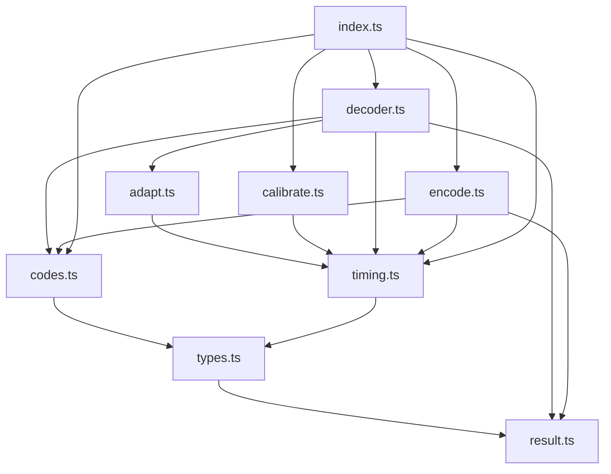
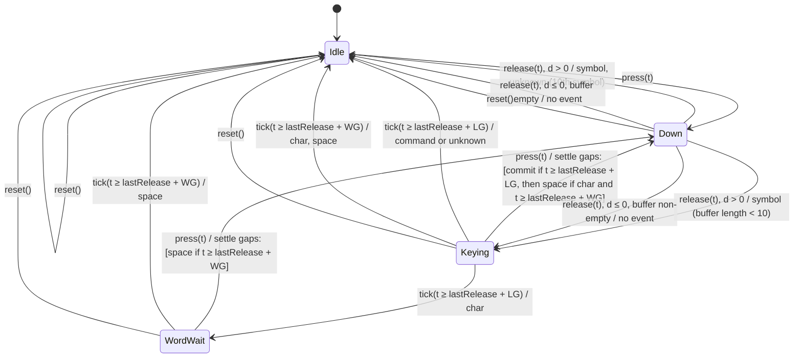
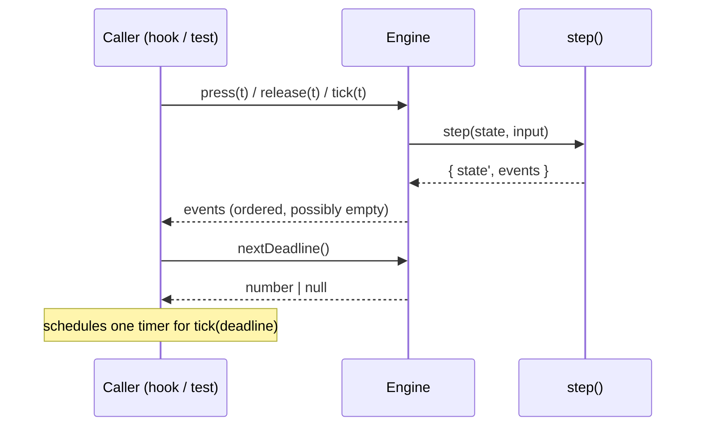

# Design Document: morse-engine

## Overview

The Morse engine is the pure TypeScript core of Dit in `src/lib/morse/`. It has four parts:

- **Tables** (`codes.ts`): the 49-entry ITU Character_Table and the 4-entry Command_Table.
- **Timing and adaptation** (`timing.ts`, `adapt.ts`): WPM/Unit conversion, thresholds, Estimate_Guards and the exponential-moving-average update.
- **Decoder** (`decoder.ts`): a state machine fed `press(t)`, `release(t)` and `tick(t)` that returns ordered `EngineEvent` lists and exposes `nextDeadline()`.
- **Encoder and Calibrator** (`encode.ts`, `calibrate.ts`): text to a timed press sequence, and 5 practice presses to starting estimates.

Every function is deterministic. Time arrives only as caller-supplied timestamps. Nothing reads a clock, a random source, storage or the DOM. Failures that callers can cause return a `Result`. Nothing throws for expected input.

Out of scope, per the requirements: input devices, debouncing, UI, abbreviation expansion, and the effects of commands. The engine only emits `command` events.

### Sources

- Numbers and behaviour: `.kiro/steering/morse-engine.md`, `docs/BRIEF.md` and `requirements.md` in this folder. Where steering and requirements differ in wording, requirements win (for example, calibration uses the mean of the 2 long presses, which equals their median).
- ITU Morse codes: [ITU-R M.1677-1, International Morse code](https://www.itu.int/rec/R-REC-M.1677-1-200910-I/). The `+` code `.-.-.` is reused as the speak command, so `+` is excluded.
- PARIS timing (`Unit = 1200 / WPM`): standard amateur-radio convention, as stated in the steering file.
- fast-check API used by the generators (`fc.double`, `fc.constantFrom`, `fc.array`, `fc.anything`, `fc.assert` with `numRuns`): [fast-check documentation](https://fast-check.dev/docs/introduction/).

### Key design decisions

| Decision | Rationale |
| --- | --- |
| The decoder is a pure transition function `step(state, input) → { state, events }`, wrapped by a small mutable `Engine` object. | Determinism, replay and "ignored input leaves state unchanged" become direct equality checks on state snapshots. |
| `command` and `unknown` commits set Space_Eligible to false. Only `char` sets it to true. | A pause after backspace, speak, next, SOS or a mis-keyed pattern must never insert a stray space (Req 4.5, 4.6, 5.6, 5.8, 6.7). |
| Gap and duration comparisons use the deadline form `t >= anchor + threshold`, never `t - anchor >= threshold`. | With floating-point timestamps the two forms can disagree at the boundary. The deadline form guarantees that `tick(nextDeadline())` always performs the action the deadline announced. `nextDeadline()` uses the same expression. |
| Gaps are settled lazily: a `press` or `tick` first settles any letter gap and word gap that the elapsed Silence has crossed, then does its own work. | Gives the same event stream whether the UI ticks or not (tick-independence, Req 15.5) and fixes event order: commit, then space, then the new press. |
| `reset()` keeps the last-accepted timestamp. | Req 10 does not ask for the monotonic clock to restart, and keeping it means a stale timestamp after reset is still rejected (Req 2.6). |
| Encoder timestamps are computed as `k × unit` from an integer unit counter, not by summing floats. | Req 12.3 requires every timestamp to equal a whole number of Units times Unit, unrounded. |
| Encoder reports unsupported characters per Unicode code point, at the UTF-16 index where the code point starts. | `index` then matches `text.slice(index)` in JavaScript, and an emoji is reported once, not as two halves. |
| Engine creation collects every invalid setting, not just the first. | Req 1.8 asks for each invalid estimate to be named, and Req 12.11 sets the same "report everything" pattern for the Encoder. |

## Architecture

### Module layout

```
src/lib/morse/
├── codes.ts          # CHARACTER_TABLE, COMMAND_TABLE, reverse lookups, lookupPattern()
├── timing.ts         # constants, wpmToUnit, unitToWpm, thresholds(), applyEstimateGuards()
├── adapt.ts          # adaptEstimates(): clamped EMA update + guards
├── decoder.ts        # DecoderState, step(), createEngine(), Engine, decodedText()
├── encode.ts         # encode(text, unit), normalizeText()
├── calibrate.ts      # calibrate(durations)
├── result.ts         # Result<T, E>, ok(), err()
├── types.ts          # EngineEvent, Symbol, CommandName, Estimates, EngineConfig, errors
├── index.ts          # public barrel (no test-support exports)
├── test-support.ts   # fast-check arbitraries + replay helpers, imported only by tests
└── *.test.ts, *.prop.test.ts
```

`calibrate.ts` is a separate file because it depends only on `timing.ts` and keeps `adapt.ts` focused on runtime adaptation. `result.ts` and `types.ts` hold shared types so no module imports `decoder.ts` just for types.

### Dependency graph



No module imports anything outside `src/lib/morse/`. There are no runtime dependencies. `fast-check` and `vitest` are dev dependencies used only by test files and `test-support.ts`.

### Decoder state machine

The decoder has four observable states. "Up" means the switch is up.

- **Idle**: up, Pattern_Buffer empty, Space_Eligible false. This is the state at creation, after `reset()`, after a command or unknown commit, and after a space.
- **Down**: switch down, `pressStart` set. Pattern_Buffer may hold symbols from the same character.
- **Keying**: up, Pattern_Buffer non-empty. `nextDeadline() = lastRelease + Letter_Gap_Threshold`.
- **WordWait**: up, Pattern_Buffer empty, Space_Eligible true (a `char` was just committed). `nextDeadline() = lastRelease + Word_Gap_Threshold`.



Notes on the diagram:

- `d ≤ 0` release from Down returns to whichever up-state matches the buffer. If the buffer is empty and Space_Eligible is true (a char was committed at this press), it returns to WordWait. `lastRelease` is not updated (Req 2.3), so Silence keeps counting from the previous accepted Release.
- Ignored inputs (non-finite or earlier timestamp, press while down, release while up) are self-loops with no event and no state change. They are left out of the diagram.
- A `tick` while Down is accepted (it advances `lastT`) but emits nothing (Req 7.4).

### Input processing



## Components and Interfaces

### result.ts

```ts
export type Result<T, E> =
  | { readonly ok: true; readonly value: T }
  | { readonly ok: false; readonly error: E };

export const ok = <T>(value: T): Result<T, never> => ({ ok: true, value });
export const err = <E>(error: E): Result<never, E> => ({ ok: false, error });
```

### types.ts

```ts
export type MorseSymbol = '.' | '-';
export type CommandName = 'speak' | 'next' | 'backspace' | 'sos';
export type EngineMode = 'adaptive' | 'fixed';

export type EngineEvent =
  | { readonly type: 'symbol'; readonly symbol: MorseSymbol }
  | { readonly type: 'char'; readonly char: string }
  | { readonly type: 'space' }
  | { readonly type: 'command'; readonly command: CommandName }
  | { readonly type: 'unknown'; readonly pattern: string };

export interface Estimates {
  readonly dotEstimate: number;
  readonly dashEstimate: number;
}

export interface EstimateSnapshot extends Estimates {
  readonly dotDashThreshold: number;   // (dot + dash) / 2
  readonly letterGapThreshold: number; // 2 × dot
  readonly wordGapThreshold: number;   // 4.5 × dot
}

export interface EngineConfig {
  readonly startingWpm?: number;          // default 6; valid: finite, 2 ≤ wpm ≤ 20
  readonly adaptationRate?: number;       // default 0.15; valid: finite, 0 < α ≤ 1
  readonly initialDotEstimate?: number;   // both or neither; each finite and > 0
  readonly initialDashEstimate?: number;
  readonly mode?: EngineMode;             // default 'adaptive'
}

export type EngineConfigError =
  | { readonly setting: 'startingWpm'; readonly value: unknown }
  | { readonly setting: 'adaptationRate'; readonly value: unknown }
  | { readonly setting: 'initialDotEstimate'; readonly value: unknown; readonly reason: 'missing' | 'invalid' }
  | { readonly setting: 'initialDashEstimate'; readonly value: unknown; readonly reason: 'missing' | 'invalid' };
```

When exactly one initial estimate is supplied, the missing one is reported with `reason: 'missing'` (Req 1.8). An unsupplied `mode` other than `'adaptive' | 'fixed'` is a type error, not a runtime case.

### codes.ts

```ts
export const CHARACTER_TABLE: Readonly<Record<string, string>>; // 49 entries, char → code
export const COMMAND_TABLE: Readonly<Record<string, CommandName>>; // 4 entries, code → name
export const CODE_TO_CHAR: ReadonlyMap<string, string>;          // built once from CHARACTER_TABLE
export const SUPPORTED_CHARACTERS: readonly string[];            // the 49 keys, table order

export type Lookup =
  | { readonly kind: 'command'; readonly command: CommandName }
  | { readonly kind: 'char'; readonly char: string }
  | { readonly kind: 'unknown'; readonly pattern: string };

/** Command_Table first, then Character_Table, else unknown (Req 3.8, 5.5). */
export function lookupPattern(pattern: string): Lookup;
```

Both tables are frozen object literals typed `as const` and then widened. `CODE_TO_CHAR` is built at module load. A unit test asserts its size is 49, which proves injectivity at load.

### timing.ts

```ts
export const MIN_UNIT = 60;
export const MAX_UNIT = 1500;
export const DEFAULT_WPM = 6;
export const DEFAULT_UNIT = 200;
export const MIN_START_WPM = 2;
export const MAX_START_WPM = 20;
export const DEFAULT_ADAPTATION_RATE = 0.15;
export const MAX_SYMBOLS = 10; // 10th symbol forces an unknown commit

export function wpmToUnit(wpm: number): number; // 1200 / wpm
export function unitToWpm(unit: number): number; // 1200 / unit
export function thresholds(e: Estimates): EstimateSnapshot;

/**
 * Estimate_Guards, in order:
 * 1. clamp both to [MIN_UNIT, 3 × MAX_UNIT]
 * 2. dot = min(dot, MAX_UNIT)
 * 3. dash = max(dash, 1.5 × dot)
 * Idempotent: applyEstimateGuards(applyEstimateGuards(e)) deep-equals applyEstimateGuards(e).
 */
export function applyEstimateGuards(e: Estimates): Estimates;
```

`wpmToUnit` and `unitToWpm` are total on finite positive numbers. Their callers (`createEngine`, tests) validate ranges. They are not range-checked themselves, because Req 1.1 defines them for any finite positive value.

Idempotence holds because step 3 produces `dash ≤ 1.5 × 1500 = 2250 ≤ 4500`, so a second pass changes nothing.

### adapt.ts

```ts
/**
 * One EMA update for a classified press (Req 8.1–8.3).
 * observation = clamp(duration, 0.5 × prior, 2 × prior) for the classified estimate;
 * next = prior + alpha × (observation − prior); then applyEstimateGuards on both.
 * Caller guarantees duration > 0 and mode === 'adaptive'.
 */
export function adaptEstimates(
  prior: Estimates,
  symbol: MorseSymbol,
  duration: number,
  alpha: number,
): Estimates;
```

### decoder.ts

```ts
export interface DecoderState {
  readonly mode: EngineMode;
  readonly alpha: number;
  readonly estimates: Estimates;
  readonly switchDown: boolean;
  readonly pressStart: number | null;  // non-null iff switchDown
  readonly lastRelease: number | null; // most recent accepted Release (d > 0) since creation/reset
  readonly lastT: number | null;       // timestamp of last accepted input; survives reset()
  readonly buffer: string;             // Pattern_Buffer, 0–9 symbols between inputs
  readonly spaceEligible: boolean;
}

export type EngineInput =
  | { readonly type: 'press'; readonly t: number }
  | { readonly type: 'release'; readonly t: number }
  | { readonly type: 'tick'; readonly t: number }
  | { readonly type: 'reset' };

export interface StepResult {
  readonly state: DecoderState;
  readonly events: readonly EngineEvent[];
}

/** Pure transition. Never throws. */
export function step(state: DecoderState, input: EngineInput): StepResult;

/** Pure: the deadline for a state (Req 7.1–7.4). */
export function deadlineOf(state: DecoderState): number | null;

export interface Engine {
  press(t: number): readonly EngineEvent[];
  release(t: number): readonly EngineEvent[];
  tick(t: number): readonly EngineEvent[];
  reset(): void;                       // emits nothing (Req 10.3)
  nextDeadline(): number | null;       // no side effects (Req 7.7)
  estimates(): EstimateSnapshot;       // no side effects (Req 1.11)
  readonly mode: EngineMode;
  /** Read-only snapshot for tests and debugging. */
  snapshot(): DecoderState;
}

export function createEngine(
  config?: EngineConfig,
): Result<Engine, readonly EngineConfigError[]>;

/** Decoded_Text: chars concatenated, one ' ' per space event. */
export function decodedText(events: readonly EngineEvent[]): string;
```

`Engine` holds one `DecoderState` in a closure and replaces it with `step(...)`'s result on each call. `snapshot()` returns the current immutable state object. Since states are never mutated, the returned object cannot be used to change the engine.

#### `step` algorithm

Let `T = thresholds(state.estimates)` be computed at the start of each step, before any adaptation in that step (Req 1.10, 8.4).

**Input validation (all of press, release, tick):**

1. If `!Number.isFinite(t)`: return `{ state, events: [] }` (Req 2.8).
2. If `lastT !== null && t < lastT`: return unchanged (Req 2.6). Equal timestamps pass.

**`settleGaps(state, t)`** (used by press and tick when the switch is up):

1. If `lastRelease === null`, nothing to settle.
2. If `buffer !== ''` and `t >= lastRelease + T.letterGapThreshold`: commit. `lookupPattern(buffer)` → emit `command` / `char` / `unknown`. Clear the buffer. Set `spaceEligible` to `true` for `char`, `false` otherwise.
3. Then, if `spaceEligible` and `t >= lastRelease + T.wordGapThreshold`: emit `space` and set `spaceEligible = false`.

Step 3 runs after step 2 on the same input, so a char committed at a word-gap-crossing press or tick is followed by its space in the same event list (Req 6.1).

**press(t):**

1. Validate. If `switchDown`, return unchanged (Req 2.4; `lastT` is not advanced because the input is ignored).
2. `lastT = t`. Run `settleGaps(t)`.
3. `switchDown = true`, `pressStart = t`. A press emits no event of its own.

**release(t):**

1. Validate. If not `switchDown`, return unchanged (Req 2.5, 10.6).
2. `lastT = t`, `switchDown = false`, `pressStart = null`.
3. If `t <= pressStart` (that is, Press_Duration ≤ 0): return with no events. `lastRelease`, buffer and estimates are unchanged (Req 2.3).
4. `symbol = t >= pressStart + T.dotDashThreshold ? '-' : '.'` (Req 2.1, 2.2).
5. If `mode === 'adaptive'`: `estimates = adaptEstimates(estimates, symbol, t − pressStart, alpha)`.
6. `lastRelease = t`, `buffer += symbol`, emit `symbol`.
7. If `buffer.length === MAX_SYMBOLS`: emit `unknown` with the 10-symbol pattern, clear the buffer, `spaceEligible = false` (Req 2.7).

**tick(t):**

1. Validate. `lastT = t`.
2. If `switchDown`: return with no events (Req 7.4).
3. Run `settleGaps(t)`.

**reset:**

`buffer = ''`, `switchDown = false`, `pressStart = null`, `lastRelease = null`, `spaceEligible = false`. Keep `estimates`, `alpha`, `mode`, `lastT`. No events (Req 10.1–10.3, 6.8, 8.9).

#### `deadlineOf` algorithm

```
if switchDown or lastRelease === null: null
else if buffer !== '': lastRelease + 2 × dot
else if spaceEligible: lastRelease + 4.5 × dot
else: null
```

A tick strictly before the deadline settles nothing, because `settleGaps` uses the same expressions (Req 7.5). After a space, `spaceEligible` is false, so the deadline is `null` (Req 7.2's "no space since the most recent accepted Release").

#### `createEngine` validation

1. `startingWpm`: if supplied and not finite or outside `[2, 20]`, add an error. Otherwise `u0 = wpmToUnit(startingWpm ?? 6)`.
2. `adaptationRate`: if supplied and not finite or not in `(0, 1]`, add an error.
3. Initial estimates: if exactly one is supplied, report the missing one. Report each supplied value that is not a finite number `> 0`.
4. If any errors, return `err(errors)` and no Engine.
5. Initial estimates are `applyEstimateGuards({ dot, dash })` when supplied, else `applyEstimateGuards({ u0, 3 × u0 })` (Req 1.6, 1.7, 9.1, 9.2). Because guards are idempotent, values returned by `calibrate` are kept exactly (Req 11.6).

Values are checked with `typeof v === 'number' && Number.isFinite(v)` so that a JavaScript caller passing a string is also rejected.

### encode.ts

```ts
export type PressInput =
  | { readonly type: 'press'; readonly t: number }
  | { readonly type: 'release'; readonly t: number };

export interface EncodedSequence {
  readonly inputs: readonly PressInput[];
  readonly endTime: number;
}

export interface UnsupportedOccurrence {
  readonly char: string;  // one code point
  readonly index: number; // UTF-16 index of the code point in the original text
}

export type EncodeTextError =
  | { readonly kind: 'empty' }
  | { readonly kind: 'unsupported'; readonly occurrences: readonly UnsupportedOccurrence[] };

export interface EncodeError {
  readonly unit?: { readonly value: unknown };  // present iff the unit is invalid
  readonly text?: EncodeTextError;              // present iff the text is invalid
}

export function normalizeText(text: string): string; // Normalized_Text
export function encode(text: string, unit: number): Result<EncodedSequence, EncodeError>;
```

With `exactOptionalPropertyTypes`, an absent field is omitted, not set to `undefined`. At least one of `unit` and `text` is present in every `EncodeError`.

#### Encoder algorithm

1. Check the unit: valid iff `typeof unit === 'number'`, finite, and `60 ≤ unit ≤ 1500`.
2. Check the text. If it contains only Whitespace (space, tab, LF, CR) or is empty, the text error is `{ kind: 'empty' }`. Otherwise, iterate code points with their UTF-16 start index. Any code point that is not Whitespace, not in `CHARACTER_TABLE` and not `A`–`Z` is an unsupported occurrence. `+` falls out naturally because it is not in the table.
3. If either check failed, return `err` with both parts as applicable (Req 12.11).
4. Normalize: lowercase `A`–`Z`, trim Whitespace, collapse Whitespace runs to `' '`. Lowercasing uses an explicit `A`–`Z` map, not `toLowerCase()`, so no other character changes.
5. Walk the normalized text with an integer counter `k` (in Units). For each character's code, each symbol: push `press` at `k × unit`, `k += 1 or 3`, push `release` at `k × unit`. Between symbols of one character `k += 1`. Between characters in a word `k += 3`. Between words `k += 7`. Spaces produce no input.
6. `endTime = (k_lastRelease + 3) × unit`.

Every timestamp is `k × unit` for an integer `k`, so press lengths and gaps are exact multiples of `unit` up to one floating-point rounding per endpoint, which is far from any threshold (smallest margin 1 Unit).

### calibrate.ts

```ts
export type CalibrationReason =
  | { readonly kind: 'not-a-list' }
  | { readonly kind: 'wrong-length'; readonly length: number }
  | { readonly kind: 'invalid-duration'; readonly position: number }; // 1-based

export interface Calibration extends Estimates {
  readonly reason: CalibrationReason | null; // null on success (Req 11.3)
}

export function calibrate(durations: unknown): Calibration;
```

Algorithm:

1. If not `Array.isArray(durations)`: defaults with `not-a-list`.
2. If `length !== 5`: defaults with `wrong-length`.
3. Find the first element that is not a finite number `> 0`: defaults with `invalid-duration` at its 1-based position.
4. `rawDot = median(d[0], d[1], d[2])` computed from a sorted copy. `rawDash = (d[3] + d[4]) / 2`.
5. If `rawDash < 1.5 × rawDot`: `rawDash = 3 × rawDot`. Equality keeps the value (Req 11.2).
6. Return `{ ...applyEstimateGuards({ rawDot, rawDash }), reason: null }`.

Defaults are `{ dotEstimate: 200, dashEstimate: 600 }` (u0 = DEFAULT_UNIT). The function reads the input only, sorts a copy, and wraps nothing in `try`; elements are read with index access after the `Array.isArray` check, which cannot throw for plain arrays. Getter-bearing or proxy arrays are not a supported input.

### index.ts

Re-exports: `createEngine`, `decodedText`, `encode`, `normalizeText`, `calibrate`, `wpmToUnit`, `unitToWpm`, `lookupPattern`, `CHARACTER_TABLE`, `COMMAND_TABLE`, `SUPPORTED_CHARACTERS`, the timing constants, and all public types. `step`, `deadlineOf` and `test-support.ts` are not re-exported; tests import them from their module files.

## Data Models

### Character_Table (49 entries)

| Group | Entries |
| --- | --- |
| Letters | a `.-` · b `-...` · c `-.-.` · d `-..` · e `.` · f `..-.` · g `--.` · h `....` · i `..` · j `.---` · k `-.-` · l `.-..` · m `--` · n `-.` · o `---` · p `.--.` · q `--.-` · r `.-.` · s `...` · t `-` · u `..-` · v `...-` · w `.--` · x `-..-` · y `-.--` · z `--..` |
| Digits | 0 `-----` · 1 `.----` · 2 `..---` · 3 `...--` · 4 `....-` · 5 `.....` · 6 `-....` · 7 `--...` · 8 `---..` · 9 `----.` |
| Punctuation | `.` `.-.-.-` · `,` `--..--` · `?` `..--..` · `'` `.----.` · `!` `-.-.--` · `/` `-..-.` · `-` `-....-` · `(` `-.--.` · `)` `-.--.-` · `:` `---...` · `=` `-...-` · `@` `.--.-.` · `"` `.-..-.` |

The longest character code has 6 symbols. The longest command code (`...---...`) has 9, so a 10th symbol can never match.

### Command_Table (4 entries)

| Code | Command |
| --- | --- |
| `.-.-.` | speak |
| `..--` | next |
| `----` | backspace |
| `...---...` | sos |

### Thresholds at default speed

With the unadapted estimates `dot = u`, `dash = 3u`: Dot_Dash_Threshold `2u`, Letter_Gap_Threshold `2u`, Word_Gap_Threshold `4.5u`. At 6 WPM: 400 ms, 400 ms, 900 ms.

### Jitter margin check (Req 14)

With every element scaled by a factor in `[0.7, 1.3]`:

| Element | Nominal | Jittered range | Rule | Margin to threshold |
| --- | --- | --- | --- | --- |
| Dot press | 1u | [0.7, 1.3]u | `< 2u` → `.` | 0.7u |
| Dash press | 3u | [2.1, 3.9]u | `≥ 2u` → `-` | 0.1u |
| Intra-char gap | 1u | [0.7, 1.3]u | `< 2u`, no commit | 0.7u |
| Letter gap | 3u | [2.1, 3.9]u | `≥ 2u` commit, `< 4.5u` no space | 0.1u / 0.6u |
| Word gap | 7u | [4.9, 9.1]u | `≥ 4.5u` commit + space | 0.4u |
| Final gap (to End_Time) | 3u | [2.1, 3.9]u | commit, no trailing space | 0.1u / 0.6u |

The smallest margin is `0.1u ≥ 6 ms`, many orders of magnitude above floating-point error for timestamps below about 10^7 ms (a 200-character string at 1500 ms/unit spans roughly 3 × 10^6 ms).

### Engine state invariants

These hold between any two calls:

- `switchDown ⇔ pressStart !== null`.
- `buffer.length ≤ 9`, and `buffer` contains only `.` and `-`.
- `buffer !== '' ⇒ lastRelease !== null`.
- `MIN_UNIT ≤ dot ≤ MAX_UNIT`, `MIN_UNIT ≤ dash ≤ 3 × MAX_UNIT`, `dash ≥ 1.5 × dot`.
- `lastRelease !== null ⇒ lastT !== null && lastRelease ≤ lastT`.

## Correctness Properties

*A property is a characteristic or behavior that should hold true across all valid executions of a system-essentially, a formal statement about what the system should do. Properties serve as the bridge between human-readable specifications and machine-verifiable correctness guarantees.*

All properties run with fast-check, `numRuns: 200` minimum. Each test carries the tag comment `// Feature: morse-engine, Property N: <title>`. Each property is implemented by exactly one `fc.assert` in the file named.

### Property 1: Tables are injective and commands never collide with characters

For all pairs of distinct Supported_Characters `a ≠ b`, `CHARACTER_TABLE[a] ≠ CHARACTER_TABLE[b]`. For all Command_Codes `c` and Supported_Characters `x`, `c ≠ CHARACTER_TABLE[x]`. For all strings `p`, `lookupPattern(p)` returns `command` iff `p ∈ COMMAND_TABLE`, else `char` iff `p` is a character code, else `unknown` with `pattern === p`. `+` is not a key of `CHARACTER_TABLE`.

**Validates: Requirements 3.4, 3.5, 3.7, 3.8, 4.1, 4.2, 5.5**

File: `codes.prop.test.ts`. Generators: `fc.constantFrom(...SUPPORTED_CHARACTERS)` pairs; `fc.constantFrom(...Object.keys(COMMAND_TABLE))`; patterns as `fc.array(fc.constantFrom('.', '-'), { minLength: 0, maxLength: 12 }).map(join)` mixed with `fc.constantFrom` over all known codes so hits are frequent.

### Property 2: WPM and Unit conversions are inverse

For all finite `w > 0` in `[0.1, 10^4]`, `unitToWpm(wpmToUnit(w))` equals `w` within a relative error of `1e-12`, and `wpmToUnit(w) === 1200 / w`.

**Validates: Requirements 1.1**

File: `timing.prop.test.ts`. Generator: `fc.double({ min: 0.1, max: 1e4, noNaN: true })`.

### Property 3: Estimate_Guards produce valid, stable estimates

For all finite positive `dot` and `dash` (including values far outside `[60, 4500]`), `g = applyEstimateGuards({dot, dash})` satisfies `60 ≤ g.dot ≤ 1500`, `60 ≤ g.dash ≤ 4500`, `g.dash ≥ 1.5 × g.dot`, and `applyEstimateGuards(g)` deep-equals `g`. Further, an Engine created in either mode with `initialDotEstimate = dot`, `initialDashEstimate = dash` reports `estimates()` equal to `g` and thresholds `((g.dot + g.dash) / 2, 2 g.dot, 4.5 g.dot)`.

**Validates: Requirements 1.7, 1.10, 1.11, 8.3, 9.1, 11.3, 11.6**

File: `timing.prop.test.ts`. Generator: `fc.double({ min: 1e-3, max: 1e5, noNaN: true })`, with `fc.constantFrom(60, 1500, 4500, 2250)` mixed in for boundaries.

### Property 4: Engine configuration is accepted exactly when valid

For all configs built from optional fields drawn from valid and invalid values (`NaN`, `±Infinity`, `0`, negatives, out-of-range numbers, non-numbers), `createEngine(config).ok` is true iff every supplied field is valid and the two initial estimates are both present or both absent. On failure, the set of `setting` names in the error equals the set of invalid settings. On success with no estimates, `estimates()` is `{ dot: 1200 / (startingWpm ?? 6), dash: 3 × that }`, and `mode` is `config.mode ?? 'adaptive'`.

**Validates: Requirements 1.2, 1.3, 1.4, 1.5, 1.6, 1.8, 1.9, 9.2**

File: `config.prop.test.ts`. Generator: `fc.record` with `requiredKeys: []`, each field `fc.oneof(validArb, invalidArb)`. The oracle is a separately written predicate per field.

### Property 5: Press classification uses pre-release thresholds

For all valid estimates `(dot, dash)`, both modes, and all Press_Durations `d > 0`, pressing at `t0` and releasing at `t0 + d` on a fresh engine emits exactly one `symbol` event whose value is `'-'` iff `t0 + d >= t0 + (dot + dash) / 2`, where `dot` and `dash` are the estimates before the release.

**Validates: Requirements 1.10, 2.1, 2.2, 8.4, 9.4**

File: `decoder.prop.test.ts`. Generators: guarded estimates from Property 3's arbitrary; `d` as `fc.oneof(fc.double({min: 1e-3, max: 1e4}), threshold ± tiny)` so the boundary is hit; `t0` from `fc.double({ min: 0, max: 1e6 })`.

### Property 6: Ignored and zero-length inputs change nothing

For all reachable engine states `s` (built by replaying a random input sequence) and every input `i` in one of these classes: non-finite timestamp; timestamp `< lastT`; press while down; release while up (including release after `reset()` with no press since), `step(s, i)` returns no events and a state deep-equal to `s`. For a release with `t === pressStart` (Press_Duration 0), the result has no events, `switchDown === false`, and every other field except `lastT` and `pressStart` equal to `s`.

**Validates: Requirements 2.3, 2.4, 2.5, 2.6, 2.8, 10.6**

File: `decoder.prop.test.ts`. Generators: `inputSequenceArb` (see generator notes) for the prefix, then `fc.constantFrom(NaN, Infinity, -Infinity)` or `lastT - fc.double({min: 1e-6, max: 1e4})` for the bad timestamp.

### Property 7: The 10th symbol forces an unknown commit

For all symbol sequences of length 10 keyed at the engine's current unit with intra-character gaps of 1 unit, the 10th release returns exactly `[{symbol}, {type: 'unknown', pattern}]` where `pattern` is the 10 symbols in keyed order, after which the buffer is empty, `spaceEligible` is false and `nextDeadline()` is `null`.

**Validates: Requirements 2.7**

File: `decoder.prop.test.ts`. Generator: `fc.array(fc.constantFrom('.', '-'), { minLength: 10, maxLength: 10 })`, unit from `fc.double({ min: 60, max: 600 })` via `startingWpm`, fixed mode.

### Property 8: Letter-gap commit happens once, exactly at the threshold

For all patterns `p` of 1–9 symbols keyed into a fixed-mode engine, and all silence lengths `s ≥ 0` after the last release, a `tick` or `press` at `lastRelease + s` commits iff `lastRelease + s >= lastRelease + Letter_Gap_Threshold`. When it commits, it emits exactly one of `command` / `char` / `unknown` matching `lookupPattern(p)`, empties the buffer, and sets Space_Eligible to true only for `char`. A press that does not commit leaves `p` in the buffer, and its own symbol is appended after `p`. Any further tick before the next press emits no second commit.

**Validates: Requirements 3.6, 4.3, 4.4, 4.5, 5.1, 5.2, 5.3, 5.4, 5.6, 5.7, 5.8, 5.9, 5.10, 6.6, 6.7**

File: `decoder.prop.test.ts`. Generators: `p` from `fc.oneof` over known codes (all 49 + 4) and random `.`/`-` strings of length 1–9; `s` from `fc.oneof(fc.double({min: 0, max: 10u}), fc.constant(LG), LG ± 1e-9)`; trigger kind from `fc.constantFrom('tick', 'press')`.

### Property 9: Space rules hold for every input stream

For all input sequences (random press, release, tick and reset with random spacing, including mis-keyed and command patterns), in both modes, the concatenated event stream satisfies all of:

1. No `space` appears before the first `char` after creation or after each `reset()`.
2. Between any two `space` events there is at least one `char` event.
3. The last `char`/`command`/`unknown` event before each `space` (since the last reset) is a `char`.
4. At most one `space` is emitted between an accepted Release and the next accepted Press.
5. Every `space` is emitted by an input at a timestamp `t >= lastRelease + Word_Gap_Threshold`, and in the same input's list it comes after any commit event and before nothing else from that input.

Also, for all words `w` (Supported_Strings without Whitespace) keyed as an encoded sequence, a tick at `lastRelease + Word_Gap_Threshold` after the final release emits a `space`, and a command code keyed then followed by the same tick emits none.

**Validates: Requirements 4.6, 6.1, 6.2, 6.3, 6.4, 6.5, 6.7, 6.8, 10.7**

File: `spaces.prop.test.ts`. Generator: `inputSequenceArb` with a bias toward realistic keying (see generator notes), so `char` commits and word gaps occur often. The checker walks the events per input call, tracking reset boundaries.

### Property 10: nextDeadline is pure and agrees with tick

For all reachable states: two consecutive `nextDeadline()` calls return the same value and do not change `snapshot()`. The deadline is `null` when the switch is down, when no release has been accepted since creation or reset, or when the buffer is empty and Space_Eligible is false. Otherwise it is `lastRelease + 2 × dot` (buffer non-empty) or `lastRelease + 4.5 × dot` (Space_Eligible). For all `t` with `lastT ≤ t < deadline`, `tick(t)` returns `[]` and leaves state unchanged except `lastT`. When the deadline is non-null, `tick(deadline)` returns a non-empty list. When it is null and the switch is up, every valid tick returns `[]`. Ticks while down always return `[]`.

**Validates: Requirements 1.11, 7.1, 7.2, 7.3, 7.4, 7.5, 7.6, 7.7, 7.8, 10.4, 10.5**

File: `deadline.prop.test.ts`. Generator: `inputSequenceArb` prefix, then a tick offset `fc.double({ min: 0, max: 1 })` × (deadline − lastT).

### Property 11: Adaptive update matches the clamped EMA model

For all valid estimates, `α ∈ (0, 1]`, and Press_Durations `d > 0`, an adaptive engine's estimates after one press/release equal `applyEstimateGuards` of the model update: the classified estimate becomes `e + α (clamp(d, 0.5e, 2e) − e)` and the other is unchanged before guards. For all press and tick inputs and zero-length releases, estimates are unchanged.

**Validates: Requirements 8.1, 8.2, 8.3, 8.5**

File: `adapt.prop.test.ts`. Generators: guarded estimates; `α` from `fc.double({ min: 1e-6, max: 1, noNaN: true })`; `d` spanning `[0.1e, 5e]` so both clamp edges are hit. The model is written inline in the test, independent of `adapt.ts`.

### Property 12: Estimates stay inside the guard bounds

For all adaptive engines and all input sequences (including extreme press durations from 1e-3 ms to 1e6 ms), after every press, release and tick: `60 ≤ dot ≤ 1500`, `60 ≤ dash ≤ 4500`, `dash ≥ 1.5 × dot`.

**Validates: Requirements 8.7**

File: `adapt.prop.test.ts`. Generator: `inputSequenceArb` with `durationScale` drawn log-uniformly via `fc.double({ min: -3, max: 6 }).map(x => 10 ** x)`.

### Property 13: Fixed-speed estimates never move

For all fixed-mode configs and all input sequences including `reset()`, after every call `estimates()` is strictly equal (`===` per field) to the post-creation estimates.

**Validates: Requirements 1.9, 8.8, 9.3**

File: `adapt.prop.test.ts`. Generator: valid fixed config from Property 4's valid arbitrary; `inputSequenceArb` with resets.

### Property 14: Adaptive estimates converge on a consistent keyer

For all `u0 = 1200 / wpm` with `wpm ∈ [2, 20]`, all `u* ∈ [0.75 u0, 1.75 u0]` with `u* ≥ 60`, all kind sequences of 40 presses with at least 15 dots and 15 dashes, and all per-press factors `f ∈ [0.9, 1.1]`, an adaptive engine with default estimates, fed dots of `u* f` and dashes of `3 u* f` (each followed by a gap of `u*`), holds `|dot − u*| ≤ 0.15 u*` and `|dash − 3u*| ≤ 0.45 u*` immediately after the 40th release.

**Validates: Requirements 8.6**

File: `convergence.prop.test.ts`. Generators: `wpm` from `fc.double({ min: 2, max: 20 })`; `r` from `fc.double({ min: 0.75, max: 1.75 })` then `u* = max(r u0, 60)`, filtered to `r u0 ≥ 60`; kinds from `fc.array(fc.boolean(), { minLength: 40, maxLength: 40 }).filter(k => count(k) ∈ [15, 25])`; factors from `fc.array(fc.double({ min: 0.9, max: 1.1, noNaN: true }), { minLength: 40, maxLength: 40 })`. Gaps of 1 unit mean every 10th symbol commits `unknown`; gaps do not affect estimates.

Tolerance margin: a numeric check of the EMA with `α = 0.15` gives these worst-case relative errors after the last update, all inside the 15% bound of Requirement 8.6:

| `u*/u0` | All `f` | Updates | Error |
| --- | --- | --- | --- |
| 0.75 | 1.1 | 15 | +12.0% |
| 1.75 | 0.9 | 15 | −12.9% |
| 1.00 | 1.1 | 25 | +9.8% |

Constant jitter in one direction moves the EMA's fixed point to `u* f`, which is already 10% from `u*`, and remaining start-up bias in the same direction adds to it. The worst case, 12.9%, leaves about 2 percentage points of margin. fast-check biases `fc.double` toward its endpoints, so these worst cases are exercised often.

### Property 15: Reset clears the character and keeps the learned speed

For all reachable states `s` (switch up or down, buffer empty or not), `reset()` returns no events, keeps `estimates()`, `mode` and `α`, and leaves `nextDeadline() === null`. After it, feeding any keyed sequence with timestamps `≥ lastT` produces the same events as a fresh engine created with `mode`, `α`, and `initialDotEstimate`/`initialDashEstimate` equal to the pre-reset estimates, fed the same sequence. In particular, no `space` precedes the first `char`, whatever the gap between the last pre-reset input and the first post-reset press.

**Validates: Requirements 6.8, 8.9, 10.1, 10.2, 10.3, 10.7**

File: `reset.prop.test.ts`. Generators: `inputSequenceArb` prefix; a keyed suffix from `keyedTextArb`, shifted to start at `lastT + gap` with `gap` from `fc.double({ min: 0, max: 1e5 })`.

### Property 16: Calibration matches the median/mean model

For all lists of 5 finite durations `> 0`, `calibrate(d)` returns `reason: null` and estimates equal to `applyEstimateGuards({ median(d[0..2]), dashRule(mean(d[3..4])) })`, where `dashRule(x) = x < 1.5 × dot ? 3 × dot : x`. Passing the result to `createEngine` in either mode yields exactly those estimates.

**Validates: Requirements 11.1, 11.2, 11.3, 11.6**

File: `calibrate.prop.test.ts`. Generators: `fc.array(fc.double({ min: 1e-3, max: 1e5, noNaN: true }), { minLength: 5, maxLength: 5 })`; plus a targeted case where `d[3] = d[4] = 1.5 × median` to hit the equality boundary.

### Property 17: Calibration is total, pure and reports why it fell back

For all values `x` (from `fc.anything()`, arrays of the wrong length, and 5-element arrays with one bad element at a random position), `calibrate(x)` does not throw, does not mutate `x` (deep-equal to a pre-call `structuredClone` where cloneable), returns deep-equal results on two calls, and on invalid input returns `{ dot: 200, dash: 600 }` with a reason whose `length` is `x.length` for wrong length, or whose `position` is the 1-based index of the first bad element.

**Validates: Requirements 11.4, 11.5**

File: `calibrate.prop.test.ts`. Generators: `fc.anything()`; `fc.array(fc.double(), { maxLength: 10 }).filter(a => a.length !== 5)`; valid 5-lists with a bad value from `fc.constantFrom(0, -1, NaN, Infinity, -Infinity, '5', null)` inserted at `fc.integer({ min: 0, max: 4 })`.

### Property 18: Encoded sequences have exact Morse timing

For all Supported_Strings `x` and Units `u ∈ [60, 1500]`, `encode(x, u)` is ok, and its sequence starts with a press at 0, strictly alternates press/release with strictly increasing timestamps, ends with a release, and has one press/release pair per symbol of the codes of the non-space characters of `normalizeText(x)` in order. Each timestamp equals `k × u` for the integer `k` predicted by the 1/3 (press) and 1/3/7 (gap) unit model, and `endTime = (k_last + 3) × u`. `encode(x, u)` deep-equals `encode(lower(x), u)` where `lower` maps only `A`–`Z`, and two calls deep-equal each other.

**Validates: Requirements 12.1, 12.2, 12.3, 12.4, 12.5, 12.6, 12.13**

File: `encode.prop.test.ts`. Generators: `supportedStringArb` (see notes), `unitArb = fc.double({ min: 60, max: 1500, noNaN: true })`. The oracle recomputes `k` from the normalized text independently.

### Property 19: Encoder rejects bad text and bad units completely

For all strings `x` built by inserting characters from an unsupported pool (including `+`, `#`, `é`, `€`, NBSP, `\v`, emoji) at random positions into a Supported_String, and all units `u` valid or invalid (`NaN`, `±Infinity`, values in `(0, 60)` and `(1500, 1e6]`, negatives), `encode(x, u)` fails. Its `text.occurrences` lists exactly the inserted code points with their UTF-16 indices in ascending order; `unit` is present iff `u` is invalid; the error contains no sequence. For all Whitespace-only strings (including `''`), the text error is `{ kind: 'empty' }`. For all Supported_Strings with an invalid unit, only `unit` is present.

**Validates: Requirements 3.9, 12.7, 12.8, 12.9, 12.10, 12.11**

File: `encode.prop.test.ts`. Generators: base `supportedStringArb`; insertion positions and pool chars via `fc.array(fc.tuple(fc.nat(), fc.constantFrom(...pool)))`; the expected index list is computed while inserting.

### Property 20: Encode then decode returns the normalized text

For all Supported_Strings `x` of 1–200 characters (and, as a dedicated sub-case, every single Supported_Character and uppercase letter) and all Units `u ∈ [60, 1500]`, feeding `encode(x, u)` into a fixed-mode engine with `initialDotEstimate = u`, `initialDashEstimate = 3u`, then `tick(endTime)`, yields: Decoded_Text equal to `normalizeText(x)`; exactly one `symbol` event per press, matching in order the codes of the non-space characters; zero `command` and zero `unknown` events. The same holds when any number of extra ticks with non-decreasing timestamps `≤ endTime` are inserted between inputs.

**Validates: Requirements 12.12, 13.1, 13.2, 13.3, 13.4, 13.5**

File: `roundtrip.prop.test.ts`. Generators: `supportedStringArb`, `unitArb`; extra ticks via `fc.array(fc.double({ min: 0, max: 1 }), …)` mapped to positions within each inter-input interval (see notes). The single-character sub-case iterates `fc.constantFrom(...SUPPORTED_CHARACTERS, ...'A'..'Z')`.

Note: Requirement 12.12 creates the engine with initial estimates `u` and `3u`, so the test sets `initialDotEstimate = u` and `initialDashEstimate = 3u` directly. This covers the Encoder's full Unit range up to 1500 ms, which `startingWpm` (units up to 600 ms) could not reach, and avoids the `1200 / (1200 / u)` round-trip error.

### Property 21: Decoding survives ±30% jitter on every element

For all Supported_Strings `x`, Units `u ∈ [60, 1500]`, and independent factors in `[0.7, 1.3]` (endpoints included) for every press length, every gap and the final gap, the jittered sequence fed to a fixed-mode engine with estimates `(u, 3u)` and then one `tick` at the jittered End_Time produces an event list deep-equal to the unjittered decode of Property 20, so its Decoded_Text equals `normalizeText(x)`, with no trailing space and no `unknown` or `command` events.

**Validates: Requirements 14.1, 14.2, 14.3**

File: `jitter.prop.test.ts`. Generator: see "Jittered sequences" below.

### Property 22: Replays are deterministic

For all configs and all sequences of press, release, tick and reset calls, two fresh engines given the same calls return deep-equal event lists after every call and strictly equal (`===`) estimates. For all text/unit pairs and all calibration inputs, two calls of `encode` or `calibrate` return deep-equal results.

**Validates: Requirements 9.5, 11.5, 12.13, 15.1, 15.3, 15.4**

File: `determinism.prop.test.ts`. Generators: `configArb` (valid only), `inputSequenceArb` with resets, `supportedStringArb` mixed with arbitrary strings, `fc.anything()` for calibrate.

### Property 23: Extra ticks never change the outcome

For all configs (both modes) and all input sequences with no `reset()` that end with the switch up, inserting any number of ticks at timestamps between neighbouring inputs leaves the concatenated event list and the final estimates unchanged, provided both versions end with a tick at or after `lastRelease + Word_Gap_Threshold` (computed after the last release).

**Validates: Requirements 15.5**

File: `tick-independence.prop.test.ts`. Generators: `inputSequenceArb` without resets, forced to end with a release; extra ticks inserted as in Property 20; final tick at `lastRelease + 4.5 × dot + fc.double({ min: 0, max: 1e4 })`.

### Reflection on redundancy

- Requirement 13.4 (ticks inside an encoded sequence) is a special case of tick insensitivity, but its end condition differs from Requirement 15.5 (it ends at End_Time, not after the word deadline). It is folded into Property 20 as a variant rather than into Property 23.
- Requirements 4.5, 5.6, 5.7, 5.8, 6.6 and 6.7 all state how a commit sets Space_Eligible. Property 8 checks the flag directly after each commit and Property 9 checks its consequences on whole streams, so no separate property is kept for the flag.
- Requirements 1.11 and 7.7 (side-effect-free reads) are both checked inside Property 10, which already snapshots state around `nextDeadline()` and `estimates()`.
- Encoder and Calibrator determinism (12.13, 11.5, 15.4) are folded into Property 22 for replay and checked again cheaply in Properties 17 and 18. The duplication is deliberate only where the extra assertion is one line.
- Requirement 9.4 (fixed mode uses the same rules) is covered by running Properties 5, 8, 9 and 10 in both modes.

### Criteria covered by examples or static checks instead of properties

| Criteria | Test |
| --- | --- |
| 1.1 examples (2/6/20 WPM) | `timing.test.ts` |
| 3.1, 3.2, 3.3 exact table entries | `codes.test.ts` compares each table to a literal copy of the requirement |
| 4.4 speak example, 4.7 commands leave Decoded_Text unchanged | `decoder.test.ts` |
| 10.1 reset while down, then release ignored | `decoder.test.ts` |
| 15.2 no clock, random, storage, DOM or globals | ESLint `no-restricted-globals` and `no-restricted-properties` (`Date`, `performance`, `setTimeout`, `setInterval`, `Math.random`, `crypto`, `window`, `document`, `localStorage`, `navigator`) scoped to `src/lib/morse/**`, plus `boundaries.test.ts` that scans the module sources for those identifiers |
| 15.6 no imports from `react`, `next`, `src/components`, `src/hooks` | ESLint `no-restricted-imports` scoped to `src/lib/**`, plus `boundaries.test.ts` that parses every `import` in `src/lib/morse/*.ts` and asserts each target is a relative path inside the folder |

## Error Handling

### Failed Results

| Operation | Failure | Shape |
| --- | --- | --- |
| `createEngine` | Invalid `startingWpm`, `adaptationRate`, either initial estimate, or only one estimate supplied | `{ ok: false, error: EngineConfigError[] }`, one entry per invalid setting, no Engine |
| `encode` | Empty/Whitespace-only text, unsupported characters (including `+`), invalid unit, or text and unit both invalid | `{ ok: false, error: { unit?, text? } }`, no sequence |

`calibrate` never fails. It always returns estimates, plus a `reason` on invalid input.

### Ignored inputs

The decoder ignores these inputs: it returns `[]` and leaves state unchanged, including `lastT`.

| Input | Requirement |
| --- | --- |
| Any input with a non-finite timestamp | 2.8 |
| Any input with a timestamp below `lastT` | 2.6 |
| `press` while the switch is down | 2.4 |
| `release` while the switch is up, including after `reset()` | 2.5, 10.6 |

These inputs are accepted (they advance `lastT`) but emit nothing:

| Input | Effect | Requirement |
| --- | --- | --- |
| `release` with Press_Duration ≤ 0 | Switch goes up; buffer, estimates and `lastRelease` unchanged | 2.3 |
| `tick` while the switch is down | None | 7.4 |
| `tick` before the deadline, or with no deadline | None | 7.5, 7.6 |

The engine does not report ignored inputs to the caller. An empty list is the whole signal. Input-layer bugs (for example, a missing release) show up as missing symbols, which the UI already surfaces.

### Programmer errors

TypeScript types prevent wrong call shapes. At runtime the engine still treats non-number timestamps as non-finite (`typeof t !== 'number'` is ignored), so a JavaScript caller cannot corrupt state. No function throws.

## Testing Strategy

### Tooling

- Vitest with `environment: 'node'` for all of `src/lib/morse/**` (set per-folder via `environmentMatchGlobs` or a `// @vitest-environment node` default in `vitest.config.ts`).
- fast-check for properties. Every property uses `numRuns: 200` or more via a shared `PROP_RUNS = 200` constant in `test-support.ts`. On failure, fast-check prints the seed and path; reproduce with `fc.assert(prop, { seed, path })`.
- Commands: `bun run test:engine` (runs `vitest run src/lib/morse`) during development; `bun run test` for the full suite; `bun run typecheck` and `bun run lint` for the static checks. Never `bun test`.

### Example unit tests

Keep these few and concrete. Properties cover input variety.

- `codes.test.ts`: every table entry against a literal copy of Requirements 3.1–3.3 and 4.1; 49 and 4 entries; `+` absent.
- `timing.test.ts`: `wpmToUnit(2) = 600`, `(6) = 200`, `(20) = 60`; guard order examples (dot 2000 → 1500 then dash raised to 2250; dash 10 → 60 then raised to 1.5 × dot).
- `decoder.test.ts`: key "sos" at 6 WPM and see `symbol ×9`, then `command: 'sos'`; key `.-.-.` and see `speak`; key "hi" then wait 900 ms and see `h, i, space`; backspace code then a word gap emits no space; reset mid-press then release is ignored; equal-timestamp inputs are accepted; config defaults (`mode 'adaptive'`, estimates 200/600).
- `encode.test.ts`: `encode('e', 200)` is press 0, release 200, endTime 800; `encode('+', 200)` fails with `{ char: '+', index: 0 }`; `encode('  ', 200)` fails with `empty`; `encode('a', 59)` fails with unit; both errors together.
- `calibrate.test.ts`: `[200, 210, 190, 600, 620]` → `200 / 610`; long presses too short → dash `3 × dot`; `[]` → reason `wrong-length` with length 0; `[1, 2, NaN, 4, 5]` → reason position 3.
- `boundaries.test.ts`: static import and global scan (Req 15.2, 15.6).

### Property tests

One file per property group, named in each property above:

| File | Properties |
| --- | --- |
| `codes.prop.test.ts` | 1 |
| `timing.prop.test.ts` | 2, 3 |
| `config.prop.test.ts` | 4 |
| `decoder.prop.test.ts` | 5, 6, 7, 8 |
| `spaces.prop.test.ts` | 9 |
| `deadline.prop.test.ts` | 10 |
| `adapt.prop.test.ts` | 11, 12, 13 |
| `convergence.prop.test.ts` | 14 |
| `reset.prop.test.ts` | 15 |
| `calibrate.prop.test.ts` | 16, 17 |
| `encode.prop.test.ts` | 18, 19 |
| `roundtrip.prop.test.ts` | 20 |
| `jitter.prop.test.ts` | 21 |
| `determinism.prop.test.ts` | 22 |
| `tick-independence.prop.test.ts` | 23 |

Each test starts with its tag comment, for example:

```ts
// Feature: morse-engine, Property 21: Decoding survives ±30% jitter on every element
```

### Generator notes (`test-support.ts`)

**`supportedStringArb`**: `fc.array(fc.constantFrom(...SUPPORTED_CHARACTERS, ...UPPERCASE, ' ', '\t', '\n', '\r'), { minLength: 1, maxLength: 200 }).map(a => a.join(''))`, filtered to contain a non-Whitespace character. Weight non-Whitespace characters about 4:1 with `fc.oneof({ weight }, …)` so the filter rarely rejects and words have several letters.

**`unitArb`**: `fc.oneof(fc.double({ min: 60, max: 1500, noNaN: true }), fc.constantFrom(60, 200, 1500))`.

**`feed(engine, inputs)`**: replays a list of `EngineInput` and returns the per-call event lists and their concatenation. All engine properties go through it, so call order matches production use.

**`inputSequenceArb(opts)`**: a list of 0–80 actions. Each action is `{ kind, dt }` with `kind` from `fc.constantFrom('press', 'release', 'tick', 'reset')` (reset weight 0 when `opts.noReset`) and `dt ≥ 0` in multiples of the current unit, drawn from a mix that hits each classification region: `fc.oneof(fc.double({ min: 0, max: 0.5 }), fc.constantFrom(1, 2, 3, 4.5, 7), fc.double({ min: 0, max: 12 }))`. Timestamps are the running sum `t_i = t_{i-1} + dt_i × u`. About one action in 20 is replaced by a bad timestamp (non-finite or `t_{i-1} − δ`) to exercise ignored inputs. Mixing in `keyedTextArb` fragments keeps `char` commits common for the space-rule property.

**`keyedTextArb`**: `supportedStringArb` × `unitArb` mapped through `encode` to a list of `EngineInput`. Used for realistic prefixes and suffixes.

**Jittered sequences** (Property 21): from the unjittered sequence `inputs` and `endTime`, derive the list of lengths `L = [t1 − t0, t2 − t1, …, endTime − t_last]` (alternating press lengths and gaps, ending with the final gap). Draw `factors = fc.array(fc.double({ min: 0.7, max: 1.3, noNaN: true }), { minLength: L.length, maxLength: L.length })`, mixing in `fc.constantFrom(0.7, 1.3)` per element so both endpoints appear often. Rebuild with `t'_0 = 0`, `t'_{i+1} = t'_i + L_i × factors_i`, keeping each input's type. The jittered End_Time is the last jittered release plus `L_last × factors_last`. Because the factor array length depends on the text, build it with `fc.chain` from the `(x, u)` pair.

**Extra ticks** (Properties 20, 23): for each gap between consecutive inputs `[a, b]`, draw 0–3 values `r ∈ [0, 1]` and insert `tick(a + r × (b − a))` in sorted order. `r = 0` and `r = 1` are included so ticks at equal timestamps are tested.

**Convergence** (Property 14): described with the property. Feed press/release pairs directly with gaps of `u*`; there is no need to go through `encode`.

### Performance budget

Property 20 and 21 at 200 runs with up to 200 characters stay well below 1 s each in Node, because each run is a few thousand `step` calls. If the full engine suite exceeds about 10 s, lower `maxLength` for the slowest generators before lowering `numRuns`.


## Review correction: separate pressing speed from pause speed (review, 2026-11-11)

These corrections supersede earlier conflicting criteria in this document.

Keep startingUnit in DecoderState across reset/adaptation. Pass it to thresholds for deadlines, settlement and estimates. Fixed-speed jitter tests with seeded estimates must configure a matching starting speed (or a faster one) when testing units outside the starting-WPM range.
