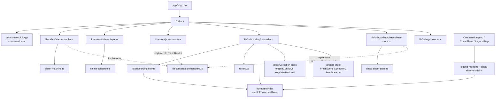
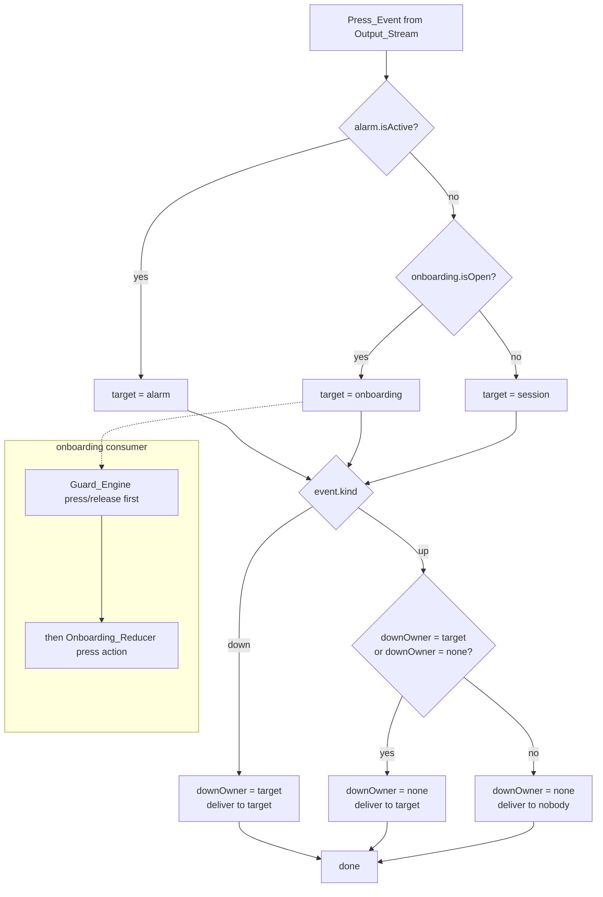
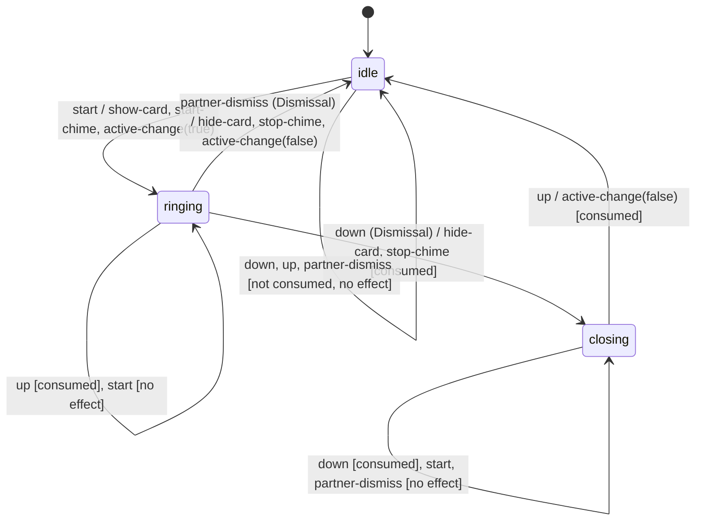
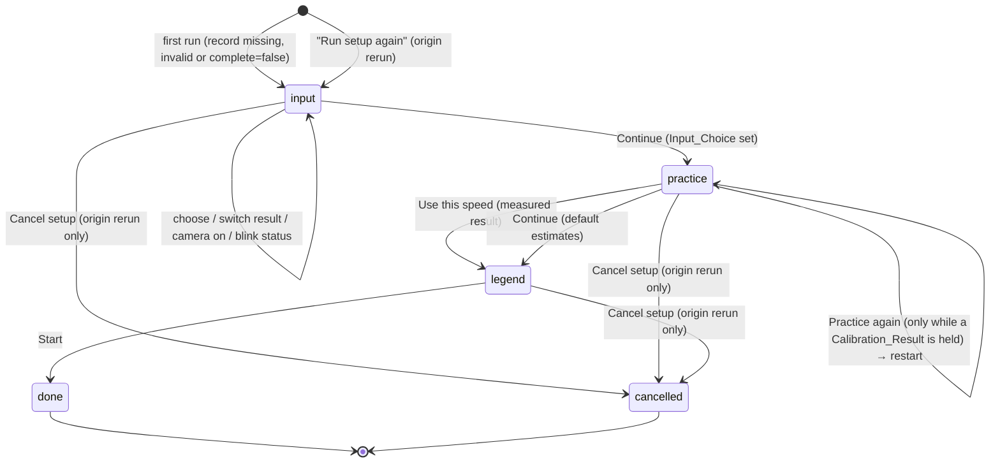

# Design Document: onboarding-and-safety

## Overview

This spec adds the four safety and first-use pieces that the sibling specs leave open: the SOS help alarm (Alarm_Card plus Chime), the always-visible Command_Legend, the non-modal Cheat_Sheet, and the first-run Onboarding_Flow with speed calibration. It plugs into `conversation-ui` through the seams that spec already defines (`AlarmHandler`, `UnknownPatternHandler`, the `legend` and `overlay` slots, `pressRouter`, `extraSettingsActions`, `SessionApiContext`, `discardInput()`, `onCharCommitted`, `setInitialEstimates`), and changes no behavior of the sibling specs.

The design follows the project rule "pure core, thin shell":

- **Pure core** (`src/lib/safety/`, `src/lib/onboarding/`): the Alarm_Machine, the Chime_Schedule, the Press_Router decision, the Onboarding_Reducer, the Cheat_Sheet state, the Legend_Model and Cheat_Sheet_Model builders, the Onboarding_Record schema and the panel placement function. No DOM, no clock, no storage. Every property in this document targets one of these functions.
- **Framework-free runtime objects** (also under `src/lib/`, no globals): the Alarm_Handler, the Chime_Player, the Press_Router runtime, the Onboarding controller and the Cheat_Sheet store. Each takes its clock, scheduler, audio port, storage backend, card view and session API as injected dependencies, so tests drive them with fakes in the `node` environment.
- **Thin shell** (`src/lib/safety/browser.ts`, `src/components/`): the Web Audio adapter and gesture unlock, and the React components that render the Alarm_Card, Command_Legend, Cheat_Sheet and Onboarding_Flow.

### Sources

- `docs/BRIEF.md`, `.kiro/steering/` (`structure.md`, `tech.md`, `accessibility.md`), and the final requirements in `.kiro/specs/onboarding-and-safety/requirements.md`.
- Sibling designs: `.kiro/specs/morse-engine/design.md` (`CHARACTER_TABLE`, `COMMAND_TABLE`, `SUPPORTED_CHARACTERS`, `calibrate`, `Calibration`, `unitToWpm`, `createEngine`, `Engine`, `EngineEvent`, `Estimates`), `.kiro/specs/input-sources/design.md` (`PressEvent`, `SourceKind`, `SourceStatus`, `Clock`, `Scheduler`, `ManualClock`, `ManualScheduler`, `SwitchLearner`, `classifyFocus`, the Blink_Source status machine, `PageLifecycle`), `.kiro/specs/conversation-ui/design.md` (`handlers.ts`, `SessionController`, `engineConfigOf`, `KeyValueBackend`, `localStorageBackend`, design tokens, and the section "Integration points for onboarding-and-safety").
- [`<dialog>` and `showModal()` on MDN](https://developer.mozilla.org/en-US/docs/Web/HTML/Element/dialog) and the [top layer](https://developer.mozilla.org/en-US/docs/Glossary/Top_layer): every modal dialog opened with `showModal()` is appended to the top layer stack, and the most recently added element renders on top of all earlier ones. Content outside the topmost modal dialog, including an earlier modal dialog, is inert. The `cancel` event fires on Escape and can be prevented. Chromium's close-watcher rules may skip a preventable `cancel` after repeated Escape presses without user activation, so this design does not depend on `cancel` alone (see AlarmCard).
- [Web Audio API on MDN](https://developer.mozilla.org/en-US/docs/Web/API/Web_Audio_API): `AudioContext.currentTime` is the audio clock in seconds and does not advance while the context is suspended; `OscillatorNode.start(when)` / `stop(when)` and `AudioParam.setValueAtTime`, `linearRampToValueAtTime`, `cancelScheduledValues` schedule sound ahead of time on that clock; `resume()` returns a promise. The [autoplay guide](https://developer.mozilla.org/en-US/docs/Web/Media/Autoplay_guide) explains that a context created or resumed outside user activation may stay `suspended`, which is why Audio_Unlock runs inside the first User_Gesture.
- Chrome timer throttling: [Background tabs in Chrome 57](https://developers.google.com/web/updates/2017/03/background_tabs) states that pages playing audible audio are exempt from background timer throttling, and the [Chrome 88 intensive throttling note](https://github.com/GoogleChrome/developer.chrome.com/blob/main/site/en/blog/timer-throttling-in-chrome-88/index.md) limits chained timers in hidden, silent pages to about one wake-up per minute. The Chime_Player therefore schedules audio far ahead on the audio clock while the page is hidden instead of trusting timers (Requirement 4.5). Content was rephrased for compliance with licensing restrictions.
- WCAG 2.2: [three flashes 2.3.1](https://www.w3.org/WAI/WCAG22/Understanding/three-flashes-or-below-threshold), [contrast 1.4.3](https://www.w3.org/WAI/WCAG22/Understanding/contrast-minimum) and [1.4.6 enhanced](https://www.w3.org/WAI/WCAG22/Understanding/contrast-enhanced), [non-text contrast 1.4.11](https://www.w3.org/WAI/WCAG22/Understanding/non-text-contrast), [reflow 1.4.10](https://www.w3.org/WAI/WCAG22/Understanding/reflow), [focus not obscured 2.4.11](https://www.w3.org/WAI/WCAG22/Understanding/focus-not-obscured-minimum). The ARIA [alertdialog pattern](https://www.w3.org/WAI/ARIA/apg/patterns/alertdialog/) for the Alarm_Card.

### Key design decisions

| Decision | Choice | Why |
| --- | --- | --- |
| Alarm logic | Pure `alarmStep(state, input)` returning `{ state, consumed, effects }`; a thin Alarm_Handler runs the effects | Requirement 3 asks for a pure machine with effects as data; tests can check every consumed flag and effect list without fakes. |
| Alarm_Card stacking | A native `<dialog>` opened with `showModal()` synchronously inside `start()`, always mounted, plus a re-raise guard | The top layer puts the most recent modal above the Settings `<dialog>` and the onboarding dialog, and makes them inert (Requirement 1.5, 1.12). A portal with a high `z-index` cannot sit above an existing top-layer dialog. |
| Alarm_Card animation | None. The card is static in every motion setting | Requirements 1.7–1.9 limit luminance change and contrast during animation. A static card meets all three with no timing code. The Chime and the full-screen card carry the urgency. |
| Escape on the Alarm_Card | A `window` capture-phase `keydown` listener feeds `partner-dismiss`; the dialog's `cancel` is also prevented and treated as `partner-dismiss` | It runs before any dialog or Cheat_Sheet handler and does not depend on Chromium's close-watcher rules. |
| Pointer dismissal | `pointerdown` on the card is a `down`; the matching `pointerup` is an `up`; the trailing `click` is swallowed in the capture phase | Requirement 2.6: the card disappears on `pointerdown`, so the `pointerup` and `click` land on whatever is underneath and must not reach it. |
| Chime timing | Pure `chimeSchedule(s, from, to, x?)` filled in windows on the audio clock; 1.5 s lookahead when visible, 70 s when hidden | Window additivity (Requirement 5.6) means refills never skip or repeat a Chime. A 70 s lookahead outlasts one-per-minute timer throttling in hidden pages (Requirement 4.5). |
| Audio unlock | Permanent passive `window` capture listeners for `keydown`, `pointerdown`, `click` that create or resume the single AudioContext and start a 1-sample silent buffer | Requirement 6.1–6.3, 6.7. A blink never unlocks audio, but the Partner's clicks during onboarding always do. |
| Press routing | Pure `routePress(state, event, ctx)` plus a small runtime that implements `PressRouter` | Requirement 12.1 and 12.8 are a decision table with one remembered fact (who received the last `down`). |
| Onboarding logic | Pure `onboardingStep(state, action)` plus a pure `onboardingEffects(prev, next, action)`; a controller runs effects | Requirement 17.1 asks the reducer to return only the next state; effects are derived separately so the reducer stays a plain state function. |
| Onboarding container | One `<dialog>`: `showModal()` for the Input_Step and Legend_Step, `show()` (non-modal, placed beside the Keying_Surface) for the Practice_Step | The Practice_Step must leave the Keying_Surface visible, focused and pressable (Requirement 14.1, 14.2); the other steps are Partner tasks where a modal keeps focus in the flow. |
| Cheat_Sheet container | A non-modal `<section>` with `position: fixed`, placed by the same pure placement function beside the Keying_Surface | Requirement 10.9 and 10.10: non-modal, no focus trap, Keying_Surface fully pressable. |
| Where the onboarding state lives | A framework-free controller created once in `DitRoot`, attached to the session API from a layout effect inside `DitApp` | `page.tsx` is a server component and cannot pass handler objects; `DitRoot` is the client boundary that builds the plug-ins. A layout effect runs before `useInputSources` starts any source in its passive effect, so no Press_Event can arrive before the onboarding decision (Requirement 11.2–11.4). |
| Legend and Cheat_Sheet data | Built at run time from `COMMAND_TABLE` and `CHARACTER_TABLE` | Requirements 8.1 and 9.1 forbid copies of the tables. |

### Dependencies this design needs from conversation-ui beyond the four listed hooks

The requirements list four integration points, and `conversation-ui` provides them. Two more values are needed. Both exist inside `DitApp` today as fields of `useInputSources()`; they only need to be added to `SessionApiContext`, which is additive:

1. `learner: SwitchLearner` (`useInputSources().learner`), for the Switch choice in the Input_Step (Requirement 13.4–13.6). The Onboarding_Flow cannot build its own learner, because `createSwitchLearner` needs the KeyRouter and Switch_Source that `useInputSources` owns.
2. `pendingSince: () => number | null` (`useInputSources().pendingSince`), so the Guard_Engine timer uses the same pending-press guard as the Session_Controller timer. If it is missing, the Onboarding controller uses `() => null`, and Guard_Engine ticks use the current time as Requirement 12.4 states.

This spec does not edit `conversation-ui`. The implementation tasks list these two context fields as a prerequisite to add on the conversation-ui side.

One more cross-spec note: `conversation-ui` keeps exactly one `aria-live` region on the page. Requirement 18.3 of this spec adds a second polite region inside the Onboarding_Flow for the time the flow is open. The conversation Live_Region is silent during that time, because no Press_Event reaches the session. The `conversation-ui` test for "exactly one `aria-live` region" runs without the flow open and stays valid.

### Interpretations of the requirements

- Requirement 12.2 keeps the Session_Engine estimates unchanged by presses during onboarding. The single `setInitialEstimates` call from "Use this speed" or Continue (Requirement 15.6, 15.7) is the intended change and is allowed.
- Requirement 17.4 says the reducer holds `calibrate()` of 5 collected presses. Requirement 14.11 discards the Calibration_Result on "Use default speed". The design applies 14.11 as the later action: after "Use default speed" no Calibration is held. If fewer than 5 presses were collected when the Partner chose it, a later fifth press still calls `calibrate()` (Requirement 15.1) and its result replaces the default result. Property 20 states the rule with this exception.
- The Done step has a heading (Requirement 18.2), but the flow closes within the same task after Start (Requirement 16.5). The Done view is rendered for that frame and is checked in an isolated component test.

## Architecture

### Module layout

```
src/
├── app/
│   └── page.tsx                      # renders <DitRoot/> (was <DitApp/>)
├── lib/
│   ├── safety/
│   │   ├── alarm-machine.ts          # pure Alarm_Machine: alarmStep()
│   │   ├── alarm-handler.ts          # createAlarmHandler(): implements AlarmHandler, runs effects
│   │   ├── chime-schedule.ts         # pure chimeSchedule(), CHIME_PERIOD_MS, tone constants
│   │   ├── chime-player.ts           # createChimePlayer(): AudioPort + Scheduler + Page injected
│   │   ├── press-router.ts           # pure routePress() + createPressRouter() runtime
│   │   ├── browser.ts                # webAudioPort(win), installAudioUnlock(win, port) (only file touching globals)
│   │   ├── fakes.ts                  # FakeAudioPort, FakeAudioContext, FakeCardView (tests only)
│   │   ├── test-support.ts           # fast-check arbitraries (not re-exported)
│   │   └── index.ts
│   └── onboarding/
│       ├── types.ts                  # InputChoice, OnboardingState, OnboardingAction, OnboardingEffect
│       ├── flow.ts                   # pure onboardingStep(), onboardingEffects(), initial states
│       ├── record.ts                 # Zod OnboardingRecordSchema, readOnboardingRecord(), writeOnboardingRecord()
│       ├── controller.ts             # createOnboardingController(): reducer + Guard_Engine + effects
│       ├── strings.ts                # every user-facing string from the requirements
│       ├── spoken.ts                 # spokenCode(), PUNCTUATION_NAMES, speedText()
│       ├── legend-model.ts           # buildLegendModel(), COMMAND_LABELS, COMMAND_SENTENCES
│       ├── cheat-sheet-model.ts      # buildCheatSheetModel()
│       ├── cheat-sheet-state.ts      # pure cheatSheetStep()
│       ├── cheat-sheet-store.ts      # createCheatSheetStore(), createUnknownPatternHandler()
│       ├── placement.ts              # pure placePanel(): position beside the Keying_Surface
│       ├── test-support.ts
│       └── index.ts
└── components/
    ├── DitRoot.tsx                   # 'use client'; builds plug-ins once; renders <DitApp …/>
    ├── AlarmCard.tsx                 # <dialog role="alertdialog">, registers its CardView
    ├── CommandLegend.tsx             # legend slot content + "All codes"
    ├── SafetyNotices.tsx             # blink resume button, setup save-failure note (legend slot)
    ├── CheatSheet.tsx                # non-modal panel
    ├── CodeGlyphs.tsx                # aria-hidden Glyph row + sr-only Spoken_Code
    ├── OnboardingHost.tsx            # attaches the controller in a layout effect; renders OnboardingFlow
    ├── OnboardingFlow.tsx            # <dialog>, heading, live region, Cancel setup
    ├── InputStep.tsx
    ├── PracticeStep.tsx
    ├── LegendStep.tsx
    └── RunSetupAgainButton.tsx       # extraSettingsActions content
```

Tests sit beside each file (`alarm-machine.test.ts`, `alarm-machine.prop.test.ts`, `AlarmCard.test.tsx`, …).

### Dependency graph



`src/lib/safety/**` and `src/lib/onboarding/**` import only from `@/lib/morse`, `@/lib/input`, `@/lib/conversation` public barrels and `zod`. They never import `react`, `next`, `src/components` or `src/hooks`, and only `src/lib/safety/browser.ts` reads `window`, `AudioContext` or `document`. The existing ESLint `no-restricted-imports` rule for `src/lib/**` covers both folders.

### Wiring in DitRoot

`DitRoot` is the client boundary. It builds every plug-in once with `useState(() => …)` lazy init. Nothing in that init touches `window`; browser adapters are created in a `useLayoutEffect` and injected with `attach…` calls, so server prerender is safe.

```tsx
'use client';
export function DitRoot() {
  const [rt] = useState(createSafetyRuntime);   // alarm, chime, router, onboarding, cheatSheet
  useLayoutEffect(() => rt.attachBrowser(window), [rt]);   // webAudioPort, installAudioUnlock, browserScheduler, page lifecycle
  return (
    <DitApp
      alarm={rt.alarm}
      unknownPattern={rt.unknownPattern}
      pressRouter={rt.router}
      legend={<><CommandLegend store={rt.cheatSheet} /><SafetyNotices onboarding={rt.onboarding} /></>}
      overlay={<><CheatSheet store={rt.cheatSheet} /><OnboardingHost controller={rt.onboarding} /><AlarmCard handler={rt.alarm} /></>}
      extraSettingsActions={({ closeSettings }) => <RunSetupAgainButton controller={rt.onboarding} closeSettings={closeSettings} />}
    />
  );
}
```

`AlarmCard` renders last in the overlay slot so its `<dialog>` is the last element in DOM order; stacking still comes from the top layer, not from DOM order.

Effect order on mount: React runs all layout effects (children first) before any passive effect. `OnboardingHost` (inside `DitApp`) attaches the controller to `SessionApiContext` in a layout effect, which reads the Onboarding_Record and either opens the flow or calls `setInitialEstimates` (Requirement 11.2–11.4). `AlarmCard` registers its CardView in a layout effect. `useInputSources` starts the Press_Sources in a passive effect, after those layout effects. So the first Press_Event always meets a decided onboarding state, a registered card and a connected router. As a defensive check, the router drops any Press_Event that arrives before `connect()`; that cannot happen with this effect order.

### Press routing



When `onboarding.isOpen()` changes, the Onboarding controller calls the router's `onOnboardingOpenChange()` hook synchronously, and the router calls `session.discardInput()` before it routes the next event (Requirement 12.10).

### Alarm state machine



### Alarm sequence: SOS keyed, card and chime, dismiss press consumed

```mermaid
sequenceDiagram
  autonumber
  participant Arb as Input_Arbiter
  participant R as Press_Router
  participant C as SessionController
  participant AH as Alarm_Handler
  participant AM as alarmStep (pure)
  participant Card as AlarmCard (dialog)
  participant CP as Chime_Player
  participant Au as AudioPort (Web Audio)

  Arb->>R: up (last dot of ...---...)
  R->>C: handlePress(up)  (alarm idle, onboarding closed)
  Note over C: letter-gap tick commits command sos
  C->>AH: start()  (effect 'alarm', sync)
  AH->>AM: alarmStep(idle, start)
  AM-->>AH: ringing, [show-card, start-chime, active-change(true)]
  AH->>Card: show(): showModal(), focus Dismiss
  AH->>CP: start()
  CP->>Au: now() = s; state running? schedule chimes s, s+1000, … within lookahead
  CP->>CP: scheduler: refill every 250 ms, sound check at 1000 ms
  AH-->>C: onActiveChange(true)
  C->>C: engine.reset(), cancel Tick_Timer
  Arb->>R: down (any source)
  R->>AH: handlePress(down)  (isActive true)
  AH->>AM: alarmStep(ringing, down)
  AM-->>AH: closing, consumed, [hide-card, stop-chime]
  AH->>Card: hide(): dialog.close()
  AH->>CP: stop(): silence every voice at now, cancel future tones
  Arb->>R: up
  R->>AH: handlePress(up)  (isActive true, downOwner alarm)
  AH->>AM: alarmStep(closing, up)
  AM-->>AH: idle, consumed, [active-change(false)]
  AH-->>C: onActiveChange(false) → reschedule()
  AH->>AH: focusKeyingSurface()
  Note over C: Session_State unchanged: no Press_Event reached the Session_Engine
```

### Onboarding steps



`isOpen()` is true for `input`, `practice` and `legend`. `done` and `cancelled` are terminal; the controller closes the dialog in the same task.

### Screen placement

| Element | Container | Position |
| --- | --- | --- |
| Alarm_Card | `<dialog>` + `showModal()` | Top layer, `inset: 0`, `width: 100vw`, `height: 100dvh`, `max-width/max-height: none`, `margin: 0`; `::backdrop` opaque |
| Command_Legend | `conversation-ui` legend slot `<aside aria-label="Commands">` | In page flow |
| Cheat_Sheet | `<section aria-labelledby>` in the overlay slot | `position: fixed`, rectangle from `placePanel()` |
| Onboarding Input_Step, Legend_Step | `<dialog>` + `showModal()` | Top layer, centered, `width: min(100vw, 40rem)`, `max-height: 100dvh`, scrolls inside |
| Onboarding Practice_Step | Same `<dialog>`, reopened with `show()` | Not top layer; `position: fixed` rectangle from `placePanel()` |

## Components and Interfaces

### lib/safety/alarm-machine.ts

```ts
export type AlarmState = 'idle' | 'ringing' | 'closing';
export type AlarmInput = 'start' | 'down' | 'up' | 'partner-dismiss';
export type AlarmEffect =
  | { readonly type: 'show-card' }
  | { readonly type: 'hide-card' }
  | { readonly type: 'start-chime' }
  | { readonly type: 'stop-chime' }
  | { readonly type: 'active-change'; readonly active: boolean };

export interface AlarmStepResult {
  readonly state: AlarmState;
  readonly consumed: boolean;
  readonly effects: readonly AlarmEffect[];
}

/** Pure; never throws; never mutates. */
export function alarmStep(state: AlarmState, input: AlarmInput): AlarmStepResult;
export const isAlarmActive = (s: AlarmState): boolean => s !== 'idle';
/** True when `input` in `state` is a Dismissal (down in ringing, partner-dismiss in ringing). */
export function isDismissal(state: AlarmState, input: AlarmInput): boolean;
```

Transition table (Requirement 3.7, 3.8). Effect arrays are frozen constants, so equal inputs return identical arrays.

| State | Input | Next | Consumed | Effects |
| --- | --- | --- | --- | --- |
| idle | start | ringing | false | show-card, start-chime, active-change(true) |
| idle | down / up | idle | false | none |
| idle | partner-dismiss | idle | false | none |
| ringing | down | closing | true | hide-card, stop-chime |
| ringing | up | ringing | true | none |
| ringing | partner-dismiss | idle | false | hide-card, stop-chime, active-change(false) |
| ringing | start | ringing | false | none |
| closing | up | idle | true | active-change(false) |
| closing | down | closing | true | none |
| closing | start / partner-dismiss | closing | false | none |

### lib/safety/alarm-handler.ts

```ts
import type { AlarmHandler } from '@/lib/conversation';

/** The AlarmCard component implements this and registers it. All methods synchronous. */
export interface CardView {
  show(): void;                       // dialog.showModal(); focus Dismiss
  hide(): void;                       // dialog.close()
}

export interface SafetyAlarmHandler extends AlarmHandler {
  /** Partner Dismiss button (keyboard activation), Escape, or dialog `cancel`/`close` not caused by hide(). */
  partnerDismiss(): void;
  /** AlarmCard pointer path: pointerdown → 'down', matching pointerup/pointercancel → 'up'. Not Press_Events. */
  cardPointer(kind: 'down' | 'up'): void;
  state(): AlarmState;
  setView(view: CardView | null): void;
  setFocusKeyingSurface(fn: (() => void) | null): void;
  /** Sound-unavailable text for the card (Requirement 6.5). */
  soundUnavailable(): boolean;
  subscribe(listener: () => void): Unsubscribe;   // state or sound note changed
}

export function createAlarmHandler(deps: { readonly chime: ChimePlayer }): SafetyAlarmHandler;
```

`apply(input)`:

1. `{ state, consumed, effects } = alarmStep(current, input)`; commit `state` first, so `isActive()` is correct while effects run (Requirement 7.1).
2. Run effects in order. Each effect runs in its own `try/catch`, so a failure in one never skips the next (Requirement 7.3–7.5):
   - `show-card`: `view?.show()`. A missing view or a throw is caught (Requirement 7.3).
   - `start-chime`: `chime.start()` (Requirement 7.4).
   - `hide-card`: `view?.hide()`.
   - `stop-chime`: `chime.stop()`.
   - `active-change`: call each `onActiveChange` listener once with `active`, each in its own `try/catch` (Requirement 2.8). When `active` is false, then call `focusKeyingSurface()` (Requirement 2.10, 18.9; it focuses on the next animation frame, under 100 ms).
3. Notify `subscribe` listeners.

`start()` = `apply('start')`. `handlePress(e)` = `apply(e.kind)`. `partnerDismiss()` = `apply('partner-dismiss')`. `cardPointer(k)` = `apply(k)`. Nothing awaits, so `start()` returns with the machine in `ringing` (Requirement 7.1). A repeated `start()` while active is a no-op row in the table (Requirement 1.2, 7.7). Second Dismissal inputs in the same episode are no-op rows too (Requirement 2.13).

### lib/safety/chime-schedule.ts

```ts
export const CHIME_PERIOD_MS = 1000;
export const TONES = [
  { offsetMs: 0,   hz: 880, durationMs: 150 },
  { offsetMs: 200, hz: 660, durationMs: 150 },
] as const;
export const PEAK_GAIN = 0.8;
export const RAMP_MS = 10;          // attack and release, inside [5, 20]
export const CHIME_END_MS = 360;    // last tone ends at 350 ms incl. release; oscillators stop at 360 ms (≤ 400)

/** Pure. Start times s + k × 1000 (k ≥ 0, integer) with from ≤ t < to and, when x is given, t < x. */
export function chimeSchedule(s: number, from: number, to: number, x?: number): readonly number[];
```

Algorithm (Requirement 5.1–5.7):

1. If any of `s`, `from`, `to` (and `x` when given) is not finite, or `to <= from`, return `[]`.
2. `end = x === undefined ? to : Math.min(to, x)`. If `end <= s` or `end <= from`, return `[]`.
3. `k0 = Math.max(0, Math.ceil((from - s) / 1000))`. Correct for floating error: while `k0 > 0 && s + (k0 - 1) * 1000 >= from`, decrement; while `s + k0 * 1000 < from`, increment.
4. For `k = k0; s + k * 1000 < end; k++`, push `s + k * 1000`. Every value is computed directly from `s` and `k`, never by repeated addition, so consecutive values differ from 1000 by at most one rounding step (Requirement 5.4).

Window additivity (Requirement 5.6) holds because membership of each `s + k × 1000` depends only on comparisons with `from`, `b`, `to` and `x`, and each value lies in exactly one of `[from, b)` and `[b, to)`.

### lib/safety/chime-player.ts

```ts
export type AudioState = 'running' | 'suspended' | 'interrupted' | 'closed' | 'none';

/** Web Audio seam. Times are audio-clock milliseconds (AudioContext.currentTime × 1000). */
export interface AudioPort {
  /** Creates the single AudioContext if none exists. Returns false when unavailable or creation throws. Never throws. */
  ensureContext(): boolean;
  state(): AudioState;
  /** Audio clock in ms; null when no context exists. */
  now(): number | null;
  /** Calls resume() without awaiting; catches a throw and a rejected promise. Never throws. */
  resume(): void;
  onStateChange(listener: (state: AudioState) => void): Unsubscribe;
  /** Schedules one two-tone Chime at audio time `atMs`. Throws if Web Audio throws. */
  playChime(atMs: number): ChimeVoice;
}
export interface ChimeVoice {
  /** Ramps any sounding tone to 0 within RAMP_MS + 5 ms of `atMs`, and stops tones that start after `atMs` before they start. */
  silence(atMs: number): void;
}
export interface PageVisibility { hidden(): boolean; onChange(listener: () => void): Unsubscribe; }

export const LOOKAHEAD_VISIBLE_MS = 1500;
export const LOOKAHEAD_HIDDEN_MS = 70_000;
export const REFILL_EVERY_MS = 250;
export const SOUND_CHECK_MS = 1000;

export interface ChimePlayer {
  start(): void;
  stop(): void;
  soundUnavailable(): boolean;
  onSoundChange(listener: () => void): Unsubscribe;
}

export function createChimePlayer(deps: {
  readonly audio: () => AudioPort | null;     // null until DitRoot attaches the browser port
  readonly scheduler: () => Scheduler | null;
  readonly page: () => PageVisibility | null;
}): ChimePlayer;
```

Episode state: `{ s: number | null, filledTo: number | null, voices: ChimeVoice[], stopAt: number | null, errored: boolean, note: boolean, refill: cancel | null, check: cancel | null }`.

`start()` (Requirement 4.4, 4.9–4.11, 6.4, 6.5, 6.9):

1. If an episode is playing (started and not stopped), return (Requirement 4.9).
2. New episode: `errored = false`, `note = false` (Requirement 4.11, 6.9).
3. `port = audio()`. If `port === null || !port.ensureContext()`: `note = true`, notify, return (Requirement 6.5 "no AudioContext"). The Alarm_Card is unaffected.
4. `s = port.now()` (the alarm start time on the audio clock; Requirement 1.1). If `port.state() !== 'running'`, call `port.resume()` once (Requirement 6.4).
5. `fill()`, then schedule the refill loop every 250 ms and one `SOUND_CHECK_MS` check: if the state is still not `running`, `note = true` (Requirement 6.5).

`fill()`: only while `port.state() === 'running'` and `!errored`. `now = port.now()`. `from = filledTo ?? s`. If `from < now - 50`, the context was suspended or the loop was late; set `from = now` (this realizes Requirement 6.6: resume starts from the first scheduled time at or after the current audio time). `to = now + (page.hidden() ? 70_000 : 1500)`. For each `t` in `chimeSchedule(s, from, to, stopAt ?? undefined)`: `voices.push(port.playChime(t))` inside `try`; on a throw set `errored = true`, `note = true`, stop the refill loop and return (Requirement 4.7). Then `filledTo = to`. A Chime at a time already in the past by less than 50 ms still starts at once, which keeps it within Requirement 4.5's 50 ms bound.

`onStateChange('running')` while an episode is playing and `!errored`: `note = false`, `fill()` (Requirement 6.6). While no episode is playing (alarm `idle` or `closing`), the player ignores it (Requirement 6.10). `page.onChange` triggers an immediate `fill()` so the 70 s lookahead is in place before throttling starts.

`stop()` (Requirement 4.6): `stopAt = port.now()`; `voice.silence(stopAt)` for every voice; cancel the refill loop and the sound check; clear `voices`; mark the episode stopped. Because every later `fill()` passes `stopAt` as `x`, nothing at or after the stop time is scheduled.

The player never calls `speechSynthesis` and holds no reference to speech objects (Requirement 4.8).

### lib/safety/browser.ts

```ts
export function webAudioPort(win: Window): AudioPort;
export function installAudioUnlock(win: Window, port: AudioPort & { unlockSilently(): void }): Unsubscribe;
export function browserPageVisibility(doc: Document): PageVisibility;
```

- `webAudioPort`: `const Ctor = win.AudioContext ?? win.webkitAudioContext`. `ensureContext` creates at most one context per page load inside `try` and keeps it for every episode (Requirement 6.3). `state()` maps `ctx.state` (`'interrupted'` is the iOS Safari value). `resume()` does `try { void ctx.resume().catch(() => {}) } catch {}` (Requirement 6.8).
- `playChime(at)`: for each tone, `osc = ctx.createOscillator()` with `type 'sine'` and `frequency.value = hz`; `g = ctx.createGain()`; `g.gain.setValueAtTime(0, t0)`, `linearRampToValueAtTime(0.8, t0 + 0.010)`, `setValueAtTime(0.8, t0 + d − 0.010)`, `linearRampToValueAtTime(0, t0 + d)`; `osc.connect(g).connect(ctx.destination)`; `osc.start(t0)`; `osc.stop(at/1000 + 0.36)`. Times are seconds (`ms / 1000`). This gives 880 Hz for 150 ms at the Chime start and 660 Hz for 150 ms from +200 ms, peak gain 0.8, 10 ms ramps, end ≤ 360 ms (Requirement 4.1–4.3). No audio file is loaded.
- `silence(at)`: for each tone: `g.gain.cancelScheduledValues(at)`, `g.gain.setValueAtTime(g.gain.value, at)`, `g.gain.linearRampToValueAtTime(0, at + 0.015)`, `osc.stop(Math.max(at + 0.02, …))` when the tone has started, or `osc.stop(at)` when its start time is after `at`. A node whose stop time is not after its start time never sounds, so cancelled tones stay silent (Requirement 4.6).
- `unlockSilently()`: `ensureContext()`; if `state !== 'running'`, `resume()`; on the first call, create a 1-sample buffer of zeros, `src.connect(ctx.destination)`, `src.start()`. No gain node is created, so nothing above gain 0 reaches the destination (Requirement 6.7).
- `installAudioUnlock`: adds passive capture listeners for `keydown`, `pointerdown`, `click` on `win`. Each listener calls `unlockSilently()` inside `try/catch` when no context exists or the state is not `running` (Requirement 6.1, 6.2, 6.8). The listener never calls `preventDefault` or `stopPropagation`, so the gesture's own handling, including Press_Event delivery, continues.

### lib/safety/press-router.ts

```ts
import type { PressRouter, SessionPressTarget } from '@/lib/conversation';
export type Consumer = 'alarm' | 'onboarding' | 'session';

export interface RouterState { readonly downOwner: Consumer | null; }
export const INITIAL_ROUTER: RouterState = { downOwner: null };
export interface RouteContext { readonly alarmActive: boolean; readonly onboardingOpen: boolean; }

/** Pure. `to` is null only for an `up` whose `down` went to a different consumer (Requirement 12.8). */
export function routePress(s: RouterState, e: PressEvent, ctx: RouteContext): { state: RouterState; to: Consumer | null };

export interface SafetyPressRouter extends PressRouter {
  /** Called synchronously by the Onboarding controller when isOpen() changes. */
  onOnboardingOpenChange(): void;
}
export function createPressRouter(deps: {
  readonly alarm: { isActive(): boolean; handlePress(e: PressEvent): void };
  readonly onboarding: { isOpen(): boolean; handlePress(e: PressEvent): void };
}): SafetyPressRouter;
```

`routePress`: `target = ctx.alarmActive ? 'alarm' : ctx.onboardingOpen ? 'onboarding' : 'session'`. For `down`: `{ downOwner: target }`, `to: target`. For `up`: `downOwner === null || downOwner === target` → `to: target`; otherwise `to: null`; both set `downOwner = null`.

`createPressRouter`: `route(e)` reads `alarm.isActive()` and `onboarding.isOpen()` at arrival (Requirement 12.1), calls `routePress`, and delivers to the chosen consumer. If `connect()` has not been called, `route` drops the event. `onOnboardingOpenChange()` calls `session.discardInput()` inside `try/catch` (Requirement 12.10). `connect(session)` stores the target and returns a disconnect function.

### lib/onboarding/types.ts

```ts
import type { Calibration, Estimates } from '@/lib/morse';
import type { SourceStatus } from '@/lib/input';

export type InputChoice = 'key-tap' | 'switch' | 'blink';
export type Step = 'input' | 'practice' | 'legend' | 'done' | 'cancelled';
export type Origin = 'first-run' | 'rerun';

export type SwitchPhase =
  | { readonly kind: 'idle' }
  | { readonly kind: 'armed' }                                    // "Press the switch now."
  | { readonly kind: 'learned'; readonly code: string }           // "Switch learned." + code
  | { readonly kind: 'failed'; readonly message: string };        // learner message + Try again + Use key or tap instead

export type BlinkPhase =
  | { readonly kind: 'idle' }
  | { readonly kind: 'explained' }                                // camera explanation + "Turn on camera"
  | { readonly kind: 'started'; readonly status: SourceStatus };

export type PracticeResult =
  | { readonly kind: 'none' }
  | { readonly kind: 'measured'; readonly calibration: Calibration }                 // reason === null
  | { readonly kind: 'default'; readonly calibration: Calibration | null };          // null after "Use default speed"; fallback keeps the non-null-reason Calibration

export interface OnboardingState {
  readonly step: Step;
  readonly origin: Origin;
  readonly selected: InputChoice | null;          // tile shown as selected
  readonly inputChoice: InputChoice | null;       // confirmed; Continue enabled iff non-null
  readonly switchPhase: SwitchPhase;
  readonly blinkPhase: BlinkPhase;
  readonly durations: readonly number[];          // 0–5 Practice_Press durations since the latest Practice_Step start
  readonly heldDownT: number | null;              // down received in this Practice_Step, awaiting its up
  readonly result: PracticeResult;
  readonly applied: Estimates | null | 'unset';   // set once by "Use this speed" or Continue
  readonly report: OnboardingReport | null;       // set once on Done
}

export interface OnboardingReport {
  readonly complete: true;
  readonly inputChoice: InputChoice;
  readonly estimates: Estimates | null;
}

export type OnboardingAction =
  | { readonly type: 'choose'; readonly choice: InputChoice }
  | { readonly type: 'switch-result'; readonly result: { ok: true; code: string } | { ok: false; message: string } }
  | { readonly type: 'switch-retry' }
  | { readonly type: 'camera-on' }                       // "Turn on camera" and blink "Try again"
  | { readonly type: 'blink-status'; readonly status: SourceStatus }
  | { readonly type: 'use-key-tap' }                      // "Use key or tap instead"
  | { readonly type: 'continue' }
  | { readonly type: 'press'; readonly kind: 'down' | 'up'; readonly t: number }
  | { readonly type: 'use-default' }
  | { readonly type: 'practice-again' }
  | { readonly type: 'use-this-speed' }
  | { readonly type: 'start' }
  | { readonly type: 'cancel' };

export type OnboardingEffect =
  | { readonly type: 'arm-learner' }
  | { readonly type: 'disarm-learner' }
  | { readonly type: 'start-blink' }
  | { readonly type: 'stop-blink' }
  | { readonly type: 'apply-estimates'; readonly estimates: Estimates | null }
  | { readonly type: 'focus-keying-surface' }
  | { readonly type: 'focus-selected-choice' }
  | { readonly type: 'finish'; readonly report: OnboardingReport }
  | { readonly type: 'cancel'; };
```

### lib/onboarding/flow.ts

```ts
export function initialFirstRun(): OnboardingState;
/** Rerun: selected = previous choice; inputChoice = previous choice for 'key-tap' and 'switch';
 *  for 'blink', inputChoice follows the current blink status (Requirement 13.9). */
export function initialRerun(previous: InputChoice, blinkStatus: SourceStatus): OnboardingState;
/** Pure; never throws; returns the same object for an action that is not valid in the current step. */
export function onboardingStep(s: OnboardingState, a: OnboardingAction): OnboardingState;
/** Pure; derives the side effects of a transition. Empty when next === prev. */
export function onboardingEffects(prev: OnboardingState, next: OnboardingState, a: OnboardingAction): readonly OnboardingEffect[];
export function isOpenStep(step: Step): boolean;   // input | practice | legend
export function continueEnabled(s: OnboardingState): boolean;
export function heldIndicatorShown(s: OnboardingState): boolean;  // heldDownT !== null && durations.length < 5
export function practicePrompt(s: OnboardingState): { prompt: 'Press short' | 'Press long'; count: string } | null;
```

Reducer rules. Any action not listed for the current step returns `s` unchanged (Requirement 17.8). `done` and `cancelled` accept nothing.

| Step | Action | Guard | Next state | Effects (from `onboardingEffects`) |
| --- | --- | --- | --- | --- |
| input | `choose key-tap` / `use-key-tap` | none | `selected = inputChoice = 'key-tap'`, phases idle | `disarm-learner` if switch armed; `stop-blink` if blink phase started and status ≠ `off` (13.3, 13.11) |
| input | `choose switch` | none | `selected = 'switch'`, `inputChoice = null`, `switchPhase = armed`, blink idle | `stop-blink` if needed, `arm-learner` (13.4) |
| input | `switch-result ok` | `switchPhase = armed` | `inputChoice = 'switch'`, `learned` | none (13.5) |
| input | `switch-result failed` | `switchPhase = armed` | `inputChoice = null`, `failed` | none (13.6) |
| input | `switch-retry` | `switchPhase = failed` | `armed` | `arm-learner` (13.6) |
| input | `choose blink` | none | `selected = 'blink'`, `inputChoice = null`, `blinkPhase = explained`, switch idle | `disarm-learner` if armed; no camera (13.7) |
| input | `camera-on` | blink phase explained, or started with a failure status other than `unsupported` | `blinkPhase = started('starting')` | `start-blink` (13.8, 13.10) |
| input | `blink-status x` | `selected = 'blink'` and phase started | `status = x`; `inputChoice = 'blink'` iff `x ∈ {active, face-lost}`, else null | none (13.9, 13.10) |
| input | `continue` | `inputChoice !== null` | `step = practice`, practice cleared | `focus-keying-surface` (13.12, 13.13, 14.1) |
| practice | `press down t` | `durations.length < 5` and `heldDownT = null` | `heldDownT = t` | none |
| practice | `press up t` | `heldDownT !== null` | `durations += [t − heldDownT]`, `heldDownT = null`; at length 5, `result = measured(c)` if `c = calibrate(durations)` has `reason === null`, else `default(c)` | none (14.3, 14.8, 15.1, 15.4) |
| practice | `use-default` | none | `result = default(null)` | none (14.11, 14.12) |
| practice | `practice-again` | result holds a Calibration (`measured`, or `default` with non-null calibration) | practice cleared | `focus-keying-surface` (15.5, 14.1) |
| practice | `use-this-speed` | `result = measured` | `applied = {dot, dash}`, `step = legend` | `apply-estimates(estimates)` (15.6) |
| practice | `continue` | `result = default` | `applied = null`, `step = legend` | `apply-estimates(null)` (15.7) |
| legend | `start` | none | `step = done`, `report = { complete: true, inputChoice, estimates: applied }` | `finish(report)`, `focus-keying-surface` (16.4, 16.5) |
| input / practice / legend | `cancel` | `origin = rerun` | `step = cancelled` | `disarm-learner`, `cancel`, `focus-keying-surface` (11.9) |

"Practice cleared" means `durations = []`, `heldDownT = null`, `result = none`. A `press` in the input or legend step changes nothing; those presses still go to the Guard_Engine (Requirement 12.3). If "Use default speed" is chosen before 5 presses and the Speaker keeps pressing, the fifth press calls `calibrate()` (Requirement 15.1) and the measured result replaces the default result; the most recent outcome wins. Because the step leaves `practice` on the first accepted `use-this-speed` or `continue`, a repeated activation is an invalid action and a no-op (Requirement 15.8). Because `done` accepts nothing, a repeated `start` is a no-op and `finish` is emitted once (Requirement 16.7, 17.9).

`practicePrompt`: with `n = durations.length`, prompt is "Press short" for `n < 3`, "Press long" for `n ≥ 3`; count is `"Press " + (min(n, 4) + 1) + " of 5"` for `n < 5`. At `n = 5` the count is hidden and the result area is shown (Requirement 14.1, 14.5, 14.6).

### lib/onboarding/record.ts

```ts
export const ONBOARDING_KEY = 'dit:onboarding:v1';

export const EstimatesSchema = z.object({
  dotEstimate: z.number().finite().gt(0),
  dashEstimate: z.number().finite().gt(0),
}).strict();

export const OnboardingRecordSchema = z.object({
  v: z.literal(1),
  complete: z.boolean(),
  inputChoice: z.enum(['key-tap', 'switch', 'blink']),
  estimates: EstimatesSchema.nullable(),
}).strict();
export type OnboardingRecord = z.infer<typeof OnboardingRecordSchema>;

export type ReadOutcome =
  | { readonly kind: 'valid'; readonly record: OnboardingRecord }
  | { readonly kind: 'absent' }            // missing, bad JSON or schema failure (11.2)
  | { readonly kind: 'read-error' };       // getItem threw or no backend (11.5)

export function parseOnboardingRecord(raw: string | null): OnboardingRecord | null;   // pure
export function serializeOnboardingRecord(r: OnboardingRecord): string;              // pure; JSON.stringify of exactly the 4 fields
export function readOnboardingRecord(backend: KeyValueBackend | null): ReadOutcome;
/** setItem, then getItem + parse; ok only when the read-back deep-equals r (16.6). Never throws. */
export function writeOnboardingRecord(backend: KeyValueBackend | null, r: OnboardingRecord): Result<void, 'write-failed'>;
```

`.strict()` rejects extra keys, so a record with any field beyond the four listed is treated as invalid (Requirement 11.11 on read, and the serializer writes only the four fields). Reading never writes (Requirement 11.2).

### lib/onboarding/controller.ts

```ts
export interface OnboardingSessionApi {          // built by OnboardingHost from SessionApiContext
  setInitialEstimates(e: Estimates | null): void;
  focusKeyingSurface(): void;
  settings(): SettingsRecord;                    // controller.getSnapshot().settings
  sources: SourceControl;
  learner: SwitchLearner | null;                 // SessionApiContext.learner (see "Dependencies")
  pendingSince: () => number | null;
}

export interface OnboardingView {
  state: OnboardingState | null;                 // null while closed
  saveFailed: boolean;                           // "Setup could not be saved…" note (16.6)
  inputChoiceInEffect: InputChoice | null;
  blinkResume: { visible: boolean; reason: string | null };   // 11.12–11.14
}

export interface OnboardingController {
  attach(api: OnboardingSessionApi): Unsubscribe;   // reads the record; opens or applies estimates
  isOpen(): boolean;
  handlePress(e: PressEvent): void;                 // router target 'onboarding'
  dispatch(a: OnboardingAction): void;              // UI actions; runs effects synchronously
  runSetupAgain(): void;
  turnOnBlinkCamera(): void;                        // "Turn on camera for blink input" (11.13)
  getView(): OnboardingView;
  subscribe(listener: () => void): Unsubscribe;
}

export function createOnboardingController(deps: {
  readonly backend: () => KeyValueBackend | null;
  readonly clock: () => Clock | null;
  readonly scheduler: () => Scheduler | null;
  readonly createEngine: (c: EngineConfig) => Engine;   // wraps morse createEngine; default config on failure
  readonly alarm: { start(): void };
  readonly router: { onOnboardingOpenChange(): void };
}): OnboardingController;
```

**attach** (Requirement 11.2–11.5): `outcome = readOnboardingRecord(backend())`.

- `valid` with `complete: true`: keep closed; `inputChoiceInEffect = record.inputChoice`; `estimatesInEffect = record.estimates`; call `api.setInitialEstimates(record.estimates)` exactly once (11.4). With `inputChoice: 'blink'`, show the blink resume button and do not start the camera (11.12).
- `absent`, or `valid` with `complete: false`: open with `initialFirstRun()` (11.2).
- `read-error`: open with `initialFirstRun()` and do not call `setInitialEstimates` (11.5).

**open(state)**: snapshot `sources.enabled()` (for "Cancel setup"); build the Guard_Engine with `createEngine(engineConfigOf(api.settings(), estimatesInEffect))` (12.5); set the state; call `router.onOnboardingOpenChange()` (12.10); subscribe to `sources.onChange` to feed `blink-status` actions while `selected === 'blink'`.

**handlePress(e)** (Requirement 12.3, 12.4, 12.6, 12.7):

```
events = e.kind === 'down' ? guard.press(e.t) : guard.release(e.t)
for ev of events: if ev is command sos → alarm.start()     // others discarded
dispatch({ type: 'press', kind: e.kind, t: e.t })
rescheduleGuard()
```

`rescheduleGuard()`: cancel the one pending guard timer; `d = guard.nextDeadline()`; if `d !== null`, schedule one timer for `max(0, d − clock())`. When it fires: `p = pendingSince()`; if `p !== null && p < d`, re-arm for 50 ms (same rule as the Session_Controller); else `events = guard.tick(clock())` with the same sos check, then `rescheduleGuard()`. At most one guard timer exists at any time. The alarm call is synchronous and happens before `handlePress` or the timer callback returns, so it precedes the next routed event (Requirement 7.6). The onboarding state is not touched by the sos branch (12.6).

**dispatch(a)**: `next = onboardingStep(s, a)`; if `next === s` return; commit; run `onboardingEffects(s, next, a)` in order:

- `arm-learner`: `learner.arm().then(r => dispatch({ type: 'switch-result', result: r.ok ? { ok: true, code: r.value } : { ok: false, message: r.error.message } }))`. A result for a learner arm that a later `disarm-learner` cancelled is dropped by an attempt token.
- `disarm-learner`: `learner.cancel()`.
- `start-blink`: `sources.startBlink()`. The component dispatches `camera-on` inside its click handler, and `dispatch` runs effects synchronously, so the camera starts inside the user action (input-sources Requirement 9.1).
- `stop-blink`: `sources.stopBlink()`.
- `apply-estimates(e)`: `api.setInitialEstimates(e)`; `estimatesInEffect = e`.
- `finish(report)`: `writeOnboardingRecord(...)`; on failure `saveFailed = true`; on success `saveFailed = false`. `inputChoiceInEffect = report.inputChoice` either way (16.6). Then close.
- `cancel`: `sources.restore(snapshot)`; close (11.9).
- `focus-keying-surface`: `api.focusKeyingSurface()`.

**close**: cancel the guard timer, drop the Guard_Engine (12.9), set state to null, call `router.onOnboardingOpenChange()` (12.10), notify.

**runSetupAgain** (Requirement 11.7, 11.10): open with `initialRerun(inputChoiceInEffect ?? 'key-tap', sources.statuses().blink)` and emit `focus-selected-choice`. Nothing is written until `finish`.

**turnOnBlinkCamera** (11.13, 11.14): `sources.startBlink()` synchronously; the view hides the button for `starting`, `active`, `face-lost` and shows it with a reason for failure statuses other than `unsupported`.

### lib/onboarding/spoken.ts, legend-model.ts, cheat-sheet-model.ts

```ts
// spoken.ts
export function spokenCode(code: string): string;          // '.-.' → 'dot dash dot'
export const PUNCTUATION_NAMES: Readonly<Record<string, string>>;
// '.' period, ',' comma, '?' question mark, "'" apostrophe, '!' exclamation mark, '/' slash,
// '-' hyphen, '(' open parenthesis, ')' close parenthesis, ':' colon, '=' equals sign, '@' at sign, '"' quotation mark
export function characterName(ch: string): string;         // letters uppercase, digits as is, punctuation by name
export function speedText(dotEstimate: number): string;    // `about ${max(1, round(unitToWpm(dot)))} words per minute`

// legend-model.ts
export const COMMAND_ORDER: readonly CommandName[] = ['speak', 'next', 'backspace', 'sos'];
export const COMMAND_LABELS: Readonly<Record<CommandName, string>>;    // Speak, Next suggestion, Delete last letter, Help alarm
export const COMMAND_SENTENCES: Readonly<Record<CommandName, string>>; // Requirement 16.1 sentences
export interface LegendEntry { readonly command: CommandName; readonly code: string; readonly label: string; }
/** Inverts the Command_Table (code → name), then orders by COMMAND_ORDER. */
export function buildLegendModel(table?: Readonly<Record<string, CommandName>>): readonly LegendEntry[];
export function legendAccessibleText(e: LegendEntry): string;          // `${label}: ${spokenCode(code)}`

// cheat-sheet-model.ts
export type CheatSheetGroupName = 'Letters' | 'Digits' | 'Punctuation' | 'Commands';
export type CheatSheetEntry =
  | { readonly kind: 'char'; readonly char: string; readonly code: string; readonly label: string }       // label: 'A', '7', '.'
  | { readonly kind: 'command'; readonly command: CommandName; readonly code: string; readonly label: string };
export interface CheatSheetGroup { readonly name: CheatSheetGroupName; readonly entries: readonly CheatSheetEntry[]; }
export function buildCheatSheetModel(
  chars?: Readonly<Record<string, string>>, commands?: Readonly<Record<string, CommandName>>,
): readonly CheatSheetGroup[];
export function entryAccessibleText(e: CheatSheetEntry): string;   // `${characterName or label} ${spokenCode}`
```

`buildCheatSheetModel` walks `SUPPORTED_CHARACTERS` order of the passed table: `a`–`z` into Letters sorted by code point, `0`–`9` into Digits ascending, and every other key into Punctuation in table order. It skips any character whose code is a Command_Code and any `+` key, so Requirement 9.8 holds even for a modified table; with the real tables nothing is skipped. Commands come from `buildLegendModel(commands)`. The default arguments are the real tables, and tests pass generated tables. The Cheat_Sheet calls the builder on each open (Requirement 9.1); the result is cheap (53 entries).

### lib/onboarding/cheat-sheet-state.ts and cheat-sheet-store.ts

```ts
export type OpenReason = 'partner' | 'unknown';
export interface CheatSheetState { readonly open: boolean; readonly reason: OpenReason | null; readonly pattern: string | null; }
export const CLOSED_SHEET: CheatSheetState = { open: false, reason: null, pattern: null };
export type CheatSheetAction =
  | { readonly type: 'unknown'; readonly pattern: string }
  | { readonly type: 'partner-open' }       // "All codes"
  | { readonly type: 'char-committed' }
  | { readonly type: 'close' };             // "Close codes" or Escape
export interface CheatSheetContext { readonly onboardingOpen: boolean; readonly alarmActive: boolean; }
export function cheatSheetStep(s: CheatSheetState, a: CheatSheetAction, ctx: CheatSheetContext): CheatSheetState;

export interface CheatSheetStore {
  getState(): CheatSheetState; dispatch(a: CheatSheetAction): void; subscribe(l: () => void): Unsubscribe;
}
export function createCheatSheetStore(ctx: () => CheatSheetContext): CheatSheetStore;
export function createUnknownPatternHandler(store: CheatSheetStore): UnknownPatternHandler;
```

| Action | Guard | Result |
| --- | --- | --- |
| any | `alarmActive` | unchanged (Requirement 7.9, 10.14) |
| `unknown p` | `onboardingOpen` | unchanged, pattern not kept (10.11) |
| `unknown p` | closed | `{ open, 'unknown', p }` (10.1) |
| `unknown p` | open | same reason, `pattern = p` (10.2) |
| `partner-open` | closed | `{ open, 'partner', null }` (10.5) |
| `partner-open` | open | `reason = 'partner'`, pattern kept (8.9, 10.12) |
| `char-committed` | open with `unknown` | `CLOSED_SHEET` (10.3, 10.13) |
| `char-committed` | otherwise | unchanged (10.4) |
| `close` | open | `CLOSED_SHEET` (10.7, 10.13) |

The Cheat_Sheet component subscribes to `controller.onCharCommitted` from `SessionApiContext` and dispatches `char-committed`. Other Engine_Events never reach the store, so they leave it open (10.4).

### lib/onboarding/placement.ts

```ts
export interface Rect { readonly top: number; readonly left: number; readonly width: number; readonly height: number; }
export type Placement = { readonly kind: 'rect'; readonly rect: Rect } | { readonly kind: 'none' };
/** Largest free band of the viewport above, below, left or right of the Keying_Surface, minus an 8 px gap. Pure. */
export function placePanel(viewport: Rect, keying: Rect, minSize: { width: number; height: number }): Placement;
```

The result never intersects `keying` and stays inside `viewport`. `none` means no band meets `minSize`; the caller then scrolls the Keying_Surface to the bottom edge with `scrollIntoView({ block: 'end' })`, re-measures, and places the panel in the band above. Components find the Keying_Surface by its role and accessible name (`[role="button"][aria-label="Keying surface"]`, stable in `conversation-ui`), track it with a `ResizeObserver` plus `resize` and `scroll` listeners, and re-place on each change, including orientation change (Requirement 18.11).

### Components

All components are function components with named exports, rendered inside `DitApp` (client) except `DitRoot`, which carries `'use client'`. They use the `conversation-ui` design tokens plus the alarm tokens below.

| Component | Props | Semantics and behavior |
| --- | --- | --- |
| `DitRoot` | none | Builds `{ alarm, chime, router, onboarding, cheatSheet, unknownPattern }` once; attaches browser adapters in a layout effect (`webAudioPort`, `installAudioUnlock`, `browserScheduler`, `performanceClock`, `browserPageVisibility`, `localStorageBackend()`); renders `DitApp` with the plug-ins (see Wiring). |
| `AlarmCard` | `{ handler }` | Always-mounted `<dialog ref role="alertdialog" aria-modal="true" aria-labelledby="alarm-title" aria-describedby="alarm-desc">`. Inside: `<p id="alarm-title">I need help</p>` at `font-size: clamp(3rem, 2rem + 8vw, 9rem)` (≥ 48 px at 320 px), `overflow-wrap: anywhere`, no `white-space: nowrap`; the sound note `<p>` when `soundUnavailable()`; `<p id="alarm-desc">Press your input, select Dismiss, or press Escape to stop the alarm.</p>`; `<button type="button">Dismiss</button>` with `min-height/min-width: 2.75rem` (Requirement 1.3, 1.4, 6.5). Registers a CardView in a layout effect: `show()` calls `dialog.showModal()` then `dismissRef.focus()` synchronously (1.6, 1.10); `hide()` sets a `hiding` flag and calls `dialog.close()`. Window capture `keydown` while active: Escape → `preventDefault`, `stopImmediatePropagation`, `handler.partnerDismiss()` when ringing (2.5, 10.14); Tab / Shift+Tab → `preventDefault` and keep focus on Dismiss (1.12). `cancel` → `preventDefault` + `partnerDismiss()`; `close` without `hiding` → `partnerDismiss()`. Dialog `pointerdown` with `button === 0 && isPrimary` → `preventDefault`, `cardPointer('down')`, remember `pointerId`; a window capture listener swallows (`stopImmediatePropagation` + `preventDefault`) the `pointerup`/`pointercancel` with that id, which also calls `cardPointer('up')`, and the next `click` (matched by `pointerId` where available, else the first `click` within 1000 ms) (2.6). Dismiss `onClick` → `partnerDismiss()`; pointer clicks never reach it because they are swallowed, so it only fires for Enter or Space (2.4). Re-raise guard: a document capture listener for `toggle` events (`newState === 'open'`) on any other `<dialog>` while ringing calls `close()` then `showModal()` on the card and refocuses Dismiss (7.8). No CSS animation or transition on the card or backdrop (1.7–1.9, 18.8). |
| `CommandLegend` | `{ store }` | Inside the legend slot. `<ul aria-label="Command codes">` with one `<li>` per Legend_Model entry: a visible part `aria-hidden="true"` holding the label and `<CodeGlyphs>`, and a `.sr-only` span with `legendAccessibleText` (8.3, 8.4). Grid `repeat(auto-fit, minmax(min(100%, 15rem), 1fr))` so entries wrap at 320 px and 200 % zoom; each code row `white-space: nowrap` so its Glyphs stay on one line (8.6, 8.7). "All codes" `<button>` (44 × 44 min) → `store.dispatch({ type: 'partner-open' })` then `focusKeyingSurface()` (8.8–8.10, 10.5). The model is built once with `useMemo` and never depends on onboarding or alarm state (8.11). |
| `CodeGlyphs` | `{ code; size: 'legend' \| 'sheet' \| 'practice' }` | `<span aria-hidden="true" class="inline-flex gap-[0.5u]">`; dot = `u × u` circle (`border-radius: 50%`), dash = `3u × u` bar (`border-radius: 0.2u`), both `bg-text`. `u` is 0.75 rem for legend and sheet, 1.25 rem for practice. Glyphs differ by shape and width, not color (18.6). |
| `SafetyNotices` | `{ onboarding }` | Below the legend. "Turn on camera for blink input" `<button>` when `blinkResume.visible`, which calls `onboarding.turnOnBlinkCamera()` in its click handler (11.12–11.14); a plain-words reason `<p>` for failure statuses; the save-failure `<p>` "Setup could not be saved on this device. It will show again next time." while `saveFailed` is true, which lasts until the page unloads or a later save succeeds (16.6). Not a live region. |
| `CheatSheet` | `{ store }` | When open: `<section aria-labelledby="sheet-title">` with `<h2 id="sheet-title">All codes</h2>`, `position: fixed` at `placePanel(...)`, internal scroll (`overflow-y: auto`), no `aria-modal`, no focus trap, nothing made `inert` (10.9, 10.10). When `pattern` is set: `<p>Not a code: <CodeGlyphs/> <span class="sr-only">{spokenCode}</span></p>` above the groups (9.9, 9.10). Four `<h3>` groups with `<ul>` entries showing label and Glyphs plus `.sr-only` `entryAccessibleText` (9.5–9.7). "Close codes" button (10.6). A window `keydown` listener (bubble phase) closes on Escape when the alarm is idle and `document.querySelector('dialog:modal')` is null (10.7). Closing moves focus to the Keying_Surface only if focus was inside the sheet (10.3) or the Partner used a control (10.7). Opening never moves focus (10.1, 10.9). |
| `OnboardingHost` | `{ controller }` | Reads `SessionApiContext`, builds `OnboardingSessionApi`, calls `controller.attach(api)` in a layout effect (see Wiring), subscribes with `useSyncExternalStore`, renders `OnboardingFlow` while `state !== null`. |
| `OnboardingFlow` | `{ state; dispatch }` | One `<dialog aria-labelledby="setup-step-title">`. On step change: Input_Step and Legend_Step → `close()` if open non-modally, then `showModal()`; Practice_Step → `close()` then `show()` with `position: fixed` at `placePanel(...)`. `cancel` (Escape) is prevented; for `origin = rerun` it dispatches `cancel`. One `<h2 id="setup-step-title">` per step: "Choose an input", "Practice", "Commands", "Setup done" (18.2). One `<div aria-live="polite" aria-atomic="true" class="sr-only">` for the life of the flow, set to the new heading on step change and to "N of 5" when the count changes (18.3). "Cancel setup" button at every step when `origin = rerun` (11.8). |
| `InputStep` | `{ state; dispatch }` | `<fieldset><legend>How does the speaker press?</legend>` with three `<button type="button" aria-pressed>` tiles "Key or tap", "Switch", "Blink" (`aria-pressed` true for `selected`, plus a visible "Selected" text marker so selection is not color alone) (13.1, 18.6). Switch area: "Press the switch now." / "Switch learned. Key: {code}" / learner message + "Try again" + "Use key or tap instead" (13.4–13.6). Blink area: the camera explanation text and "Turn on camera"; status text per Requirement 13.8; failure reason + "Use key or tap instead" + "Try again" (not for `unsupported`) (13.7–13.10). "Continue" `<button disabled={!continueEnabled}>` (13.12, 13.13). Focus on the selected tile when opened by "Run setup again" (11.7). |
| `PracticeStep` | `{ state; dispatch }` | Prompt "Press short" / "Press long" and count "Press N of 5" (14.1, 14.5, 14.6); practice row with `CodeGlyphs`-style Glyphs whose type is fixed by position (dots 1–3, dashes 4–5) (14.4); held indicator `<p>Holding…</p>` when `heldIndicatorShown` (14.7); "Use default speed" button always (14.10); result area: Speed_Text + optional close-presses sentence + "Use this speed" + "Practice again" for `measured`; "Default speed: about N words per minute" (N = `settings.startingWpm`) + "Practice again" (only if a calibration is held) for `default`; "Continue" enabled iff `result = default` (14.11, 15.2–15.4, 15.7). No transitions on any of these (14.13). |
| `LegendStep` | `{ dispatch }` | The 4 Legend_Model entries in order with Glyphs, label, `.sr-only` Spoken_Code and the one sentence from `COMMAND_SENTENCES` (16.1); "Tap All codes, or key a pattern that is not a code, to see every letter." (16.2); "Start" button (16.3). |
| `RunSetupAgainButton` | `{ controller; closeSettings }` | `<button type="button">Run setup again</button>` (44 × 44 min). Click → `closeSettings({ focusKeyingSurface: false })`, then `controller.runSetupAgain()` (11.6, 11.7). |

The close-presses sentence (Requirement 15.3) is shown when `mean(d[3], d[4]) < 1.5 × median(d[0..2])`, computed in `PracticeStep` from `state.durations` with the same median as `calibrate()`.

## Data Models

### Onboarding_Record

```jsonc
// localStorage["dit:onboarding:v1"]
{ "v": 1, "complete": true, "inputChoice": "switch", "estimates": { "dotEstimate": 180, "dashEstimate": 560 } }
// default speed chosen
{ "v": 1, "complete": true, "inputChoice": "key-tap", "estimates": null }
```

Exactly four fields; `.strict()` rejects anything else. No timestamps, durations, camera data or text are stored (Requirement 11.11). The key is separate from `dit:settings:v1` and `dit:history:v1`.

### Runtime state summary

| Object | State | Lifetime |
| --- | --- | --- |
| Alarm_Handler | `AlarmState`, listeners, view, focus function | Page |
| Chime_Player | Episode `{ s, filledTo, voices, stopAt, errored, note }` | One Alarm_Episode; the AudioContext lives for the page |
| Press_Router | `RouterState { downOwner }`, session target | Page |
| Onboarding controller | `OnboardingState \| null`, Guard_Engine, one guard timer handle, source snapshot, `inputChoiceInEffect`, `estimatesInEffect`, `saveFailed` | Page; Guard_Engine only while open |
| Cheat_Sheet store | `CheatSheetState` | Page |

### Alarm and onboarding tokens (added to `globals.css` `@theme`)

```css
@theme {
  --color-alarm: #5C0A14;        /* Alarm_Card background and ::backdrop, L = 0.0254 */
}
```

### Contrast pairs (WCAG ratio, computed with the WCAG formula)

| Use | Foreground | Background | Ratio | Needed | Req |
| --- | --- | --- | --- | --- | --- |
| "I need help", sound note, description | text #F5F7FA | alarm #5C0A14 | 12.97 | 7:1 | 1.7, 18.1 |
| Dismiss button boundary (text-colored fill) | text #F5F7FA | alarm #5C0A14 | 12.97 | 3:1 | 18.1 |
| Dismiss label | on-accent #0B0D10 | text #F5F7FA | 18.13 | 4.5:1 | 18.1 |
| Focus ring on the card | focus #FFD166 | alarm #5C0A14 | 9.65 | 3:1 | 18.1, 18.4 |
| Glyphs (legend, sheet, practice) | text #F5F7FA | surface #161A20 / bg #0B0D10 | 16.27 / 18.13 | 3:1 | 8.5, 18.1 |
| Legend, sheet and onboarding body text | text | surface / bg | 16.27 / 18.13 | 4.5:1 | 8.5, 18.1 |
| Muted hints (count, held indicator) | muted #A9B1BC | surface | 8.07 | 4.5:1 | 18.1 |
| Control boundaries | border #7A8491 | surface | 4.60 | 3:1 | 18.1 |
| Focus ring on panels | focus #FFD166 | surface | 12.11 | 3:1 | 18.1 |

`conversation-ui` ships one dark scheme, so these pairs cover every supported scheme (Requirement 8.5). The Alarm_Card has no animation, so its contrast is constant and it changes luminance only when it appears and disappears (Requirement 1.7, 1.8).

### Text constants

All user-facing strings from the requirements live in one module, `src/lib/onboarding/strings.ts` (re-exported by `index.ts`), so tests and components share them: alarm texts, legend labels and sentences, punctuation names, Input_Step and Practice_Step prompts, blink status and failure texts, and the save-failure message. Blink failure reasons:

| Status | Text |
| --- | --- |
| `permission-denied` | "Camera permission was refused. Allow the camera for this site in the browser settings, then try again." |
| `no-camera` | "No camera was found." |
| `unsupported` | "This browser cannot use blink input." |
| `error` | "The camera could not start." |

## Correctness Properties

*A property is a characteristic or behavior that should hold true across all valid executions of a system-essentially, a formal statement about what the system should do. Properties serve as the bridge between human-readable specifications and machine-verifiable correctness guarantees.*

Every property is one fast-check test with `numRuns: 200` or more, in the file named in its "Test" line. Its test name starts with its ID (for example `P1 every press consumed while active`), and it carries the tag comment `// Feature: onboarding-and-safety, Property N: <title>`. Generators live in `src/lib/safety/test-support.ts` and `src/lib/onboarding/test-support.ts`.

### Property 1: Every press is consumed while the alarm is active, and none while idle

*For any* sequence of 0 to 200 Alarm_Machine inputs (`start`, `down`, `up`, `partner-dismiss`) folded through `alarmStep` from `idle`, each `down` or `up` input returns `consumed: true` exactly when the state before that step is `ringing` or `closing`, and `consumed: false` when it is `idle`; `start` and `partner-dismiss` always return `consumed: false`.

**Validates: Requirements 3.2, 3.8, 2.1, 2.3, 2.12**

Test: `src/lib/safety/alarm-machine.prop.test.ts`

### Property 2: Exactly one Dismissal per Alarm_Episode

*For any* sequence of 0 to 200 inputs folded from `idle`, split into Alarm_Episodes (from a step that leaves `idle` to the next step that returns to `idle`): every completed episode contains exactly one Dismissal, exactly one `hide-card` and exactly one `stop-chime`, all three in the same step; an episode still open at the end of the sequence contains at most one of each; and no step in `idle` or `closing` emits `hide-card` or `stop-chime`.

**Validates: Requirements 3.3, 2.1, 2.13, 3.7**

Test: `src/lib/safety/alarm-machine.prop.test.ts`

### Property 3: Active-change effects alternate and match isActive

*For any* sequence of 0 to 200 inputs folded from `idle`, the `active-change` values emitted across the whole sequence alternate `true, false, true, …` starting with `true`; `active-change(true)` appears only in a step from `idle` to `ringing`; `active-change(false)` appears only in a step from `ringing` or `closing` to `idle`; no step from `ringing` to `closing` emits `active-change`; and after every step `isAlarmActive(state)` equals the value of the most recent `active-change` (or false if none).

**Validates: Requirements 3.5, 2.7, 2.8**

Test: `src/lib/safety/alarm-machine.prop.test.ts`

### Property 4: The Alarm_Machine is deterministic and does not mutate

*For any* sequence of 0 to 200 inputs, replaying it twice from `idle` yields identical states, consumed flags and effect lists, element by element and in order; and when each input state and input are deep-frozen before the call, `alarmStep` never throws.

**Validates: Requirements 3.1, 3.6**

Test: `src/lib/safety/alarm-machine.prop.test.ts`

### Property 5: No Press_Event reaches the Session_Engine or Guard_Engine while the alarm is active

*For any* interleaving of 0 to 200 commands (`press(kind, t)` from any Source_Kind, `start`, `partner-dismiss`, `onboarding-open`, `onboarding-close`), run against `createPressRouter` with a real Alarm_Handler (fake card and chime) and recording session and onboarding consumers: no Press_Event is delivered to the session or onboarding consumer between the first Press_Event after a `start` that left `idle` and the Press_Event or `partner-dismiss` that returns the Alarm_Machine to `idle`, inclusive; and every Press_Event in that span is delivered to the Alarm_Handler.

**Validates: Requirements 3.4, 2.9, 2.11**

Test: `src/lib/safety/press-router.prop.test.ts`

### Property 6: Each Press_Event goes to at most one consumer, chosen by priority at arrival

*For any* sequence of 0 to 200 Press_Events with arbitrary `alarmActive` and `onboardingOpen` flags at each arrival, `routePress` returns for each event either `null` or the single consumer `alarm` if `alarmActive`, else `onboarding` if `onboardingOpen`, else `session`; it returns `null` only for an `up`; and the runtime calls exactly one consumer's `handlePress` for each non-null result and none for a null one.

**Validates: Requirements 12.1, 12.2, 10.8**

Test: `src/lib/safety/press-router.prop.test.ts`

### Property 7: Cross-consumer ups are dropped and same-consumer pairs are kept

*For any* sequence of alternating `down`/`up` Press_Events with arbitrary context flags at each arrival, an `up` is delivered exactly when the consumer chosen for it equals the consumer that received the preceding `down` (or no `down` was delivered since the last `up`); a dropped `up` is delivered to no consumer; and the router state after any `up` is `downOwner = null`.

**Validates: Requirements 12.8**

Test: `src/lib/safety/press-router.prop.test.ts`

### Property 8: The Chime_Schedule matches its model inside the window

*For any* valid inputs (finite `s`, `from < to`, no stop time, with `|values| ≤ 1e9` and windows up to 10⁶ ms), `chimeSchedule(s, from, to)` equals the list built by a reference loop over integers `k ≥ 0` that keeps `s + k × 1000` when `from ≤ s + k × 1000 < to`, in ascending order with no duplicates; and no returned time is less than `s` or `from`, or greater than or equal to `to`.

**Validates: Requirements 5.2, 5.5**

Test: `src/lib/safety/chime-schedule.prop.test.ts`

### Property 9: The Chime_Period is exact

*For any* valid inputs, every pair of consecutive times returned by `chimeSchedule` differs by 1000 ms within 0.001 ms, and every returned time `t` satisfies `|(t − s) / 1000 − round((t − s) / 1000)| ≤ 1e-9`.

**Validates: Requirements 5.4**

Test: `src/lib/safety/chime-schedule.prop.test.ts`

### Property 10: Splitting the window never repeats or skips a Chime

*For any* valid `s`, `from`, `to`, optional `x`, and any `b` with `from ≤ b ≤ to`, `chimeSchedule(s, from, to, x)` deep-equals `chimeSchedule(s, from, b, x)` concatenated with `chimeSchedule(s, b, to, x)`, where a window with `b = from` or `b = to` is the empty list; and the same holds for any split into 1 to 20 consecutive windows.

**Validates: Requirements 5.6**

Test: `src/lib/safety/chime-schedule.prop.test.ts`

### Property 11: Nothing is scheduled at or after the stop time, and invalid inputs give an empty list

*For any* valid inputs with a stop time `x`, `chimeSchedule(s, from, to, x)` equals `chimeSchedule(s, from, to)` with every time `≥ x` removed, and is empty when `x ≤ s` or `x ≤ from`. *For any* inputs where `s`, `from`, `to` or a given `x` is `NaN` or ±Infinity, or `to ≤ from`, the call returns `[]` and does not throw.

**Validates: Requirements 5.3, 5.7, 5.1**

Test: `src/lib/safety/chime-schedule.prop.test.ts`

### Property 12: The Chime_Player plays each scheduled Chime once, on time, and nothing after stop

*For any* run of the Chime_Player against a `FakeAudioPort` (state `running`) and a `ManualScheduler`, driven by 0 to 100 commands (`advance(ms)` with late timer firing of 0 to 120 000 ms, `hide`, `show`, `start` again, `stop`), the set of Chime start times passed to `playChime` equals `chimeSchedule(s, s, stopAt ?? endTime, stopAt)` with no time requested twice; each request for time `t` is made while the audio clock is at most `t + 50` ms; repeated `start()` calls in the same episode add no second series; and after `stop()`, every voice has received `silence(stopAt)` and no `playChime` call is made.

**Validates: Requirements 4.5, 4.6, 4.9, 5.8**

Test: `src/lib/safety/chime-player.prop.test.ts`

### Property 13: The Legend_Model equals the Command_Table

*For any* command table that maps 4 distinct codes over `{.,-}` (length 1 to 9) to the 4 distinct command names, and for the real `COMMAND_TABLE`, `buildLegendModel(table)` has exactly 4 entries in the order speak, next, backspace, sos; each entry's `code` and `command` equal one table entry; and every table entry appears exactly once.

**Validates: Requirements 8.1, 8.2**

Test: `src/lib/onboarding/legend-model.prop.test.ts`

### Property 14: The Cheat_Sheet_Model equals the engine tables, grouped, with no `+`

*For any* character table built by permuting the codes of the real `CHARACTER_TABLE` across its 49 keys and optionally adding `+` and a key whose code equals a Command_Code, and for any command table as in Property 13, `buildCheatSheetModel(chars, commands)` returns four groups named Letters, Digits, Punctuation, Commands in that order; Letters holds `a`–`z` in alphabetical order, Digits `0`–`9` ascending, Punctuation the other keys in table order; every table character except `+` and command-code collisions appears exactly once with its table code; no entry is for `+`; no non-Commands entry has a Command_Code; and Commands equals `buildLegendModel(commands)`. For the real tables the model has exactly 49 character entries.

**Validates: Requirements 9.1, 9.2, 9.3, 9.4, 9.8**

Test: `src/lib/onboarding/cheat-sheet-model.prop.test.ts`

### Property 15: Spoken_Code and accessible texts follow the code exactly

*For any* code string of 1 to 10 symbols over `{.,-}`, `spokenCode(code).split(' ')` has one word per symbol, in order, each `dot` for `.` and `dash` for `-`; and for any Legend_Model or Cheat_Sheet_Model entry, its accessible text equals the label (with `: ` for legend entries, a space for sheet entries) followed by `spokenCode(entry.code)`.

**Validates: Requirements 8.4, 9.6, 9.7, 18.7**

Test: `src/lib/onboarding/spoken.prop.test.ts`

### Property 16: The Cheat_Sheet state follows its model

*For any* sequence of 0 to 200 actions (`unknown(p)` with random patterns, `partner-open`, `char-committed`, `close`) paired with random `onboardingOpen` and `alarmActive` flags, folding `cheatSheetStep` from `CLOSED_SHEET` matches a reference model in which: while `alarmActive` every action is ignored; `unknown` while `onboardingOpen` is ignored; `unknown` opens with reason `unknown` or keeps the current reason and replaces the pattern; `partner-open` opens with reason `partner` and no pattern, or switches the reason to `partner` keeping the pattern; `char-committed` closes only a sheet with reason `unknown`; `close` closes; and every close leaves `pattern = null`.

**Validates: Requirements 10.1, 10.2, 10.3, 10.4, 10.11, 10.12, 10.13, 10.14, 8.9, 9.10, 7.9**

Test: `src/lib/onboarding/cheat-sheet-state.prop.test.ts`

### Property 17: Placed panels never cover the Keying_Surface

*For any* viewport from 320 × 320 to 3840 × 2160 CSS pixels and any Keying_Surface rectangle that intersects the viewport, `placePanel(viewport, keying, minSize)` returns either `none` or a rectangle that lies inside the viewport, does not intersect the Keying_Surface rectangle, and is at least `minSize`; and when some band of the viewport outside the Keying_Surface meets `minSize`, it does not return `none`.

**Validates: Requirements 14.2, 10.9**

Test: `src/lib/onboarding/placement.prop.test.ts`

### Property 18: Onboarding steps advance only in order

*For any* initial state (`initialFirstRun()` or `initialRerun(choice, status)`) and any sequence of 0 to 300 Onboarding actions, every transition either keeps the step or moves `input → practice → legend → done`; the only transition that restarts the Practice_Step is `practice-again` while a Calibration_Result is held; the only transition to `cancelled` is `cancel` from an open step with `origin = rerun`; and every transition into `legend` is either `use-this-speed` with a `measured` result or `continue` with a `default` result.

**Validates: Requirements 17.2, 17.6, 13.12, 15.5**

Test: `src/lib/onboarding/flow.prop.test.ts`

### Property 19: Only the first 5 Practice_Presses since the latest Practice_Step start count

*For any* sequence of actions that reaches the Practice_Step, including arbitrary `press` actions (down/up with non-decreasing timestamps, unmatched ups, and ups whose down came before a restart), `use-default` actions and restarts: `durations` holds at most 5 values; it equals the first `min(5, n)` values of `up.t − down.t` for the Press_Pairs whose `down` arrived after the latest Practice_Step start, in order, including 0 ms durations; `use-default` never changes `durations`; and `heldIndicatorShown` is true exactly when a `down` from this Practice_Step is unmatched and fewer than 5 durations are held.

**Validates: Requirements 17.3, 14.1, 14.3, 14.7, 14.8, 14.9, 14.12**

Test: `src/lib/onboarding/flow.prop.test.ts`

### Property 20: The held Calibration_Result equals calibrate() of the collected durations

*For any* action sequence in the Practice_Step, when 5 durations are held and no `use-default` came after the fifth press, the state holds a Calibration deep-equal to `calibrate(durations)`, as a `measured` result when its reason is null and a `default` result otherwise; and when fewer than 5 durations have been collected since the latest Practice_Step start, the state holds no Calibration.

**Validates: Requirements 17.4, 15.1**

Test: `src/lib/onboarding/flow.prop.test.ts`

### Property 21: Skipping or a fallback calibration gives null estimates

*For any* reachable Practice_Step state, applying `use-default` yields a `default` result with no Calibration; *for any* 5 durations whose `calibrate()` reason is non-null (generated with zeros, negatives, NaN or Infinity), the result is `default`; and in both cases a following `continue` emits `apply-estimates(null)`, and reaching Done reports `estimates: null`.

**Validates: Requirements 17.5, 14.11, 15.4, 15.7**

Test: `src/lib/onboarding/flow.prop.test.ts`

### Property 22: Estimates are applied once and reported once per Onboarding_Flow

*For any* action sequence from an initial state, the effects from `onboardingEffects` over the whole run contain at most one `apply-estimates` and at most one `finish`; `apply-estimates` comes only from an accepted `use-this-speed` (with that Calibration's `dotEstimate` and `dashEstimate`) or `continue` with a `default` result (with null); and when the run reaches Done, the single `finish` report has `complete: true`, the Input_Choice confirmed at the Input_Step, and estimates equal to the applied value.

**Validates: Requirements 17.9, 15.6, 15.7, 15.8, 15.9, 16.4, 16.7**

Test: `src/lib/onboarding/flow.prop.test.ts`

### Property 23: Invalid onboarding actions are no-ops

*For any* reachable state and any action that is not valid in its step (for example `practice-again` with no Calibration, `press` outside the Practice_Step, `continue` while Continue is disabled, `cancel` with `origin = first-run`, anything after `done` or `cancelled`), `onboardingStep` returns a state deep-equal to its input, does not throw, and `onboardingEffects` returns an empty list.

**Validates: Requirements 17.8, 13.13**

Test: `src/lib/onboarding/flow.prop.test.ts`

### Property 24: The Onboarding_Reducer is deterministic and does not mutate

*For any* action sequence, replaying it from the same initial state produces deep-equal states after every action, and with every state deep-frozen before each call, `onboardingStep` and `onboardingEffects` never throw.

**Validates: Requirements 17.1, 17.7**

Test: `src/lib/onboarding/flow.prop.test.ts`

### Property 25: Continue on the Input_Step is enabled exactly when an Input_Choice is confirmed

*For any* sequence of Input_Step actions (`choose`, `switch-result`, `switch-retry`, `camera-on`, `blink-status` with any Source_Status, `use-key-tap`), after every action `continueEnabled(state)` equals `inputChoice !== null`; `inputChoice` is `'blink'` only when `selected = 'blink'` and the latest blink status is `active` or `face-lost`; `inputChoice` is `'switch'` only after a successful `switch-result` with no later `choose`; and `choose blink` or `choose switch` never sets `inputChoice` by itself.

**Validates: Requirements 13.2, 13.3, 13.4, 13.5, 13.6, 13.7, 13.9, 13.10, 13.11**

Test: `src/lib/onboarding/flow.prop.test.ts`

### Property 26: Onboarding_Record serialization round trip

*For any* valid Onboarding_Record (any Input_Choice, `complete` boolean, estimates null or two finite positive numbers), `parseOnboardingRecord(serializeOnboardingRecord(r))` deep-equals `r`, and the parsed JSON object has exactly the keys `v`, `complete`, `inputChoice`, `estimates`.

**Validates: Requirements 11.1, 11.11, 16.4**

Test: `src/lib/onboarding/record.prop.test.ts`

### Property 27: The record schema accepts exactly the valid records

*For any* JSON value or arbitrary string (wrong `v`, missing or extra keys, non-boolean `complete`, unknown `inputChoice`, estimates with zero, negative, non-number or missing fields, non-JSON text, `null`), `parseOnboardingRecord(raw)` returns a record exactly when the value satisfies the validity rule of Requirement 11.1, and never throws.

**Validates: Requirements 11.1**

Test: `src/lib/onboarding/record.prop.test.ts`

### Property 28: The load decision follows the stored record

*For any* stored value (valid complete, valid incomplete, invalid or absent), `attach()` on a controller with a memory backend opens the Onboarding_Flow at the Input_Step with no Input_Choice exactly when the value is not a valid record with `complete: true`; otherwise it stays closed and calls `setInitialEstimates` exactly once with the stored estimates (or null); and in every case the backend's stored value is unchanged after `attach()`.

**Validates: Requirements 11.2, 11.3, 11.4**

Test: `src/lib/onboarding/controller.prop.test.ts`

### Reflection on redundancy

- A single "transition table conformance" property would imply Properties 1–3. They are kept separate because each names a safety rule from Requirement 3 and gives a clear failure message; the table itself is checked row by row in examples, not as a fourth property.
- Property 5 (no leak during an alarm) and Property 6 (priority choice) overlap for the alarm case. Property 5 runs the real Alarm_Handler, so it also catches a wrong `isActive()`; Property 6 checks the pure decision for every context. Both stay.
- The Chime_Schedule "bounds" criterion (5.5) is part of Property 8, and "stop time" (5.3) and "invalid inputs" (5.7) share Property 11, so no separate bounds or invalid-input property exists.
- Requirement 17.6 (Legend_Step reached only through two transitions) is folded into Property 18. Requirement 15.8 (repeated activation) is folded into Property 22.
- Requirement 14.5 and 14.6 (`practicePrompt` for n = 0 to 5) have six possible inputs and are tested exhaustively as examples, not as a property.
- Requirement 11.11 (only four fields) is part of Property 26 instead of its own property.

### Criteria covered by examples, smoke checks or manual checks

- **Examples** (`*.test.ts(x)`): 1.1, 1.4, 1.6, 1.10, 1.11, 1.12, 2.4–2.6, 2.10, 4.1–4.4, 4.7, 4.8, 4.10, 4.11, 6.1–6.10, 7.1–7.6, 8.3, 8.8, 8.10, 8.11, 9.5–9.7, 9.9, 10.5–10.7, 10.10, 11.5–11.10, 11.12–11.14, 12.3–12.7, 12.9, 12.10, 13.1, 13.8, 14.4–14.6, 14.10, 15.2, 15.3, 16.1–16.3, 16.5, 16.6, 16.8, 18.2, 18.3, 18.6, 18.9, 18.11.
- **Smoke and static checks**: 1.7, 8.5, 18.1 (token contrast test); 1.8, 1.9, 14.13, 18.8 (no `animation` or non-opacity `transition` in the components' classes and CSS; reduced-motion media rule present); 5.8 (lint rule that `chime-player.ts` references no global).
- **Manual** (see Testing Strategy): 1.3, 1.5, 7.8 in real browsers, 8.6, 8.7, 18.4 target sizes, 18.5, 18.10, real speaker volume, blink-triggered SOS after unlock.

## Error Handling

### Audio

| Failure | Where caught | Result |
| --- | --- | --- |
| No `AudioContext` constructor, or the constructor throws | `webAudioPort.ensureContext()` | Returns false; Chime_Player sets the sound note at once (6.5); Alarm_Card shown as normal. |
| Context `suspended` or `interrupted` at alarm start (no Audio_Unlock yet, typical for a blink-only first session) | Chime_Player `start()` | `resume()` once, not awaited (6.4); no chimes scheduled until `running`; note after 1000 ms if still not running (6.5); chimes start from the next schedule time when it becomes `running` during Ringing, and the note is removed (6.6). |
| `resume()` throws or rejects | `webAudioPort.resume()` | Caught; no unhandled rejection (6.8). |
| `createOscillator`, `connect`, `start` or a param call throws | Chime_Player `fill()` | `errored = true`, note shown, no more chimes this episode (4.7); the next episode clears the mark (4.11). |
| `silence()` throws during stop | Chime_Player `stop()` | Caught per voice; remaining voices are still silenced; the Alarm_Machine has already moved on. |
| Unlock listener fails | `installAudioUnlock` | Caught; the gesture continues to the input sources (6.8). |

### Alarm_Handler

- Every effect runs in its own `try/catch` (Requirement 7.3–7.5). A throwing `view.show()` still lets `start-chime` and `active-change` run, and the Dismissal paths still work because they depend only on the machine state, the router and the `window` listeners, not on the dialog.
- If no CardView is registered when `start()` runs, the machine still moves to `ringing`; the AlarmCard's layout effect checks `handler.state()` when it registers and shows itself if the alarm is already ringing.
- `onActiveChange` listeners are each wrapped, so a throwing Session_Controller listener cannot block focus return or other listeners.

### Storage

| Failure | Result |
| --- | --- |
| `localStorageBackend()` returns null, or `getItem` throws on load | Treated as missing: flow opens; `setInitialEstimates` is not called (11.5). |
| Stored value is not JSON or fails the schema | Treated as missing: flow opens; nothing is written (11.2). |
| `setItem` throws, or the read-back differs, on Start | `saveFailed = true`; the in-memory Input_Choice and estimates stay in effect for the page; the earlier stored record is left as it was, because a failed `setItem` does not change it; the flow still closes and focuses the Keying_Surface (16.5, 16.6). |

### Camera and switch

- Blink statuses map to the plain-words texts in Data Models. `permission-denied`, `no-camera` and `error` offer "Try again" (calls `startBlink()` again inside the click) and "Use key or tap instead"; `unsupported` offers only "Use key or tap instead" (13.10, 11.14). Keyboard and pointer stay enabled in every case, because the controller never disables them.
- A blink failure after `active` or `face-lost` during the Input_Step clears the Input_Choice and disables Continue (13.10). After the Input_Step, a later failure leaves the flow where it is; the existing `conversation-ui` `source-blink` status message reports it.
- Switch_Learner failures (`reserved-input`, `cancelled`, `save-failed`) show the learner's own message with "Try again" and "Use key or tap instead" (13.6). The learner never rejects, so `arm()` needs no catch; a result for a cancelled attempt is dropped by the attempt token.
- If `SessionApiContext.learner` is missing (the conversation-ui prerequisite has not landed), the Switch tile shows "Switch setup is not available in this build." and leaves Continue disabled. This path exists only to keep the app working during the integration.

### Engine

`createEngine` returns a failed Result only for invalid configuration. The controller's `createEngine` dependency falls back to `createEngine()` defaults, the same rule `conversation-ui` uses, so the Guard_Engine always exists while the flow is open.

## Testing Strategy

### Tooling

- Vitest + fast-check, run with `bun run test` (never `bun test`), single non-watch pass, no network.
- Environment per file: `src/lib/safety/**` and `src/lib/onboarding/**` run in `node`. `src/components/**` run in `jsdom` via `// @vitest-environment jsdom`.
- Every property test uses `numRuns: 200` or more (the reducer and router properties use 500) and carries the tag comment, for example:

```ts
// Feature: onboarding-and-safety, Property 2: Exactly one Dismissal per Alarm_Episode
it('P2 exactly one dismissal per episode', () => {
  fc.assert(fc.property(arbAlarmInputs({ max: 200 }), (inputs) => { /* fold alarmStep, split episodes, count */ }), { numRuns: 200 });
});
```

- Each correctness property is implemented by a single property-based test. Example tests cover specific scenarios and error paths; they do not repeat what a property already covers.

### Generators

- `arbAlarmInputs()`: arrays of 0–200 inputs, weighted toward `start` followed by `down`/`up` bursts so many episodes complete.
- `arbPressEvents()`: alternating or arbitrary `down`/`up` with non-decreasing `t` and random Source_Kind; `arbRouterCommands()` mixes presses with `start`, `partner-dismiss`, `onboarding-open`, `onboarding-close`.
- `arbChimeInputs()`: `s`, `from`, `to`, optional `x` as finite doubles in ±1e9 with window lengths up to 10⁶ ms, biased toward `from` and `x` landing exactly on `s + k × 1000`; `arbBadNumber()` yields `NaN`, ±Infinity.
- `arbCommandTable()`: 4 distinct codes over `{.,-}` with lengths 1–9 mapped to the 4 names. `arbCharTable()`: permutations of real codes plus optional `+` and collision keys.
- `arbOnboardingActions()`: stateful (`fc.commands` or a fold) so most actions are valid in the current step, with 20 % invalid actions; presses have non-decreasing timestamps and durations from 0 to 3000 ms; 5-tuples for calibration include zeros, negatives, NaN and Infinity.
- `arbStoredRecord()`: valid records, near-misses (each field broken once), extra keys, random strings and `null`.
- `arbRect()` for viewport and Keying_Surface rectangles, including surfaces partly off-screen.

### Fakes

- `FakeAudioPort`: settable `state`, manual audio clock, records `playChime(t)` calls and returned voices' `silence(t)` calls, can throw on the Nth `playChime`.
- `FakeAudioContext`: records `createOscillator`, `createGain`, frequencies, `setValueAtTime` / `linearRampToValueAtTime` / `cancelScheduledValues` calls, `start`/`stop` times, `createBuffer`, and `resume()` calls (settable to reject). Used by `browser.test.ts` to check tones, gains, ramps, silent unlock and the single-context rule (4.1–4.3, 4.6, 6.1–6.3, 6.7, 6.8).
- `FakeCardView`, `FakeChimePlayer` (can throw on `start`), `ManualClock` and `ManualScheduler` from `@/lib/input`, `FakeEngine` (scripted events and `nextDeadline`), a fake `SourceControl`, a fake `SwitchLearner` (resolves on demand), `memoryBackend()` and `throwingBackend()` from `conversation-ui` test support.

### Property tests

| File | Properties |
| --- | --- |
| `src/lib/safety/alarm-machine.prop.test.ts` | P1–P4 |
| `src/lib/safety/press-router.prop.test.ts` | P5–P7 |
| `src/lib/safety/chime-schedule.prop.test.ts` | P8–P11 |
| `src/lib/safety/chime-player.prop.test.ts` | P12 |
| `src/lib/onboarding/legend-model.prop.test.ts` | P13 |
| `src/lib/onboarding/cheat-sheet-model.prop.test.ts` | P14 |
| `src/lib/onboarding/spoken.prop.test.ts` | P15 |
| `src/lib/onboarding/cheat-sheet-state.prop.test.ts` | P16 |
| `src/lib/onboarding/placement.prop.test.ts` | P17 |
| `src/lib/onboarding/flow.prop.test.ts` | P18–P25 |
| `src/lib/onboarding/record.prop.test.ts` | P26, P27 |
| `src/lib/onboarding/controller.prop.test.ts` | P28 |

### Example and unit tests (node)

- `alarm-machine.test.ts`: one example per row of the transition table.
- `alarm-handler.test.ts`: `start()` order (`show`, chime `start`, one `onActiveChange(true)`) inside one synchronous call; `start()` with a throwing view, a throwing chime, and no view (machine `ringing`, no rethrow); repeated `start()`; focus function called once on return to `idle`; start succeeds while fakes report a pending Client request, open Settings_Panel, open Cheat_Sheet and open onboarding (7.2).
- `chime-player.test.ts`: first chime at `s` within 100 ms; no context → note at once; suspended → one `resume()`, note after 1000 ms on the scheduler, removed when the state becomes `running`, chimes from the next schedule time; `running` while idle or closing → nothing; throw on `playChime` → note and no more calls; a new episode clears the note; no speech object is touched.
- `browser.test.ts` (node with `FakeAudioContext` on a fake `window`): tone frequencies, offsets and durations, peak 0.8, 10 ms ramps, oscillator stop ≤ 400 ms; `silence` ramps to 0 within 20 ms and stops future tones at `at`; unlock on first `keydown`/`pointerdown`/`click`, `resume()` on later gestures while suspended, one context per page, silent 1-sample buffer and no gain node during unlock, rejected `resume()` leaves no unhandled rejection.
- `press-router.test.ts`: dropped events before `connect`; `onOnboardingOpenChange` calls `discardInput` once per change.
- `flow.test.ts`: every reducer table row; `practicePrompt` for n = 0..5; rerun initial states; the `key-tap` path with 4 Partner actions and 5 presses (16.8).
- `controller.test.ts`: Guard_Engine gets each press before the reducer; one guard timer at most after each press and fire; pending-press re-arm; sos from press and from tick calls `alarm.start()` once and keeps the step and durations; other events discarded; close cancels the timer; read-error path (11.5); "Run setup again" selects the previous choice and writes nothing until Start (11.7, 11.10); "Cancel setup" restores sources and leaves storage and estimates untouched (11.9); Start writes once, a throwing or mismatching backend sets `saveFailed` and keeps the in-memory choice (16.4–16.7); blink resume button logic (11.12–11.14).
- `record.test.ts`, `spoken.test.ts` (13 unique punctuation names, Speed_Text rounding and minimum 1), `legend-model.test.ts` (labels and sentences for the real table), `cheat-sheet-model.test.ts` (real tables give 26 + 10 + 13 + 4 entries).

### Component tests (jsdom, Testing Library)

Elements are found only by role and accessible name (`getByRole('alertdialog', { name: 'I need help' })`, `getByRole('button', { name: 'Dismiss' })`), never by class or test ID. A setup file polyfills `HTMLDialogElement.showModal`, `show` and `close` (toggling `open`, firing `toggle`, and tracking a top-layer stack so `:modal` and the topmost dialog can be checked), and stubs `matchMedia('(prefers-reduced-motion: reduce)')`.

- `AlarmCard.test.tsx`: role, `aria-modal`, name and description naming all 3 Dismissal ways (1.4); focus on Dismiss right after `start()` (1.6); Tab and Shift+Tab stay on Dismiss (1.12); Enter and Space on Dismiss go straight to `idle` and the keyboard source emits no Press_Event (2.4); Escape goes to `idle` and the Settings dialog and Cheat_Sheet stay as they were (2.5, 10.14); `pointerdown` on the card hides it and the following `pointerup` and `click` reach no element underneath (2.6); focus returns to the Keying_Surface (2.10); with the Settings dialog opened first, the card is the last entry on the top-layer stack, and a dialog opened during Ringing triggers a re-raise (1.5, 7.8); the sound note text appears and disappears with the fake player (6.5, 6.6); no element has a CSS animation (1.8, 1.9).
- `CommandLegend.test.tsx`: 4 list items with accessible names "Speak: dot dash dot dash dot" etc.; Glyphs are `aria-hidden`; Glyph count per code; "All codes" opens the sheet with reason `partner`, focuses the Keying_Surface, and produces no Press_Event (8.3, 8.4, 8.8–8.10); content is identical with the flow open and the alarm ringing (8.11).
- `CheatSheet.test.tsx`: four group headings; 49 character entries and 4 command entries with correct names; "Not a code:" line only for reason `unknown` (9.5–9.7, 9.9, 9.10); opening does not move focus; Tab leaves the sheet; nothing is `inert` or `aria-hidden` outside it; "Close codes" and Escape close it and focus the Keying_Surface; Escape with the Settings dialog open does not close it (10.5–10.7, 10.10); a `char` commit through a fake controller closes an `unknown` sheet.
- `OnboardingFlow.test.tsx`: one `h2` per step and still exactly one `h1` on the page (18.2); live-region text for step changes and counts, and nothing per press (18.3); Input_Step tiles, `aria-pressed`, disabled Continue (13.1, 13.2); Switch path with the fake learner (13.4–13.6); Blink path: no `startBlink` before "Turn on camera", status texts and failure texts (13.7–13.10); Practice_Step prompt, count, Glyph row of 5 with dots then dashes, held indicator, "Use default speed" (14.1, 14.4–14.7, 14.10, 14.11); result texts and the close-presses sentence (15.2–15.4); Legend_Step sentences and Start (16.1–16.3); Start closes and focuses the Keying_Surface (16.5); "Cancel setup" only for reruns (11.8); `RunSetupAgainButton` inside the Settings dialog closes it and focuses the selected tile (11.6, 11.7); a fake orientation change (resize) keeps step, choice and durations (18.11).
- `DitRoot.test.tsx`: first load with an empty memory backend opens the flow before the first keyboard press; a press during the flow never changes Current_Text; a complete record calls `setInitialEstimates` once before the first press; an SOS keyed through the real keyboard source and a real Engine at a fast WPM shows the alarm card and the next Space press dismisses it without changing Current_Text.
- `tokens.test.ts` (shared with `conversation-ui`): adds the alarm rows of the contrast table.

### Manual checklist (tablet and desktop)

Run with `bun run dev` started by a human, on an iPad-class tablet (Safari) and desktop Chrome and Firefox:

1. Real speaker volume: trigger SOS with the device at its normal volume and confirm the Chime is clearly audible from the next room; repeat with the tab in the background for at least 6 minutes and confirm no Chime is missing or doubled (4.2, 4.3, 4.5).
2. Blink-triggered SOS after unlock: complete onboarding with the Blink choice using taps only (which unlocks audio), then key `...---...` with blinks alone and confirm the Chime plays. Reload, enable blink with "Turn on camera for blink input", trigger SOS by blink, and confirm sound plays or the sound-unavailable note appears within 1 s (6.1, 6.5).
3. Alarm stacking: open Settings, then trigger SOS from a switch; confirm the card covers Settings, Tab cannot leave Dismiss, clicks on the edges hit the card, and Escape closes only the alarm (1.5, 1.12, 2.5, 7.8).
4. Pointer dismissal: tap the card above a suggestion button; confirm the suggestion is not spoken (2.6).
5. Tablet layouts: 768 × 1024 and 1024 × 768, portrait and landscape, rotating mid-step: Command_Legend fully visible without scroll; every onboarding step has no horizontal scroll or clipping; the Practice_Step and Cheat_Sheet never cover the Keying_Surface (8.6, 14.2, 18.10, 18.11).
6. 320 px width and 200 % zoom at 1280 px: legend entries wrap with each code on one line; Alarm_Card text "I need help" wraps without clipping; Cheat_Sheet and onboarding reflow (1.3, 8.7, 18.5).
7. Large screens (2560 × 1440 and 3840 × 2160): "I need help" stays unclipped (1.3).
8. Reduce motion on: no movement anywhere in this spec's UI (1.9, 14.13, 18.8).
9. VoiceOver and NVDA: the alarm announces "I need help" with its description when shown; legend and sheet codes read once as "dot dash …"; onboarding announces steps and counts only (1.10, 8.4, 18.3, 18.7).
10. Camera denied and no camera: plain-words reasons, "Try again" re-prompts where the browser allows, key and tap keep working (13.10, 11.14).

## Implementation notes

Decisions made while building the library and runtime objects (tasks 1 to 15). Each keeps the requirements; where the design text above says otherwise, these notes describe the code.

- **Chime_Player refill after a hidden fill.** `fill()` returns without touching `filledTo` when the new window ends at or before it (`to <= from`). Becoming visible after a hidden fill gives a 1.5 s window inside the 70 s one; setting `filledTo = to` there would move it backwards and the next refill would request the same Chimes again. Property 12 caught this.
- **Chime_Player memory and the sound note.** Each `fill()` releases the voices of Chimes that have ended (`t + CHIME_END_MS <= now`), so a long alarm holds only voices that can still sound; `stop()` silences all of those. `stop()` also clears the sound-unavailable note, because the episode it describes has ended (Requirement 6.5); `start()` clears it as before (6.9).
- **Property 12 timer lateness.** The harness generates `advance(ms)` of 0 to 120 000 ms with a lateness of 0 to 120 000 ms, and clamps the lateness to 1 000 ms while visible and 60 000 ms while hidden (Chrome's documented throttling). The 70 s hidden lookahead covers those bounds; a timer 120 s late in a hidden page would skip Chimes with this design.
- **`silence(at)`.** The adapter holds the tone's own envelope value at `at` (computed from the known attack, hold and release) instead of reading `gain.value`, whose getter has differed between browsers, then ramps to 0 in 15 ms. A sounding oscillator's stop time is never moved later than its original stop. Finished oscillators and gains are disconnected on `ended`.
- **Press_Router and Property 5.** An `up` that arrives while the alarm is active, whose `down` went to the session or the flow before the alarm started, goes to no consumer (Requirement 12.8). Every other press while the alarm is active goes to the Alarm_Handler only.
- **SOS during onboarding.** When the Guard_Engine reports `sos` for a press, the controller starts the alarm, cancels the guard timer and resets the Guard_Engine, and does not pass that press to the reducer. The flow state when the alarm ends therefore equals its state when the alarm left `idle` (Requirement 2.11), and the `up` the router drops cannot leave a half press in the Guard_Engine.
- **Guard_Engine configuration on first load.** OnboardingHost attaches in a layout effect, before the session controller has read the stored Settings_Record, so `settings()` returns the defaults at that moment. A Guard_Engine that has seen no press is rebuilt at the first press when `engineConfigOf(settings(), estimatesInEffect)` has changed since the flow opened (Requirement 12.5).
- **Load decision once per page load.** `attach()` reads the record and decides only the first time; a later `attach()` (a strict-mode remount) rebinds the session API and the source subscription and reschedules the guard timer. Detaching never closes the flow.
- **`focusSelectedChoice()`.** `OnboardingSessionApi` has a `focusSelectedChoice()` method; `runSetupAgain()` runs the `focus-selected-choice` effect through it. OnboardingHost implements it like `focusKeyingSurface`: focus the selected Input_Step tile on the next animation frame.
- **Lazy browser getters.** React runs child layout effects before the parent's, so OnboardingHost's `attach()` runs before DitRoot's own layout effect. `backend`, `clock` and `scheduler` are therefore getters that read the browser at call time (`() => localStorageBackend()`, `() => performanceClock`, `() => browserScheduler`); only the Web Audio port, page visibility and the unlock listeners need DitRoot's layout effect.
- **Reducer no-ops.** `choose blink` while Blink is already selected keeps the current camera phase (otherwise a running camera would show "Turn on camera" again and a second start would never report a new status). `choose key-tap` when Key or tap is already confirmed, `blink-status` with the current status and a repeated `use-default` return the same state. `practicePrompt` returns null once 5 presses are collected. `closePressesShown(state)` computes the Requirement 15.3 sentence for PracticeStep.
- **Record schema.** `EstimatesSchema` uses `z.number().gt(0)` without `.finite()`, which Zod 4 deprecates as a no-op because `z.number()` already rejects NaN and ±Infinity (a stored `1e999` parses to Infinity and is rejected).
- **Lint rule.** `dit/safety-onboarding-purity` in `eslint.config.mjs` bans the 7 listed globals plus the conversation core's timer, storage, network and DOM globals, `SpeechSynthesisUtterance`, `Date.now` and `Math.random`, in every non-test file of both folders except `src/lib/safety/browser.ts`.

Decisions made while building the components and the wiring (tasks 16 to 22):

- **Glyph shapes.** `CodeGlyphs` draws the Symbol_Stream's shapes so all Morse on screen looks the same: a `u × u` dot and a `3.25u × u` dash pill (at least 3 times a dot, as the Glyph definition asks), 1u apart, instead of a `3u` bar with `0.5u` gaps. `u` is `min(max, 100cqi / 24)` with max 0.75 rem (legend), 0.625 rem (sheet) or 1.25 rem (practice); 24u holds SOS, the longest code (23.75u), so every code stays on one line inside its container at 320 px (Requirement 8.7). Each Glyph is `role="img"` named "dot" or "dash" inside the `aria-hidden` row, as in the Symbol_Stream, so tests can count them.
- **Alarm_Card close events.** Browsers fire `close` as a later task, so the card counts its own `close()` calls (hide and re-raise) instead of keeping one `hiding` flag; any other `close` while ringing is a `partnerDismiss`. The card fills the viewport with `inset: 0` and `100%` sizes (not `100vw`, which can overflow by a scrollbar). "I need help" uses the `--text-alarm-title` token, `clamp(3rem, 2rem + 8vw, 9rem)`. A swallowed click is matched by `pointerId` when the click carries a positive one, else it is the first click within 1000 ms of the swallowed `pointerup`.
- **Command_Legend layout.** Grid cells are at least `13.5rem` (not `15rem`) inside a wrapping row, and "All codes" sits beside the two code columns when they fit, as on a tablet in portrait. That keeps the legend 112 px high at 768 × 1024, so it fits under the Keying_Surface (conversation-ui Requirement 22.7, see that design's "Implementation notes"). Design polish pass (2026-11-11, conversation-ui task 17.6): the legend sits in the "Commands" panel, a `surface` panel with no border at the top of the rail in Wide_Layout and right after the suggestions in one column (conversation-ui Requirement 28.2). The rows are compact: each label in `text-base` above its Glyphs, in one column in the rail and on phones and in two columns where they fit. Side by side would need about 28rem for "Help alarm" and the SOS Glyphs, wider than any legend column at the target sizes, so every row stacks the same way. "All codes" is a quiet secondary button (a 1 px `border` boundary on the panel fill, `text-base`) that stays inside the legend, below the codes in the rail and on phones and beside them where they fit. Requirements 8.6 to 8.8 are unchanged: every code stays on one line, and the legend with "All codes" must stay on screen at 768 × 1024 and 1024 × 768, which conversation-ui task 17.7 measures.
- **Cheat_Sheet details.** Entries sit in `17.5rem` cells, so the glyphs get their full size; command entries put the label above the code. The "Not a code:" pattern uses the larger legend Glyphs. The Escape listener ignores an Escape that another handler already cancelled.
- **One placement hook.** The Cheat_Sheet and the Practice_Step share `src/hooks/usePanelPlacement.ts`: `placePanel` before paint, again on `resize`, on `scroll` (capture) and on Keying_Surface size changes, one animation frame at a time. When no band is big enough it scrolls the Keying_Surface to the bottom edge once and uses the band above.
- **Onboarding dialog.** The `<dialog>` is a transparent positioning shell around one panel, so the Practice_Step panel can sit at the top of its band at most 40 rem wide while the rest of the band lets pointer presses through. `dialog.matches(':modal')` decides whether a step change must reopen it. A `close` the flow did not cause (a close request the browser did not let it cancel) reopens a first-run flow and cancels a rerun. The live-region text is updated while rendering, from the step and the practice count. `OnboardingFlow` also takes `startingWpm` and an `id`; OnboardingHost reads Starting_WPM from the session snapshot and focuses the selected tile through that id.
- **One AudioContext across re-attachments.** `DitRoot` keeps its Web Audio port and page visibility for the page's life, so React's strict-mode effect replay installs the unlock listeners again without a second port or AudioContext.
- **Test setup.** The jsdom polyfill (task 16.1) handles Escape after the keydown has reached every listener, as a browser does, so a bubble-phase listener such as the Cheat_Sheet's still sees an open Settings dialog. `:modal` works through a selector rewrite, and `topLayer()` returns the modal stack. `DitRoot.test.tsx` uses Vitest fake timers for `setTimeout`, `requestAnimationFrame` and `performance.now`, with jsdom's localStorage.
